# HALV – kutatási napló

A bitcoin puzzle vizsgálata. **Nincs ellenőrzött megfejtés vagy privát kulcs.**

A kutatás fő térképe az [összefüggések és hipotézisek](research/HYPOTHESES.md)
fájl: a jelölő, az aláírás, a hullám és a dátum lehetséges adat-, maszk-,
vezérlő- és sorrendi szerepeit együtt kezeli. A korábbi eredmények hash-sel
ellátott jegyzéke: [RUN_INDEX.json](research/RUN_INDEX.json).

Folytatáskor először olvasd el az [AGENTS.md](AGENTS.md) fájlt és a
[kutatási naplót](research/LOG.md). A felhasználó által adott korábbi szöveg
a [források között](research/sources/user_prior_notes.txt) található;
állításai önmagukban nem reprodukált eredmények.

A lépcsővizsgálat az **50→3,125 BTC jutalomsorhoz** való
illeszkedését 0,515 px RMS-sel reprodukálja. Ugyanez a felezési sor a
középső öt blokk nullahelyfázisát is adja. A **3 magas + 1 alsó bit**
ezekben a blokkokban veszteségmentes: mind a 160 állapotot pontosan
visszakódoltuk. Részletek a napló tizenegyedik körében és a
[C18](research/data/signature_phase_decode_check.json),
[C19](research/data/reward_staircase_check.json) eredményekben.

A [C20](research/data/uniform_phase_layers_check.json)
ugyanazzal a szabállyal bontja az összes cellát főcsatornára és maradékra:
32+12 bájt, teljes veszteségmentességgel. **44 cella szabályos,20 eltérő**;
a12 kiemelt nemnulla minta mellett17 további alsó egyes is megmarad.
A közvetlen főcsatorna96 olvasata nem adta a kulcsot; a maradék szerepe nyitott.

A **C21–C23** a teljes maradék előrejelzését és képi szerepét
vizsgálja. A helyi szabályok, a rögzített ellenőrzőkódok és közvetlen
deltaolvasatok nem adtak teljes előrejelzést. Fontos mérési javítás:
az utolsó blokk hibájából kivettük az aláírás pixeleit. Hullámkivágáson a
maradék elhagyása 2,3–4,8-szoros ellenőrzési hibát ad; mind a hat szabad
újraillesztés ugyanazt a 256 mintát állítja vissza. A generátor és a kulcs
továbbra sincs azonosítva. Részletek a napló tizenharmadik körében.

A legfrissebb **C24–C26** a 13 új csatolmányt és a két blokkal távolabbi
illesztést auditálja. A négy mellékelt program eredménye reprodukálható.
A közös felezési eltolás a 7. blokkban 25/32 értéket és mind a nyolc
változó alsó bitet eltalálja; a hét eltérés mind magasbit-eltérés.
A külső maradék egyszerű cellánkénti hozzárendelése nem adja meg ezeket
a javításokat. [Teljes audit és kontrollkorlátok](research/REPORT_20261101_UPLOAD_AUDIT.md).

## Reprodukálás

Python 3, külső csomag nélkül:

```sh
cd /workspace/HALV
python3 tools/check_price_hypothesis.py
python3 tools/check_morse_ambiguity.py
```

A parancsok eredményeit a `research/data/price_check.json` és
`research/data/morse_ambiguity.json` őrzi. A napi árfolyamadatok forrása
és a letöltött teljes CSV SHA-256 lenyomata: `research/sources/coinmetrics.json`.

## Új pixelmérés és kulcsellenőrzés

Megtaláltuk a kép két bájtra azonos nyilvános GitHub-másolatát;
a PNG most már a `research/sources/cryptoHALV.png` fájlban elérhető.
Forrás és hash: `research/sources/image_provenance.json`.
A szerző oldaláról és a chatcsatolmány bájtjaival még nem ellenőriztük az azonosságot.

A 3 px-es, négyállapotú, szimmetrikus töröttvonal modell 256 mintát ad.
Ezekből 1800 különböző skalárt ellenőriztünk, mindkét nyilvánoskulcs-formátummal:
**nincs címegyezés**. Ez a korlátozott transzformációcsalád negatív eredménye.

```sh
# Python-csomagok: numpy, Pillow, cryptography; az ábrához matplotlib.
python3 tools/inspect_png.py
python3 tools/measure_image.py
python3 tools/bitcoin_oracle.py
python3 tools/check_reconstruction_candidates.py
python3 tools/check_miner_revenue.py
python3 tools/plot_reconstruction.py
```

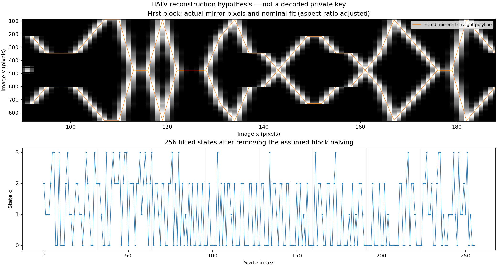

A részletes korlátokat és a következő kísérleteket a napló legújabb bejegyzése írja le.

## Ötmintás WIF-hipotézis

`python3 tools/check_five_sample_wif.py` – a 256 állapotból 51 ötmintás
csoportot vizsgál, egy kihagyott mintával. 384 közvetlen négyes számrendszerű
értelmezés kiesik az értéktartomány miatt; 112 bináris projekcióból kapott
karaktersor egyike sem érvényes WIF. A WIF-dekóder kilenc pozitív/negatív
ellenőrzése sikeres. Részletek: `research/data/five_sample_wif_check.json`.

A jelölőnél a `fényesség > 0` feltétel valóban **négy** összefüggő alakzatot ad.

## Teljes küszöbmérés és hétbites jelölő

`python3 tools/check_marker_grid.py` reprodukálja a 24…107 közötti 84 küszöbön
stabil kilenc jelet (`>=` összehasonlítással), a feltételes NMRM olvasatot és
a kilenc hétbites számot. Az 56 vizsgált egyszerű hétbites átalakítás egyike
sem ad teljes Base58-szöveget vagy nullaalapú indexsort.

`python3 tools/check_signed_models.py` az előjeles, tengelyen áthaladó
töröttvonal-változatokat vizsgálja. A hárompixeles modell hibája nem javul;
az itt vizsgált hatpixeles változatok továbbra is rosszabbak. Ez nem spline-teszt.

## Alsó sarkok és szerzői embléma

`python3 tools/check_corners.py` – a két alsó sarok mérése, összehasonlítás
az 5. szint két nyilvános képmásolatával, valamint célzott bitmap-kulcsteszt.
A közös fejléc és ZDEN-rész pixelre egyezik; a dátum `20042402`.
**10386** különböző sarokból képzett kulcsjelölt egyik nyilvánoskulcs-formátummal
sem egyezik a célcímmel. Ez nem a sarokban levő esetleges utasítások kizárása.

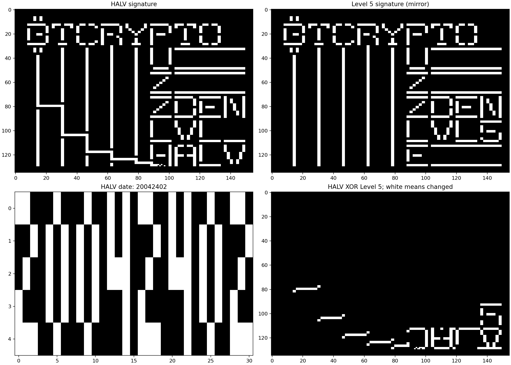

`python3 tools/check_hex_text.py` – a 256 négyszintű mintából képzett 64 bájt
ASCII-hexadecimális olvasatának ellenőrzése. 48 változatból nincs teljes hexszöveg.

## Összekapcsolt modellek

`python3 tools/check_composite_models.py` – az előre rögzített C1…C5 láncok:
hullám + jelölő/aláírás mint maszk vagy rétegválasztó; dátum/Morse által
vezérelt blokkolvasás; külön jelölő + aláírás, hullám nélkül.
A futásban 134016 különböző érvényes skalár, két nyilvánoskulcs-formátum:
nincs célcímegyezés. A pontos paraméterek a `research/models/composite_v1.json`
fájlban, a futás a `research/data/composite_model_check.json` fájlban van.

`python3 tools/check_marker_glyph_relation.py` – C6: a 63 bites jelölő és
a szintén 63 bites betűrácsok lehetséges bináris fedvényei. Nem találtunk
pontos XOR/OR/AND összefüggést a megadott családban.

`python3 tools/build_research_index.py` – a bizonyítékjegyzék frissítése új
mentett eredmények után. A negatív eredmények a pontos modellekre vonatkoznak;
egy képrész további szerepét nem zárják ki.

## Hétsoros rács, BD és a féljel

A hat erős csúcs nyolc 7 px-es helyet jelöl: `10111101 = BD`.
**BD a Latin1 és Windows-1252 kódlapon „½”**; UTF-8-ban a féljel `C2 BD`.
Ez tematikus és műveleti hipotézis, nem kész megfejtés; a 506. sor gyengébb
csúcsát a nyolcbites modell még nem magyarázza.

- `python3 tools/check_bd_halving.py`: C8, mintafelezés és blokkonkénti BD-vezérlés.
- `python3 tools/check_halving_pairs.py`: C9, páronkénti átlagolás és más rögzített műveletek.
- `python3 tools/check_timing_lattice.py`: C7, időzítési kontrollok, rögzített seed és teljes nullpontszámok.
- `python3 tools/diagnose_timing_specificity.py`: a legjobb időmodell szerepeinek ellenőrzése.

A C7 kontrollhoz képest szabályosabb aktivitást talál, de a legjobb modell
nem használ hétegységes szünetet, és nem különíti el a jel/szünet polaritását.
Ez még nem Morse-azonosítás. A korábbi szignatúrák közös részei mellett a
HALV lépcsőzése továbbra is vizsgálandó saját módosítás.

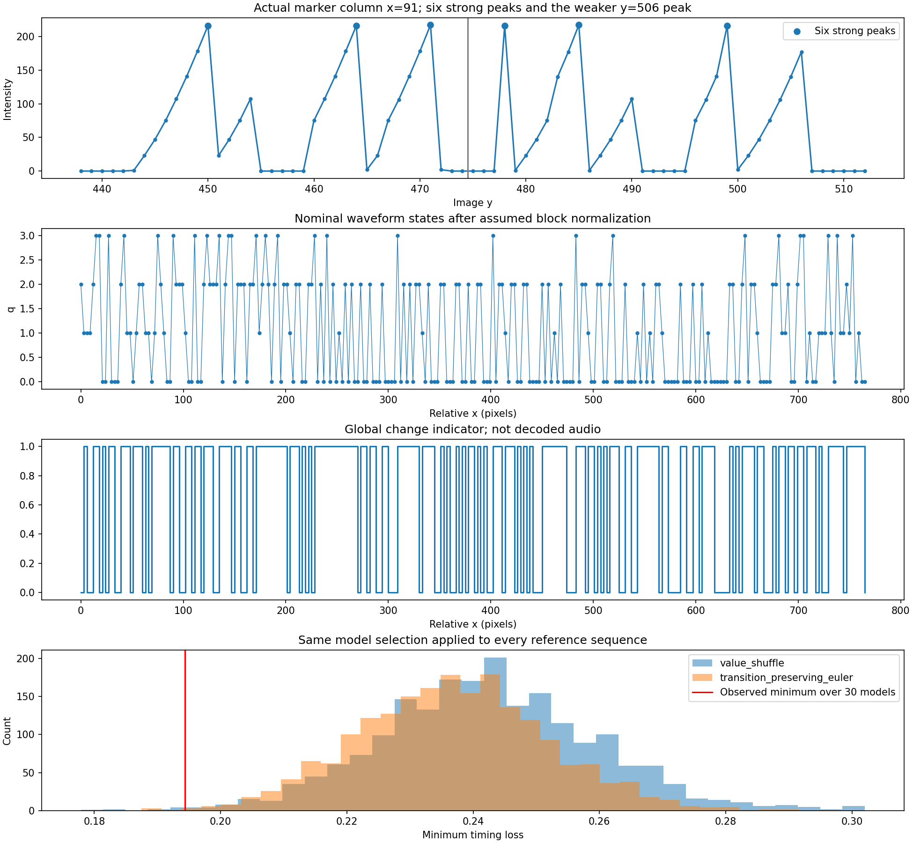

## Level 5 pozitív kontroll és 64×12 px HALV-egységek

`python3 tools/verify_level5_geometry.py` a képből kiméri a 64 téglalapot,
alkalmazza a két segédvonal szélességkorrekcióját, majd normalizál, kerekít
és párokat összead. Pontosan a publikált régi kulcs és cím adódik.

`python3 tools/check_pair64.py` és `python3 tools/check_bd_pair64.py`
ezt a kompozíciós mintát teszteli a HALV 64 négyállapotú mintacsoportján,
geometriai értékein és a BD-vezérelt felezésen. Véglegesítésük közvetlen
32 bájt, hash nélkül. A két rögzített család nem adott célcímegyezést.

`python3 tools/diagnose_pair64_ranges.py` a bájttartomány-korlátot ellenőrzi.
`python3 tools/plot_pair64.py` elkészíti az összehasonlító ábrát.

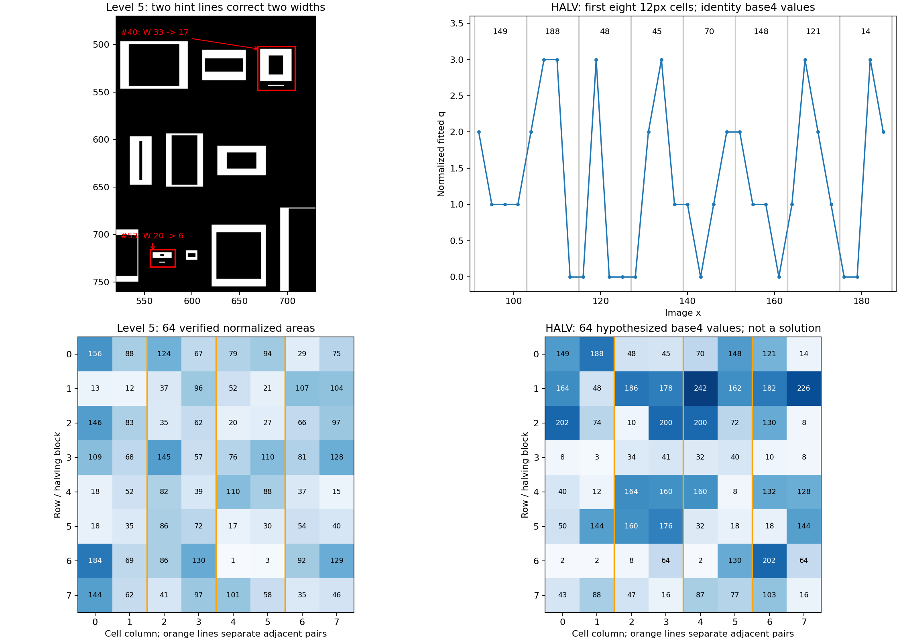

## Új fázisóra mind a nyolc blokkban

A páratlan minták domináns fázisa `2,1,0,3,2,1,0,3`. Csak a középső öt
blokkban kizárólagos; a többi alsó bitet is megőriztük.

```sh
python3 tools/analyze_parity_phase.py
python3 tools/diagnose_phase_law.py
python3 tools/check_phase_decode.py
python3 tools/plot_phase_channels.py
```

A C12 képi fázisvizsgálatot és külön illesztési/ellenőrzési oszlopokat használ.
A C13 a kétbitsíkos irányt a korábbi 64→32 összegzéssel és a dokumentált
deltakódolással is összeköti. A rögzített családokban nincs címegyezés;
a két fő kutatási ág továbbra is aktív.

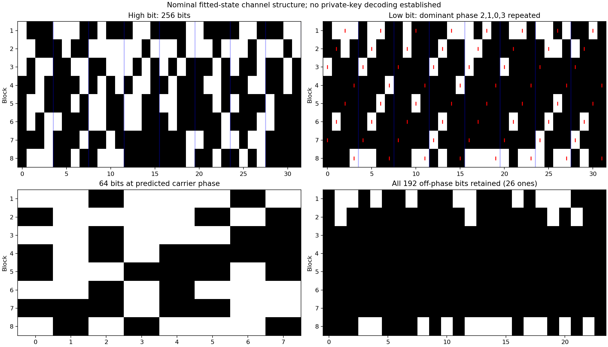

## Blokkhatárok és pontos félértékű területek

```sh
python3 tools/check_boundary33.py
python3 tools/check_fractional_area.py
python3 tools/measure_signature_staircase.py
MPLCONFIGDIR=/tmp/halv_mpl XDG_CACHE_HOME=/tmp/halv_cache python3 tools/plot_boundary_fraction.py
```

C15-ben az x=284 határ a folytonos, közös végpontot támogatja a vizsgált
külön egészértékű végpontokkal szemben. Az x=860-ig rajzolt új végpont
sem illeszkedik a hullám végéhez. **Ez nem zárja ki a 33 logikai pozíciós
adatkezelést**, és a fázisóra eredetét még nem magyarázza.

C16 megőrzi a `q/2 = H + L/2` összes törtrészét az integrálás és a
páronkénti összegzés előtt. Az alsó bit a cellaigazítástól függően 45 vagy
47 területet módosít a 64-ből. A rögzített lánc 404 különböző érvényes
skalárja nem adott címegyezést. A fizikai pixelterületek közvetlen összegzése
minden vizsgált olvasatban túlcsordult; a helyes normalizálás továbbra is nyitott.

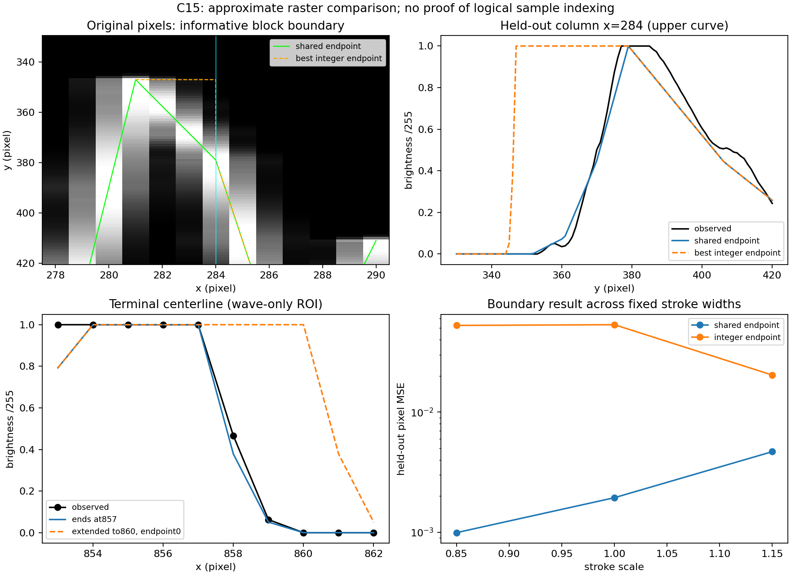
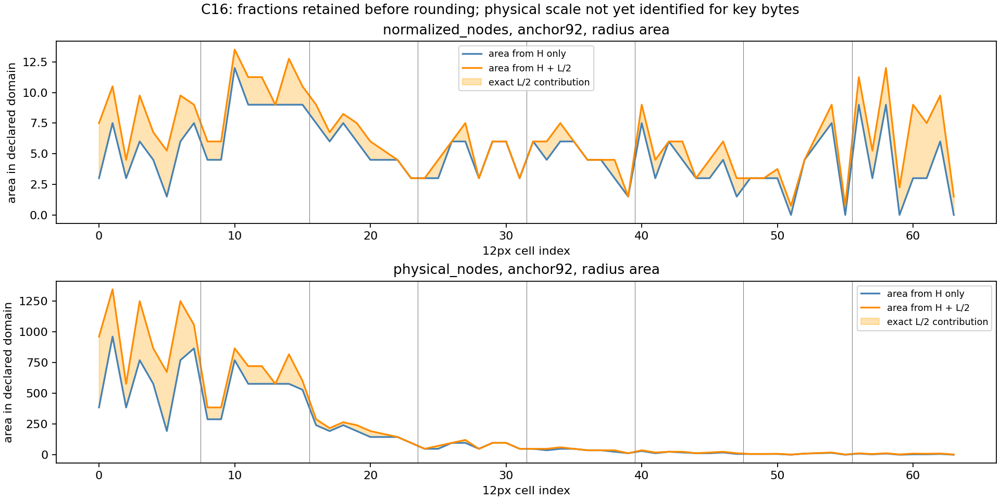

## Rétegzett szerkezet, lépcsőfázis és blokkjutalom

```sh
python3 tools/check_layered_structure.py
python3 tools/check_signature_phase_decode.py
python3 tools/check_reward_staircase.py
MPLCONFIGDIR=/tmp/halv_mpl XDG_CACHE_HOME=/tmp/halv_cache python3 tools/plot_signature_phase.py
```

C17 reprodukálja az új felhasználói szöveg nullahely- és entrópiaméréseit,
és keresési családra korrigált, feltételes perióduskontrollt ment.
C18 elkülöníti a nulla- és páratlan fázist. A 40 középső cellában egy
teljes minta mindig nulla, két további minta páros, a negyedik tetszőleges
0…3: így 3H+1L bitből minden állapot pontosan rekonstruálható.

A teljes 256 állapot veszteségmentes köztes ábrázolása
[44 bájt](research/data/layered_lossless44.bin), rögzített blokkhosszakkal
`8,8,4,4,4,4,4,8`. Ez kutatási adat, nem megtalált kulcs. A C18 rögzített
BD-/kontrollvezérelt 768 skalárja egyik címformátumban sem egyezett.

C19 a jutalomsort és a fáziskapcsolatot együtt tartja meg. A középső
hullámskálák és a jutalmak pontos aránya 25/16; ez önmagában még nem
ad bájttartományú területnormalizálást. A geometriai ág továbbra is aktív.

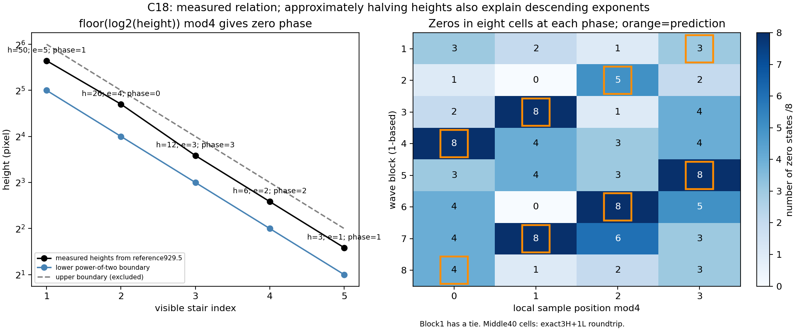

## Egységes adat- és maradékfelbontás mind a64 cellában

```sh
python3 tools/check_uniform_phase_layers.py
MPLCONFIGDIR=/tmp/halv_mpl XDG_CACHE_HOME=/tmp/halv_cache python3 tools/plot_uniform_layers.py
```

C20 ugyanazt a4+4 bites szétválasztást használja minden cellára.
A főcsatorna32 bájt, a szélső blokkok maradéka12 bájt; minden állapot
pontos visszakódolással ellenőrizve. A teljes3+1 feltételnek **44 cella**
felel meg,20-ban van eltérés. A12 kijelölt nemnulla mintán kívül17 további
alsó egyest is megőrzünk. A főcsatorna96 közvetlen kulcsváltozata nem ad címegyezést.

Ez egységes, veszteségmentes felbontás; a maradékértékeket előrejelző
generátort továbbra sem azonosítottuk.

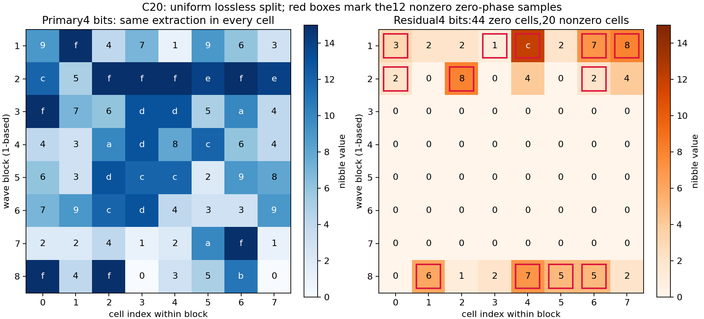

## Maradék-előrejelzés és javított képi ellenőrzés

```sh
python3 tools/check_residual_predictors.py
python3 tools/check_residual_codes.py
python3 tools/check_residual_physics.py
MPLCONFIGDIR=/tmp/halv_mpl XDG_CACHE_HOME=/tmp/halv_cache python3 tools/plot_residual_followup.py
```

C21 külön abszolút és fázishoz forgatott csatornákat használ, és egész
szélső blokkokat hagy ki a tanításból. C22 a 32 adatbájt→12 ellenőrzőbájt
RS-/CRC-modelleket és Fibonacci-rekurziókat teszteli pontos előrejelzéssel.
A főprogramhoz nem kell reedsolo: nyolc, külön implementációból mentett
referenciavektor ellenőrzi az RS-magot. A referenciák újragenerálása
opcionális, a `tools/capture_rs_reference.py` és a reedsolo 1.7.0 használatával.

C23 a legjobb R=0 képi modellnél is újrailleszti az összes megengedett
amplitúdót. A maradék megtartását mindkét ellenőrzési oszlop és mindhárom
vonalvastagság támogatja. A q/2 geometriai felbontásban R 26 fél- és 3 egész
egységnyi csúcskorrekciót hordoz; pontos normalizált sugárterülete 48.
Ez továbbra is mért, modellfüggő összefüggés, nem igazolt kulcsdekóder.

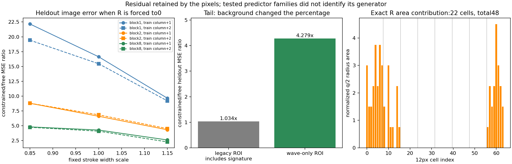

## Feltöltött auditok és lag2 jóslat

```sh
python3 tools/reproduce_uploaded_audits.py
python3 tools/check_lag2_halving.py
python3 tools/check_lag2_residual_bridge.py
MPLCONFIGDIR=/tmp/halv_mpl XDG_CACHE_HOME=/tmp/halv_cache python3 tools/plot_lag2_audit.py
```

Az eredeti csatolmányok a `research/sources/upload_*` fájlokban vannak;
az audit négy átnézett programot futtat külön ideiglenes könyvtárban,
a hiányzó CSV-t a repó rögzített mintáiból előállítva.

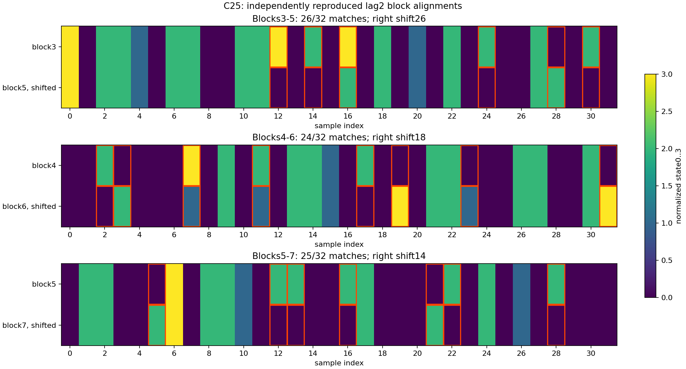
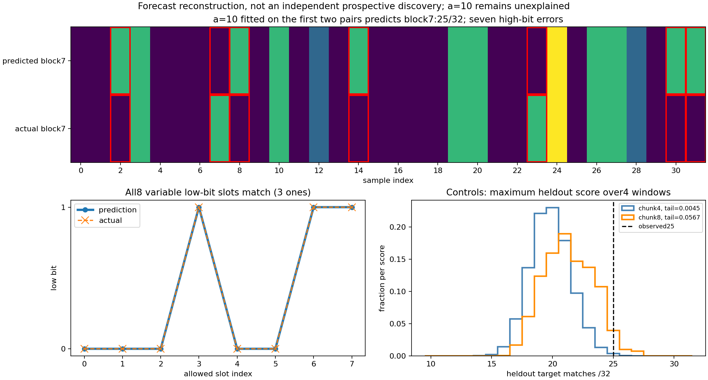
