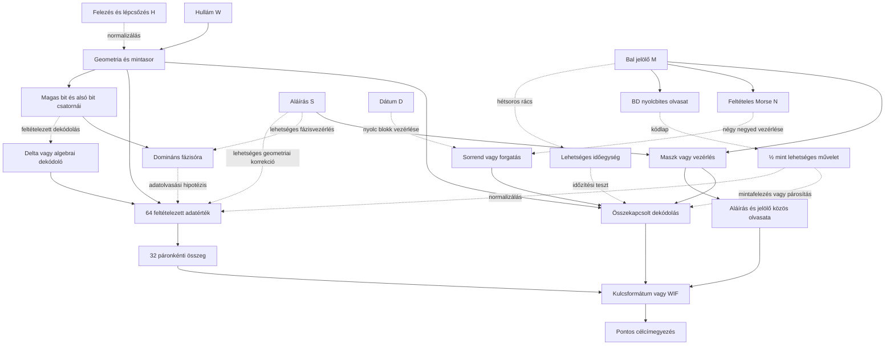
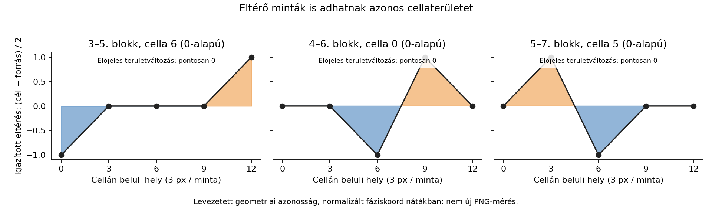
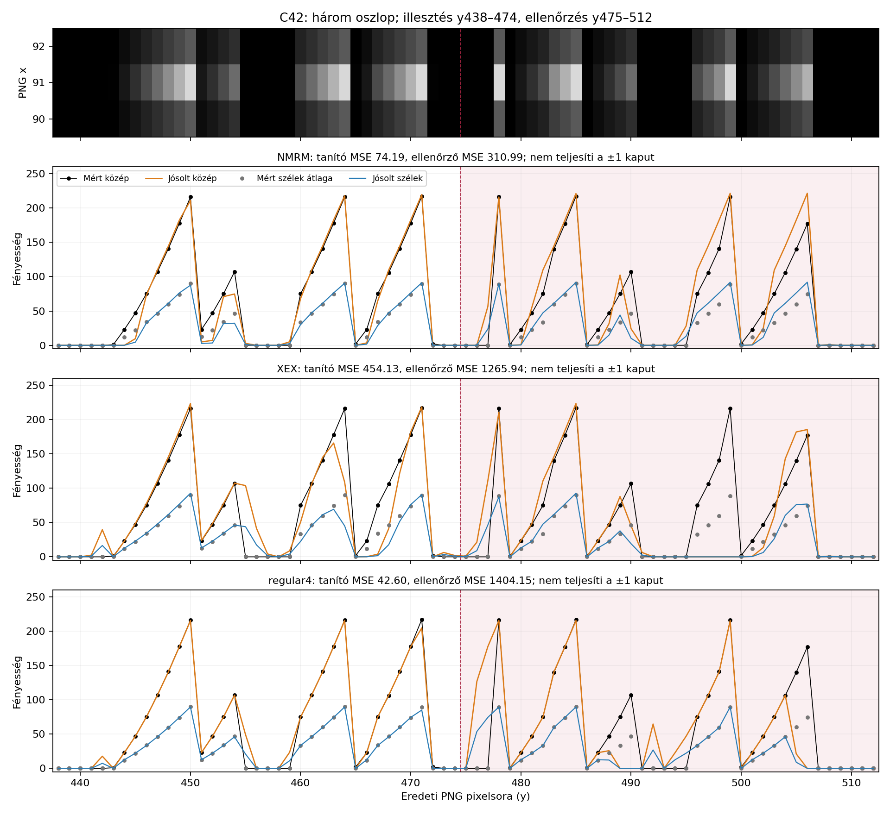
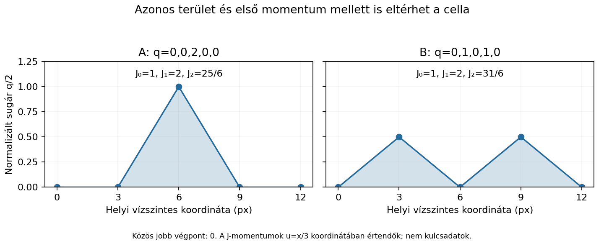

# HALV – teljes kutatási jegyzőkönyv


A felhasználó kérésére összeállított, folyamatosan frissülő fő MD.


**Generált fájl:** a forrásdokumentumokat frissítsd, majd futtasd az indexelőt. A teljes mentett napló és minden részletes jelentés be van ágyazva; a nagy adatok és programok hash-sel hivatkozva szerepelnek.


Tartalom: [állapot](#state) · [alapadatok](#data) · [teljes napló](#journal) · [hipotézisek](#hypotheses) · [részletes jelentések](#reports) · [modellreceptek](#models) · [bizonyítékjegyzék](#evidence).


<a id="state"></a>

## Állapot és olvasási útmutató

**Nincs igazolt HALV-megfejtés vagy privát kulcs.** A végső bizonyíték
a `1crypto24HCr178iMcKd5iUi5D4rsg1nK` célcím pontos egyezése.
Ez az egybefűzött MD az elejétől tartalmazza a mentett kutatási lépéseket,
a későbbi javításokat, a hipotéziseket és a modellrecepteket.

A kronológiai napló korábbi állításai történeti állapotot rögzítenek.
A későbbi korrekciókkal együtt olvasandók; nem minden régi állítás az
aktuális következtetés. A felhasználótól átvett állítás önmagában nem
reprodukált eredmény. A dokumentum a mentett lépéseket őrzi, nem talál ki
korábban nem naplózott számításokat vagy forrásokat.

### Mit tudunk stabilan?

- A tárolt PNG két azonos nyilvános GitHub-másolatból származik. A chatben
  csatolt eredeti bájtjaival és a szerző oldaláról még nincs azonosságigazolás.
- A névleges modell 256 állapota 3 px-es rácson, 8×32 mintaként, 0..3 értékekkel
  követi a tükrözött töröttvonalat. Skálák: 128,64,32,16,8,4,2,1; középvonal: 475.
- A fázisalapú A32+R12 felbontás veszteségmentes. 44 cella szabályos,
  20 eltérő. Az R 29 egyes bitjéből nem hagyható el a korábban ki nem
  emelt 17 alsó bit sem.
- A BD→féljel utasításszerepe hipotézis. A lépcső a Bitcoin-jutalomfelezéssel
  és középső fázisokkal kompatibilis; ez még nem dekódolási szabály.
- A Level 2 és Level 5 történeti pozitív kontrolljai reprodukáltak; a régi
  nyilvános megoldási kulcsok nem HALV-találatok.

### Legutóbbi végrehajtott kör: C35–C36

A tiszta fizikai felezésnél a mért kettőhatvány-skálák miatt az osztás egészre
esik. A deklarált négy kerekítés nem magyarázza az 5–7. pár hét, egyenként 4 px-es
eltérését. A nyolc blokk hisztogramja mind különbözik: egy változatlan 32 mintás
sablon tetszőleges átrendezése és felezése, illetve két paritássablon nem elég.
Ez a szűk modell kizárása, nem minden kvantálási vagy közösadatfolyam-kódolóé.

A teljes 512 bites, fázisigazított ASCII/flag család 12 672 formátumpróbája
nem adott 64 karakteres hexszöveget; a skalárkapun semmi nem jutott át.
Az összes flag és eredeti bit visszaállítható. A részletes C35–C36 jelentés
az alábbi beágyazott jelentések között van.

### Nyitott munkafeladat

Olyan közös előállítási szabály kell, amely változó jelalakot is generál,
és a külső mintákat, az összes R-bitet, a felezési skálát és fázist együtt
kezeli. A lag2 modell 10-es alapja továbbra sem képi levezetés. A hét hibát
nem tekintjük bizonyított javítókód-feladatnak.

A geometriai ág aktív; az azonos területet adó eltérő minták miatt külön
mintaszintű kontroll kell. A dátum, BD és aláírás szerepe, valamint a
Fibonacci–hang–Morse ág megmarad. Új hangteszthez konkrét jelforrás,
előjel, mintavétel és kodek szükséges.

### Folyamatos frissítés

A kézzel szerkesztett állapotkép ebben a `MASTER_OVERVIEW.md` fájlban,
a kronológia a `LOG.md`-ben, az aktuális értelmezés a `HYPOTHESES.md`-ben,
a részletek a `REPORT_*.md` fájlokban vannak. Minden körben ezek frissítése
után a `tools/build_master_document.py` újraírja a teljes fő MD-t.
A `tools/build_research_index.py` ezt automatikusan is elvégzi az indexelés előtt.

A nagy adatok és programok külön, a bizonyítékjegyzékben hash-sel hivatkozva
maradnak meg; nem másoljuk be a több tíz megabájtnyi jelöltet a szövegbe.
A forrásjegyzék nem utasítás: külső fájlok állításait külön kell ellenőrizni.


<a id="data"></a>

## Névleges bemenet, egy helyen


A forráskép: [cryptoHALV.png](sources/cryptoHALV.png). A következő sorok a mért névleges q-állapotok, nem megfejtett szöveg. A skála és mintarács modellfüggő mérési eredmény.


| Blokk | Skála (px) | 32 egymást követő q-érték |
| --- | ---: | --- |
| 1 | 128 | `21112330030002311012211013210032` |
| 2 | 64 | `22100300232223023302220223123202` |
| 3 | 32 | `30221022002230203020102020020020` |
| 4 | 16 | `00200003020202210200022000220020` |
| 5 | 8 | `02200030221022002200002020102000` |
| 6 | 4 | `03022100220023000200010201022100` |
| 7 | 2 | `00020002002010000002200230221000` |
| 8 | 1 | `02231120023301001113103112130100` |

<a id="journal"></a>

## Teljes kronológiai napló – az első körtől


Forrás: [LOG.md](LOG.md), SHA-256: `cc8371188f5880136cfec69949f5975a434c8cde11d9403dbc04952285f3b882`.


## Kutatási napló

### 2026-10-31 – árfolyam, morze, Fibonacci és hang

#### Bemenet és bizonyítékok állapota

- Felhasználói célcím: `1crypto24HCr178iMcKd5iUi5D4rsg1nK`.
- A felhasználó a HALV képet a beszélgetéshez csatolta, és külön megerősítette,
  hogy az eredeti alkotói kép. A kép vizuálisan látható, de nem érkezett hozzá
  a programokkal használható fájlelérési út vagy letöltési azonosító. Az
  `/workspace/attachments`, `/mnt/data` és `/tmp` elérhető csatolmányhelyein
  sem találtunk képfájlt. Ez eszközhozzáférési korlát, nem annak állítása,
  hogy a felhasználó ne csatolta volna a képet. Nincs fájlhash, saját numerikus
  pixelmérés vagy rejtettadat-vizsgálat ebben a futásban.
- A teljes kapott előzmény: `sources/user_prior_notes.txt`. A szerzőre,
  dátumra, díjra, egyenlegre, 768 px szélességre, nyolc 96 px-es blokkra,
  59 lobuszra, 128 mintára és a korábbi sikertelen próbákra vonatkozó állítások
  ebből származnak. Ezek itt nem lettek önállóan igazolva.
- A „Cracked it … Fibonacci and morse code, and audio decryption” komment
  forráslink és bizonyíték nélkül érkezett. Vizsgálandó nyom, nem hitelesített megoldási út.
- `https://crypto.satori.digital`, `https://zden.art` és a feltételezett
  `https://crypto.satori.digital/cryptoHALV.png` lekérése a proxy
  `403 Forbidden` válaszával meghiúsult. Az utóbbi URL létezése sem igazolt.
  Nem kapcsoltunk ki TLS-ellenőrzést és nem kerültük meg a hálózati szabályzatot.
- A GitHub tároló kezdetben üres volt; a távoli lekérdezés sikerült, de nem adott refet.

#### 1. A 2020–2024 közötti BTC-árfolyam hipotézise

**Közvetlen időrendi árfolyamgrafikonként gyenge hipotézis.** A képen vizuálisan
középvonalra tükrözött ágak és csökkenő amplitúdó látható, ár- és időtengely nélkül.
Ez nem önmagában kizárás: egy árfolyamot is lehet tükrözni, feleződő burkolóval
szorozni, megfordítani vagy differenciálni. Ilyen átalakításra azonban külön nyom kell.

Letöltött forrás: Coin Metrics nyilvános `btc.csv`, `PriceUSD` mező.
Az eltett kivonat 1572 napi sor, 2020-01-01–2024-04-20.
A teszt csak 2024-04-19-ig használ adatot, hogy ne használjon a feltételezett
megjelenési napon később keletkezett árfolyamot. A mai adatsor történeti
revíziókat is tartalmazhat; nem 2024-ben archivált adatváltozat.

Két előre rögzített kezdődátumot vizsgáltunk: 2020-01-01 és a 2020-as
felezés napja, 2020-05-11. Nyolc egymást követő, közel azonos számú napból
álló blokkot használtunk, illesztés nélkül.

| Ablak | Első napi ár | Utolsó napi ár | Blokkmaximumok az elsőhöz képest |
|---|---:|---:|---|
| 2020-01-01–2024-04-19 | 7170,63 USD | 63762,63 USD | 1; 3,94; 6,12; 6,52; 4,58; 2,74; 3,03; 7,05 |
| 2020-05-11–2024-04-19 | 8591,65 USD | 63762,63 USD | 1; 4,06; 4,23; 4,32; 2,54; 1,95; 2,01; 4,68 |

A korábbi feljegyzésben állított feleződő burkoló arányai ezzel szemben:
`1; 0,5; 0,25; 0,125; 0,0625; 0,03125; 0,015625; 0,0078125`.
A napi loghozamok blokkonkénti RMS-e sem mutat sorozatos feleződést.

**Korlát:** ez csak a közvetlen, időrendi, lineáris árfolyamburkoló egyszerű
ellenőrzése, nem képpontokkal végzett alakillesztés. Nem zárja ki az árfolyamból
valamilyen további, előre megindokolt transzformációval nyert jelet.
Program: `tools/check_price_hypothesis.py`; teljes eredmény: `data/price_check.json`.

#### 2. A bal oldali kilenc jel mint morze

**Lehetséges, de még nem igazolt.** Kilenc függőlegesen elhelyezett jel is lehet
morze: a tájolás nem számít. Először az eredeti kép alapján a jelek magasságát és
a köztük levő üres szakaszokat kell megmérni, nem pusztán a fényerőt.

Standard időzítésben pont:vonal = 1:3, belső szünet:betűszünet:szószünet = 1:3:7.
Egy grafikus puzzle eltérhet ettől, de az eltérést külön igazolni kell.
Egyetlen globális küszöböt és olvasási irányt kell választani, nem betűnként
hangolni az osztályozást.

A korábbi jegyzet két külön jelsorozatot ismer:

| Feltételezett szöveg | Csoportosítva | Szünetek nélkül |
|---|---|---|
| XEX | `-..- . -..-` | `-..-.-..-` |
| NMRM | `-. -- .-. --` | `-.--.-.--` |

Ez nem pusztán eltérő betűhatár: a pont/vonal besorolás is különbözik.
Mindkettő kilenc jel, de mindkettőnek **200** lehetséges A–Z/0–9 olvasata van,
ha a betűhatárokat szabadon választjuk. A számítás nem képből dekódolás:
a kapott előzményben szereplő két feltételezett jelsort használja.
Program: `tools/check_morse_ambiguity.py`; eredmény: `data/morse_ambiguity.json`.

Ha csak a kilenc pont/vonal választás hordoz adatot, az legfeljebb kilenc bit;
a szünetek és hosszak további adatot hordozhatnak. Önmagában kilenc bináris
jel nem ad meg egy 256 bites magánkulcsot. Rövid utasítás vagy formátumjelölő viszont lehet.

#### 3. Fibonacci: sorozat vagy hangkodek?

Érdemes különválasztani:

- Fibonacci-pozíciók, Fibonacci-hosszúságok vagy például 1, 2, 3, 5, 8 arányok
  keresése. Az 1, 2, 4, 8, … skálák **kettőhatványok**, nem Fibonacci-sorozat.
- Az Amiga IFF/8SVX Fibonacci-delta hangtömörítésének hipotézise.
  A szokásos 16 elemű deltatábla:
  `[-34,-21,-13,-8,-5,-3,-2,-1,0,1,2,3,5,8,13,21]`;
  a 8-as index nulla változás. A nulla delta nem feltétlenül nulla amplitúdó.

A −3…+3 képpontlépések puszta előfordulása nem bizonyítja ezt a kodeket:
interpolált görbe raszterezése is adhat ilyen kis egész különbségeket.
A pixelenkénti meredekséget nem szabad automatikusan eredeti hangminták
különbségének tekinteni. Kodekhipotézist egy globális modellből rekonstruált,
következetesen dekódolható mintasor vagy tényleges formátumadat támogatna.
Az előzményben említett fájlformátum- és szteganográfiai kizárásokat itt nem ismételtük meg.

#### 4. Hangrekonstrukció és következő kísérlet

A hullámformaszerű ábra támogatja a hang irányát, de hangfájl ebből még nincs.
Az „audio decryption” lehet pontatlan elnevezés: tömörítés-visszafejtés,
hangszintézis és titkosítás különböző műveletek.

Különösen fontos: a képen ugyanazon x-hez tükrözött felső és alsó ág is tartozik.
Egy hangmintának egy időpontban egy értéke van. El kell dönteni, hogy ez
burkológörbe, két csatorna, szimmetrikus ábrázolás vagy más konstrukció;
a felső ág mechanikus hangként lejátszása önkényes félhullám-egyenirányítás lehet.

Következő, előre rögzített eljárás az eredeti PNG birtokában:

1. Eredeti bájtok, forrás-URL, SHA-256, méret és színmód mentése.
2. Bal oldali jelölő: mind a kilenc összefüggő jel kezdete, vége, közepe,
   magassága, köztes szünete; több küszöb és a mérési bizonytalanság mentése.
   Előbb az időzítési arányokat kell vizsgálni, csak utána a betűket.
3. A hullám pozitív és negatív ágának külön kinyerése, tükrözési hibával.
   Ellenőrizni a középvonalat, 768-as szélességet, 96-os blokkot és felezést;
   ezek jelenleg előzményből átvett számok.
4. Globális 3 px-es és 6 px-es mintavételi modell összevetése. Ne vezessünk be
   lobuszonként új időzítést. A megfigyelt rács nem feltétlenül szimbólumóra.
5. Első blokkokon illesztés, későbbieken előrejelzés, maradékhiba mentése.
   A kis amplitúdójú, utolsó blokkokat ne kezeljük ugyanolyan pontosként.
6. Csak a geometria után következzen a hang és a Fibonacci-delta teszt.
   A WAV fejléc mintavételi frekvenciáját hipotézisként kell jelölni;
   a sebesség szabad hangolása könnyen okoz belehallást.
7. Morzevizsgálat a hang amplitúdóburkolóján és frekvenciatartományában,
   egy globális időegységgel. Véletlen/eltolt kontrollokon ugyanaz a detektor.
8. Kulcsjelölt esetén a scalar tartományának és a tömörített, illetve
   tömörítetlen nyilvános kulcsból képzett P2PKH-címnek a pontos ellenőrzése.
   Ebben a futásban nem állítottunk elő és nem teszteltünk privátkulcs-jelölteket.

#### Összegzés és akadály

A morzejelölő + hang + esetleges kodek irány célzottabb a közvetlen
árfolyamgrafikon-értelmezésnél, de egyik sem bizonyított megfejtés.
További numerikus képi bizonyítékhoz szükséges a már csatolt PNG bájtjaihoz
programozott hozzáférés: például fájlként elérhető melléklet vagy hozzáférhető,
igazolt letöltési URL. A korábbi 128 értékű mintasor és
mérőprogramok szintén hiányoznak. Jelenleg nincs ellenőrzött kulcs.

### 2026-10-31 – második menet: a kép előkerült, saját rekonstrukció és címegyezési teszt

#### A korábbi képhozzáférési akadály feloldása

GitHub README-keresésben megtaláltuk a felhasználói előzményben idézett hosszú
geometriai szöveg forrását: `benjacasas02/independent-cryptography-research`.
Ez nem új, független bizonyíték ugyanazokra a geometriai állításokra.
A `research/zden/README.md` hivatkozása a lekéréskor 404-et adott.

Két másik nyilvános tárolóban tényleges képfájl található:

- `gpt4omni/unsolved-crypto-puzzles`
- `floflo777/open-crypto-puzzles`

Mindkettő útvonala: `2-mid-prizes/zden-haluska-halv-312ksats/clues/cryptoHALV.png`.
Mindkét letöltés 61566 bájt, SHA-256:
`3a487ebaeb4801137f09159a2d533046936cd395f4e2f7d115ac554607790e95`.
A PNG 950×950 képpontos, `L` színmódú. Vizuálisan megfelel a chatben látható
képnek. **Bájtszintű azonosságot a chatcsatolmánnyal vagy a szerző oldalán
lévő eredetivel nem igazoltunk.** A két tároló közös eredetű másolatot is őrizhet.
Részletes származás: `sources/image_provenance.json`.

Saját PNG-ellenőrzés: érvényes szignatúra, minden chunk CRC-je helyes,
az IEND után nulla bájt. Chunkok: IHDR, pHYs, IDAT, tEXt, IEND.
A komment a puzzle megnevezését, célcímét és a szerző elérhetőségeit tartalmazza.
Ez **nem** teljes szteganográfiai kizárás; bitplane/FFT vizsgálatot itt nem futtattunk.
Program és adat: `tools/inspect_png.py`, `data/png_structure.json`.

#### Saját pixelmérés

A függőleges tükrözés három vizsgált tengelye közül y=475 adja a legkisebb
átlagos fényerőeltérést: 0,662 / 255. y=474-nél 2,482, y=476-nál 2,414.
A vizsgált tartományt a program rögzíti; ez csak az adott ROI eredménye.

Rögzített modellcsalád:

- felső és alsó, y=475-re tükrözött, egyenes szakaszokból álló görbe;
- csomópontokban `q ∈ {0,1,2,3}` nemnegatív amplitúdó;
- skála 32 hárompixeles lépésenként feleződik: 128, 64, …, 1;
- három globális kezdőfázis: x=91, 92, 93;
- 3 px és 6 px csomóponttávolság;
- külön 3 px-es modell kizárólag ±1 szomszédos állapotváltozással;
- minden szakaszhoz közelítő vonalprofil; dinamikus programozás választja ki
  a teljes minimumköltségű állapotsort. A csomóponti oszlopok kimaradnak a veszteségből.

Néhány mért modellhiba, 0…1 fényerőre számított átlagos szakasz-MSE:

| Kezdő x | Óra | Modell | MSE |
|---:|---:|---|---:|
| 91 | 3 px | szabad négyállapotú | 0,018728 |
| 92 | 3 px | szabad négyállapotú | **0,003055** |
| 93 | 3 px | szabad négyállapotú | 0,018816 |
| 92 | 3 px | csak ±1 változás | 0,032879 |
| 93 | 6 px | szabad négyállapotú | 0,025518 |

A hatpixeles modell legkisebb nyers hibája kb. 8,35-szöröse a hárompixeles
modellének. **Nem tekinthető formális valószínűségi modell-összehasonlításnak:**
eltérő a paraméterszám és a költségbe vett oszlopok halmaza. A 6 px-es spline,
lekerekített vagy más görbemodelleket ez nem zárja ki.

Az x=92-től hárompixeles modell **256 állapotot** ad. A négy állapot
darabszáma: q0=117, q1=34, q2=78, q3=27. A vonalprofil szélességét 0,85 és
1,15 szorzóra változtatva mind a 256 állapot változatlan maradt.
Ez korlátozott stabilitási próba, nem teljes rekonstrukciós bizonyítás.
Az utolsó, kis amplitúdójú blokk alternatív állapotaihoz jóval kisebb
költségkülönbségek tartoznak; ezeket a CSV/JSON megőrzi.

Fontos módosítás a korábbi irányhoz képest: a rögzített hárompixeles,
négyállapotú modellben **256**, nem 128 állapot van. Ez elvileg 512 nyers bit;
a kulcshoz vezető átalakítás nem ismert. Nem szabad egyszerűen 128 jól
meghatározott kétbites mintát állítani a mért sor helyett.

Mentett adatok:

- `data/pixel_measurements.json`: minden modell állapotsora, geometria és költség;
- `data/reconstructed_states.csv`: névleges modell 256 állapota, koordinátái és alternatívaköltsége;
- `data/reconstruction.png`: eredeti képpontok és illesztés az első blokkban,
  alatta a felezési skálától megszabadított állapotsor;
- `tools/measure_image.py`, `tools/plot_reconstruction.py`: reprodukáló programok.

#### Bal oldali jelölő: a kilenc jel nem küszöbfüggetlen

A 90…92 oszlopokban, y=438…512 között mérve:

| Küszöb (szigorúan nagyobb) | Összefüggő jelek száma |
|---:|---:|
| 1 | 6 |
| 5, 10, 20 | 8 |
| 40, 80 | 9 |
| 120 | 7 |
| 180 | 6 |

40-es küszöbnél a jelmagasságok: `6,3,5,5,1,5,3,4,5` képpont.
A több sornyi fényerőrámpák szétvágása is létrehozhat külön jeleket.
Ezért a kilenc pont/vonal és az XEX/NMRM olvasat továbbra sem igazolt.
Minden nyers pixel és küszöbönkénti intervallum mentve:
`data/marker_pixels.csv`, `data/pixel_measurements.json`.

#### Saját bitcoin-ellenőrző és tényleges kulcsjelöltek

A célcím Base58Check ellenőrzőösszege érvényes, mainnet P2PKH-verziója 0,
HASH160 tartalma: `06c84797d1f468b9d5773a61c80073b344df7470`.
`tools/bitcoin_oracle.py` kizárólag offline ellenőriz, pénzmozgatást nem végez.

Ismert válaszú teszt a privát skalár 1-gyel:

- tömörített: `1BgGZ9tcN4rm9KBzDn7KprQz87SZ26SAMH` – sikeres;
- tömörítetlen: `1EHNa6Q4Jz2uvNExL497mE43ikXhwF6kZm` – sikeres;
- nulla és a csoport rendjével egyenlő skalár elutasítása – sikeres.

Az ellenőrzött, előre meghatározott transzformációcsalád:

- a négy amplitúdóállapot összes nemkonstans bináris projekciója;
- az egymást követő állapotkülönbségek −3…+3 ábécéjének összes
  nemkonstans bináris projekciója, négy kezdeti állapottal;
- a négy állapot mind a 24 kétbites permutációja, az így kapott 64 bájt
  első/második fele, páros/páratlan bájtjai, a két fél XOR-ja,
  SHA-256 és dupla SHA-256 lenyomata;
- a nyers állapotbájtok és az ASCII-állapotsor kétféle lenyomata;
- a különbségek 8SVX Fibonacci-delta táblabeli indexeinek nibble-pakolása,
  mindkét nibble-sorrendben, annak negyedei és SHA-256 lenyomata;
- előre/hátra bejárás, bájtfordítás és a programban megadott komplementálás.

**1800 különböző, érvényes 32 bájtos skalár, mindegyikhez kétféle nyilvános
kulcs: nulla célcímegyezés.** A három vonalvastagság azonos állapotsora miatt
ezek nem három független jelöltkészletet jelentenek. A teljes deduplikált
jelöltkészlet SHA-256 lenyomata és a futási eredmény:
`data/candidate_check.json`. Program: `tools/check_reconstruction_candidates.py`.
Nem volt magánkulcs-találat. Nem futott teljes bizonytalansági keresés vagy
korlátlan transzformációkeresés. Ez a negatívum nem zárja ki a Fibonacci-hang irányt.

#### A felhasználó új miner-revenue ábrája

A 2020…2024-es képrészlet címében „Miner revenue, USD” szerepel. Ez különbözik
a BTC árfolyamától és a blokkonkénti támogatástól. Az USD-napi bevétel a
kibocsátástól, a díjaktól, a blokkszámtól és az átváltási ártól is függ.
A kivágás teljes függőleges skálája, aggregációja és eredeti forrása nem ismert;
a képhez nem állítunk pontos adatillesztést.

Coin Metrics-adatból közelítő napi bevételt számoltunk:
`(IssTotNtv + FeeTotNtv) × PriceUSD`. Ez napi referenciaáron történő átváltás,
nem egy kész `RevUSD` mező: az aktuális CSV-ben ilyen mező nincs.

2020-05-11–2024-04-19 között nyolc egyforma napmennyiségű blokk maximumai,
az elsőhöz viszonyítva: `1; 4,20; 3,92; 3,53; 2,18; 1,81; 2,22; 4,31`.
Ez a közvetlen időrendi bevételburkoló sem ad ismétlődő felezést.
Átalakított bevételjel vagy a felezés mint tematikus kapcsolat nincs kizárva.
Mentett adat: `data/miner_revenue_daily.csv`, `data/miner_revenue_check.json`;
program: `tools/check_miner_revenue.py`; forrás: `sources/miner_revenue.json`.

#### További munka pontos kiindulópontja

1. Az új állapotsor geometriai ellenőrzése más globális raszterezővel és
   a teljes képtartományon, beleértve a most kihagyott csomóponti oszlopokat.
2. A 6 px-es spline-modell összevetése: a pusztán egyenes 6 px-es modell
   rosszabb illeszkedése nem minden 128 szimbólumos modellt cáfol.
3. A bal jelölő fényerőrámpája és kitakarási maszkja szétválasztása;
   puszta küszöbözésből ne állítsunk elő biztos morzeüzenetet.
4. A hanghipotézishez a jel előjelét és időskáláját is igazolni kell.
   Ebben a menetben nem készítettünk állítólagosan „dekódolt” hangfájlt.

Módszertani korrekció a külső forrásokhoz: egy 118 bites megfigyelésből is
képezhető determinisztikusan 256 bites kulcs például SHA-256-tal. Az alacsonyabb
megfigyelt entrópia önmagában nem bizonyítja, hogy a képhez külső kulcsfél kell.
Hasonlóképp a 256 rekonstruált négyszintű állapot nem bizonyít automatikusan
512 független információbitet. A generátor és a kódolás továbbra is nyitott.

### 2026-10-31 – harmadik menet: négy alakzat és ötmintás WIF-olvasat

#### Új támpont és forrásstátusz

A felhasználó szerint a szerző megoldásábráin az 1., 2. és 4. szinten
51 karakteres Base58 WIF, a 3. szinten 32 közvetlen kulcsbájt szerepel.
A szöveget a `sources/user_wif_lead_2026-10-31.txt` őrzi. Ezeket az ábrákat
ebben a menetben nem kaptuk meg fájlként vagy konkrét URL-lel, ezért nem
állítjuk, hogy saját szemrevételezéssel hitelesítettük a történeti állítást.
A WIF mint hipotézis ettől még tesztelhető.

A cbman0/BitcoinPuzzles két kapcsolódó README-jéből keresési kivonatot
mentettünk: `sources/earlier_levels_discovery.json`. Ezek másodlagos források.
A sorozatleírás HALV-ra „Solved” státuszt ír, miközben más források „OPEN”
státuszt adnak. Itt egyik sem mellékel hitelesített kulcsot; nem következtetünk
ebből megoldottságra.

#### Saját mérés: négy alakzat a legalacsonyabb küszöbön

A korábbi mérés 1-es szigorú küszöbnél kezdődött. Most a `fényesség > 0`
esetet is hozzáadtuk ugyanahhoz a 90…92 oszlopos, y=438…512 ROI-hoz.
Az eredmény **négy** összefüggő tartomány, az intervallumvégeket beleszámítva:

| Kezdő y | Záró y | Hossz |
|---:|---:|---:|
| 443 | 454 | 12 |
| 460 | 472 | 13 |
| 478 | 490 | 13 |
| 496 | 506 | 11 |

Ez reprodukálja a felhasználó megfigyelését. A korábbi hatos számnál
`fényesség > 1` volt a feltétel, ami az 1 fényességű összekötő pixeleket elhagyja.
Frissítés: `tools/measure_image.py`, `data/pixel_measurements.json`.
A rekonstruált állapotsorok és modellköltségek változatlanok maradtak.
A küszöbfüggés önmagában sem nem bizonyítja, sem nem cáfolja a morzét.

#### A pontosan tesztelt ötmintás család

Kiindulás: az x=92, 3 px-es, négyállapotú névleges modell 256 mintája.
`256 = 51 × 5 + 1`: az első vagy az utolsó mintát hagytuk ki, körbeforgatás
nélkül. Mindkét teljes olvasási irányt és csoporton belüli számjegysorrendet
vizsgáltuk.

| Család | Hipotézisek | Eredmény |
|---|---:|---|
| Öt négyértékű minta mint base4 számjegy, mind a 24 állapotpermutáció, nulla- és egyalapú indexelés | 384 | Mind kiesik a Base58-tartományból; legalább 40 hibás csoport az 51-ből |
| Az állapotok mind a 14 nemkonstans bináris projekciója, öt bit mint Base58-index | 112 | 112 különböző karaktersor, mind hibás ellenőrzőösszegű |

A 112 bináris olvasat közül négy kezdődik 5-tel, de ezek sem érvényes WIF-ek.
Öt bináris minta csak 32 értéket ad, tehát nem teljes Base58-karakterkód.
Egy konkrét WIF elvileg használhat részábécét, ezért itt ténylegesen
ellenőriztük az összes kapott karaktersor ellenőrzőösszegét.
Öt négyértékű minta 1024 kombinációja túl nagy a közvetlen Base58-indexeléshez;
az aktuális sorokon ez tényleges tartományhibaként jelentkezik.
Nem alkalmaztunk modulo 58-at, önkényes levágást vagy karakterjavítást.

#### WIF-ellenőrzés és validálás

Az új dekóder ellenőrzi a Base58-ábécét, az 51/52 karakteres és 37/38 bájtos
hosszt, a dupla SHA-256 első négy bájtos ellenőrzőösszegét, a mainnet 0x80
verziót, a tömörítési jelölő 0x01 értékét és a privát skalár tartományát.

**Kilenc pozitív/negatív teszt sikeres:** a skalár 1 ismert 51 és 52
karakteres WIF-je; mindkettőn egy karakter elrontása; hibás verzió; hibás
tömörítési jelölő; nulla skalár; a csoport rendjével egyenlő skalár; tiltott
Base58-karakter. Az alap címellenőrző ismert tesztjei is sikeresek.

**Érvényes WIF: 0. Célcímegyezés: 0.** Nem jutottunk új, WIF-ből kinyert
kulcsjelölthöz; a 496 hipotézis nem 496 privátkulcs-ellenőrzés.
Teljes eredmény és determinisztikus hipotéziskészlet-hash:
`data/five_sample_wif_check.json`. Program: `tools/check_five_sample_wif.py`.

#### A 59 = 51 + 8 értelmezés korlátja

A számazonosság továbbra is hipotézis. **A nyolc elválasztót a célkulcstól
független, mérhető szabállyal kell azonosítani**, majd a maradó lobuszokból
egyértelmű karakterértéket képezni. Nem választottunk önkényesen nyolc
eldobandó lobuszt, és nem kerestünk tetszőleges helyettesítési táblát.

A jelenlegi állapotsoron 63 nemnulla összefüggő szakasz van. Ez nem ugyanaz
a definíció, mint az előzményben említett 59 vizuális lobusz; nem kezeljük
az 59 megcáfolásaként. Az ötmintás teszt a szabályos mintasoron futott,
nem egy igazolt 59 lobuszos szegmentáláson.

A WIF-irány általában nem kizárt. A konkrét közvetlen ötmintás család ezen
a rekonstrukción nem működik. Előrelépést egy indokolt elválasztó-szegmentálás
vagy egy forrással alátámasztott karakterkód adhat; az ellenőrzőösszeg
utólagos „javítása” nem megoldás.

### 2026-10-31 – negyedik menet: teljes küszöbskála, hétbites rács, előjeles kontroll

#### Átvett eredmények és saját futások különválasztása

A felhasználó részletes küszöbtáblát, feltételes NMRM-olvasatot, kilenc
hétbites értéket és egy 1200 jelöltes, 1067 különböző karaktersort adó külső
futás összegzését adta meg. A strukturált átirat:
`sources/user_marker_wif_update_2026-10-31.json`.
Az utóbbi futás pontos transzformációlistája, jelöltjei és az állítólagosan
használt első szintű ismert kulcs tesztvektora nem érkezett meg. Ezért a
1200/1067/0 számokat átvett eredményként őrizzük; nem saját végrehajtott
tesztként, és nem adjuk hozzá a saját jelöltösszegekhez.
A történeti megoldásábrák állításai változatlanul a felhasználó közléséből
származnak; ebben a menetben sem végeztünk saját hitelesítést az ábrákon.

#### A küszöbtábla pontosan reprodukálható

A mentett 950×950-es PNG x=91 oszlopán, y=438…512 tartományban végigmértük
mind a 255 nemnulla egész fényességküszöböt. A feltétel most **fényesség ≥ T**.

| T tartomány | Összefüggő jelek |
|---|---:|
| 1 | 4 |
| 2 | 6 |
| 3…23 | 8 |
| 24…107 | 9 |
| 108…177 | 7 |
| 178…216 | 6 |
| 217 | 2 |
| 218…255 | 0 |

Az új tábla egyezik a felhasználóéval. A korábbi program **fényesség > T**
feltételt használt, ezért a tartományhatárok ott eggyel kisebbek voltak.
A kilences plató valóban **84 egymást követő küszöböt** fed le, nem egyetlen
kényelmes küszöbértéket. Ez erősíti a kilencalakzatos grafikus olvasatot,
de önmagában nem igazolja a morzekódot.

T=32 mellett a magasságok `6,3,5,5,1,5,3,4,5`, az üres szünetek
`1,5,2,6,2,2,5,2` pixelsor hosszúak. Legalább 4 pixeles vonással és
legalább 5 üres soros betűhatárral pontosan `-. -- .-. --`, azaz **NMRM**
adódik. Ez **feltételes dekódolás**, nem igazolt értelmes üzenet. Ezen konkrét
szabályok nem az XEX olvasatot adják; az XEX más besorolást/csoportosítást igényel.

#### Kilenc hétbites egység: a számsor is egyezik

T=3 (`>=`) mellett az aktív oszlop y=444…506, mindkét végponttal együtt
**63 sor**. Felülről lefelé, csoporton belül legnagyobb helyiértékkel kezdve:

`127,120,31,63,1,63,60,15,63`.

Ezek nem mind Base58 ASCII-karakterek és nem mind 0…57 indexek.
Egy előre rögzített, kis átalakításcsaládot is lefuttattunk:

- 7 ciklikus fázis a 63 bites blokkon;
- előre/hátra teljes bejárás;
- komplementálás igen/nem;
- csoporton belüli bitrend megfordítása igen/nem.

Összesen **56 paraméterkombináció**. Egyik sem ad kilenc érvényes Base58
ASCII-karaktert, és egyik sem ad kilenc szabályos nullaalapú Base58-indexet.
Ez nem tetszőleges hétbites kódolás kizárása. A ciklikus fázis műveleti
hipotézis: nem jelent a képen kívül mért további pixeleket.
Program: `tools/check_marker_grid.py`; teljes adat és minden variáns:
`data/marker_grid_check.json`.

#### Új geometriai kontroll: előjeles minták a tükrözött ágak mögött

A korábbi illesztés nemnegatív csomópontokból két tükrözött görbét rajzolt.
Ez nem engedett meg csomópontok közötti tengelykeresztezést akkor, ha
az eredeti, rejtett jel előjelet váltott volna. Ezt külön kontrollal vizsgáltuk.

Azonos közelítő vonalprofillal két előjeles ábécét engedtünk meg:
`{-3,-2,-1,0,1,2,3}` és `{-3,-1,1,3}`. Három órát/fázist vizsgáltunk:
3 px x=92, 6 px x=92, 6 px x=95. A globális tükrözési szabadságot az első
állapot nemnegativitásával rögzítettük; nulla állapot után további előjel-tie
maradhat. Az előjelsor nem tekinthető egyértelműen kinyert adatnak.

| Óra, kezdő x | Ábécé | Átlagos szakasz-MSE |
|---|---|---:|
| 3 px, 92 | −3…+3 | 0,003055 |
| 3 px, 92 | −3,−1,+1,+3 | 0,021439 |
| 6 px, 92 | −3…+3 | 0,022894 |
| 6 px, 92 | −3,−1,+1,+3 | 0,026080 |
| 6 px, 95 | −3…+3 | 0,021337 |
| 6 px, 95 | −3,−1,+1,+3 | 0,027095 |

A hárompixeles hétállapotú modell nem javít a névleges négyállapotú
illesztés hibáján; abszolút állapotai is azonosak a korábbi sorral.
A hatpixeles egyenes előjeles változatok nem közelítik meg ezt a hibát.
A különböző órák eltérő oszlopokat vesznek a költségbe, ezért ezek nem
formális likelihood-arányok. Spline-modellt nem teszteltünk.

A közös `fit` függvény ábécéparamétert kapott, az alapértelmezés változatlan.
A névleges modellt újrafuttatva a teljes eredménye **pontosan megegyezik**
a korábban mentettel. Program: `tools/check_signed_models.py`;
eredmény: `data/signed_model_check.json`.

Ebben a menetben nem állítottunk elő új privátkulcs-jelölteket.
Az ellenőrzött nyom most a kilences plató és a hétbites geometria;
egyik sem adott kulcsot vagy igazolt Base58-üzenetet.

### 2026-10-31 – ötödik menet: két alsó sarok, korábbi logók és lobuszok

#### A felhasználó új iránya

A felhasználó jelezte, hogy korábbi szinteknél a sarkokban elhelyezett
rajzoknak szerepük volt a megoldásban, és csatolt egy Level 4-képet.
A bemutatott képen vizuálisan valóban megjelenik a rokon BTCrypto/ZDEN
embléma. Ehhez a csatolmányhoz sem kaptunk bináris fájlelérést, ezért
**Level 4-gyel nem állítunk pixelazonossági vizsgálatot**.

Ettől függetlenül letöltöttük a már ismert floflo777 tárolóból az 5. szint
`crypto5.png` és `crypto5fix.png` képmásolatait. Mindkettő 950×950-es;
források és SHA-256: `sources/level5_image_provenance.json`.
Ezek harmadik fél másolatai, nem a szerző oldaláról letöltött fájlok.

#### Jobb alsó aláírás: mért közös és változó részek

A HALV jobb alsó aláírása a vizsgált 788…931, 806…929 tartományban kizárólag
0 és 255 intenzitású pixeleket használ. Itt nincs külön szürkeárnyalatos
intenzitáscsatorna; a geometriai vagy bináris adatrejtés ettől még lehetséges.

HALV és az 5. szint javított képe között, félig nyílt ROI-kkal:

| Rész | ROI [x0,y0,x1,y1] | Eltérő pixelek |
|---|---|---:|
| BTCrypto fejléc | [788,806,916,830] | **0** |
| Függőleges U/Z és a ZDEN sor | [868,832,932,890] | **0** |
| Bal függőleges szárak és lépcsőzés | [788,830,868,930] | 164 |
| Szintcímke környéke | [868,890,932,930] | 418 |

Az 5. szint eredeti és javított képe a fenti négy ROI-ban pixelre azonos.
A HALV két felső T-je egymással, és a függőleges két Z egymással is
azonos mintát ad. A közös betűk tehát nem különálló, HALV-specifikus
pixeleltérések. A nagy függőleges szárakat összekötő lépcső és a szintcímke
változását viszont nem söpörjük félre: utasításként is vizsgálandók.
A lépcsőzés összefér a felezés témájával; pontos műveleti dekódolást nem találtunk.

#### Bal alsó sarok: a tényleges felirat és egy dátumhipotézis

A 20…50 oszlopokban, 925…929 sorokban nyolc 3×5 pixeles számjegy van.
A mért bitmapek olvasata **20042402**. Az 5. szint mindkét képén ugyanezen
a helyen **09111819** szerepel. A karakterenkénti bitminták a JSON-ban megvannak.

Ez nem a szokásos YYYYMMDD dátumrendezés. Egy egyszerű lehetséges formátum:
**DDMMYYHH**, vagyis `20.04.24, 02 óra`, illetve `09.11.18, 19 óra`.
A nap/hónap/év illeszkedik a két szint közölt megjelenési napjához.
A HALV 02 órája összefér a 2024-es Bitcoin-felezés közép-európai nyári
idő szerinti 02 óra körüli időpontjával is. **A formátumot és a szerző
óra-/időzóna-választását nem igazoltuk szerzői forrásból.** Más olvasat is lehet;
az eltérő sorrend önmagában nem bizonyít rejtett kulcsot.

#### Ténylegesen ellenőrzött sarok-kulcsjelöltek

A HALV és ZDEN négy-négy nagy karaktere 7×9-es rácson mintavételezhető:
egy karakter 63, négy karakter **252 bit**. A HALV mezőben három 2×2-es
cella nem homogén, a ZDEN mezőben minden cella homogén. A látható
lépcsővonal betűmezőbe érő része is érinthet ilyen cellákat; ez nem három
önálló, bizonyított adatbit.

Előre rögzített, korlátozott tesztcsalád:

- négy globális 2×2 mintavételi szabály: bal felső, bármely fehér,
  minden fehér, illetve legalább két fehér pixel;
- karakterenkénti vagy soronként összefűzés, transzponálás és tengelyfordítások;
- 252 bit kiegészítése négy prefix-/suffixbittel, minden 16 értékkel;
- külön változatként karakterenként egy prefix-/suffixbit: négy 64 bites
  mező, mind a 16 kitöltéssel, előre/hátra karakterrendben;
- komplementálás;
- a dátum, az aláírás, a lépcsőzés és az 5. szinttel vett XOR kanonikus
  bitcsomagolásának SHA-256 és dupla SHA-256 lenyomatai;
- az olvasott `20042402`, illetve a hagyományos `20042024` és `20240420`
  ASCII-, BCD- és bináris decimális alakjának kétféle lenyomata.

**10386 különböző, érvényes skalár**, mindegyikhez tömörített és tömörítetlen
nyilvános kulcs: **nulla célcímegyezés**. Ez csak a megadott kódolási család
negatívuma, nem az aláírásban szereplő lehetséges műveleti utasításoké.
Minden jelölt determinisztikusan újra előállítható, a deduplikált készlet
hashét a `data/corner_check.json` tartalmazza.

Az ellenőrző standard tesztjein túl a másodlagos forrásban közzétett,
megoldott Level 5 32 bájtos kulcsával is ellenőriztük a címképzést.
Tömörítetlenül pontosan `1cryptoGeCRiTzVgxBQcKFFjSVydN1GW7` adódott.
Ez a címképzés új ismert-válaszú kontrollja, nem a HALV megoldása.
A történeti kulcs forrása:
`https://github.com/floflo777/open-crypto-puzzles/blob/HEAD/4-solved/zden-haluska-lvl5-555ksats/README.md`.

#### Az 59 lobusz és a nyolc elválasztó kérdése

A külső 59 elemű alaklistát és negatív naplókat is archiváltuk:
`sources/external_data__lobe-shape-sequence.csv`,
`sources/external_analysis__tested.md`, `sources/external_analysis__leads.md`.
Származás: `sources/lobe_reference_provenance.json`. A külső mérési és
entrópiaállítások nem lettek ettől saját bizonyított eredményeink.

Saját, pontosan definiált szegmentálás: y=475 középvonal, x=91…858,
az adott küszöbnél sötétebb pixelek összefüggő szakaszai.
Az 1…4 küszöb mind **59** szakaszt ad. Az 5…32 tartományban 61,
33…64-nél 63, 65…119-nél 64 szakasz van. Az 59-es eredmény így valóban
reprodukálható, de nem minden küszöbön. Tartalmazza az első nyitott
lobuszrészt, és az egymásba mosódó kis végső hullámok nem mind elkülöníthetők.
Nem zárt topológiai bizonyítás a teljes hullám 59 szimbólumára.

Az 59 szakasz középpontja szerint a nyolc 96 px-es blokkba rendre
`5,7,11,9,9,9,6,3` darab esik. Nincs ebből adódó egyértelmű nyolc speciális
jel. A blokkonként egy elem eldobása pusztán az 51-es célszámhoz igazítana;
ilyen szabályra nem alapítottunk WIF-keresést.
Az összes intervallum, szélesség és mért csúcssor:
`data/lobes_centerline_t1.csv`. A küszöbplatók a `data/corner_check.json` fájlban vannak.
Az archivált külső D/O alaklistát még nem igazítottuk ehhez a szegmentáláshoz.
A mi első, nyitott szakaszunk felső csúcsa 100 feletti intenzitásnál négy
pixel széles, miközben a külső lista első jele D. Ez eltérő szegmentálásból
vagy csúcsdefinícióból is adódhat; a két 59 elemű felsorolás azonosságát
nem szabad pusztán az elemszámból feltételezni.

#### Rövid, külön hexszöveg-kontroll

A korábbi 256 négyszintű minta mind a 24 kétbites címkézését két irányban
64 bájttá alakítottuk. Ellenőriztük, lehet-e ez 64 ASCII-hexadecimális karakter,
amelyből 32 közvetlen kulcsbájt adódna. A **48** változat legjobbja is csak
**15/64** szabályos hexkaraktert tartalmazott. Nem keletkezett ilyen kulcsjelölt.
Program és eredmény: `tools/check_hex_text.py`, `data/hex_text_check.json`.

A sarokmérések, a történeti összehasonlítás és a kulcsjelöltek közös
reprodukálója: `tools/check_corners.py`. Az összehasonlító ábra:
`data/corner_comparison.png`. Továbbra sincs ellenőrzött HALV-kulcs.

### 2026-10-31 – hatodik menet: összefüggéstérkép és több réteget összekapcsoló tesztek

#### Kutatási módszer korrekciója és tartós memória

A felhasználó hangsúlyozta, hogy a jelek egymásra épülhetnek, egy képrész
lehet vezérlés vagy utasítás is, és a hullám szerepe sem előre eldöntött.
A korábbi közvetlen adat→kulcs negatívumok valóban nem tesztelték ezeknek
a kapcsolatoknak a nagy részét. Az irányt a
`sources/user_research_method_2026-10-31.md` őrzi.

Új közös térkép: `research/HYPOTHESES.md`, függőségi gráffal, modellazonosítókkal,
bemeneti szerepekkel és a megmaradó nyitott irányokkal. Az AGENTS.md
előírja ennek és a bizonyítékindexnek az elolvasását a későbbi munkamenetekben.
A `research/RUN_INDEX.json` a korábbi eredményeket és forrásokat is indexeli,
fájlhash-ekkel és egymástól elkülönített számlálási egységekkel.

Ez a módszertani változtatás nem bizonyítja előre, hogy melyik kapcsolat
helyes: a több réteg konkrét szerepeit továbbra is tesztelni kell.

#### Előre rögzített modellcsalád

Az állandó paraméterleírás a futás előtt elkészült:
`research/models/composite_v1.json`. Az alábbiakat kapcsoltuk össze:

- **W:** a korábbi 256 négyszintű hullámminta, az ismert felezési skálától
  megszabadítva. Minden bijektív kétbites címkézés két 256 bites réteget ad.
- **M:** a bal jelölő két, egy sorral eltérő 64 soros ablaka, az öt mért
  platóhoz tartozó reprezentatív küszöbön. Négyszer ismételve, olvasási
  irányokkal és komplementálással **40 különböző 256 bites maszk**.
- **S:** a HALV/ZDEN négy 63 bites betűrácsa egy-egy kitöltőbittel 64 bites
  mezőkké alakítva; két globális mintavétel, olvasási irányok és kitöltések:
  **384 különböző 256 bites maszk**. A kitöltés szerepe hipotézis.
- **D:** a mért 20042402 nyolc számjegye nyolc 32 mintás blokk bal/jobb
  forgatását adja a minták kétbites értelmezése előtt. Ez gyenge, méretazonosságra
  épülő teszthipotézis; nem megfejtett dátumutasítás.
- **N:** a feltételes NMRM négy Morse-csoportjának gyökér=1, pont=0,
  vonás=1 faindexei **6,7,10,7**. Ezek négy 64 mintás negyed forgatásait
  vezérlik két irányban. A kezdő 1 megőrzi a Morse-jel hosszát; a szerep hipotézis.

#### Lefuttatott láncok és pontos eredmények

| Modell | Műveletlánc | Különböző érvényes skalár |
|---|---|---:|
| C1 | W bitrétegei → M szerinti rétegválasztás vagy réteg XOR M → kulcs | 2384 |
| C2 | W bitrétegei → S szerinti rétegválasztás vagy réteg XOR S → kulcs | 21728 |
| C3 | S XOR M → kulcs; a hullám nem szerepel a láncban | 14592 |
| C4 | D szerinti blokkonkénti mintaforgatás → W rétegei → C1/C2 | 47512 |
| C5 | N szerinti negyedenkénti mintaforgatás → W rétegei → C1/C2 | 47800 |

Az első két modellben a maszk pozíciónként választhatja ki a magas vagy
alacsony bitet. A bemenetek összekapcsolása tehát már a kulcs előtt megtörténik;
nem az egyes képrészek külön-külön vett hash-einek összevetéséről van szó.
Kontrollként egy-egy bitréteg és a maszk XOR-ját is teszteltük.
A köztes 256 bitet nyersen és egyszeres SHA-256 után ellenőriztük.

A generálás 641280 próbát tartalmazott ismétlésekkel együtt. Az ismétlődések
kiszűrése után **134016 különböző érvényes skalár** maradt ebben a futásban;
**mindegyikhez tömörített és tömörítetlen nyilvános kulcsot** ellenőriztünk.
**Célcímegyezés: 0.** A standard ismert-válaszú címellenőrzési tesztek sikeresek.
Ezt a mennyiséget nem adjuk hozzá automatikusan korábbi futások számaihoz:
a futások közötti esetleges átfedést nem mértük.

A teljes bemeneti hashlista – a program és az állandó specifikáció hashével
együtt –, a családonkénti számlálók és a teljes deduplikált jelöltkészlet
hash-e: `data/composite_model_check.json`. A 424 maszk pontos bájtjai és
forrásműveletei: `data/composite_masks.json`. Futtató:
`tools/check_composite_models.py`. A műveletláncok és adatok alapján minden
jelölt újra előállítható. A futás bemeneti hash-eit utólag ellenőriztük:
mind megegyeznek a mentett állománnyal.
A végrehajtási napló: `data/composite_run.log`.

#### Külön szerkezeti teszt: M 63 bitje és S 63 bites betűi

Az egyik közvetlenül mérhető méretkapcsolat, hogy a T=3 jelölő aktív
területe 9×7=63 sor, a nagy betűk pedig 9×7=63 mintacellát tartalmaznak.
Ezt nem csak kulcsellenőrzéssel, hanem **pontos fedvényegyenlőséggel** is
vizsgáltuk: előáll-e a jelölő a nyolc HALV/ZDEN betű valamely nem üres
részhalmazának XOR/OR/AND képeként?

C6: két globális cellamintavétel, négy tengelyfordítás, komplementálás,
öt jelölőküszöb, 255 nem üres betűrészhalmaz, három művelet:
**61200 összehasonlítás, ismétlődő mintákkal. Pontos egyezés: 0.**
Ez strukturális teszt, nem 61200 új privátkulcs-jelölt.

A legkisebb eltérés 5/63 bit, de ez a 178-as küszöb nagyon ritka maszkjánál
adódik, ahol az állandó nulla mintától is csak 9 bit az eltérés. Az 5 bites
közelséget ezért nem fogadjuk el kapcsolatként vagy megfejtett üzenetként.
A legközelebbi mintákat nem javítottuk kézzel, és nem vittük tovább kulcsként.
Eredmény és konstans kontrollok: `data/marker_glyph_relation.json`;
program: `tools/check_marker_glyph_relation.py`.

#### A negatív eredmény hatóköre és nyitott kapcsolatok

Az eredmény csak ezekre az explicit mintavételi, maszk-, forgatási és
kulcsformálási láncokra vonatkozik. A jelölő ettől még adhat mintavételi
órát vagy dekóderutasítást; az aláírás vonalhosszai vagy sorrendje
szabályozhatják az olvasást; a hullám más generátorral is rekonstruálható.
WIF- és hangdekódoló láncot ez a futás nem vizsgált. A kétbites állapotok
rekonstrukciós bizonytalanságát sem terjesztettük ki.

A további kutatásnak ezeket a kapcsolatokat is nyitva kell tartania;
az egyedi vagy összekapcsolt tesztek sikertelensége nem indokolja egy teljes
képrész lényegtelennek minősítését. Továbbra sincs ellenőrzött HALV-kulcs.

### 2026-10-31 – hetedik menet: 1:3:7, hétsoros rács, BD → ½ és ellenőrzött időzítés

#### Felhasználói adatok és a montázsok szerepe

A felhasználó két aláírás-montázst és több korábbi szint képét csatolta.
A HALV saját lépcsőzése és a megváltozott szintcímke a közös fejléc mellett
is önállóan vizsgálandó módosítás; a közös emblémarészek nem teszik ezeket
lényegtelenné. Az inline képek bináris fájlelérése továbbra sem áll rendelkezésre.
A saját mérések a már archivált HALV- és Level 5-képmásolatokon futnak.

Az új szöveges adatokat és a külső statisztikai eredményeket a
`sources/user_lattice_controls_update_2026-10-31.json` őrzi. A felhasználó
560 dátumpermutációra, 30 modellre közölt 2,3%/34,6%, illetve 2000
lobuszelőjel-kontrollra közölt 48,9% arányai **átvett eredmények**: az eredeti
program, pontszám és seed hiányában ezeket a konkrét kontrollfutásokat
nem állítjuk saját reprodukált kísérletnek. Az alábbi C7 más, teljesen
specifikált kontrollprotokoll; nem helyettesíti ezeket az eredményeket.

#### Saját pixelmérés: mindkét új jelölőolvasat reprodukálható

x=91-ben a legalább 178 intenzitású lokális csúcsok:
`450,464,471,478,485,499`, intenzitásuk `216,216,217,216,217,216`.
A párosított csúcsok közös közepe **474,5**. Különböző távolságaik:
`3,5;10,5;24,5`, arányuk pontosan **1:3:7**.
A szomszédos csúcsok távolsága `14,7,7,7,14`, legnagyobb közös osztója **7**.
A hullám korábban illesztett 475-ös középvonala és e csúcspárok 474,5-ös
közepe külön mért mennyiség, nem szabad automatikusan azonosítani őket.

A 450…499 közötti nyolc rácshely: `10111101 = 0xBD`. Ez bitfordítva is
ugyanaz, ami a már ismert tükrözési szimmetria következménye.
Az y=506 helyen **177** intenzitású további csúcs van. A nyolcbites modell
nem magyarázza meg önmagában ezt a kilencedik, gyengébb csúcsot.

Leíró kontroll: a nyolc rácshely hat aktív pozíciós részhalmazai közül
1/28, kilenc rácshelynél 2/84 ad szimmetrikus 1:3:7 távolságokat.
**Ez nem p-érték**: a küszöböt, a rácsot és az ablakot a látott képből
választottuk. A radiális távolságok nem automatikusan Morse-hangidőtartamok.

#### Új műveleti kapcsolat: BD és a féljel

Python szabványos kódlapjaival ellenőrizve `0xBD` a Latin1/ISO-8859-1 és
Windows-1252 kódolásban **„½”**. UTF-8-ban ugyanez a jel **C2 BD**, nem
önmagában BD. A kódlap kiválasztása és a jel műveleti használata hipotézis,
de ez egy konkrét, a HALV és a lépcsőzés felezési témájához illő kapcsolat.

**C8:** M → BD → „½”/nyolc blokkvezérlő → minták felezése → kulcs.
Tíz rögzített mintakiválasztás: globális páros/páratlan, első/második fél,
blokkonként első/második fél, valamint BD és komplementere által vezérelt
blokkfél- vagy páros/páratlan választás. Minden esetben 128 négyszintű
minta marad, ami 256 bitre képezhető. További változatként a nyolc BD-bit
egy-egy 32 mintás blokk magas/alacsony bitrétegét választja.
24 állapotcímkézés, irányok, bájtsorrend, nyers és SHA-256 véglegesítés.
**2112 különböző érvényes skalár, két nyilvánoskulcs-formátum, nulla címegyezés.**
Specifikáció és eredmény: `models/bd_halving_v1.json`, `data/bd_halving_check.json`.

**C9:** a felezés páronkénti számítást is jelenthet. Három párosítás
(szomszédos, teljes jel két fele, blokkok két fele) és kilenc rögzített
művelet szerepelt: átlag lefelé/felfelé/párosra kerekítve, abszolút különbség,
minimum, maximum, XOR, modulo 4 összeg és különbség. Az amplitúdóértékeken
végeztük az aritmetikát, és csak utána a 24 kétbites címkézést.
**5184 különböző érvényes skalár, két nyilvánoskulcs-formátum, nulla címegyezés.**
Ez az unsigned burkoló hipotetikus párosítása, nem bizonyított PCM- vagy
8SVX-dekódolás. Specifikáció és eredmény: `models/halving_pairs_v1.json`,
`data/halving_pairs_check.json`. Futtatók: `tools/check_bd_halving.py`,
`tools/check_halving_pairs.py`. Az egyes futások darabszámait nem összegezzük
globális egyedi kulcsszámként; a futások közti átfedés nincs kimérve.

#### Fibonacci/exponenciális kompatibilitás és a közölt Morse-tábla

Az FFmpeg hivatalos 8svx.c forrásából kiolvastuk a két dokumentált táblát:
`sources/ffmpeg_8svx.c`, származása `sources/ffmpeg_8svx_provenance.json`.
A nyolc blokkon belüli 8×31=248 változásból **248 Fibonacci-kompatibilis**,
**225 exponenciális-kompatibilis**; a 23 hiányzó átmenet mind ±3.
Blokkonként az exponenciális táblából hiányzó változások száma:
`4,4,4,2,2,3,1,3`.
A 0…3 állapotok különbsége szükségszerűen −3…+3, tehát ez nem független
bizonyíték a használt kodekre. Tényleges IFF/8SVX-adatfolyam nem került elő.

A felhasználó négy közvetlen Morse-hosszmérési sorát pontosan reprodukáltuk,
egy mintát egységnek véve, szélső futamokat is beleszámítva:

| Aktivitás | Szabályos jel / összes | Szabályos szünet / összes |
|---|---:|---:|
| q > 0 | 42/63 | 40/63 |
| q ≥ 2 | 39/61 | 33/61 |
| q = 3 | 21/24 | 6/25 |
| globális delta ≠ 0, kezdő False mintával | 29/61 | 47/62 |

Az utolsó sor a globális 255 különbségből és egy kezdő nulla aktivitásból
adódik. Ez **nem azonos** a 248 blokkon belüli különbséggel; a két protokollt
külön őrizzük. Nem állítunk közvetlen tiszta Morse-jel megfejtést.

#### C7: jelölőből származó időegység és helyi átmeneteket megőrző kontroll

A futás előtt rögzített protokoll: `models/timing_lattice_v1.json`.
Öt aktivitás (a fenti négy és blokkonként visszaállított változásjelző), két
polaritás és három fizikai időegység: **3 px** mintarács, **3,5 px** radiális
egység és **7 px** csúcsrács. Összesen **30 modell**. Ez az aktivitási
proxyk időzítését vizsgálja, nem visszafejtett audiofájlt.

A veszteség a legközelebbi 1/3 jelhossz és 1/3/7 szünethossz egységben
mért négyzetes eltérésének átlaga. Az első és utolsó futamot csonkolhatja
a képhatár, ezért ezeket kihagytuk. A pontszám az olvasási irányra invariáns;
a két irány nem lett új független időmodellként felszámolva.

Seed: **20261031**. Két, egyenként 2000 különböző kontrollsort adó család:

- a q értékek keverése minden 32 mintás blokkon belül;
- véletlenített Euler-bejárás ugyanazon blokkbeli átmenetgráfon. Ez megőrzi
  minden rendezett állapotpár darabszámát, a blokk kezdő/végállapotát és
  állapotgyakoriságait. Minden előállított blokknál assert ellenőrizte ezeket.

Az Euler-módszer egy megadott, **nem egyenletes** referenciamintavétel;
az arányokat nem állítjuk egzakt permutációs p-értéknek. A legjobb modell
kiválasztását minden kontrollon ugyanúgy elvégeztük mind a 30 modellből.
Az egész korábbi kutatás sok utólagos döntésére ez nem ad globális korrekciót.

A megfigyelt minimumveszteség **0,1943877551**. Legjobb aktivitás q≥2,
7 px egységgel; mindkét polaritás azonos. Az add-one referenciaarány
`(1 + legalább ilyen jó kontrollok)/(2000+1)`:

| Kontroll | Arány |
|---|---:|
| értékkeverés | 0,3998% |
| átmenetmegőrző Euler | 0,29985% |

Ez a rögzített kontrollokhoz képest szabályosabb időstruktúrát mutat,
de **nem Morse-specifikus eredmény**. A legjobb modell hozzárendelése:
59 rövid + 1 hosszú jel, 55 rövid + 5 háromegységes szünet,
**nulla hétegységes szünet**. Az egyszerű, mindkét szerepnél csak 1/3
hosszt engedő nyelvtan pontosan ugyanazt a veszteséget adja; a jel és
szünet felcserélése sem változtat az eredményen. Az RMS eltérés 0,441 egység,
tehát a szekvencia abszolút illeszkedése sem hibátlan.
Ez nem cáfolja a Morse lehetőségét, de ebből az eredményből nem azonosítható
egyedül a Morse-kódolás vagy a szerző szándéka.

Eredmény: `data/timing_lattice_check.json`; a kontrollok minden modellre
kapott pontszámai: `data/timing_surrogate_scores.npz`; diagnosztika:
`data/timing_specificity.json`; ábra: `data/timing_lattice_controls.png`.
Futtatók: `tools/check_timing_lattice.py`, `tools/diagnose_timing_specificity.py`.

**Egyetlen teljes képet előrejelző jelgenerátor, visszafejtett hang,
ellenőrzött Morse-üzenet vagy HALV-kulcs továbbra sincs.** A BD/féljel,
a lépcsőzés, a jelölő rácsa és a hullám kapcsolata nyitott, konkrétan
nyilvántartott kutatási lánc marad.

### 2026-10-31 – nyolcadik menet: Level 5 teljes pozitív kontroll, HALV 64×12 px

#### Mi lett most újonnan, saját képméréssel igazolva?

A felhasználó a megoldott Level 5 64→32 páronkénti összegzését javasolta
erősebb alkotói előzménynek. A korábbi saját kontrollunk csak a közzétett
kulcsból történő címképzést ellenőrizte. Most **a képtől a kulcsig vezető
teljes láncot** is reprodukáltuk. A támpontot a
`sources/user_level5_pairing_lead_2026-10-31.md` őrzi.

A letöltött másodlagos megoldásleírás és geometriai referencia:
`sources/level5_README.md`, `sources/level5_data__rectangle-measurements.csv`;
URL és hash: `sources/level5_solution_provenance.json`. Az elsődleges
echo.ls cikkre a leírás hivatkozik; azt ebben a menetben nem olvastuk.
A közölt megoldási dátumot nem ellenőriztük külön láncadatokból.

#### A Level 5 képből reprodukált eljárása

1. A már archivált 950×950-es crypto5fix.png képen, az emblémát és a
   bal alsó utasítást kizáró ROI-ban 66 fehér összefüggő komponens van.
   Közülük 64 lyukas téglalapkeret, kettő egysoros segédvonal.
2. A kereteket függőleges közép szerint nyolcas sorokra, azon belül x szerint
   rendeztük. A külső szélesség/magasság, külső/belső/keretterület
   **mind a 64 téglalapnál egyezik** a közzétett referenciával.
3. A bal/jobb, illetve felső/alsó vastagságokat a keretek középvonalán
   fehér pixelfutamként mértük. Mindegyiknél a szemközti vastagságok egyeznek.
4. A két segédvonal a megfelelő téglalap alatt pontosan négy üres sorral
   található, vízszintes középvonaluk legfeljebb 1 px eltérésű.
   Ezzel a geometriai szabállyal, a kulcstól függetlenül rendeltük őket hozzá:
   **#40: W=33 helyett 17**, **#53: W=20 helyett 6**.
5. Minden téglalapra a publikált képletet alkalmaztuk:

   `X = (10*valódi_szélesség + bal_vastagság - 1)/64`

   `Y = (10*magasság + felső_vastagság - 1)/64`

   `érték = round(X*Y)`.

6. A 64 kerekített területet sorfolytonosan, szomszédos párokban összeadtuk.
   Mind a 32 összeg 0…255 közé esik. A 32 bájt **pontosan megegyezik**
   a publikált kulccsal, és tömörítetlenül pontosan a régi
   `1cryptoGeCRiTzVgxBQcKFFjSVydN1GW7` címet adja.

A maximális kerekítési maradék 0,14453125, tehát minden érték 1/6-on belül
van egy egészhez. A segédvonalak figyelembevétele a teljes lánc része;
nem pusztán „64 adat összeadása” oldja meg a régi képet.
Ez nem HALV-találat, hanem ellenőrzött történeti pozitív kontroll.

Program: `tools/verify_level5_geometry.py`; teljes mért tábla:
`data/level5_remeasured_rectangles.csv`; képletek, korrekciók, a 64 érték,
32 összeg, ismert történeti kulcs és cím: `data/level5_geometry_verification.json`.

#### C10: 64 HALV-egység, normalizálás, majd 32 közvetlen összeg

Rögzített specifikáció: `models/pair64_v1.json`.
768 px = 64×12 px; a névleges 3 px-es rekonstrukció négy mintája jut
egy cellára. Nyolc amplitúdóblokk × nyolc cella egy 8×8 elrendezést ad.
A 12 pixeles cellahatárok viszont nincsenek függetlenül megjelölve a képen:
ez továbbra is tesztelt, nem bizonyított adatbontás.

Két adatcsaládot kezeltünk külön:

- **Base4:** négy négyszintű minta egy 0…255 közötti érték. A 24 globális
  címkézés, két olvasási irány és két négyes-számjegysorrend 96 profilt ad.
- **Geometria:** minták összege, konstans mintatartás területe, lineárisan
  interpolált sugár-/teljes átmérőterület és négyzetes energiaösszeg.
  A lineáris területeknél 91 és 92 px-es cellaeredetet is vizsgáltunk;
  a széleken a legelső/utolsó illesztett értéket tartottuk állandónak.
  Lefelé/felfelé/legközelebbi párosra kerekítés és irányok: 42 profil.

Összesen **138 darab 64 értékes profil**, teljes számsorral archiválva:
`data/pair64_profiles.json`. A cellák négy mintája, identitás-base4 értéke
és fő területolvasatai a `data/halv_64_cells.csv` fájlban vannak.
A geometriai értékek a névleges illesztésből számított hipotézisek, nem
függetlenül igazolt eredeti vektorgeometriai adatok.

Négy párosítás: szomszédos, teljes 64-es sor két fele, minden nyolccellás
amplitúdóblokk két fele, valamint 8×8 transzponálás után szomszédos.
Hét rögzített normalizálás/összegzés: közvetlen összeg, összeg felezése
három kerekítéssel, értékek külön felezése két kerekítéssel, illetve
külön megjelölt modulo 256 bájttúlcsordulási kontroll.
Nem használtunk hash-véglegesítést vagy tetszőleges osztókeresést.
A Level 5 konkrét 10/64 együtthatóinak HALV-beli jelentését nem feltételeztük.

**3864 paraméterkombináció, 2846 különböző érvényes skalár**, mindkét
nyilvánoskulcs-formátummal: **0 HALV-címegyezés**.

#### A bájttartomány külön, kriptográfiától független korlát

A normalizálás nélküli base4-értékek páronkénti összege **mind a 384**
irány/címkézés/párosítás kombinációban túllépi a 255-öt legalább egy helyen.
A legjobb tartományilleszkedésnél is **kettő a 32-ből** túl nagy.
Példa egy ilyen, nem javított olvasatra: 270 és 412 két összege.
Az identitás szerinti első két cella 149 és 188, amelyek összege 337.
Ez közvetlen, mérhető akadály ennek az egyszerű byte→összeg olvasatnak.
Nem javítottunk ki két önkényes mezőt a célcímhez igazítva.
A 64-egységes általános modell ettől még nyitott: más lehet az adatérték
képzése, a geometriai korrekció vagy a normalizálás.

Eredmény: `data/pair64_check.json`; külön tartománydiagnosztika:
`data/pair64_range_diagnostics.json`. Programok: `tools/check_pair64.py`,
`tools/diagnose_pair64_ranges.py`.

#### C11: BD-vezérelt blokkfelezés a párok összeadása előtt

A Level 5 kontroll megmutatja, hogy mellékelt geometriai jelölés csak egyes
adatértékeket is korrigálhat. Ezt nem vittük át önkényes hibajavításként:
a HALV-ban már mért **BD nyolc bitje** jelöli ki a felezendő nyolccellás
blokkokat. Külön változat a hat aktív vagy a két inaktív hely kiválasztása.
Az integer értékek felezését három globális kerekítés követi, utána a négy
párosítás szerinti **közvetlen** összeg. Túlcsorduláskor elutasítás;
nincs modulo, hash vagy célcímhez igazított mezőjavítás.

Specifikáció: `models/bd_pair64_v1.json`. **3312 paraméterkombinációból
754 különböző érvényes skalár**, mindkét nyilvánoskulcs-formátummal:
**0 HALV-címegyezés**. Ezeket nem adjuk hozzá automatikusan más futások
számaihoz, mert a futások közötti átfedés nincs meghatározva.
Eredmény: `data/bd_pair64_check.json`; program: `tools/check_bd_pair64.py`.

#### Következő pontosan megfogalmazott kérdés

A történeti **mérés→jelölő általi korrekció→normalizálás→64 érték→32 összeg**
lánc most valóban teljesen visszaellenőrzött. A HALV-nál a hiányzó láncszem
az, hogy egy 12 pixeles egységből melyik geometriai/kódolt mennyiség lesz
a helyes normalizált adatérték, és ezt hogyan szabályozza a saját aláírása.
A 64×12 felosztás és a BD-féljel együtt ezt a kérdést motiválja, nem
azonosítja már megoldottként.

Összehasonlító ábra: `data/pair64_control_comparison.png`, reprodukálója
`tools/plot_pair64.py`. Ellenőrzött HALV-kulcs továbbra sincs.

### 2026-10-31 – kilencedik menet: fázistörvény, oszlopokra bontott predikció és két aktív kutatási ág

#### A felhasználó új nyoma és a párhuzamos kutatási irány

A felhasználó kéri az új fázis-/bitsíkos és a korábbi geometriai/páronkénti
irány együttes folytatását. Ezt az AGENTS.md és HYPOTHESES.md is rögzíti.
A közölt adatokat a `sources/user_phase_lead_2026-10-31.json` őrzi.
A korábbi kutatási ágak és negatív eredményeik megmaradtak.

A 3–7. blokkok páratlan mintaszámai és fázisai pontosan reprodukálhatók.
A magas bitsík is pontosan a felhasználó által megadott sor:
`8e461863c4fdddddb33aa2922156463262ccc28858cc4118112019b072701250`.
Ez kísérleti adatsor, nem megfejtett kulcs; a közvetlen olvasat nem ad célcímet.
A felhasználó 1216 jelöltes futását pontos paraméterei és programja hiányában
nem állítjuk saját reprodukált tesztnek, és nem keverjük a saját futásszámokkal.

#### Új összefüggés: az egyedi leggyakoribb fázis mind a nyolc blokkban szabályos

Az indexek nullaalapúak. Az egyes sorok a 32 mintás blokkon belüli j mod4
pozíciókat jelölik. A „leggyakoribb” itt móduszt jelent, nem feltétlenül többséget.

| Blokk | Páratlan minták fázisonként [0,1,2,3] | Leggyakoribb fázis | Más fázisokon összesen |
|---:|---|---:|---:|
| 1 | [2,5,6,3] | 2 | 10 |
| 2 | [2,5,2,0] | 1 | 4 |
| 3 | [5,0,0,0] | 0 | 0 |
| 4 | [0,0,0,2] | 3 | 0 |
| 5 | [0,0,3,0] | 2 | 0 |
| 6 | [0,6,0,0] | 1 | 0 |
| 7 | [3,0,0,0] | 0 | 0 |
| 8 | [4,4,4,5] | 3 | 12 |

Tehát **minden blokk egyértelmű módusza** `r_b=(2-b) mod4`, azaz
`2,1,0,3,2,1,0,3`. Az első és utolsó blokkban a módusz mindössze egy
mintával vezet a következő fázis előtt; ezt a bizonytalanságot nem hallgatjuk el.
A középső öt blokkban a szabály kizárólagos. Az első kettőben és az utolsóban
a többi fázis adatait nem javítottuk ki és nem minősítettük zajnak.

A szigorú középső szabály `(j+b) mod4=2`; a globális i=32b+j indexszel
ugyanez `(i+b) mod4=2`. Ez blokkonként egy plusz logikai számlálólépést,
33 pozíciós logikai értelmezést is felvet. De ebből nem következik nyolc
független hiányzó minta. Ha a blokk végpontja a következő blokk első
fizikai pontja, az előző skálában rendre `1;1,5;0;0;0;0;0;0` adódik.
A második blokk 1,5-ös végpontja ellentmondana egy végig egész négyszintű
33-pontos forrásnak. Teljes generátorszabályt ebből még nem azonosítottunk.

#### C12: rögzített fázisreferenciák

Specifikáció: `models/parity_phase_v1.json`.
Mind a 4^8=65536 független blokkonkénti fázisforgatást felsoroltuk;
a blokktartalmat és annak belső mintázatát megtartva, csak az illeszkedés
fázisát változtatva. A vizsgált szabályt a kontrollon is kiválasztottuk.

- Bármely ötblokkos ablakon, négy meredekség és négy kezdőfázis mellett
  (64 modell) a megfigyelt kizárólagos szabályhoz legalább ilyen jó
  kontroll 1024/65536 = **1,5625%**.
- A mind a nyolc blokk móduszára illesztett affine fázisszabálynál
  (16 modell) pontosan illeszkedő kontroll 16/65536 = **1/4096**.

Ezek az adott feltételes fázisreferencia pontos arányai, **nem a teljes
kutatásra korrigált p-értékek**, és nem bizonyítják a szerző szándékát.
A nyolcblokkos móduszszabály ebben a menetben észrevett további megfigyelés,
nem előzetesen vakon rögzített felfedezés.

#### Képi ellenőrzés: valódi oszlopfelosztás ugyanazon modellben

A korábbi névleges fit a mintapontok közötti +1 és +2 oszlopokat már
felhasználta az állapotok kiválasztásához. A 496 blokkon belüli oszlopon
kapott korábbi kis maradék ezért itt nem független validálás.
A felhasználó 0,0404 amplitúdóegységű hibáját és 0,858 kontrollmediánját
a pontos középvonalbecslő hiányában nem reprodukáltuk; az alábbi egység
**normalizált pixelintenzitás-MSE**, tehát a számok közvetlenül nem összevethetők.

C12-ben frissen illesztettünk csak a +1 oszlopokon, és a +2-ken mértünk,
majd felcseréltük a szerepeket. Mindegyik irányban 248 illesztési és
248 ellenőrzési oszlop volt; a 7 blokkközi átmenet oszlopai kimaradtak.

| Illesztés / ellenőrzés | Ellenőrzési pixel-MSE | 1000 blokkon belül kevert sorrend mediánja |
|---|---:|---:|
| +1 / +2 | 0,00306927 | 0,05102909 |
| +2 / +1 | 0,00312957 | 0,05163618 |

**Mindkét friss illesztés pontosan ugyanazt a 256 állapotot adta**, mint a
névleges fit, a paritás-/móduszminta is változatlan. A szomszédos oszlopok
korreláltak, és azonos közelítő vonalprofil-modellt használunk; ez nem új
képen vagy új raszterezőn történő független ellenőrzés.

A költségfüggvényt ellenőrzésként újraszámoltuk: az eredeti 256 állapot és
az eredeti célfüggvényérték egyezik a mentett baseline-nal.

#### Mi történik, ha az egész hullámra kizárólagossá kényszerítjük a fázist?

A fázison kívüli páratlan állapotokat tiltó illesztést a képre, a célcímtől
függetlenül futtattuk. Az első blokk lokális pixel-MSE-je kb. **10,72-szeres**,
a másodiké **4,55-szeres** lenne. Ezeket nem lehet egyszerűen kitisztítani
a középső kizárólagos szabály kedvéért.

Az utolsó blokkot a várható 3-as fázisra korlátozva 13 állapot változik;
a lokális MSE kb. **2,82%-kal** nő. Ez egy külön, struktúrával regularizált
forrásjelölt lehet, nem a valódi eredeti adatok bizonyítása. A nyers sor
mindig megmarad mellette. A teljes célfüggvényben ez kb. 0,95% növekedés;
az összes blokkra kényszerített szigorú modell kb. 336% növekedést okozna.

#### Három csatorna pontos megőrzése

A névleges sor minden bitjét megőrző felbontás:

- H: magas bit, 256 bit;
- F: az előre jelzett fázishelyeken vett alsó bit, 64 bit,
  hexben `dd7adc5062d713ae`;
- E: minden további alsó bit, 192 bit. Ezek közül 120 (a középső öt blokk
  nem-fázishelyei) nulla; a szélső három blokkban 72 bit marad vizsgálandó,
  sorrendben `6918b840081418af6a`.

E nem 26 bites mező: **192 pozíciójában 26 darab 1 van**. Az első két és
utolsó blokkhoz tartozó 72 bit összesen 9 bájt, de nem azonosítottuk formátumát.
Az F középső 40 bitje `1101110001010000011000101101011100010011`;
futamai között 2 és 5 is van, így a közvetlen 1/3/7 Morse-olvasat nem tiszta.
A felbontás tömör empirikus szerkezet, nem teljes forráskódoló azonosítása.

#### C13: a fáziság összekapcsolása a korábbi 64→32 kutatással

Specifikáció: `models/phase_decode_v1.json`. Két forrás: a névleges sor,
illetve a képi fáziskényszerrel kapott utolsó blokk. Öt adatolvasási nézet:
eredeti, négyes csoportonkénti és blokkonkénti ciklikus fázisigazítás,
utóbbi kettő az összes blokkra vagy csak a középső ötre. A nézet a forrás
értékeit átrendezi; nem célcím alapján módosít mintákat.

| Ág | Lánc | Különböző skalár a futáson belül |
|---|---|---:|
| nibble | a magas/alsó bitsík nibble-jei és a fázisbit rögzített algebrai kombinációi → 32 bájt | 640 |
| pair64 | fázisolvasat → 64 base4-érték → a korábbi párosítások/normalizálások → 32 összeg | 22448 |
| codec_pair64 | H-nibblesor és opcionális flag-módosítás → Fibonacci vagy exponenciális dekódermag → 64 érték → szomszédos összegek | 143458 |

A dekódermagban az archivált FFmpeg forrás szerint **minden lépés után
0…255-re telítés** szerepel, nem moduláris prediktor-túlcsordulás. A
csomagolt adat alacsony nibble-először sorrendjét külön vizsgáltuk. Az ismeretlen
kezdő unsigned prediktor teljes 0…255 tartományát teszteltük.
Három ismert eredményű dekóderellenőrzés futott, köztük alsó/felső telítési
esetekkel; mind sikeres. Ez nem tényleges IFF/8SVX-fájl azonosítása.

**166546 különböző érvényes skalár** ebben a futásban, mindkét P2PKH
publikuskulcs-formátummal: **0 célcímegyezés**. Nincs hash-véglegesítés.
A számot nem adjuk hozzá korábbi futások darabszámaihoz globális egyediként.
Az ismert címképzési tesztek is sikeresek.

#### C14: a 64 bites fázismező egyszerű ellenőrző szerepei

Külön, kulcskeresés nélküli adatkapcsolati teszt: F előáll-e a H-nibble
négy bitjének valamely affine paritásfüggvényeként? Illetve egyezik-e F
négy megnevezett CRC64 (ECMA182, WE, XZ, GO-ISO) valamelyikével a H-adat
nyers bájtjain vagy hexszövegén, a programban rögzített irányváltozatokkal?
Nincs pontos egyezés. A négy CRC-implementáció ismert `123456789`
ellenőrzővektorát sikeresen ellenőriztük. A közeli mintákat nem fogadjuk
el dekódolásként. Ez nem zár ki más ellenőrző-, titkosítási vagy metadataszerepet.

#### Párhuzamosan megtartott geometriai értelmezés

A BD-féljel után `q/2 = H + L/2` pontos azonosság. Az alsó bit ezért fél
egységnyi geometriai korrekcióként is értelmezhető; nem szükségszerűen
vezérlőbit. Ez közvetlenül kapcsolódik a korábbi Level 5-ben igazolt
korrekció→normalizálás→kerekítés→páronkénti összeg modellhez.
A HALV esetén a megfelelő geometriai mennyiség, skála és a kerekítés
sorrendje továbbra is igazolandó. A C13 pair64 ága az adatolvasási kapcsolatot
teszteli, de nem helyettesíti a C10/C11 nyitott terület-/aláíráskalibrációját.

#### Mentett bizonyítékok

- `data/parity_phase_check.json`, `data/parity_phase_audit.png` – C12,
  teljes fázis- és oszlopillesztési adatok;
- `data/phase_law_diagnostics.json`, `data/phase_channels.png` – nyolcblokkos
  móduszszabály, lokális költségek, megőrzött bitmezők;
- `data/phase_decode_check.json`, `data/phase_decode_run.log` – C13,
  bemeneti hash-ek, jelöltkészlet-hash és ágonkénti eredmények;
- `data/phase_field_consistency.json` – C14 strukturális ellenőrzések;
- `tools/analyze_parity_phase.py`, `tools/diagnose_phase_law.py`,
  `tools/check_phase_decode.py`, `tools/check_phase_field_consistency.py`,
  `tools/plot_phase_channels.py` – reprodukálás.

**Mindkét kért kutatási ág aktív és összekapcsolt marad.** A domináns
fázis mind a nyolc blokkra kiterjedő megfigyelés, de a teljes generálószabály,
az extra alsó bitek szerepe és az ellenőrzött HALV-kulcs még nincs meg.

### 2026-10-31 – tizedik kör: közös végpont, pontos törtek, lépcsőmérés

A felhasználó engedélyével folytattuk a két összekapcsolt kutatási ágat.
Az eredeti 256 állapot és minden korábbi számítás változatlanul megmaradt.
Új specifikációk: `models/boundary33_v1.json`, `models/fractional_area_v1.json`.
A modellek az új futások előtt kerültek fájlba; ez munkameneten belüli
rögzítés, nem külső előregisztráció. Bemeneti hash-ek a JSON-eredményekben.

#### C15 – 32 intervallum nem azonos 32 csúccsal

A 92+3i rács 256 illesztett csúcsa 92…857 között **255 intervallumot és
765 px csúcstávolságot** ad. A 256×3=768 ezért nem bizonyít 256 teljes
geometriai intervallumot. A 64×12-es felosztás lehetséges cellázás, de a
széleken extrapolációt vagy más forrásmodellből eredő értelmezést igényel.
A közösen használt 33. pozíció önmagában csak indexelési lehetőség;
nem új, független képi adat.

Közelítő, véges szegmensekből álló raszterizálót használtunk, szimmetrikus
felső/alsó görbével. A vonalprofil rögzített; három globális szélességskálát
(0,85; 1; 1,15) az első négy blokk belső csúcskörnyezetein hasonlítottunk
össze. Tanítóadat alapján 0,85 adódott; a második négy blokk külön ellenőrzés.
Az egyes blokkhatárokra nem hangoltunk külön vonalvastagságot.

A hét határnál a szomszédos négy oszlop szolgál a külön végpont kiválasztására,
a határoszlop az ellenőrzés. Az előző blokk 0…3 egészértékű végpontját két
rajzolási móddal vizsgáltuk: függőleges összekötés, illetve külön útvonalak.
Hat határnál a legjobb külön végpont geometriailag azonos a közössel;
ezeken nincs modelleket elkülönítő bizonyíték.

**Az x=284 határ viszont elkülönít:** a következő blokk első mintája 3,
feleakkora skálán, tehát az előző skáláján 1,5. A folytonos görbe ellenőrző
MSE-je a kiválasztott 0,85 skálán 0,0009921; a tanítóoszlopokon legjobb
külön egész végponté 0,0526678. A másik két vonalskálán is a folytonos
görbe a jobb. Ez a vizsgált független egész végpontok ellen szól, nem a
logikai 33-helyes forráskezelés általános kizárása.

A hullám végén a 859. oszlopban még 16/255 fényesség van, a 860.-ban a
468…482 ROI minden pixele fekete. A 857-nél lezárt modell MSE-je 0,0000607;
a 860-ig levágás nélkül hosszabbított modellé legalább 0,08209 ugyanott.
A terminális mérés szűk, hullámra korlátozott ROI-t használ: az első helyi
fejlesztési változat túl magas ROI-ja az aláírást is bevonta volna, ezt
az eredmény értelmezése előtt javítottuk. A végső JSON a helyes ROI-t és
az eredeti ellenőrző oszlopok összes fényességértékét őrzi.

Korlát: ez továbbra is közelítő raszterizáló és rögzített névleges állapotsor.
Más ecsetvég, levágás vagy rajzolás előtti transzformáció nincs kizárva.
A paritásóra eredetét ez a teszt nem oldja meg; a fáziság aktív marad.

#### C16 – q/2 = H + L/2 geometria, kerekítési sorrenddel

Mind a 61 alsó egyes geometriai hozzájárulását megtartottuk, beleértve
a fázison kívüli E-adatokat. Két külön koordinátahipotézis:
normalizált csúcsok interpolációja; illetve az eredeti blokkskálával
megszorzott csúcsok interpolációja. Utóbbi a fizikai geometriát jelenti.
A q/2 magasság és a csak H magasság külön, kontrollált adatág.

64 darab 12 px-es cella, 91 és 92 px-es kezdőpont, sugár/átmérő terület.
A határokon konstans végpont-folytatást deklaráltunk; ez feltevés, nem mérés.
**Minden interpoláció és integrál racionális számokkal pontos**, nincs korai
lebegőpontos kerekítés. Négy párosítás, két olvasási irány, floor/ceil/
legközelebbi páros/legközelebbi felfelé kerekítés. Külön receptekben a
területeket kerekítjük és összeadjuk, illetve az összeget kerekítjük.

- Az L/2 tag 91-es igazításnál 47, 92-esnél 45 cella területét módosítja.
- A normalizált sugárterületek összes korrekciója mindkét igazítással
  pontosan 183/2 = 61×3/2. Az összes alsó egyes hozzájárulása megmarad.
- 512 kerekítési sorrendpár közül 388 ad eltérő 32 értéket, helyenként
  legfeljebb 1 különbséggel. Ez a fizikai, bájtként érvénytelen recepteket is
  tartalmazó strukturális összehasonlítás, nem 388 külön kulcstalálat.
- 16 értékprofilból 1024 recept; a 512 fizikai területrecept mindegyike
  legalább egy helyen túlcsordul. A másik 512 recept 404 különböző érvényes
  skalárt ad. **0 célcímegyezés**, mindkét P2PKH-formátumban.

Nincs önkényes osztókeresés, modulojavítás vagy hash-véglegesítés. Három
ismert integrál, 24 ismert kerekítési eset, négy teljes párosítási partíció,
256 cellán az Area(H)+Area(L/2)=Area(q/2) azonosság, továbbá a címképzés
meglévő ismert esetei sikeresen ellenőrizve. Minden recept és az egzakt
64-értékű profilok elmentve. A negatívum a specifikált láncra vonatkozik;
a valós mennyiség és a normalizálás képi indoka továbbra is hiányzik.

#### A lépcső külön, nyers koordinátamérése

A 788…867 × 830…929 ROI bináris. A legalább négy fehér pixeles vízszintes
futamokat kimérve, az azonos szomszédos sorokat összevonva öt vonalpár van:

| Bal x | Y-sorok | Közép y | Megfigyelt szélesség |
|---:|---|---:|---:|
| 794 | 879–880 | 879,5 | 18 |
| 810 | 903–904 | 903,5 | 18 |
| 826 | 917–918 | 917,5 | 18 |
| 842 | 923–924 | 923,5 | 18 |
| 858 | 926–927 | 926,5 | 10, a ROI levágja |

A bal végpontok x-lépése pontosan 16 px; az y-középtávolságok 24,14,6,3.
Ebből még nem állítunk pontos felezőképletet vagy öt adatszintet. A felirat
területébe eső folytatás külön geometriai elemzést igényel. Ez megőrzött
adat az aláírás lehetséges utasításszerepéhez, nem elvetett mellékág.

#### Következő megkülönböztető feladat

A fázisóra esetén olyan **logikai** előfeldolgozó szabály kell, amely
megmagyarázza a blokkonkénti +1 indexeltolást, de nem igényel a képen
nem látható egész amplitúdójú pluszcsúcsokat. A geometriai ágon a lépcső
teljes folytatását és rajzolási rácsát kell összekötni egy mérhető skálával;
a 64 értéket csak ilyen indokolt korrekció után érdemes újra összepárosítani.
A két ágban az összes bit, a BD-jelölő, a dátum és az aláírás megmarad.

Mentés: `data/boundary33_check.json`, `data/boundary33_audit.png`,
`data/fractional_area_check.json`, `data/fractional_area_profiles.json`,
`data/fractional_area_recipes.json`, `data/fractional_area_audit.png`,
`data/signature_staircase_geometry.json`; reprodukálás a megfelelő tools/
programokkal és `tools/plot_boundary_fraction.py`-jal.

**Ellenőrzött HALV-privát kulcs ebben a körben sem került elő.**

### 2026-10-31 – tizenegyedik kör: új felhasználói adatok, nullahely és jutalom

Munka közben új szöveg érkezett, majd külön lépcső–fázis és blokkjutalom
észrevétel. A teljes feltöltött szöveg mentése:
`sources/user_layered_notes_20261031.txt`; a két további üzenet állításainak
kivonata a megfelelő `sources/user_*_note_20261031.md` fájlokban.
Korábbi ágakat és eredményeket nem töröltünk. Új modellek C17–C19.

#### C17 – a közölt megfigyelések saját reprodukciója

A 8. blokk0,7,14,21,28 és a 2. blokk6,14,22,30 helyein valóban nulla van.
A három szélső blokk állapotentrópia-átlaga1,879613 bit/minta, a középső
öté1,446816; az előbbi pontosan a három legnagyobb entrópiájú blokk.
Az56 hármas közül ez adja a legnagyobb különbséget; leíró eredmény,
nem független jelentőségteszt, hiszen ugyanazon adaton választottuk ki.

A nullahelyekre előre fájlba rögzített feltételes kontroll: mind a nyolc
blokkban minden2…10 periódus minden legalább4 pozíciós maradékosztálya,
pontos-nullaság feltétellel. Teljesen nulla osztály esetén a pontszám a
hisztogramot megőrző nullmodell szerinti fix rács valószínűségének negatív
logaritmusa.20000 blokkon belüli permutáció, rögzített173105 seed;
minden kontrollnál újrakeressük a teljes család maximumát.

A 8. blokk hétes mintájának szintjét476/20000=2,38%, a 2. blokk nyolcas
mintájáét1223/20000=6,115% kontroll éri el valahol a családban. A legerősebb
mért nullahelyrács viszont a 3. blokk négyes periódusa,1-es fázisa;
annak szintjét174/20000=0,87% éri el. Ez **feltételes, feltáró referencia**,
nem az összes korábbi hipotéziskeresést tartalmazó p-érték, és nem külön
Morse-bizonyíték. A teljes kontrollpontszámokat NPZ-ben őrizzük.

A20042402 számjegyenként felezve10021201; nemnulla-maszkja10011101=9D,
aBD-től egy bitre. Az560 különböző átrendezésből60 ad legalább ilyen
egyezést:10,714%. Maga a felezés a nemnulla-maszkot nem változtatja,
ezért a maszkegyezés nem a felezés lépését igazolja. A két maszk szélső
blokkokon vett101 egyezése sem új, független bizonyíték.

A szövegben említett1032,10368,35436 kulcspróba forrásprogramjai csak
fájlnévként szerepeltek; ezeket nem saját, reprodukált futásként jelentjük.
A Codex Protocol Fibonacci-mod5 módszerét konkrét forráslink hiányában
egyelőre felhasználói történeti állításként tartjuk számon.

#### C18 – fontos javítás: a3+1 valóban lehet veszteségmentes

Az új lépcsőképlet **nullahelyfázist** ad: a középső ötben1,0,3,2,1.
A korábbi **páratlanfázis**0,3,2,1,0; a kettő egy pozícióval különbözik.
Az összes blokkra kiterjesztett nullahelyfázis3,2,1,0,3,2,1,0.
A kijelölt helyeken a nullaszám3,5,8,8,8,8,8,4 a nyolc cellából.
Az első blokkban3 nullával másik fázis is holtversenyes, a többiben
egyedi maximum. Ezt a különbséget a táblázat és ábra is jelzi.

A középső40 négyes mindegyikében a z-fázis teljes mintája nulla,
két másik minta páros, az r=z−1 fázis mintája tetszőleges0…3. Így a négy
magas bitből egy fix nulla; csak **három magas bit és egy alsó bit** változik.
Az előző gyors megjegyzés, amely öt változó bitet feltételezett, hibás volt;
ezt a nullahelymérés alapján javítottuk a jelentésben és az adatmodellben.

Kanonicitási választás: növekvő helyi pozíció szerint a három nem-z magas
bit, majd az r alsó bitje. Öt32 bites köztes sor:
`f76dd5a4`, `43ad8c64`, `63dcc298`, `79cd4339`, `22412af1`.
Mind a40 cella, összesen160 eredeti állapot pontosan visszakódolható.
Ezek köztes adatok, nem igazolt kulcsdarabok.

Megőrzött **teljes veszteségmentes ábrázolás**:44 bájt, blokkhosszak
8,8,4,4,4,4,4,8. A három szélső blokk minden nyers kétbitese megmarad;
a középsők a fenti négybites cellakódot használják. Az eltárolt bájtokból
visszaolvasva mind a256 állapot pontosan egyezik. Fájl:
`data/layered_lossless44.bin`, SHA-256
`6613982c04744eaba5ebcf0fc7fdff6f5fc83da3ecd7163fef59542b5fbc91e5`.

A929,5 referenciából a magasságok50,26,12,6,3; a log2 egészrésze5,4,3,2,1.
A nullahelyfázis mind az öt helyen egyezik. Ugyanezek az egészrészek a
referencia **[928,5;930,5)** tartományában végig változatlanok, tehát
nem egyetlen tizedespontos referencia választásán múlnak. Ugyanakkor a
képlet az adatok ismeretében született; a feleződő sor önmagában is
csökkenő logaritmus-egészrészeket ad. Nem tekintjük önálló szándékbizonyítéknak.

Kulcslánc: három szélső blokk BD szerinti H/L választása, annak fordítottja,
valamint mindenütt H/L kontroll; a középső négy bit24 közös permutációja,
két cellairány, két blokkon belüli bitirány és két teljes blokksorrend.
**768 különböző érvényes skalár,0 címegyezés**, mindkét P2PKH-formátumban.
Nincs hash, utólagos moduláris felezés vagy blokkonként hangolt permutáció.
A kiválasztás mellett kihagyott96 szélső bitet minden szabálynál külön
eltároltuk; lehetséges utasítás-/korrekciószerepük nyitott marad.

#### C19 – jutalomsor és fázis együtt értelmezve

A felhasználó50,25,12.5,6.25,3.125 BTC sora jó tematikus értelmezést ad.
A mért magasság mínusz jutalom pontosan0,1,−1/2,−1/4,−1/8 px;
MSE=17/64 px², RMS=**0,5153882032 px**, maximális eltérés1 px.
Ezt saját egzakt számítás reprodukálja, külön per-lépcső korrekció nélkül.

Az ideális jutalmak logaritmusának egészrésze is5,4,3,2,1. A jutalomtéma
és a nullahelyfázis azonossága tehát együtt igaz; a tematikus magyarázat
nem teszi semmissé a mért fáziskapcsolatot. A kulcshoz szükséges műveleti
értelmet viszont egyik sem bizonyítja önmagában.

További pontos arány: a középső öt hullám amplitúdóegysége32,16,8,4,2;
mindegyiket25/16-dal szorozva a jutalomsor adódik. Az összes blokkra
kiterjesztve200,100,50,25,12.5,6.25,3.125,1.5625 keletkezik. Ez az első
két helyen matematikai visszafelé extrapoláció, **nem történelmi jutalom**;
a3+5 felosztás szerepét nem igazolja automatikusan.

A geometriai ágban a fizikailag mért területekre a25/16 és reciprok16/25
tényezőt külön tartományellenőriztük. Minden profilban marad legalább256-os
cella már lefelé kerekítve is; mivel minden korábbi párosítás minden
nemnegatív területet felhasznál, közvetlen bájtösszeg továbbra sem lehet.
Ez tiszta tartománykorlát, ezért új célcímpróbákat nem indítottunk rá.
További, képi indokkal bíró normalizálási lépésre lenne szükség.

#### Friss kutatási sorrend és mentések

Elsőként olyan közös előállítási szabályt érdemes keresni, ahol a fázis a
függőleges skála kettes kitevőjéhez kötött: z=e mod4, r=e−1 mod4. Ez az
új adat jobb kiindulópont, mint kizárólag hiányzó33. csúcsot feltételezni.
A három szélső blokk összes192 bitjét megőrizve kell eldönteni, mi vezérlés,
mi kulcsadat és mi korrekció. Az öt középső160 bit immár veszteségmentes
kiinduló adat. A BD/dátum, Fibonacci/Morse/hang és a64→32 geometriai ág
megmarad, de új tesztet a teljes lánc konkrét, egységes képlete indokoljon.

Új bizonyítékok: `data/layered_structure_check.json`,
`data/layered_zero_surrogates.npz`, `data/signature_phase_decode_check.json`,
`data/signature_phase_decode_recipes.json`, `data/signature_phase_audit.png`,
`data/layered_lossless44.bin`, `data/reward_staircase_check.json`;
a megfelelő tools/ programok és models/ specifikációk mellett.

**A privát kulcs továbbra sincs meg.** A legerősebb új, ellenőrzött
eredmény a középső állapotok veszteségmentes3H+1L leírása, valamint a
jutalom-, skála- és nullahelyfázis közös, számszerűen ellenőrzött kapcsolata.

### 2026-10-31 – tizenkettedik kör: minden cellára egységes kétcsatornás szabály

A felhasználó újabb megfigyelése a12 nemnulla, kijelölt nullahelyről érkezett.
Állításkivonat: `sources/user_exception_layer_note_20261031.md`.
Modell: `models/uniform_phase_layers_v1.json`, C20, a futás előtt mentve.

#### Saját ellenőrzés és a pontos kivételfogalom

Mindhárom maszk10011011,10100010,01001110 és azEAA,ETE,ES közvetlen
0-elválasztós Morse-olvasat egyezik. Az érintett64 mintából52 nulla,
9 egyes,3 kettes. A16 affine modulo4 törvény sorrendjében z=(3−b)mod4
52 nullával első, a második38. ABD és a11000001 blokkmaszk3/8 egyezésű.

A teljes3+1 feltételt cellánként külön ellenőrizve **44** cella szabályos,
**20** eltérő. A középső40 mellett a2. blokk1,3,5 és a8. blokk0 cellája
is szabályos, nullaalapú cellaszámozással. A40+24 csak a középső/szélső
területek száma; nem mind a24 szélső cella sérti a feltételt.

#### Két csatorna, blokkfüggő külön algoritmus nélkül

Minden négyesben ugyanaz a bitkivonatolás:
z=(3−b)mod4, r=z−1mod4, b nullaalapú;
**A4** a három nem-z magas bit növekvő pozíciósorrendben, majd L[r];
**R4** H[z], majd a három nem-r alsó bit növekvő pozíciósorrendben.

Az A és R nyolc bitje együtt az eredeti négy kétbites állapot puszta,
invertálható átrendezése. Mind a64 cella,256 állapot pontosan visszaáll.
A64 nibble32 bájt; R középső40 nibble-je nulla. R szélső24 nibble-je
12 bájt: `3221c2782080402406127552`. Együtt újabb44 bájtos, teljes
veszteségmentes ábrázolás. A tényleges eltárolt bájtokat is visszaolvastuk
és a képzett csatornákkal pontosan egyeztettük.

Ez egységesebb a C18 szélső H/L kiválasztásánál: minden cellára azonos
szabály vonatkozik. Ugyanakkor invertálható szétválasztás, **nem a kivételek
értékét előrejelző jelgenerátor**. A32 bájtos főcsatorna sem igazolt kulcs.

R-ben29 egyes bit marad. Ebből3 darabH[z] a kettes kivételekben,
9 darabL[z] az egyes kivételekben, további17 pedig más nem-r, nem-z
pozícióban van. Ezért önmagában a12 kivételes minta nem tartalmazza
a teljes második réteget. Az összes maradékbitet megőrizzük.

#### Kontroll és korlátozott közvetlen kulcsteszt

A16 affine törvényhez20000, blokkon belüli nullahely-permutációt vizsgáltunk,
minden blokk hisztogramját megtartva,201031 seed mellett. Minden kontrollban
újraszámoltuk az összes16 törvényt, a legnagyobb értéket és az első–második
különbséget.0 kontroll ért el52 nullát,0 ért el14-es különbséget. Ez
**feltételes referencia**, a korábbi teljes keresést nem korrigálja.
A0/20000 nem nulla valószínűség; plusz-egy becsléssel1/20001 az alsó
felbontás. A teljes maximum- és különbségsorozat NPZ-ben megmarad.

A főcsatorna24 közös bitpermutációja, cellák és blokkon belüli bitek
fordítása, eredeti/fordított blokksorrend:192 recept,96 különböző
érvényes skalár. **0 célcímegyezés**, mindkét P2PKH-formátumban, hash és
maradék alapján hangolt javítás nélkül. A negatívum a főcsatorna ezen
közvetlen olvasataira vonatkozik. A12 bájtos maradék feltételezett
utasítás-, korrekció- vagy más adatkapcsolati szerepe nyitott marad.

Mentések: `data/uniform_phase_layers_check.json`,
`data/uniform_phase_layers_recipes.json`, `data/uniform_affine_surrogates.npz`,
`data/uniform_primary32.bin`, `data/uniform_edge_residual12.bin`,
`data/uniform_lossless44.bin`, `data/uniform_phase_layers.png`;
reprodukálás: `tools/check_uniform_phase_layers.py`, `tools/plot_uniform_layers.py`.

A következő előrelépéshez R szerepét kell **egységes, előre megadott**
művelethez kötni és lehetőleg új képoszlopokat vagy részmintákat jósolni vele.
Fibonacci/hang/Morse műveletet ennek indokolt helyére érdemes tenni.
Az R egyszerűen elhagyva nem adta a kulcsot. Az eddigi geometriai terület-,
BD-, dátum- és aláírásadatok továbbra is megvannak a közös térképen.

### 2026-11-01 – tizenharmadik kör: a 12 bájt előrejelzése és a tail-ROI javítása

A felhasználó a teljes maradék szerepének levezetését kérte, a geometriai
és Fibonacci–hang–Morse ágak megőrzésével, majd a kutatási kör befejezését.
A C21–C23 specifikációk futás előtt fájlba kerültek. Az eredeti mérések
és a C20 ábrázolása megmaradt; az új eredmények nem írják felül a régi JSON-okat.

#### C21 – két koordinátakeret, visszatartott teljes blokkok

A C20 növekvő fizikai pozíciósorrendjét és az r-fázishoz forgatott
sorrendet külön kezeltük. A relatív változat főbitjei H[r], H[r+2], H[r+3], L[r],
maradékbitjei H[z], L[z], L[z+1], L[z+2]. Mindkét keretben pontos a 256
állapot visszakódolása. A fázishoz igazított maradék 12 bájt:
`5114a1784080104106127552`; az abszolút továbbra is
`3221c2782080402406127552`.

Mindkét keretben 10 olyan A-érték van, amelyhez több eltérő R tartozik.
Például az abszolút 9-es A-hoz 0, 2, 3 is előfordul. Ez egyértelműen kizárja
a pozíciófüggetlen, memóriátlan R=f(A) szabályt ezen a felbontáson.
A négybites A affine bináris függvénye sem konzisztens a teljes adaton.

Előrejelzési család: aktuális/előző/következő A 4-4 bitje, blokkindex 3 és
cellaindex 3 bitje, összesen 18 bemenet. Minden R-kimenetre legfeljebb 3
XOR-tag, opcionális komplement, minimum tanítóhibával és rögzített
egyszerűségi sorrenddel választva. Az 1976 jelöltet kimenetenként a tanító
adatokon hasonlítottuk össze. Külön 1., 2., 8. egész blokk volt kihagyva;
a tanítás 56 cella, az ellenőrzés 8. A szomszédos A megengedett bemenet,
a kihagyott R-értékek nem szerepelnek a modellválasztásban.

Mindkét keretben a minimumhibás szabály és a tanító többségi lookup is
nulla R-t jósolt az összes kihagyott cellán. Ez 4/24 teljes cellát és 67/96
bitet talál el, de **a 29 nemnulla R-bitből és 12 nemnulla nullahelyből egyet
sem állít helyre**. Nem értékeljük pozitív eredményként a nullákból adódó
bitpontosságot. A nulla-osztály dominálja ezt a célfüggvényt; más,
nemlineáris vagy súlyozott család ettől még nincs kizárva.

A főcsatorna-kulcs kontrollja 192 skalár, két P2PKH-formátummal: 0 egyezés.
Ebből 96 az előző C20 kontrollkészlet pontos ismétlése, hash-azonossággal
ellenőrizve; 96 a mostani relatív keret új változata. A darabszámot nem
adjuk hozzá más futásokhoz globális egyediként. Nincs hash-véglegesítés.

#### C22 – teljes csomagra rögzített ellenőrzőkódok és rekurziók

A 32 adatbájt + 12 maradékbájt rövidített RS(44,32) lehetőségét vizsgáltuk
két GF256 mező-/generátorváltozattal és 0/1 kezdőgyökkel. A két keretben
96-96 egyedi A- és R-olvasatot adott a 24 közös bitpermutáció és az előre
megadott irányok. **73728 teljes 12 bájtos összevetés, 0 egyezés.**

Külön ellenőrzőbankok: CRC32 IEEE, Castagnoli, BZIP2, MPEG2 és Adler32.
Három deklarált felosztás: a három szélső szó önálló ellenőrzése;
első 16 / utolsó 16 / teljes 32 bájt; szélső 12 / középső 20 / teljes 32 bájt.
Mindkét szó-bájtsorrenddel és azonos olvasati családdal **552960 teljes
96 bites összevetés, 0 egyezés**. Ezek ellenőrzőkód-előrejelzések,
nem privátkulcs-próbák, és nem fednek le minden lehetséges ECC-/CRC-kódot.

A három 32 bites R-szó első kettőjéből az összeadó Fibonacci-rekurzió
mod 2^32 a harmadikat sem közvetlen következő elemként, sem a tényleges
7-es blokkindexre léptetve nem találja el, egyik bájtsorrendben sem.
A bináris Fibonacci/LFSR irányban a 64 első bitből Berlekamp–Massey
eljárással kapott rekurziók 31–33 fokúak, tehát nem legfeljebb 16 fokúak;
a 32 visszatartott bit egyik változatban sem egyezik teljesen.
Ez nem általános Fibonacci-, véletlenszám-generátor- vagy rekurziókizárás.

Validálás: 8 RS-referenciavektor egy külön implementációból, 5 szabványos
`123456789` ellenőrzővektor, ismert harmadfokú bináris rekurzió és zérussorozat.
Mind sikeres. A reedsolo 1.7.0 referencia ideiglenes /tmp telepítésből származik,
verziója és modulhash-e archiválva. A fő kutatóprogram saját GF256-magot
használ; a mentett referenciák miatt nincs reedsolo futásidejű függősége.

#### C23 – az aláírás korábban felhígította a hullám hibaarányát

A korábbi y85…865 ROI a legutolsó hullámblokk oszlopain az alatta levő
BTCrypto-aláírást is tartalmazza. A hullámmodell ott feketét jósol, így
az aláírás állandó hibája mindkét modell alap-hibaszintjét megemeli. Ez az
amplitúdóállapotok minimumhelyét nem változtatja meg, de a relatív
százalékos eltérést lényegesen kisebbnek mutatja.

Az új, előre rögzített végblokk-ROI x≥764 esetén y450…500; az összes
megengedett 0…3 amplitúdó és a vonaludvar is elfér benne. Más oszlopoknál
a régi ROI marad. Két irányban az egyik köztes képoszlopon illesztettünk,
a másikon ellenőriztünk, a 7 blokkhatáros szegmens kizárásával: 248+248
oszlop. Három fix vonalskála: 0,85; 1; 1,15. A kényszeres modellek minden
megengedett állapotát újraoptimalizáltuk; nem csak az eredeti R-biteket töröltük.

**Mind a hat szabad újraillesztés ugyanazt a 256 névleges állapotot adta.**
Ez a megadott modellcsaládon belüli stabilitás, nem raszterizálótól független
konfidenciaintervallum. A teljes R=0 kényszer ellenőrzőhiba-aránya:

| Blokk | Hullám-ROI: legkisebb/legnagyobb arány a szabad illesztéshez |
|---:|---:|
| 1 | 9,191…22,162 |
| 2 | 4,320…8,799 |
| 8 | 2,277…4,811 |

Névleges 1-es vonalskálán, +1-en tanítva, +2-n ellenőrizve a 8. blokkban
ugyanaz az R=0 kényszer a régi ROI-val 1,034-szeres, hullám-ROI-val 4,279-szeres
hibát ad. A korábbi kicsi tail-százalékból ezért nem helyes a maradék
lényegtelenségére következtetni. A régi 2,82%-os C12 adat csak páratlanfázis-
kényszerre vonatkozott; az itt számított 1,034/4,279 a teljes R=0 feltétel,
ezeket nem azonos kényszerként hasonlítjuk össze.

#### Geometriai és közvetlen hang-delta kapcsolat

Az A-ból R=0-val rekonstruált q0 és a teljes q között 26 egyegységnyi és
3 kétegységnyi csúcskülönbség van. A BD után vizsgált q/2 koordinátában
ez 26 fél- és 3 egész egység. A 64 cellából 22 normalizált sugárterülete változik,
a teljes pontos területkorrekció 48. Fizikai csúcskálával, felezett magasságon
az összeg 3282 px². Cellánként egzakt racionális integrálással ellenőriztük
Area(q/2)=Area(q0/2)+Area((q−q0)/2) azonosságot. Ez előállítási azonosság,
nem annak bizonyítéka, hogy a szerző valóban területeket kódolt.

A közvetlen hanghipotézisben R mint deltaindex határozná meg az egymást
követő A-k különbségét. Mindkét keretben R=0-hoz többféle nemnulla belső
amplitúdókülönbség tartozik, saturációval nem érintett mintákon is;
ezért egyetlen állandó delta-lookup sem írja le ezt a konkrét kapcsolatot.
A dokumentált Fibonacci/exponenciális táblák plain/xor8 indexe, 15/255
klippeléssel, sem adnak teljes egyezést. Ez **nem** zárja ki, hogy R
paramétereket, sorrendet, hangdemodulációt vagy egy előző dekódolási lépést vezérel.

#### A kör eredménye és a megmaradt bizonytalanság

A maradék képi szerepét és stabilitását sikerült pontosabban alátámasztani;
az előállítási szerepét nem sikerült levezetni. A vizsgált helyi, RS-/CRC-,
Fibonacci-rekurziós és közvetlen delta-család nem adott teljes előrejelzést.
**A közös generátor és a HALV-privát kulcs nincs meg.** Nem állítjuk, hogy
a tesztek az összes több lépéses megoldást kizárják.

Mentések: `data/residual_predictors_check.json`, `data/residual_codes_check.json`,
`data/residual_physics_check.json`, `data/residual_followup_audit.png`,
a két keret primary32/residual12 bináris fájljai; a három models/ specifikáció,
`sources/rs_reference_vectors.json`, valamint a megfelelő tools/ programok.
A teljes bizonyítékjegyzék frissítve; a régi geometriai és hang-/Morse-ágak megmaradnak.

### 2026-11-01 – tizennegyedik kör: új csatolmányok, eltolásjóslat és maradékhíd

A felhasználó 13 fájlt és egy három sorpárból álló illesztési ábrát adott.
Az eredeti fájlokat bájtpontosan archiváltuk `sources/upload_*` néven;
eredet/név/méret/hash a `sources/upload_batch_20261101_manifest.json` fájlban.
A dokumentumokba ágyazott javaslatok nem új felhasználói felhatalmazások.
Négy átnézett programot választottunk az elkülönített saját reprodukcióhoz.

#### C24 – a deklarált számítások reprodukálhatók

A csatolmányokból hiányzott a numerikus CSV; a repó rögzített 256 állapotából
ideiglenes round_q CSV készült. Ezzel a rangjelentés eredeti/minimális
dimenziói és a három mellékelt JSON minden mezője egyezik, a futási idő kivételével.
Az eredeti cellák affine dimenziói 6,6,4,4,3,4,3,5; a négy fázis minimumai
5,5,4,4,3,4,3,5. Ez az egyszerű, közös négybites affin kód külső alkalmazása
ellen szól, nem általános nonlinearitás vagy állapot kizárása.

WIF-audit: 4608 olvasat, 0 teljes Base58-sor, legjobb 33/50 karakter.
Háromkimenetes audit: 2368 jelölt, 0 pontos találat a program által felsorolt
cím-/szkriptcsaládra. Ez a feltöltött futás reprodukciója; nem 2368 új hipotézis.
A script CORE20 értéke beégetett, a reprodukció ezt használja változatlanul.

TXID128-kontroll: 52/128 egyezés, 400 kontrollból 341 legalább ilyen jó,
kontrollmedián 53, plusz-egyes arány 342/401=0,8528678. Az egyszerű közvetlen
TXID-olvasat e családban nem kap támogatást. A kód állapotpermutációkat és
eltolásokat is újrakeres minden kontrollon; ismeretlen titkos maszkot nem tesztel.
A nem csatolt programokhoz tartozó nagy futásszámok továbbra is forrásállítások.

Az új H XOR kvartetten belül jobbra forgatott L művelet is reprodukálható;
az ütközésszám 6,4,0,0,0,0,0,5, összesen 15. A súlyozott S=2H+L oszlopok
20 helyen túlcsordulnak. Ezek nem azonos maradékdefiníciók, nem egymás checksumjai.

#### C25 – a felezési eltolás valóban ad konkrét jóslatot

A három ábrabeli pár eredménye 26/32,24/32,25/32; a jobbra eltolások
26,18,14. A négy lehetséges ötblokkos ablak pontszáma 56,67,75,63.
Első 16 mintából választva az eltolások ugyanezek, a második feleken
12/16,12/16,12/16 egyezéssel. Ez a korábban teljesen megtekintett adatokon
végzett ellenőrzés; nem állítunk új, független mintából történt validálást.

Rögzített alacsony paraméterszámú modell: `s_b=(a+S_b/2) mod32`,
S_b=128/2^b. Minden ablakban az első két párból választjuk a-t, legkisebb
értékkel bontva a holtversenyt. A középső ablakban a=10, tanítás 50/64;
a 7. blokkot nem használva az eltolás jóslata 14. Az újraszámolt 7. blokkban
25/32 érték egyezik. Mind a nyolc változó L hely helyes, három egyessel;
a hét eltérés H-bit. A 24 további fix nulla L bit nem új független jóslat.
Eltérő célpozíciók: 2,7,8,14,23,30,31 (nullaalapú).
Összehasonlítás: mindig nulla 21/32, eltolás nélküli forrásmásolás 12/32,
rögzített 2-es fázisigazítás 16/32. Az erősen nemuniform állapoteloszlást
a kontrollok is megőrzik; nem 25%-os találati alaphoz mérjük a 25/32-t.

Az összes lag2 párra extrapolálva az egyezések 7,17,26,24,25,8.
A teljes kép generátorát ez még nem adja. A 10-es alap képi utasításként
nem azonosított. A `phi_b=floor(2*S_b/3)-5*b` alak ugyanazokat a lag2
fáziskülönbségeket adja; csak algebrai átírás. A két eltolásból moduláris
felezéssel önmagában 14/30 kétértelműség lenne; a konkrét amplitúdóformula
választja a 14-et. Ezt az implicit választást dokumentáltuk.

#### A kontrollcsalád érzékenysége

30000 kontroll az egész négyes cellákat, 10000 kontroll egész nyolcmintás
szakaszokat kever blokkonként, belső sorrendjük megtartásával. A generálásnál
ellenőriztük a teljes szakaszok megőrzését; nem külön-külön kevertük a négy
bitpozíciót. Minden kontrollon újra elvégezzük az összes ablak/modellválasztást.

A 75-ös összpontszámot kvartett-kontrollon 0, nyolcmintás kontrollon 44 eset
éri el. A tanításon választott közös a és a céljóslat összesített 75-ös
eredményét rendre 0 és 4 kontroll éri el. A puszta 25/32-es céljóslatot,
a négy ablakból legjobbat választva, 134/30000 és 566/10000 éri el;
plusz-egyes arányok 0,4500% és 5,6694%. E különböző tesztstatisztikákat
nem cseréljük fel. A pontos kontrollsorozatok NPZ-ben elmentve.

A plusz-egyes arány nem konfidencia-felsőkorlát, nem minden korábbi
keresést korrigáló p-érték. A helyi hosszabb alakzatok megtartása gyengíti
a szokatlanság bizonyítékát. Két félblokk cseréje puszta körforgatás;
a leíró körkörös maximum változatlanságát ellenőriztük, de nem nevezzük
informatív nullmodellnek.

#### C26 – a 96 bites javítás és a 96 bites R kapcsolata

Új hipotézis: a három külső R-szó a három középső lag2 átmenet javítását
hordozza. A három XOR-javítás bitösszege 7,11,7, összesen 25; R-é 12,5,12,
összesen 29. Puszta bitpermutáció nem lehet pontos megfeleltetés.

Tágabb célzott család: két R-keret, három A-keret (köztük a feltöltött,
nullahelyet kitöltő olvasat), XOR/nibble-/teljes szókivonás, hat szóhozzárendelés,
egyetlen közös cellairány és forgatás. A 1728 koordinátakonfiguráció mindegyikén
csak az első két átmeneten illesztünk közös R4→D4 affine leképezést vagy
általános nibble-táblát. Már a tanító 16 cellán sincs konzisztens megoldás.
A harmadik átmenetre így e családból nincs teljes jóslat. Nem teszteltünk
önkényes, nagy paraméterszámú 96→96 leképezést, amely ezen az egy adaton
bármit megmagyarázhatna. Kulcspróbát a C25/C26 nem indít.

#### Külső forrásellenőrzés és mentés

A csatolt finanszírozási hivatkozás GitHub-README-je letöltve és archiválva.
A 312500 sat összeget és 2024-04-18 dátumot közli, a teljes TXID-t nem.
A nyers háromkimenetes tranzakciót továbbra sem igazoltuk; a DotPuz-kimenet
szerepe nyitott. A másik megadott GitHub solved-levels útvonal 404-et adott;
ebből a Codex Fibonacci-módszere nem vált most önállóan ellenőrzött ténnyé.
A harmadik fél 118 bites alakzatbecslését nem tekintjük a teljes PNG korlátjának.

Részletes jelentés: `REPORT_20261101_UPLOAD_AUDIT.md`. Új eredmények:
`data/upload_audit_check.json`, a négy `data/reproduced_upload_*.json`,
`data/lag2_halving_check.json`, `data/lag2_control_scores.npz`,
`data/lag2_residual_bridge_check.json`, `data/lag2_pair_alignment.png`
és `data/lag2_prediction_audit.png`.
A fájlok pontos neve és hash-e a frissített RUN_INDEX-ben van.
**Nincs közös, minden kivételt előállító generátor és nincs igazolt HALV-kulcs.**

### 2026-11-01 – tizenötödik kör: korábbi műveletek és a következő kutatási irány

A felhasználó a korábbi Zden-játékokkal való módszertani összevetést kérte:
több képelem, egyedi matematikai lánc, esetleges kihagyott 5 vagy áthelyezett 0.
A kérdésre konkrét történeti implementáció keresésével és reprodukciójával
válaszoltunk; nem indítottunk újabb HALV-kulcscsaládot.

#### Forrásellenőrzés

A két ismert GitHub-katalógus letöltve: `sources/zden_series_reference_20261101.md`,
`sources/zden_slovak_reference_20261101.md`, hash-ek a fetch-manifesztben.
Státuszokban ellentmondásosak és több konkrét algoritmust nem írnak le,
így nem tekintjük őket egyedi műveletek bizonyítékának. GitHub-repókeresés
azonosította a `jsn/btc-crypto` forrást; több további keresés 429-et adott.

A történeti repó commitja `13b1d3279e42a3e0acf7042db21fed765fa7bb89`.
Öt változatlan referenciafájl archiválva, pontos URL-ek és hash-ek:
`sources/history_level2_provenance.json`. A README szerint a befejező
lépések a szerző publikált megoldása után készültek; nem szerzői eredeti
forráskódként hivatkozunk rá. Külső repo utasításait nem hajtottuk végre.
A Go- és Ruby-programot elolvastuk; saját Python3-as reprodukció készült.

#### C27 – teljes történeti pozitív kontroll

A mintavétel 51 szektor, szektoronként 13 nyers bit, a rögzített szög/sugár
koordinátákon. A hat nemközponti gyűrű adatbitjeit szomszédos szektorokból
rekonstruálja. A választott bal és jobb bit összege mind a 306 esetben 1.
A központi flag 1 esetén mind a hét bitet invertálja, 0 esetén a központi
bitet 1-re teszi. Hétbites ASCII következik, majd az első 5-höz forgatás
és a két lehetséges olvasási irány.

Pontosan egy WIF érvényes. Az ebből képzett tömörítetlen régi cím
`1cryptoTuax4qeedzVC35eYf4c16v4reJ`, az eredeti Level 2 kép feliratával egyezik.
A felirat kézi átírással és nagyított pixelkivágással lett összevetve;
ez nem automatikus OCR. A WIF-checksum és címképzés programozott teszt.
A régi nyilvános megoldás kulcsa történeti kontrolladat, nem HALV-találat.

A kód kifejezetten mutatja, hogy a nyers ábra→karakter közvetlen olvasat
kevés: szomszédrekonstrukció, belső redundancia és vezérlőjel kell a lánchoz.
Az 5 ebben a példában jelen van és a kezdőpozíciót rögzíti. A más játékokra
említett kihagyott 5 vagy 0-csere pontos műveletét ez nem igazolja.

#### Prioritás a HALV-nál

Elsőként a marker/aláírás által meghatározott flag, szomszédválasztás és
feltételes bitinverzió vizsgálata indokolt. Az alsó bit vagy R lehet egy
művelet vezérlése; nem szükséges független kulcsrésznek vagy checksumnak
lennie. Az állapotos dekódolást az eddigi helyi R→A modellek negatívuma
nem zárja ki. Második a felezés helye a teljes műveletláncban, carry/borrow
és kerekítés előtti/utáni sorrenddel, szabad blokkonkénti javítás nélkül.

A geometriai ág párhuzamosan aktív. A Level 5-ből az önellenőrző mérési
láncot vesszük át: mért adat, külön képi korrekció, normalizálás, belső
ellenőrzés, végül kulcs. A konkrét 10/64 képletet nem másoljuk indok nélkül.
A WIF vezető 5 visszahelyezése csak akkor indokolt, ha már 50 megfelelő
karakter született; a 0 kezelésénél bit/karakter/koordináta különválasztandó.

Az első képi jóslatok: azonos szabály a középső és külső adatokra, a hét
magasbit-eltérés előre kijelölt részének majd többi részének előrejelzése,
a 10-es alap jelentése, ha az eltolási modell szerepel. Egyedi kivételenkénti
paraméter vagy utólag célcímhez igazítás nem része a javasolt tervnek.

Részletes javaslat: `REPORT_20261101_ZDEN_METHOD_AND_NEXT_STEPS.md`.
Új eredmény: `data/historical_level2_control.json`,
`data/historical_level2_audit.png`; reprodukció: `tools/verify_historical_level2.py`,
`tools/plot_historical_level2.py`. C27 kizárólag történeti pozitív kontroll;
a HALV-ra írt feltételes dekódolási analógia még hipotézis.

### 2026-11-01 – tizenhatodik kör: a jóváhagyott műveletsorrend végrehajtása

A felhasználó kérése: „próbáljuk a sorrededet”. Végrehajtottuk a C27 után
javasolt vezérlőjel → felezés/átvitel → formátum/célcím sorrendet.
A futás előtt rögzített specifikáció: `models/ordered_decode_v1.json`.
Minden lépés az eredeti 256 állapoton és az összes maradékbiten alapul;
képi utasítások szerepét hipotézisként jelöljük.

#### C28 – történetileg kalibrált vezérlő- és szomszédváltozatok

A közös flagprimitív mind az 51 Level 2 karaktert reprodukálja.
Három keretben 588 feltételes és 3 identitáskontroll készült. Minden
esetben pontosan visszaáll mind a 256 állapot. A három előre megadott
szomszéd-komplementdiagnosztika egyik változatban sem teljesül pontosan.
Az adatmegőrzést nem tekintjük kész dekódolónak vagy generátornak.

#### C29 – párok, felezés, carry/borrow és geometria

4728 bájtpárrecept (886 tartományhiba), 37 824 szószintű recept,
7092 területrecept (3546 tartományhiba), összesen 49 644 próba.
28 307 különböző 32 bájtos eredmény marad. A szóaritmetika öt ismert
tesztet és 4728 önálló ripple-carry/borrow összevetést teljesít.
A területprimitív 128 korábbi C16 pontos racionális értékkel egyezik.
A fizikai területek mind tartományon kívüliek, a normalizáltak belüliek.
A teljes receptnapló és a kontroll átviteli példái archiválva.
Az átlagolást/összegzést nem nevezzük veszteségmentes leképezésnek.

#### C30 – teljes formátumkapuk és célcímellenőrzés

A C28 és C29 adataiból előre/hátra bájtsorrend és bájton belüli bitfordítás
115 592 különböző érvényes skalárt ad. Mindkét publikus kulcsformátum
ellenőrizve; **0 egyezés** a HALV célcímére. Az orákulumok kontrolljai sikeresek.
14 184 ASCII7/50 olvasat: maximum 30/50 Base58-karakter, nincs teljes
Base58-szöveg, ezért nincs a WIF-ellenőrzésre átjutó HALV-jelölt.
1182 ASCII64-hex olvasat: maximum 11/64, nincs teljes hexszöveg.
Hash-véglegesítés és karakterjavítás nem szerepelt.

#### Integritás, értelmezés és folytatás

Külön audit ellenőrizte 17 bemeneti/programfájl hashét, minden C28
visszaalakítást, az összes recept- és formátumnapló számosságát, valamint
a jelölthalmaz pontos unióját/hashét. 16 skalár két publikus formátumának
szerializációját a meglévő teljes címképzéssel is összevetettük (32 eset).
A nagyméretű generált kulcs-JSON veszteségmentesen gzip-be archiválva.

A lokális flag és deklarált szóátvitel e családja nem adott megoldást.
Ez nem minden állapotos lánc kizárása. Nem magyaráztuk meg a lag2 modell
10-es alapját vagy hét H-eltérését. Következő megkülönböztető feladat:
az R-t kezdőállapotként vagy átviteli/kerekítési utasításként használó,
azonos frissítéssel minden blokkra érvényes generáló szabály; visszatartott
korrekciókra pontos előrejelzés szükséges. A geometriai, dátum- és
Fibonacci–hang–Morse ágakat megőriztük; utóbbira most új teszt nem futott.

Részletes jelentés: `REPORT_20261101_ORDERED_SEQUENCE.md`. Programok:
`tools/check_ordered_controls.py`, `tools/check_ordered_arithmetic.py`,
`tools/check_ordered_formats.py`, `tools/audit_ordered_results.py`;
közös primitívek: `tools/ordered_decode_common.py`.
Eredmények a `data/ordered_*` fájlokban, pontos hash-ek a RUN_INDEX-ben.
**Nincs HALV-kulcs, teljes R-előrejelzés vagy igazolt közös generátor.**

### 2026-11-01 – tizenhetedik kör: állapotos kapcsolat és előrejelzési lefedettség

A felhasználó folytatást kért. A korábbi sorrend következő feladatát
vizsgáltuk: a teljes96bites maradék és a lag2 átmenetek közös állapotszabályát.
Nem futtattunk újabb kulcscsaládot szerkezeti siker nélkül.

Előzetes modell: `models/stateful_bridge_v1.json`. Az első két átmenet
illesztési adat, a harmadik ellenőrzés. A C25-ből átvett10-es alap továbbra
sem képi levezetés, a visszatartott ismert kép nem vak új mérés.

C31:576 koordinátanézet, XOR/szókivonás cél, két bitirány és határkezelés,
0..4 bemeneti és kimeneti bitmemória. Az összes115200 konfiguráció
tanításkor inkonzisztens. A4608 maximális lineáris tér kudarca már a kisebb
memóriákat is kizárja az adott keretben. A GF(2)-megoldó100 teljesenumerációs
kontrollt és egy ismert kauzális generátor előrejelzését teljesíti.

C32: carry/borrow és prefix-XOR/összeg/különbség, egy közös kezdeti0..15
állapot, két irány és határkezelés. A184320 konfigurációból nincs pontos
illesztés az első16 cellára. Négy független egészaritmetikai kontroll sikeres.

C33: az igazított, normalizált q/2 sugarú hullámterület változása és R
közös affin kapcsolata nem illeszthető. A576 könyvelt nézetben a geometriai
adatok három főcsatorna-keretben ismétlődnek;192 nyers R-nézet különböző.
Mindhárom párban van nemtriviális, nulla területváltozású cella. Az5–7.
pár5. cellájának q-különbsége [0,+2,−2,0,0], tehát két H-eltérés területe
pontosan kioltja egymást. Ez levezetett azonosság, nem független új mérés
vagy az R-rel talált kódolási kapcsolat. A mintaszintű és területszintű
ellenőrzéseket ezért külön kell kezelni.

A C31–C33 negatívuma után külön rögzített C34:
`models/nonlinear_context_v1.json`. R-ből, előzőR-ből, egy/két előző kimenetből
és opcionális aktuális forrásból nemlineáris kontextustábla.46080 konfiguráció,
30388 pontos tanítóillesztés,0 teljes harmadik-szó-jóslat.25618 tanítóillesztés
egy ellenőrző cellára sem ad választ. Maximum4/8 ismert, maximum2/8 helyes
cella, eltérő változatokban. Az első kiválasztott tanítóillesztés1/8 jóslata
hibás. Ismeretlen kontextus kitöltése és ellenőrzőcél visszatáplálása nincs.
Az ismert nemlineáris szabály és ismeretlenállapot-kezelés kontrollja sikeres.

Külön audit ellenőrizte a forráshasheket, mind a346176 naplórekordot és
a C34 lefedettségi hisztogramját;24 területértéket külön trapézösszegből
is visszaállított. Az eredeti q és minden R-bit változatlan.

A három külső R-szó↔három középső javítás hozzárendeléséhez nem született
támogató szabály. Következő prioritás a hullám és maradék közös előállítása,
nem újabb kivételenkénti javítás. A geometriai, BD/aláírás/dátum és
Fibonacci–hang–Morse ág megmarad; új hangteszt nem futott.

Jelentés: `REPORT_20261101_STATEFUL_BRIDGE.md`. Reprodukció:
`tools/check_stateful_bridge.py`, `tools/check_nonlinear_context.py`,
`tools/audit_stateful_bridge.py`, `tools/plot_stateful_bridge.py`.
Eredmények: `data/stateful_bridge_*`, `data/nonlinear_context_*`,
`data/stateful_area_cancellations.png`; a pontos hash-ek a RUN_INDEX-ben.
**Nincs megjósolt teljes javítás, közös generátor vagy HALV-kulcs.**

### 2026-11-01 – tizennyolcadik kör: folytatási terv és előzményellenőrzés

A felhasználó kérdése: „folytassuk, hogyan haladjunk tovább”. A repó naplóját,
eredményjegyzékét és a C12/C15/C16, illetve C25/C31–C34 kapcsolódó forrásait
áttekintettük. Új generátorfutás, kulcskeresés vagy hangdekódolás nem történt.

A lag2 modell hét középső H-eltérése nem bizonyított javítókód-feladat;
a közös10-es eltolás teljes kiterjesztése a szélső párokon nem működik.
Az R lehet a közös előállító eljárás következménye. Skálázás/kvantálás,
közös adatfolyam/fázis és geometriai kódolás versengő családjai kerültek
a tervbe, még nem lezárt C35-ként.

Elvárás a jövőbeli tesztekhez: rögzített egyenlet és paramétertartomány,
külső minták kihagyása az illesztésből, minden q és R-bit számonkérése,
majd közös vonalmodellel történő PNG-visszarajzolás. A visszatartott ismert
kép nem új független mérés; a q visszarajzolása nem kulcsból dolgozó generátor.
A kulcsellenőrzés a szerkezeti siker után jön.

A33pontos határértelmezés korábbi C12/C15 vizsgálatát azonosítottuk;
nem jelentjük új ötletként vagy eredményként. Az összetett képi szerepek,
geometriai és Fibonacci–hang–Morse ágak megmaradnak. Új próbához konkrét
megkülönböztető következmény szükséges. Nincs megfejtés.

Mentett terv: `REPORT_20261101_GENERATOR_PLAN.md`; README és hipotézistérkép
frissítve. A korábbi mérések és eredményfájlok változatlanok.

### 2026-11-01 – tizenkilencedik kör: C35–C36 és az egybefűzött, teljes MD

A felhasználó jóváhagyta a folytatást, és kérte, hogy egy MD az elejétől
a végéig minden lépést tartalmazzon, folyamatos frissítéssel. Az új fő fájl
`HALV_TELJES_KUTATAS.md`; a részletes forrásdokumentumok megmaradnak.

1. Elolvastuk az AGENTS/README/LOG/HYPOTHESES/RUN_INDEX dokumentumokat és
   a generátortervet. A névleges q, a skálák és a korábbi C25 paraméterek
   változatlanok. A felhőkörnyezet fut és a hálózati szabályzat érvényes.
2. A közös32mintás sablon és felezés G1/G2 részmodelljét pontosítottuk;
   a `models/halving_invariants_v1.json` C35 specifikáció futás előtt mentve.
   A hisztogramadatok korábban ismertek, a vizsgálat nem vak felfedezés.
3. Öt racionális kerekítési kontroll és30 kis hisztogramfeladat összes720
   permutációjának kontrollja sikeres.192 pontos felezési azonosság igazolt.
   Minden lag2 forrásmagasság negyedelése egész, köztes felezés is egész:
   a deklarált kerekítések nem változtatják az eredményt.
4. A rögzített C25 eltérései reprodukálva. Az5–7. pár hét hibája a cél
   koordinátájában2,7,8,14,23,30,31; mind4px, egyik sem a fenti kerekítés.
5. Mind a nyolc q-hisztogram különbözik. Mind a28 párhoz pontos
   hisztogram-intersection egyezési korlát és konstruktív optimális permutáció
   mentve. Egy közös32mintás sablon vagy két paritássablon puszta permutáció
   és felezés mellett lehetetlen. Hosszabb adatfolyam eltérő ablakai nem kizártak.
6. Megvizsgáltuk a korábbi közvetlen ASCII-hex és fáziskódolási programok
   hatókörét. Új teljes512bites, fázis+ASCII+megőrzöttflag családot rögzítettünk
   a `models/phase_ascii_generator_v1.json` C36 modellben. Ez nem azonos
   a C30352bites50karakteres WIF-kapuval; közvetlen ágában van régi kontrollátfedés.
7. Négy fázisnézet, két irány,24 állapotbijekció, két bájtképzés, nyolc közös
   flagpozíció és feltételes XOR/komplementálás. Nincs szélső blokkonkénti
   javítás. Mind a64 flag megmarad. Skalár1 címkontroll és32 szintetikus
   ASCII/flag kódoló-dekódoló ellenőrzés sikeres.
8. C36 futás:384 közvetlen8bites és12288 hétbites+flag próba, összesen12672.
   Nincs teljes64karakteres hexszöveg, maximum29/64,0 skalár. Ez nem
   közel-megfejtés. Külön fázisinverziós ellenőrzést is beépítettünk és
   újrafuttattuk ugyanazt a családot; a számlálók változatlanok, nem új
   független kísérlet. A végső forráshash az eredményben szerepel.
9. Külön integritásaudit ellenőrzi a C35/C36 nyolc bemeneti/programfájlját,
   mind a28 permutációs korlátot és a C36 teljes12672 rekordos naplóját.
   Nem indítottunk új nyers skalárkeresést vagy hangdekódolást.
10. A fő MD teljes egészében beágyazza a kronológiai LOG-ot, hipotézistérképet,
    minden részletes jelentést és modell-JSON-t; az eredmény-/forrás-/program-
    állományokat kattintható hash-jegyzék őrzi. Nem találunk ki nem mentett
    korábbi lépéseket. A történeti állításokat későbbi javításaikkal együtt adjuk.
11. Új kézi állapotkép: `MASTER_OVERVIEW.md`. A `tools/build_master_document.py`
    reprodukálhatóan állítja elő a fő MD-t és a bemeneti manifesztet.
    Az indexelő ezt minden futásakor automatikusan újraépíti. Az AGENTS
    rögzíti a jövőbeli frissítési kötelezettséget a felhasználó kérésére.
12. A strukturális és formai negatívumok csak a rögzített családokra
    vonatkoznak. Változó jelalakot is előállító közös generátor, geometriai
    kódolás és konkrét Fibonacci–hang–Morse lánc továbbra is nyitott.
13. A fő MD teljességellenőrzése19 naplókört,6 teljes jelentést és26 modell-
    specifikációt igazol. Mind a267 manifesztbemenet és269 indexelt állomány
    hash-e egyezik. Az ismételt indexelés bájtra azonos fő MD-t, manifesztet
    és indexet ad.185 korábbi adat-/forrás-/modellállomány változatlan maradt.

Jelentés: `REPORT_20261101_HALVING_AND_PHASE_ASCII.md`. Programok:
`tools/check_halving_invariants.py`, `tools/check_phase_ascii_generator.py`,
`tools/audit_halving_phase_ascii.py`, `tools/build_master_document.py`.
Eredmények: `data/halving_invariants_check.json`, `data/phase_ascii_generator_check.json`,
`data/phase_ascii_generator_trials.jsonl.gz`, `data/halving_phase_ascii_integrity.json`,
`data/master_document_manifest.json`. **Nincs HALV-kulcs vagy teljes generátor.**


<a id="hypotheses"></a>

## Teljes hipotézistérkép


Forrás: [HYPOTHESES.md](HYPOTHESES.md), SHA-256: `d4adbaa53823b133b333e99d76d9886ab81b0560b71ffebc77da254a03ea716e`.


## HALV – összefüggések és tesztelhető modellek

Ez a fájl a kutatás közös térképe. A LOG.md a dátumozott részleteket őrzi.
**A közvetlen adat→kulcs teszt sikertelensége nem zár ki vezérlő-, sorrend-,
szűrő-, normalizáló- vagy ellenőrző szerepet ugyanannál a képrésznél.**
A több réteg lehetőségét vizsgáljuk; a konkrét rétegeket még nem igazoltuk.

### Mért elemek és lehetséges szerepek

| ID | Megfigyelés | Bizonyíték | Lehetséges szerep, még hipotézis |
|---|---|---|---|
| W | Hullám, 8×96 px feltételezett blokk, 256 négyszintű állapot | pixel_measurements.json, modellfüggő rekonstrukció | adatfolyam, két bitréteg, más görbemodell bemenete |
| M | Bal jelölő, 64 soros ablak; ezen belül 63 aktív sor T=3-nál | marker_pixels.csv, marker_grid_check.json | maszk, bitréteg-választó, időzítési vagy blokksorrendi utasítás |
| N | NMRM négy betű, 9 jelből, megadott küszöbökkel | feltételes Morse-dekódolás, nem igazolt üzenet | négy negyedhez tartozó vezérlés, faindexek vagy további dekódolókulcs |
| S | HALV/ZDEN: 4×(7×9) mintacella | corner_check.json, 3 nem homogén HALV-cella | négyrészes maszk, referencia, olvasási/geometriai utasítás |
| D | 20042402 nyolc számjegy | corner_check.json, közvetlen bitmap | időbélyeg; esetleg nyolc blokk paraméterei |
| H | Csökkenő hullámskála és lépcsőzés a logóban | bitmap és illesztés | felezés, normalizálás, réteg-/mintaválasztás |
| B | Hat erős csúcs 7 px rácson, nyolc helyen 10111101=BD | timing_lattice_check.json | Latin1/cp1252 „½” műveleti jel, vagy nyolc blokk vezérlése; a gyenge kilencedik csúcs magyarázandó |
| P | Domináns páratlan fázis mind a 8 blokkban: 2,1,0,3,2,1,0,3 | parity_phase_check.json, phase_law_diagnostics.json | fázisóra, 64 bites vezérlő és külön megőrzött maradékcsatorna |
| A | Bitcoin-célcím | Base58Check és offline címképzés | a teljes modell végső ellenőrzése |



A nyilak **kutatási hipotézisek**, nem megállapított adatfüggések.

### Most előre rögzített kapcsolt tesztek

| ID | Rétegek | Pontos feltételezés | Miért érdemes tesztelni? | Korlát |
|---|---|---|---|---|
| C1 | W + M + H | A 64 soros jelölő négyszer ismételve választ a hullám két bitrétegéből; XOR-kontroll is | 256 négyszintű minta = két 256 bites réteg; 4×64 vezérlőbit | ismétlés és bitréteg-kód nem bizonyított |
| C2 | W + S + H | A négy 63 bites betű egy-egy kitöltőbittel négy 64 bites maszkká válik | az aláírás négy mezője és a 256 minta kompatibilis méretű | a kitöltés és szerep hipotézis |
| C3 | S + M | A 256 bites aláírásmaszk és az ismételt jelölő XOR-ja ad adatot | két bináris rajz közös, hullámtól független olvasata | nincs szerzői utalás az XOR-ra |
| C4 | W + D + M/S | A nyolc számjegy nyolc 32 mintás blokk forgatását adja, utána C1/C2 | 8 jel és 8 blokk, explicit sorrendváltozat | gyenge kötés; a dátum lehet puszta időbélyeg |
| C5 | W + N + M/S | A négy Morse-faindex négy 64 mintás negyedet forgat, utána C1/C2 | négy Morse-csoport, négy negyed; a kezdő 1 megőrzi a jelhosszt | a Morse és a forgatási szerep is feltételes |
| C6 | M + S, strukturális teszt | A jelölő 9×7 bitje egy vagy több betűrács XOR/OR/AND fedvénye | egy jelölőmező és egy betű **azonos 63 bites méretű** | pontos egyezést kérünk; kis Hamming-távolság nem megfejtés |

N Morse-faindexei gyökér=1, pont=0, vonás=1 szabállyal:
`-. → 110₂=6`, `-- → 111₂=7`, `.-. → 1010₂=10`, `-- → 111₂=7`.
Ez egy szabályos számozás; nem állítjuk, hogy a szerző ezt használta.

C6-ban a nyolc HALV/ZDEN betű minden nem üres részhalmazát vizsgáljuk,
két globális 2×2 mintavétellel, négy tengelyfordítással, komplementálással
és az öt jelölőküszöbbel. A 63 bites vektorok mérete rögzített. Nem hangolunk
pixelenkénti eltéréseket, és a legközelebbi nem pontos olvasatot nem visszük
tovább kulcsként.

Minden családban előre/hátra olvasás, két forgatási irány, a négy állapot
24 bijektív címkézése szerepel. A teljes 256 bites köztes eredményt nyersen
és egyszeres SHA-256 után ellenőrizzük. Nincs korlátlan műveletlánc-keresés.

### Megőrzendő nyitott utak

- M vagy S csak az eredeti görbe mintavételi/rajzolási módját adja meg;
  a jelenlegi W-rekonstrukció ettől még hibás lehet.
- N nem feltétlenül betűként értelmezendő, és M nem feltétlenül Morse.
- S vonalainak helye vagy hossza számíthat, nem a betűbitmapek bitjei.
- W lehet mellékszereplő vagy redundáns ellenőrzés; C3 külön vizsgálja ezt.
- A 59 lobusz és az 51+8 olvasat továbbra is nyitott, a nyolc elválasztó
  független definíciója hiányzik.
- A korábbi negatívumok mindig egy adott rekonstrukcióra, kódolásra és
  műveletláncra vonatkoznak, nem egy teljes képrész általános irrelevanciájára.

### Végrehajtott első kapcsolt futás, 2026-10-31

| Modell | Az adott család különböző skalárjai | Pontos egyezés |
|---|---:|---:|
| C1 | 2384 | 0 |
| C2 | 21728 | 0 |
| C3 | 14592 | 0 |
| C4 | 47512 | 0 |
| C5 | 47800 | 0 |

Ebben a futásban összesen **134016** különböző érvényes skalár szerepelt,
mindkét nyilvánoskulcs-formátummal. Ezek a konkrét, előre rögzített láncok
nem adtak találatot. A végeredmény önmagában nem bizonyítja, hogy az adott
képrészek ne lennének összefüggésben.

C6: 61200, részben ismétlődő strukturális összehasonlítás, nulla pontos
fedvényegyezés. Ez nem privátkulcs-keresés. A legkisebb Hamming-távolság 5,
de ugyanazon ritka jelölőmaszk nullával való összehasonlítása is csak 9;
ezt nem tekintjük dekódolt kapcsolatnak.

Futtatók: `tools/check_composite_models.py`, `tools/check_marker_glyph_relation.py`.
Az eredményfájlok és hash-ek a `research/RUN_INDEX.json` jegyzékben vannak.

### C7/C8: jelölőrács → időzítés vagy felezési utasítás

**Mért:** a hat erős csúcs 450,464,471,478,485,499; páronkénti közepe
474,5, távolságai 3,5/10,5/24,5, azaz 1:3:7. Az egymás közti távolságok
14/7/7/7/14. Ez egyszerre egy szimmetrikus arány és egy 7 pixeles rácsminta.
A radiális távolság nem automatikusan hangidőtartam.

**Új kódolási kapcsolat:** BD a Latin1 és Windows-1252 kódlapon „½”.
UTF-8-ban „½” két bájt: C2 BD. A kódlap és a műveleti szerep hipotézis;
y=506-nál egy 177 intenzitású kilencedik csúcs megmarad, amelyet az egyszerű
nyolcbites olvasat nem magyaráz meg.

| Modell | Lánc | Eredmény |
|---|---|---|
| C7 | M rácsa → 3/3,5/7 px időegységek → normalizált W aktivitás → Morse-hosszak | megadott kontrollhoz képest ritkább időstruktúra; nem Morse-specifikus |
| C8 | M → BD → „½”/8 blokkparaméter → W mintafelezése vagy bitrétegválasztása → kulcs | 2112 különböző skalár, 0 címegyezés |

C7-ben öt explicit aktivitás, két polaritás és három időegység 30 modelljét
azonos modellválasztással alkalmaztuk 2000+2000 kontrollra. A blokkon belüli
átmeneteket és végpontokat megőrző Euler-kontroll referenciaaránya kb. 0,30%.
A legjobb modell azonban nulla hétegységes szünetet használ; ugyanazt a
veszteséget adja egy egyszerű 1/3 jel–szünet nyelvtan. Ez nem azonosítja
egyedül a Morse-t. A kontroll generálása nem egyenletes permutációmintavétel,
az arány feltáró referenciamutató, nem szerzői szándékot bizonyító p-érték.

Adatok: `timing_lattice_check.json`, `timing_specificity.json`,
`timing_surrogate_scores.npz`, `bd_halving_check.json`; a data/ könyvtárban.
Az egyetlen, a teljes képet előrejelző generátorszabály továbbra is nyitott cél.

C9: a „½” lehetséges műveleti olvasataként két mintából egyet képzünk:
átlagolás, különbség és a specifikáció szerinti rögzített műveletek, három
párosítással. A 128 négyszintű eredmény 256 kulcsbitre képezhető.
Ez a minták páronkénti feldolgozását vizsgálja a puszta ritkítás mellett;
nem 8SVX-dekódolás. Eredmény: `data/halving_pairs_check.json`.
5184 különböző skalár, nulla célcímegyezés ebben a rögzített családban.

### C10/C11: ellenőrzött alkotói előzmény, 64 érték → 32 összeg

**Pozitív kontroll:** a Level 5 képéből 64 téglalapot mértünk ki; mind a
64 W/H/külső-/belső-/keretterület egyezik a közzétett referenciával.
Két segédvonal a 40. egység szélességét 33→17, az 53.-ét 20→6 módosítja.
Ezután a közzétett normalizálás és kerekítés 64 értéke páronként összeadva
pontos kulcsot és a régi célcímet adja. Ez a teljes képi lánc ellenőrzése,
nem csupán egy ismert kulcsból történő címképzés.

HALV-hipotézis: 768 px = 64×12 px; a 256 állapot négyes csoportjai 64
értéket adhatnak. 8 felezési blokk × 8 cella egy 8×8 elrendezést is képez.

| Modell | Összekapcsolt lánc | Eredmény |
|---|---|---|
| C10 | W → 64 base4-/geometriai érték → normalizálás/½ → páronkénti összeg → 32 közvetlen bájt | 2846 különböző skalár, 0 címegyezés |
| C11 | W → 64 érték → M/BD által kijelölt blokkok felezése → páronkénti összeg → 32 bájt | 754 különböző skalár, 0 címegyezés |

A közvetlen, normalizálás nélküli base4-párok mind a 384 olvasatban
túlcsordulnak, legalább két bájthelyen. Ez egy pontos kódolási korlát;
a 64-egységes általános modellre nem kizárás. A Level 5 saját 10/64
együtthatóit nem alkalmaztuk automatikusan a HALV-ra, ahol jelentésük ismeretlen.

Adatok: `level5_geometry_verification.json`, `level5_remeasured_rectangles.csv`,
`halv_64_cells.csv`, `pair64_profiles.json`, `pair64_check.json`,
`pair64_range_diagnostics.json`, `bd_pair64_check.json`; a data/ könyvtárban.
A HALV 64 valódi adatértékének és normalizálási szabályának azonosítása nyitott.

### C12/C13: paritás, fázisóra és a korábbi 64-egységes ág összekötése

A felhasználó 3–7. blokkra adott táblája és a közvetlen magas bitsík pontosan
reprodukálható. Új, mind a nyolc blokkra érvényes megfigyelés:
**a páratlan értékek egyértelműen leggyakoribb helyi fázisa**
`r_b=(2-b) mod4`, azaz `2,1,0,3,2,1,0,3` (b nullaalapú).
Ez az első két és az utolsó blokkban nem kizárólagos fázis!

A jelöltek 64 bites fáziscsatornája mellett az összes további 192 alsó bitet
is megőrizzük. Ezekben blokkonként `10,4,0,0,0,0,0,12` egyes van.
Az első két és utolsó blokk adatait nem minősítjük zajnak, és nem töröljük.

C12-ben az egyik köztes képoszlopon újraillesztve, a másikon ellenőrizve
mindkét irányban pontosan ugyanaz a 256 állapot adódott. Ez oszlopok közti
predikció ugyanazon közelítő modellben, nem új képen történő validálás.
A korábbi 496 oszlop nagy része már a tárolt fit tanítóadata volt.

A `(mintaszám+b) mod4` értelmezés 33 logikai pozíciós blokkot is felvet,
de nem igazol hiányzó mintákat. A megosztott geometriai végpontot követve
a második blokk végén 1,5 állapot adódna, ami az egész négyszintű forrás
feltételezésével nem egyezik. Teljes generátorszabály még nincs.

| Modell | Cél | Eredmény |
|---|---|---|
| C12 | paritás-/fázismérés, referencia, képi kényszerek és oszloponkénti predikció | a szabály és domináns fázis stabil; globálisan kizárólagossá téve az első két blokk rosszul illeszkedik |
| C13-nibble | fázisolvasás → magas nibble + alsó bit / flag → 32 bájt | 640 különböző skalár a futáson belül, 0 találat |
| C13-pair64 | fázisolvasás → a korábbi 64 érték / normalizálás / páronkénti összeg | 22448 különböző skalár a futáson belül, 0 találat |
| C13-codec | nibblesor + flag → 8SVX-kompatibilis delta-mag → 64 érték → páronkénti összeg | 143458 különböző skalár a futáson belül, 0 találat |

A C13 teljes futásában 166546 különböző skalár, mindkét P2PKH-formátummal;
nem használ hash-véglegesítést. A kodekmag telítődő aritmetikát és külön
vizsgált nibble-sorrendet használ az archivált FFmpeg forrás szerint;
nem feltételez moduláris prediktor-túlcsordulást. IFF-fájl vagy hangüzenet
ettől még nem lett azonosítva.

**Mindkét fő ág aktív marad:** (1) az óra/fázis, magas adatbit és alsó
vezérlő/maradék csatorna szerepe; (2) a Level 5 által alátámasztott
geometria→korrekció→64 érték→32 összeg kompozíció. A C13 összeköti őket,
és nem helyettesíti a még nyitott geometriai terület- és aláíráskalibrációt.

Az alsó bit másik, párhuzamos értelmezése geometriai: `q/2 = H + L/2`.
A BD-féljel után L fél egységnyi koordináta-/amplitúdókorrekció lehet.
Ezt nem azonosítjuk automatikusan vezérlőbittel. A pontos területméréshez
a normalizálás és a kerekítés sorrendjét is igazolni kell, ahogy a Level 5-nél.

C14 az L fázishelyein vett 64 bit egyszerű paritás- vagy CRC64-szerepét
ellenőrizte a H adatokon: a deklarált affine-paritás és négy CRC64-változat
egyike sem adott pontos kapcsolatot. Ez nem általános ellenőrzőösszeg-kizárás.

### C15/C16: fizikai végpontok és fél egységnyi területkorrekció

C15 elkülöníti a **logikai** 33 helyet a külön rajzolt 33. **geometriai**
csúcstól. A 256 illesztett csúcs 255 intervallum, vízszintes távolságuk
765 px (92…857). A 256×3=768 számtani szorzat nem bizonyít 256 teljes,
független geometriai intervallumot; a 64×12-es cellázás külön hipotézis.

A hét belső határból hatnál a külön egészértékű végpont összeeshet a közös
végponttal; ezek nem különítik el a modelleket. Az x=284-nél a megosztott
végpont 1,5 előző-blokkbeli egység. A rögzített egész {0,1,2,3} végpontok,
két csatlakozási mód és három vonalskála közül mindegyik rosszabbul jósolja
az ellenőrző oszlopot a folytonos görbénél. A végső 857→860 hosszabbítás
a vizsgált, levágás nélküli modellekben szintén rosszul illeszkedik.
Ez nem zárja ki a logikai paddinget, más raszterizálót vagy a rajz előtti
adatátalakítást. A `r_b=(2-b) mod4` fázisóra továbbra is magyarázandó.

C16 a BD-féljel lehetséges műveleti olvasatát és az alsó bitsíkot geometriailag
kapcsolja össze: `q/2 = H + L/2`. A 61 alsó egyes hozzájárulása mind megmarad;
az F- és E-csatornát nem vágjuk le. Egzakt racionális trapézintegrálás, két
cellaigazítás, normalizált vagy fizikai csúcsmagasság, sugár/átmérő terület,
négy korábbi párosítás, két irány és négy kerekítési szabály szerepel.
Külön vizsgáljuk a kerekítés→összeg és az összeg→kerekítés sorrendet.

1024 recept, 404 különböző érvényes skalár, 0 címegyezés mindkét P2PKH
formátummal. A 512 fizikai-terület recept mind túlcsordul; a 512 normalizált
receptből adódik a 404 skalár. Nincs hash, modulojavítás vagy célcím alapján
választott skála. A statisztika és a helyes normalizálás nem azonosított.

A jobb alsó lépcső külön mérése: a bal végpontok x-lépése négyszer 16 px,
a vízszintes vonalpárok y-középértékei `879,5; 903,5; 917,5; 923,5; 926,5`.
Az utolsó futam a kijelölt ROI szélén levágott. A középértékek különbsége
`24,14,6,3`, ezért ezekből önmagukban nem állítunk pontos felezőképletet,
ötblokkos vezérlést vagy számszerű normalizálást. Az aláírás utasításszerepe
továbbra is aktív hipotézis, a teljes alakzat folytatása vizsgálandó.

Adatok: `boundary33_check.json`, `boundary33_audit.png`,
`fractional_area_check.json`, `fractional_area_profiles.json`,
`fractional_area_recipes.json`, `fractional_area_audit.png`,
`signature_staircase_geometry.json`; a data/ könyvtárban.

### C17/C18/C19: nullahelyfázis, veszteségmentes3+1 és jutalomsor

**Új, reprodukált strukturális adat:** a 3–7. blokkban nemcsak az alsó
egyesek helye kötött. Minden négyes csoport egy teljes mintája nulla!
Ennek fázisa `z_b=(3-b) mod4`, a páratlan mintáé `r_b=z_b-1 mod4`.
Az előbbi a középső ötben `1,0,3,2,1`, az utóbbi `0,3,2,1,0`.
A két fázist nem szabad felcserélni.

Következmény: a négy magas bitből egy fix nulla; három magas bit és az
r-fázis alsó bitje **veszteségmentesen** leír egy négyes csoportot.
40 csoport→160 bit, visszakódolva pontosan egyezik mind a 160 állapottal.
Ez a3+1 felépítés helyes bitköltsége; az öt változó bitre vonatkozó
kezdeti gyors értelmezést a nullahelymérés alapján javítottuk.

C17 az új szöveg7/8 periódusait és a három legnagyobb entrópiájú blokkot
reprodukálja. A dátummaszk kontrollja60/560=10,714%; a felezés a nemnulla
maszkot nem változtatja. A két képrész101 egyezése a szélső blokkokon nem
független a teljes maszkok7/8 egyezésétől. A felhasználó korábbi1032,
10368 és35436 kulcspróbáját külön bemenetek nélkül nem saját futásként kezeljük.

C18 a felhasználói929,5 referenciával a megmért lépcsőből számítja a
`floor(log2(h)) mod4` nullahelyfázist. Az összes képlet ugyanaz marad,
ha a referencia a **[928,5;930,5)** tartományon belül változik. Az összes
blokkra kiterjesztett nullahelyszám3,5,8,8,8,8,8,4 a nyolc lehetséges
cellahelyből. Az első blokkban holtversenyes, a többiben egyedi maximum.

A teljes, rétegzett veszteségmentes adat44 bájt: a három szélső blokkban
8-8 nyers bájt, az öt középsőben4-4 bájt. Pontos256-állapotos visszakódolás.
A három szélső blokk mintánkénti egybites kiválasztása még feltevés;
a kimaradó96 bitet minden BD-/kontrollváltozat mellett megőriztük.
A rögzített768 közvetlen kulcsjelölt nem adott címegyezést, hash nélkül.

C19 **jutalomértelmezése** és a fázisazonosság együtt fennáll. Az ideális
50,25,12.5,6.25,3.125 sorhoz a mért lépcső MSE-je pontosan17/64 px²,
RMS-e0,515388 px. Mindkettő logaritmusának egészrésze5,4,3,2,1.
A hullám középső skálái32,16,8,4,2, a jutalmakhoz közös faktoruk25/16.
A jutalom a lépcső természetes tematikus magyarázata lehet, de a szándékolt
kulcsműveletet ez még nem azonosítja. A feleződésből általában is
egyesével csökkenő logaritmus-egészrészek keletkeznek.

A25/16 és16/25 tényezővel külön ellenőrzött fizikai cellaterületek között
is van256 fölötti, ezért a közvetlen pozitív páronkénti összegzés továbbra
sem ad32 bájtot. Ez tartományvizsgálat, nem új kulcskeresés. A helyes
geometriai normalizálás és a szélső96 bit szerepe közös nyitott feladat.

### C20: egységes4+4 bites felbontás, a12 kivétel megőrzésével

Az új felhasználói maszkok ésEAA/ETE/ES olvasatok pontosan reprodukálhatók.
A kijelölt64 pozíció eloszlása52 nulla,9 egyes,3 kettes. A16 affine
fázismodell közül a(z=3−b mod4) valóban52 nullával az első, a második38.
A maszkBD és11000001 egyezése3/8; egyszerű kivételblokk-kijelölésként nem pontos.

Pontosítás: a40 középső cellán kívül a2. blokk1.,3.,5. és a8. blokk0.
cellája is teljesen megfelel a3+1 feltételnek (cellák nullaalapúak).
Így44 szabályos,20 eltérő cella van. A40+24 területi csoportosítás,
nem az összes cella pontos viselkedési besorolása.

Egységes kivonatolás minden cellában, z=(3−b)mod4 és r=z−1mod4:

- A4: három H bit növekvő helyi sorrendben z nélkül, majd L[r].
- R4: H[z], majd három L bit növekvő sorrendben r nélkül.

Egyetlen invertálható szabály, külön szélső bitválasztás nélkül. A mind a64
cellán képzett A32 bájt; az R64 nibble-jéből a középső40 nulla. A szélső
24 nibble12 bájtja mind megmarad, együtt44 bájt veszteségmentes adat.
Az R-ben29 egyes bit van:3 darabH[z],9 darabL[z] és17 további nem-r,
nem-z alsó egyes. A12 jelölt nullapozíció elemzése ezért nem a teljes
maradékréteg elemzése; a másik17 bitet sem hagyjuk el.

A főcsatorna24 közös bitpermutációja és rögzített irányai192 receptből96
különböző skalárt adnak,0 célcímegyezéssel, hash nélkül. A maradék szerepe
ettől nyitott. A szabály nem jósolja meg a12 értéket; **nem teljes generátor**.

A16-modelles, hisztogramot megőrző új kontrollban20000 permutáció közül
egyik sem érte el az52-es maximumot vagy a14-es első–második különbséget.
Ez feltételes, feltáró kontroll;0 esemény nem nulla valószínűség és nem
globális szándékbizonyíték. A kontrollpontszámok mentve vannak.

### C21–C23: teljes maradék, előrejelzés és képi kontroll

Két veszteségmentes keret: a C20 abszolút helyi bitsorrendje, illetve az
r-fázishoz forgatott sorrend. Utóbbi:
`A=[H[r],H[r+2],H[r+3],L[r]]`,
`R=[H[z],L[z],L[z+1],L[z+2]]` (pozíciók mod4).
Mindkettő visszaadja az összes 256 állapotot; nem dobunk el maradékbitet.

C21-ben mindkét keretben 10 főnibble-értékhez több különböző R tartozik.
Ez pontos ellenpélda bármely pozíciófüggetlen `R=f(A)` táblához.
A szomszédok és koordináták 18 bitjéből kimenetenként legfeljebb 3 XOR-tagot
használó, minimum tanítóhibára választott szabályok a kihagyott teljes
szélső blokkokon sem jósoltak meg nemnulla kivételt. Ez csak a deklarált,
korlátozott család negatívuma, nem minden kontextusos szabály kizárása.
A 192 közvetlen főcsatorna-kulcs között 96 korábbi kontroll és 96 új,
fázisrelatív változat van; nincs célcímegyezés.

C22 a 32+12 bájtos szerkezetet szabványos ellenőrzőkód lehetőségeként
vizsgálta. A rögzített RS(44,32), CRC32/Adler-bank és Fibonacci-rekurziós
család egyik olvasatban sem jósolta meg a 12 bájtot. RS: 73728 teljes
csomag-összevetés; ellenőrzőbankok: 552960. Ezek 96 bites előrejelzési
összevetések, **nem privátkulcs-próbák**. A 64 bitből tanult bináris
rekurziók 31–33 fokúak és a visszatartott 32 bitet sem találták el pontosan.
Ez nem általános hibajavítókód-, rekurzió- vagy Fibonacci-kizárás.

C23 fontos képi javítást ad: a korábbi magas tail-ROI az aláírást is
tartalmazta. Az x≥764 oszlopokra rögzített y450…500 hullám-ROI az összes
megengedett végblokk-görbét és vonaludvarát tartalmazza, az aláírást nem.
Azonos R=0 kényszer mellett a névleges ellenőrzőhiba-arány így 1,034-ről
4,279-re nő. Ez a háttérből eredő százaléktorzítás javítása; a korábbi
névleges állapotsor nem változik. Három vonalskála és két oszlopszerep
mind ugyanazt a 256 szabadon illesztett mintát adja. A maradék eltörlése
az utolsó blokkban 2,277–4,811-szeres hibát okoz ebben a modellcsaládban.

A q/2 geometriai eltérés 26 fél- és 3 egész egységnyi csúcskorrekció.
64 cellából 22 területe változik; a normalizált sugárterület-korrekció
pontos összege 48, a felezett fizikai magasság modelljében 3282 px².
Az R ezért ebben a felbontásban nem kizárólag fél egységnyi törtrész.
Az R-ből közvetlenül A-különbséget előállító állandó táblák is ellentmondásosak,
a vizsgált Fibonacci/exponenciális táblák sem adnak teljes egyezést.

**Nyitva marad:** állapottal, távolabbi összefüggéssel vagy más sorrenddel
működő közös generátor; R esetleges utasítás-/paraméter-szerepe; a megfelelő
geometriai normalizálás; összetettebb Fibonacci–hang–Morse műveletsorrend.
Az eddigi tesztek nem igazolnak kész dekódolási láncot.

### C24–C26: csatolmányok, lag2 fázis és a maradék lehetséges kapcsolata

Az új 13 forrásból négy átnézett programot futtattunk a rögzített q-n.
A rangok, 4608 ASCII7-olvasat, 2368 kulcsjelölt és a TXID-kontroll teljes
eredménye reprodukálható. A hiányzó CSV-t a repóból generáltuk; az eredeti
csatolmányok változatlanok. A nyers finanszírozási tranzakció nincs függetlenül
ellenőrizve. A beégetett CORE20 egy adott konvenció paramétere, nem új mérés.

A 3–5., 4–6., 5–7. pár körkörös eltolása 26,18,14, az egyezések 26,24,25.
Az első két párból az `s_b=(a+S_b/2) mod32` modellben a=10 adódik;
a harmadikra 14-et jósol. A 7. blokk 25/32 értéke és a nyolc változó L bitje
egyezik, hét H bit hibás. Ez a már látott adatokon végzett modellrekonstrukció;
a 10-es alap képi jelentése nincs meg. Az összes lag2 párt nem írja le pontosan.

A `phi_b=floor(2*S_b/3)-5*b` fáziskoordináta ugyanennek algebrai átírása,
nem külön bizonyíték. Az első 16 minta szerinti illesztés második felén
12/16 egyezés reprodukálható, de nem független új képi teszt.

A négy ablakra végzett kontroll az ismert 75-ös összegnél egész kvartetteket
keverve 0/30000, nyolcmintás szakaszokat keverve 44/10000 találatot ad.
A 25/32 céljóslatot a négy ablak közül legjobbat választva rendre 134/30000
és 566/10000 kontroll éri el. A különböző statisztikákat nem cseréljük fel;
a lokális szerkezet megőrzése lényegesen befolyásolja az értékelést.

Új összekapcsolási teszt: a három átmenet cellakód-javítása szintén 96 bit,
mint a külső R. Az XOR-javítások 7,11,7 egyest, az R-szavak 12,5,12 egyest
tartalmaznak; puszta bitpermutáció nem elég. Két R-keret, három A-keret,
XOR/nibble-/szókivonás és egységes forgatások 1728 konfigurációja közül
sem affine, sem általános memóriátlan nibble-tábla nem konzisztens már az
első két átmenettel sem. Ez e helyi család negatívuma, nem globális vagy
állapotos kapcsolatok kizárása.

Részletes audit: `REPORT_20261101_UPLOAD_AUDIT.md`. A korábbi geometriai,
Fibonacci–hang–Morse és bitréteg-ágak megmaradnak. Közös generátor és kulcs nincs.

### C27: történeti vezérlőjel-kontroll és új kutatási prioritás

A felhasználó a korábbi Zden-feladatok összetett műveleteit és több képelem
együttes szerepét kérte előtérbe helyezni. A most megtalált, commitra rögzített
`jsn/btc-crypto` Level 2 megoldó közösségi implementáció, a szerző publikált
megoldása után befejezve. Saját reprodukció: 51 szektor, 306/306 szomszédos
komplementpár, központi flag szerinti inverzió, két WIF-irányból egy érvényes;
a régi kép címe pontosan egyezik. Ez a HALV-tól független pozitív kontroll.

A fő tanulság: a flagből vezérlés, a szomszédos adatból tartalom lesz.
Az R=f(A) negatívumai nem zárják ki a dekódolt adat=f(A,R,előző állapot)
szerkezetet. A következő elsődleges HALV-irány a marker/aláírás által
indokolt feltételes inverzió és szomszédrekonstrukció, utána a felezéshez
kötött carry/borrow vagy kerekítési állapot. Ez tervezett kutatás, ebben a
körben nem új HALV-kulcscsalád.

A Level 5 teljes geometriai pozitív kontrollja megmarad. A WIF vezető 5,
a kihagyás vagy 0-kezelés csak konkrét formatálási/indexelési utasítás
alapján alkalmazható. A Level 2-ben az 5 nem hiányzik: a forgatás horgonya.
A más játékokban említett kihagyások pontos primer ellenőrzése részben
nyitott; nem egységes, minden Zden-képre érvényes műveletként kezeljük.

Részletes sorrend és falszifikációs feltételek:
`REPORT_20261101_ZDEN_METHOD_AND_NEXT_STEPS.md`.

### C28–C30: végrehajtott vezérlés → felezés → validálás

A felhasználó elfogadta a C27 után javasolt sorrendet. A rögzített
`models/ordered_decode_v1.json` szerinti család most lefutott.
Az A három adatbitjét szomszédválasztás és feltételes inverzió módosítja;
a flaget a helyi Lr, egy R-függvény, opcionális BD-bit és közös polaritás
határozza meg. A három keret összes 591 változata pontosan visszaadja a
256 bemeneti állapotot. Ez adatmegőrzési kontroll, nem dekódolási bizonyíték.
Nincs a Level 2-höz hasonló teljes komplementkapcsolat a három vizsgált
szomszédsági diagnosztikában. A primitív mind az 51 történeti karaktert
helyesen állítja elő a külön pozitív kontrollon.

A C29 mind a 591 esethez két főcsatorna/R byte-csomagolást, páros
felezést/összeget és négy szegmentálással carry/borrow szóaritmetikát
vizsgál. Az átalakított hullám pontos geometriai területe külön ág.
49 644 receptből 28 307 egyedi 32 bájtos eredmény született; a túlcsorduló
közvetlen bájtértékek elutasítva. A fizikai területváltozatok normalizálás
nélkül nem adnak bájtokat. A C16 területkontroll és az önálló átviteli
ellenőrzések sikeresek. Az összeg/átlag nem invertálható, eredeti bemenete
és determinisztikus receptje megmarad.

C30: négy rögzített kulcsolvasattal 115 592 különböző érvényes skalár,
két publikus kulcsformátum, 0 célcímegyezés. Az 50 karakteres ASCII7
14 184 olvasatában nincs teljes Base58-tartalom (maximum 30/50), ezért
a vezető 5 hozzáadása nem jutott át a formátumkapun. Az ASCII64-hex
1182 esetében sincs teljes hexszöveg. Nincs karakterjavítás vagy hash-véglegesítés.

Ezek nem zárnak ki más állapotfrissítést, más képből levezetett sorrendet
vagy normalizálást. Nem vezettük le a lag2-modell 10-es alapját vagy a hét
magasbit-hibát. A következő elsődleges követelmény e korrekciók közös
generáló szabályból történő előrejelzése, nem újabb paraméterenkénti javítás.
A dátum és a Fibonacci–hang–Morse szerepe nyitott; új hangteszt most nem futott.
Részletek és hatókör: `REPORT_20261101_ORDERED_SEQUENCE.md`.

### C31–C34: kauzális maradékkapcsolat és a megjegyzés korlátja

A három külső R-szót a három középső lag2 javítás bemeneteként vizsgáltuk,
nem független kulcsrésznek feltételezve. Az első két átmenet illesztési,
a harmadik ellenőrzési adat. A 10-es alap továbbra is poszthoc, és a teljes
kép ismert; visszatartott részhalmaz nem jelent független új mérést.

C31: aktuális és legfeljebb4 múltbeli R-bit, legfeljebb4 múltbeli kimeneti
bit és konstans GF(2)-rekurziója. Két határkezelés és bitirány, XOR/szókivonás
cél. Mind a4608 maximális jellemzőtér ellentmondásos az első64 célbiten;
a115200 könyvelt kisebb/nagyobb memóriaváltozat között nincs pontos illesztés.
Ez nem minden rekurzió vagy Fibonacci-delta hangkodek kizárása.

C32: R-rel és forrással végzett nibble-carry/borrow, prefix-XOR/összeg/különbség,
egy közös0..15 kezdőállapot, két irány és határkezelés. A184320 konfiguráció
közül egyik sem írja le pontosan az első16 cellát. Tetszőleges R-ből képzett
kezdőszó vagy más rejtett állapot ettől még nyitott.

C33: a normalizált, igazított q/2 cellaterület-változás és R-nibble közös
affin kapcsolata sem illeszthető pontosan. A geometriai következmény szerint
mindhárom párban van nemnulla mintakülönbségű, mégis nulla területváltozású
cella. Az5–7. pár5. cellájának [0,+2,−2,0,0] különbsége két H-eltérést rejt
el az integrált terület elől. Ez levezetett azonosság, nem új R-kódolás.

C34: nemlineáris R/előzőR/előzőkimenet kontextustáblák, opcionális forrásnibble.
46080 konfigurációból30388 konzisztens a tanításban, de nincs8/8 teljes
ellenőrzőjóslat. A legnagyobb lefedettség4/8; a legtöbb helyes cella2/8,
eltérő konfigurációkban. Ismeretlen kontextust nem töltünk ki és nem tanítunk
az ellenőrző kimenetekből. A sok tanítóillesztés itt nem dekódolási bizonyíték.

A három R-szó↔három javítás hozzárendelése továbbra is hipotézis, most
nincs rá új támogató eredmény. Következő prioritás a hullámot és R-t együtt
előállító szabály, a képi koordináták és felezés közös levezetésével.
A geometriai és Fibonacci–hang–Morse ág megmarad. Nincs új kulcskeresés,
teljes generátor vagy HALV-kulcs. Jelentés: `REPORT_20261101_STATEFUL_BRIDGE.md`.

### Tervezett folytatás: közös generátor, nyitott R-szerep

A lag2 modell teljes kiterjesztése7,17,26,24,25,8 egyezést ad32-ből;
a hét középső hibát ezért nem kezeljük igazoltan javítandó kódhibának.
Három versengő család: skálázás/kvantálás sorrendje; közös adatfolyam
képből indokolt fázissal; geometriai kódolás levezetett normalizálással.
Ezek tervek, nem végrehajtott C35-modellek.

Sikerhez kihagyott külső minták, minden R-bit és végül a teljes hullám
közös előállítása szükséges. A tárolt q visszarajzolása rajzolókontroll,
nem kulcsból dolgozó generátor. A BD, lépcső és dátum szerepe konkrét
új jóslattal igazolandó; nem kötelező mindegyiknek külön kulcsadatnak lennie.

A33pontos határértelmezés már C12/C15 tárgya volt; új bizonyíték nélkül
nem ismételjük. A geometriai és Fibonacci–hang–Morse ág megmarad.
Ebben a tervezési körben új futás nincs. Sorrend: `REPORT_20261101_GENERATOR_PLAN.md`.

### C35–C36: pontos felezési korlát és teljes fázis/ASCII-lánc

A következő körben a terv két szűk változata ténylegesen lefutott.
C35-ben q*S_b/4 egész minden lag2 párnál; a négy deklarált kerekítés,
közvetlen negyedelés vagy két köztes kerekítéses felezés mind ugyanaz.
Az5–7. pár hét H-különbsége egyenként4px, tehát ebből a kerekítésből nem
származik. Mind a nyolc blokk hisztogramja eltér: egy változatlan32mintás
sablon, vagy két paritássablon tetszőleges átrendezéssel sem magyarázza
az összes blokkot. Ez nem változó tartalmú hosszabb adatfolyam vagy
általános kvantáló kódoló kizárása. A28 párhoz pontos permutációs korlát
és azt elérő tanú mentve;192 kerekítési azonosság ellenőrizve.

C36 a teljes512bites q-bemenetet használja: négy rögzített fázisnézet,
két irány,24 állapotleképezés, két bájtképzés, közvetlen8bit vagy7ASCIIbit
és egy megőrzött flag, feltételes XOR/komplementálással. A12672 olvasat
egyike sem64karakteres hexszöveg (maximum29/64). A skalárkapun0 jelölt
jutott át. A12288 flagművelet és minden fázisnézet pontosan visszaállítható;
ez adatmegőrzési kontroll, nem bizonyított kódoló. A C25-fázis örökli az
illesztett10-et; a flagek kulcsból való generálását nem állítjuk.

A következő generátorjelöltnek a jelalak változását is elő kell állítania,
nem pusztán felezett másolatokat. A geometriai és Fibonacci–hang–Morse
ágak nyitottak. Részletek: `REPORT_20261101_HALVING_AND_PHASE_ASCII.md`.
A teljes történet mostantól a folyamatosan frissülő `HALV_TELJES_KUTATAS.md`.


<a id="reports"></a>

## Minden részletes jelentés


A jelentések fájlnév szerint rendezettek; az időrendi sorrendet a teljes napló tartalmazza.


Forrás: [REPORT_20261101_GENERATOR_PLAN.md](REPORT_20261101_GENERATOR_PLAN.md), SHA-256: `b20b8ecda8a1c9929f1c50c4ee87d0c5e64b77ecdf64276abdfd1112aee47818`.


### HALV – következő kutatási terv: közös generátor, majd kulcs

2026-11-01. A felhasználó kérdése: „folytassuk, hogyan haladjunk tovább”.
Ez **terv és előzményellenőrzés**, nem új dekódolófutás. Nincs új pozitív
mérés, kulcsjelölt vagy igazolt megfejtés.

#### Miért változik a prioritás?

A C25 lag2 modell 10-es alapeltolása nem képből levezetett szám.
Mind a hat lag2 párra kiterjesztve 7,17,26,24,25,8 egyezést ad32-ből.
A harmadik középső átmenet hét H-eltérése ezért nem bizonyítottan
javítandó kódhiba. Lehet, hogy a részleges hasonlóságot leíró modell
nem az alkotó teljes eljárása. Az R↔javítás közvetlen és állapotos
változatai nem adtak teljes szabályt (C26, C31–C34).

Az R szerepét újra nyitott kérdésnek kezeljük. Lehet egy közös generáló
eljárás következménye. Megőrizzük a256 állapotot, fizikai amplitúdóskálákat,
az A32+R12 veszteségmentes felbontást és minden képi mellékjelet.

#### 1. Három versengő előállítási család

Ezek motivált tervek, **nem lezárt vagy végrehajtott C35-modellek**.
Futtatás előtt külön rögzítendő a pontos egyenlet, paramétertartomány,
bemeneti hash-ek és tanító/ellenőrző felosztás.

| Család | Kérdés | Kötelező új jóslat |
| --- | --- | --- |
| G1: skálázás és kvantálás | A felezés a diszkrét kódolás előtt vagy után történik? | Egy kerekítési szabály a középső és szélső mintákra, külön csúcsonkénti rejtett értékek nélkül |
| G2: közös adatfolyam és fázis | Ugyanazon adatfolyam eltérő pozícióit vagy rétegeit látjuk? | Képi okból származó indexelés, pontos jóslattal az illesztésből kihagyott külső mintákra |
| G3: geometriai kódolás | Milyen geometriai mennyiséget állított elő az alkotó a kulcsból? | Levezetett cellahatár és normalizálás, a maradék törtrészeinek és a mintáknak közös kezelése |

G1 nem nyerhet minden csúcshoz külön illesztett belső jellel. G2-ben a
10-es eltolás algebrai átírása nem képi levezetés. G3-ban a C33 kioltásai
miatt a területegyezés nem elég a mintaszintű generátor igazolásához.

#### 2. A képi mellékjelekhez konkrét művelet

| Képelem | Jelenlegi státusz | Mit kellene megjósolnia? |
| --- | --- | --- |
| BD-jelölő | Nyolcbites olvasat és Latin1/cp1252 féljel-kapcsolat reprodukált; utasításszerep hipotézis | A felezés helyét a láncban, mérhető következménnyel a kivételekre |
| Jobb alsó lépcső | A jutalomfelezéssel és középső fázisokkal kompatibilis | Skálát vagy bejárást, külön blokkonkénti paraméterek nélkül |
| Dátum | A felirat ismert, dekódolási szerep nincs azonosítva | Indokolt kezdőindexet vagy sorrendet; nem tetszőleges hash-alapanyagot |
| Hullám és R | A rekonstrukció stabil a vizsgált vonalmodellekben, R nem törölhető | Közös generátor ugyanazzal a szabállyal minden blokkban |

Nem feltétel, hogy minden képelem külön kulcsadat legyen. Lehet skála,
sorrend vagy ellenőrzőjel is. Az összetett láncot konkrét következmények
igazolhatják, nem a bevont képelemek nagy száma.

#### 3. Előállítás visszafelé és ellenőrzés

A vizsgált kódoló iránya: feltételezett adat → rögzített műveletek →
előállított256 minta → közös vonalrajzolási modell.

1. Rögzített középső rész alapján illesztés; további középső és külső
   minták előre kijelölve kimaradnak a paraméterválasztásból.
2. Minden ellenőrző q és R-bit számít. A nemnulla kivételek találati
   aránya külön jelentendő; sok nulla eltalálása nem elég.
3. Teljes szerkezeti egyezés után PNG-visszarajzolás. A vonalvastagság és
   élsimítás közös paraméter; az aláírás nem kerülhet a hullámhibába (C23).
4. Paraméterszám és az átvizsgált alternatívák naplózása. A már ismert
   kép visszatartott része feltáró kontroll, nem független új mérés.

A tárolt q visszarajzolása csak a rajzoló kontrollja, nem kulcsból dolgozó
generátor. Sikerhez a teljes hullám és R közös előállítása, valamint
a skálák és fázisok indoklása szükséges.

#### 4. Csak ezután kulcs és formátum

A teljes adat közvetlen32bájtos, vagy indokolt ASCII-hex/Base58-WIF
olvasata ellenőrizhető. Vezető5, nulla-kezelés, kihagyás vagy csere csak
konkrét dekódolási szabály részeként szerepelhet. Végső bizonyíték a HALV
célcím pontos egyezése. Nincs utólagos karakterjavítás vagy tetszőleges hash.

#### Korábbi tesztek, amelyeket új indok nélkül nem ismétlünk

- A33pontos határértelmezés már C12/C15 tárgya volt. A fáziseltolás nem
  azonosít egyedi33pontos generátort.256 csúcs255 megfigyelt intervallum;
  a közös végpont és32intervallum átindexelése nem új adat.
- C15-ben a3. blokk előtti közös végpont az előző skálán1,5; a tesztelt
  független egész végpont ott lényegesen rosszabb volt. Más clipping-
  vagy rajzolási szabály ettől nincs általánosan kizárva.
- Az R vizsgált helyi és rövid állapotos javítókódjai negatívak.
  Nagyobb kontextus puszta tanítóillesztése nem új bizonyíték.
- A Fibonacci–hang–Morse ág megmarad. Új hangteszthez konkrét jelforrás,
  előjel, mintavétel és kodek/demoduláció kell. A kis egész delták
  Fibonacci-táblába férését nem tekintjük új támpontnak.

**Azonnali prioritás:** G1 vagy G2 pontos, kevés szabad paraméterű
egyenletének rögzítése, előre kijelölt külső mintajóslattal. A három szélső
blokk külön kivételkezelése nem teljesíti ezt. A geometriai G3 azonos
adatokkal és külön mintaszintű kontrollal párhuzamosan megmarad.

Források: `data/lag2_halving_check.json`, `data/boundary33_check.json`,
`data/parity_phase_check.json`, `models/fractional_area_v1.json`,
`REPORT_20261101_STATEFUL_BRIDGE.md`. Ezek ellenőrző átolvasása történt;
a korábbi számításokat nem jelentjük új futásként.


Forrás: [REPORT_20261101_HALVING_AND_PHASE_ASCII.md](REPORT_20261101_HALVING_AND_PHASE_ASCII.md), SHA-256: `d6832ed85ebfd7f89ff8ee07ae623d3c3b95837ef0f6ae375bf326449ff08c02`.


### HALV – felezési invariánsok és teljes fázis/ASCII-lánc, C35–C36

2026-11-01. A felhasználó a közös generátor vizsgálatának folytatását és
egy minden lépést tartalmazó, folyamatosan frissített MD-t kért.
**Nincs igazolt HALV-kulcs.** Ebben a körben két előre rögzített, véges
modellt futtattunk; az eredeti256 mintát és minden maradékbitet megőriztük.

#### C35 – megmagyarázhatja-e a különbségeket a felezés utáni kerekítés?

Specifikáció: [halving_invariants_v1.json](models/halving_invariants_v1.json).
A blokk b magasságskálája `S_b=128/2^b`; a névleges fizikai csúcs `h=q*S_b`,
ahol q egész0..3. Két blokkal később `S_(b+2)=S_b/4`, ami mind a hat
lag2 párnál egész. Emiatt:

```
(q*S_b)/4 = q*S_(b+2) ∈ egész számok
```

Floor, ceil, legközelebbi páros és felfelé döntött legközelebbi kerekítés
egyformán változatlanul hagyja ezt az értéket. Két egymást követő felezés
és köztes kerekítés is pontos: az első és a második osztás is egészre esik.
Mind a hat pár, négy q-érték, négy kerekítés és két lánc192 egyezősége igazolt.

Ez feltételes, pontos megállapítás a mért q- és skálamodellre, nem a teljes
ismeretlen kódoló általános kizárása. Nem tesztel tetszőleges korábbi
interpolációt, clippinget, modulációt vagy más rejtett adatot.

A C25-ből örökölt, újra nem illesztett eltolásokat mind a hat párra alkalmazva:

| Blokkpár | Előre rögzített eltolás | Egyező minták /32 |
| --- | ---: | ---: |
| 1–3 | 10 | 7 |
| 2–4 | 10 | 17 |
| 3–5 | 26 | 26 |
| 4–6 | 18 | 24 |
| 5–7 | 14 | 25 |
| 6–8 | 12 | 8 |

Az5–7. pár hibapozíciói a célblokk koordinátájában2,7,8,14,23,30,31.
Mind a hét q-különbség abszolútértéke2, a célskála2px, ezért mindegyik
**pontosan4px** eltérés. Ezek egyike sem jön létre a fenti kerekítésekből.
A fázismodell részleges hasonlósága nem válik teljes generátorrá egy
kerekítési lépés hozzáadásával.

##### A közös32mintás sablon erősebb, eltolásfüggetlen tesztje

| Blokk | q=0 darab | q=1 | q=2 | q=3 |
| --- | ---: | ---: | ---: | ---: |
| 1 | 9 | 10 | 7 | 6 |
| 2 | 8 | 2 | 15 | 7 |
| 3 | 15 | 2 | 12 | 3 |
| 4 | 19 | 1 | 11 | 1 |
| 5 | 18 | 2 | 11 | 1 |
| 6 | 17 | 4 | 9 | 2 |
| 7 | 21 | 2 | 8 | 1 |
| 8 | 10 | 11 | 5 | 6 |

Mind a nyolc hisztogram különböző. Tetszőleges permutáció – tehát bármely
körkörös eltolás is – megőrzi a hisztogramot. Ezért egy változatlan
32mintás sablon puszta felezése és átrendezése nem adhatja a nyolc blokkot.
Külön páros/páratlan blokksablon sem elég, mert egy paritáson belül is eltérnek.

Két blokk esetén a tetszőleges permutációval elérhető legnagyobb egyezés:
`Σ_v min(darab_A[v],darab_B[v])`. Mind a28 blokkpárhoz elmentettünk egy
ezt pontosan elérő permutációt és a legalább módosítandó minták számát.
Ez pontos korlát, nem statisztikai szignifikancia. Egy hosszabb közös
adatfolyam eltérő ablaka vagy változó jelalak ettől még lehetséges.

Kalibráció: öt racionális kerekítési vektor;30 kis feladat mind a720
permutációjának összevetése a hisztogramképlettel. Program:
[check_halving_invariants.py](../tools/check_halving_invariants.py).
Eredmény: [halving_invariants_check.json](data/halving_invariants_check.json).

#### C36 – fázisigazítás és feltételes flag a teljes512biten

Specifikáció: [phase_ascii_generator_v1.json](models/phase_ascii_generator_v1.json).
A256 kétbites állapot64 nyolcbites szót ad; a privát kulcs hexszövege64
karakter. A Level2 feltételes flagművelete történetileg ellenőrzött, ezért
megvizsgáltuk a7 ASCII-bit +1 megőrzött flag felbontást is.

Ez új, teljes512bites fázis/ASCII/flag lánc. A korábbi C30352bites50karakteres
WIF-kapu más bemenettel és formátummal dolgozott. A közvetlen8bites ág
részben korábbi csomagolási kontrollokat ismétel, ezt nem tekintjük új nyomnak.

Műveletsorrend:

1. Négy rögzített nézet: eredeti; aláírásfázis szerinti cellán belüli
   forgatás; ugyanazon fázis egész blokkon; a C25 ekvivalens fázisa.
   Utóbbi örökli az illesztett10-et, nem független képi utasítás.
2. Két olvasási irány és24 közös állapot→kétbit bijekció.
3. Két bájtképzés: mintánként összefűzött bitpárok vagy4H+4L.
4. Közvetlen8bites ASCII, illetve egy közös pozíciójú flag kivétele,
   opcionális flag-XOR és közös komplementálás a7 adatbiten.
5. Csak teljes64 ASCII-hex karakter után jöhet32bájtos skalár és célcím.

Mind a64 flag megmarad. A flagművelet, állapotleképezés és fázisforgatás
inverzét ellenőriztük. A visszaállíthatóság adatmegőrzési kontroll,
nem kódolófelismerés: az extra flagek kulcsból való előállítását nem állítjuk.

| Eredmény | Darab |
| --- | ---: |
| Közvetlen8bites formátumpróba | 384 |
| Hétbites + flag formátumpróba | 12 288 |
| Teljes formátumpróba | 12 672 |
| Teljes64karakteres hexszöveg | 0 |
| Kapun átjutó skalár | 0 |

A legnagyobb megfelelőkarakter-szám29/64; ez diagnosztika, nem közel-megfejtés.
Nincs karakterjavítás, flageldobás vagy hash-véglegesítés. Valós HALV-jelölt
címellenőrzésére nem jutott adat. A skalár1 nyilvános kontrolljának
címellenőrzése és32 szintetikus ASCII/flag kódoló-dekódoló kontroll sikeres.

Program: [check_phase_ascii_generator.py](../tools/check_phase_ascii_generator.py).
Eredmény: [phase_ascii_generator_check.json](data/phase_ascii_generator_check.json).
Teljes receptnapló: [phase_ascii_generator_trials.jsonl.gz](data/phase_ascii_generator_trials.jsonl.gz).

#### Mit szűkítettünk, mi marad nyitva?

A közös felezett sablon és egyszerű képpontkerekítés nem magyarázza a
blokkváltozásokat. A vizsgált fázis/ASCII/flag család sem ad teljes formátumot.
Ez nem zár ki változó tartalmú hosszabb adatfolyamot, más kódolót vagy
a geometriai ágat. A következő értelmes generátorjelöltnek a jelalak
változását is elő kell állítania; puszta eltolás és skálázás már nem elég.

A BD, aláírás és dátum szerepe nyitott; nem lett új hangteszt. A geometriai
invariánsokat a C33 kioltásai miatt továbbra is mintaszintű kontroll kíséri.

#### Folyamatos fő MD

A felhasználó kérésére a [HALV_TELJES_KUTATAS.md](HALV_TELJES_KUTATAS.md)
a teljes eddigi naplót, hipotézistérképet, részletes jelentéseket és rögzített
modellrecepteket egy olvasható fájlba gyűjti. A korábbi naplószöveg történeti
állapotot is tartalmazhat; a későbbi javításokkal együtt olvasandó.
A források és programok külön megmaradnak; a fő MD mindet hash-sel hivatkozza.

Reprodukció:

```sh
python tools/check_halving_invariants.py
python tools/check_phase_ascii_generator.py
python tools/audit_halving_phase_ascii.py
python tools/build_master_document.py
python tools/build_research_index.py
```


Forrás: [REPORT_20261101_ORDERED_SEQUENCE.md](REPORT_20261101_ORDERED_SEQUENCE.md), SHA-256: `970c77c385565a59a4183510d83428de1a8d0a6ec4ff64c473c09388b4732b4b`.


### HALV – a jóváhagyott műveletsorrend tesztje, C28–C30

2026-11-01. **Nincs igazolt HALV-kulcs.** A felhasználó által elfogadott
sorrendet végrehajtottuk: kapcsolt vezérlőbites átalakítás → felezés és
átvitel/kölcsönzés → teljes formátum- és célcímellenőrzés. A geometriai
ágat ugyanennek a láncnak külön kimeneteként is vizsgáltuk.

| Lépés | Vizsgált egység | Eredmény |
| --- | --- | --- |
| C28 | 591 invertálható vezérlő-/szomszédváltozat, 3 identitáskontrollal | Mind visszaadja a 256 állapotot; nincs teljes szomszédos komplementkapcsolat |
| C29 | 49 644 aritmetikai/geometriai recept, ismétlésekkel | 28 307 különböző, 32 bájtos eredmény |
| C30 | 115 592 különböző érvényes skalár, két publikus kulcsformátum | 0 célcímegyezés |
| C30 | 14 184 hétbites, 50 karakteres olvasat | 0 teljes Base58-szöveg; ezért 0 érvényes WIF |
| C30 | 1182 teljes, 64 bájtos ASCII-hex-jelölt | 0 teljes hexszöveg |

Ezek különböző mértékegységek. Nem adhatók össze, és a skalárok más
kutatási körökkel való átfedését nem mértük. A negatív eredmény csak az
alább pontosított, véges családra vonatkozik.

#### Bemenet és előzetesen rögzített modell

Specifikáció: [ordered_decode_v1.json](models/ordered_decode_v1.json).
A névleges 256 amplitúdómintát, a képből mért fizikai blokkskálákat,
a C18 nullahelyfázisait és a C7 nyolcbites BD-jelölőjét használjuk.
Minden forrás és program SHA-256 lenyomata az egyes eredményfájlokban van.
A modellt a futtatás előtt rögzítettük, de a kép korábbi ismerete alapján
választottuk: ez feltáró vizsgálat, nem vak megerősítés.

A teljes 32+12 bájtos veszteségmentes felbontás marad a bemenet.
Nem hagyjuk el a maradék 17 további alsó bitjét, és nem csak a korábban
kiemelt 12 nemnulla amplitúdómintával dolgozunk. A BD mint műveleti
utasítás és az aláírás mint fázisutasítás továbbra is hipotézis.

#### C28: a történeti Level 2 vezérlőműveletének analógiája

A Level 2 pozitív kontrollja ugyanazzal az általános flagprimitívvel mind
az 51 korábbi karaktert előállítja. Ott az eredeti képi lánc 306/306
komplementkapcsolatot, érvényes WIF-et és a régi célcímet is adta (C27).
Ez történeti kontroll, nem a HALV-analógia bizonyítéka.

A HALV egy cellájában `A=[D0,D1,D2,F]`, a változatlan maradék `R`.
A vizsgált vezérlés:

```
g = F XOR kiválasztott_R_függvény XOR opcionális_BD_bit XOR polaritás
D' = szomszéd(D) XOR g
F' = 1-g
```

Az R-függvény nulla, egy kiválasztott R-bit, R-paritás vagy R-nemnullaság.
A hét szomszédválasztás azonos szabályt használ minden cellában: helyben,
előző/következő cella blokkon belül vagy globálisan, illetve a BD által
meghatározott irány és annak fordítottja. A ciklikus leképezések bijektívek.
Három koordinátakeretet használtunk: abszolút, fázisrelatív, valamint
a flag visszahelyezése a tényleges z pozícióba.

Az összes 591 esetből pontosan visszaáll az eredeti 256 állapot. Ez azt
ellenőrzi, hogy nem veszett adat; önmagában nem jelenti a dekódoló felismerését.
Az előre kijelölt három komplementdiagnosztika egyike sem teljesül pontosan.
A legjobb teljes arányok 110/186, 86/144 és 58/96. Ezek kiválasztott
maximumok, nem szignifikanciák, nem közel-megfejtések.

Program és eredmények: [check_ordered_controls.py](../tools/check_ordered_controls.py),
[ordered_control_check.json](data/ordered_control_check.json),
[minden köztes eset](data/ordered_control_cases.json).

#### C29: felezés, átvitel és a geometriai ág

A dekódolt főnibble és az R-nibble két deklarált összecsomagolása
`16*A'+R` vagy `16*R+A'`, összesen 64 bájt. Ezek hipotetikus adatszavak;
nem új, közvetlenül a képen mért bájtok. A szomszédos párokból vizsgáltuk:

- közvetlen összeg, lefelé/felfelé kerekített páronkénti átlag;
- külön-külön felezés után összegzés;
- teljes szóösszeg, átlag és kivonás, deklarált átvitelekkel/kölcsönzéssel;
- egész 256 bites szó, 32 bites blokkok, illetve BD által kijelölt határok;
- mindkét bájtsorrend.

Az összeg alsó szavának megtartása és a körbeforduló kivonás csak az
előre deklarált szóaritmetikánál szerepel. A közvetlen bájtösszeg nem
kap önkényes modulo-javítást: tartománytúllépésnél elutasítjuk.
Az átlaghoz a teljes összeget felezzük, a végső átvitel levágása nélkül.
Öt ismert aritmetikai ellenőrzés és 4728 független, bájtonként továbbvitt
carry/borrow összevetés sikeres.

| Család | Receptek | Bájtérték-tartomány miatt elutasítva |
| --- | ---: | ---: |
| Bájt-párok | 4728 | 886 |
| Többbájtos szavak | 37 824 | 0 |
| Geometriai párok | 7092 | 3546 |

A geometriai ágon az átalakított főcsatorna és a teljes R együtt
visszaalakítható egy **hipotetikus transzformált hullámmá**. Ez nem új
illesztés az eredeti PNG-re. A `q/2` töröttvonal 64 cellájának sugárterületét
pontos negyedegységben számoltuk; kétféle normalizálás, három kerekítés
és kerekítés előtti/utáni páros összegzés szerepelt. Az alap területszámítás
mind a 128 korábbi C16 kontrollértékkel pontosan egyezik.

Az összes fizikai területváltozat tartományon kívüli, a normalizáltak
tartományon belüliek. Ez a közvetlen terület→bájt lánc negatívuma;
nem zár ki egy még le nem vezetett képi normalizálást.

Az átlagolás és páros összegzés sok-egyhez művelet. Nem nevezzük
veszteségmentes generátornak. Az eredeti bemenet, minden recept és a
kontrollpéldák átvitelei/maradékai megmaradtak; tetszőleges recept
determinista módon újraszámolható.

Program: [check_ordered_arithmetic.py](../tools/check_ordered_arithmetic.py).
[Összesítő és átviteli példák](data/ordered_arithmetic_check.json),
[teljes receptnapló](data/ordered_arithmetic_recipes.jsonl.gz),
[egyedi eredmények](data/ordered_arithmetic_payloads.json).

#### C30: szigorú formátumkapu és kriptográfiai ellenőrzés

A C28 főcsatornáit és a C29 egyedi eredményeit négy rögzített olvasattal
ellenőriztük: előre/hátra bájtsorrend és bájton belüli bitfordítás.
Nincs hash-véglegesítés, célcímhez igazítás vagy szabad karakterjavítás.
115 592 különböző skalár adódott; mindkét P2PKH publikus kulcsformátum
ellenőrzése megtörtént a `1crypto24HCr178iMcKd5iUi5D4rsg1nK` célra.
**Nincs egyezés.** A cím- és WIF-orákulum pozitív/negatív kontrolljai sikeresek.

Az 50 karakteres WIF-tartalmat két veszteségmentes, 352 bites csomagból
kerestük: főcsatorna+maradék, illetve blokkos összefűzés. Két bitirány,
0/1/2 kezdőeltolás és két karakteren belüli bitirány ad 14 184 olvasatot.
A legjobb is csak 30/50 Base58-karaktert tartalmazott; egyetlen teljes
Base58-tartalom sincs. Ezért a vezető 5 visszahelyezésére és a WIF-checksum
HALV-jelöltön végzett vizsgálatára nem jutott át olvasat. A checksum-dekóder
külön kalibrációja megtörtént; nincs hallgatólagos karaktercsere.

Az 1182 teljes ASCII-hex olvasat legjobbja 11/64 megfelelő karakter.
A tetszőleges 32 bájt hexadecimális kiírhatósága nem formátumbizonyíték.

Program: [check_ordered_formats.py](../tools/check_ordered_formats.py).
[Összesítő](data/ordered_format_check.json),
[teljes formátumnapló](data/ordered_format_trials.jsonl.gz),
[kulcsjelöltek első előállító recepttel](data/ordered_key_candidates.json.gz).
Az utolsó fájl veszteségmentesen tömörített generált JSON; nem ismert kulcsok
listája. A C29 családneve az első előállító receptet jelöli, nem minden
lehetséges családtagságot.

#### Mi marad nyitva, és mi legyen a következő megkülönböztető feladat?

A mostani család a lokális/eltolt flag és a deklarált szóátvitel egyszerű
kapcsolását szűkíti. Nem talált teljes jelgenerálót, nem vezette le a 10-es
alapeltolást, és nem jósolta meg a hét magasbit-eltérést. A történeti pozitív
kontroll összetettsége ezért nem érv egy újabb tetszőleges művelet hozzáadására.

A következő körben előbb a **közös előállító szabályt** kell vizsgálni:
az R lehet-e egy végigvezetett állapot kezdőértéke vagy kerekítési/átviteli
jelzése? Egy ilyen modellnek a blokk- és cellasorrendet képi okból kell
megadnia, ugyanazzal az állapotfrissítéssel kell működnie mind a nyolc
blokkban, és a korrekciókat az ismert hibákra szabott külön paraméterek
nélkül kell előállítania. A hét eltérés egy részét szabályillesztésből
ki kell hagyni, és a megmaradó részre pontos előrejelzést követelni.
Mivel az adatok már ismertek, ez is utólagos, visszatartott részhalmazos
kontroll lenne, nem új, független mérés.

A geometriai ágban ugyanennek megfelelő követelmény a képből levezetett
egyetlen normalizálás, amely a külső maradékot is megmagyarázza. A
Fibonacci–hang–Morse és a dátum szerepe nyitott; ebben a körben nem futott
új hangdekódoló. Egyik nyomot sem tekintjük kizártnak a nyers kulcspróbák miatt.

#### Reprodukálás és integritás

Python 3, numpy, cryptography; a meglévő bemeneti fájlok szükségesek.

```sh
python tools/check_ordered_controls.py
python tools/check_ordered_arithmetic.py
python tools/check_ordered_formats.py
python tools/audit_ordered_results.py
python tools/build_research_index.py
```

Az audit ellenőrzi a forráshasheket, minden C28 visszaalakítást, a recept-
és formátumnaplók számosságát, a kulcsjelöltek pontos unióját és halmazhashét.
16 skalár két publikus kulcsformátumát a meglévő teljes címképzési úttal is
összeveti. A nagy generált kulcs-JSON-t bájtra azonosan gzip-be archiválja.
Eredménye: [ordered_integrity_audit.json](data/ordered_integrity_audit.json).


Forrás: [REPORT_20261101_STATEFUL_BRIDGE.md](REPORT_20261101_STATEFUL_BRIDGE.md), SHA-256: `50e9602235f939b2db7e3027bb8599496399aaa721ff49c2f620564278f3e585`.


### HALV – állapotos maradékkapcsolat és geometria, C31–C34

2026-11-01. A felhasználó folytatást kért a C28–C30 után. **A kulcs még
nincs meg.** A teljes maradék és a három középső lag2 átmenet közötti
közös, állapotos kapcsolatot vizsgáltuk. Új nyers kulcskeresés nem futott:
előbb pontos szerkezeti szabályt követeltünk, és ilyen nem született.

#### Kiindulás és korlátok

A C25 eltolásai 26,18,14. A 3.,4.,5. blokkot az eltolt 5.,6.,7. blokkhoz
hasonlítjuk. A 10-es alapeltolás továbbra is az adatokra illesztett paraméter,
nem új képi utasításból levezetett szám. A harmadik átmenet visszatartása
az illesztésből való kihagyást jelenti; a már ismert kép nem új vak mérés.

Az R mind a 96 bitjét megtartjuk, három 32 bites szóként. Két R-keret,
három főcsatorna-keret, hat szóhozzárendelés, közös előre/hátra cellasorrend
és közös nyolcféle forgatás 576 koordinátakonfigurációt ad. Nincs szavanként
külön forgatás vagy eltérésenkénti javítóparaméter.

A vizsgált állítás: lehet-e az R a három lag2 javítás bemenete egy azonos,
rövid memóriájú műveletben? A kudarc nem jelenti az R lényegtelenségét
vagy minden állapotos algoritmus kizárását.

#### C31: bináris visszacsatolás

Specifikáció: [stateful_bridge_v1.json](models/stateful_bridge_v1.json).
A kimenet a főcsatornák XOR-különbsége vagy teljes szókivonásának bitje.
GF(2) felett aktuális R-bitből, legfeljebb négy korábbi R-bitből és négy
korábbi kimeneti bitből, valamint állandóból képezhető lineáris kimenetet
keresünk. Két bitirány és két határkezelés: folyamatos 96 bit vagy szavanként
nullázott előzmény. A kezdeti történet nulla, nem szabadon illesztett állapot.

Az első 64 célbit pontos konzisztenciáját vizsgáljuk. Siker esetén az összes
szabad együtthatómegoldásból kauzálisan generálnánk a harmadik szót,
a valódi ellenőrző kimenetek visszatáplálása nélkül. **Nincs pontos tanítóillesztés**,
így ilyen harmadik-szó-jóslat nem készült.

115 200 konfigurációt naplóztunk. Ezek nem független próbák: a kisebb
memóriájú terek a legnagyobbak részterei. Mind a 4608 maximális, 4+4
memóriájú jellemzőtér ellentmondásos, ami az adott koordinátákon az összes
kisebb változatot is kizárja.

Kalibráció: 100 kis GF(2)-feladat összevetése az összes együttható közvetlen
enumerálásával, és egy ismert visszacsatolt generátor pontos előrejelzése.
Ez a bináris visszacsatolás nem az Amiga Fibonacci-delta hangkodek tesztje.

#### C32: nibble-enként továbbvitt állapot

A forrás S, az R és az állapot együttes használatával öt közös szabályt
vizsgáltunk: összeadás carryvel; kivonás borrow-val; R-prefix XOR;
R-prefix összeg és különbség. A prefixszabályok frissítik az állapotot R-ből,
majd XOR-t vagy összeadást alkalmaznak S-re. Egyetlen közös kezdeti állapot
0…15 között, két irány és folyamatos/szavanként újraindított állapot szerepel.

A 184 320 konfiguráció egyike sem írja le pontosan az első 16 tanítócellát.
Nincs illesztett modell a harmadik nyolc cella előrejelzésére. A carry/borrow
primitív négy egészszó-aritmetikai kalibrációja sikeres. Ez nem tesztel minden
R-ből képzett kezdőállapotot, rejtett állapotot vagy más képi adatbejárást.

#### C33: geometriai kapcsolat és pontos kioltások

Az igazított hullámok q/2 sugarának cellánkénti előjeles területváltozását
pontos negyedegységekben számoltuk. Ez normalizált fáziskoordináták
geometriája, **nem az eredeti PNG fizikai területének új mérése**.
A 32 mintás összehasonlító jelet egy konstans végponttal zárjuk a 32.
intervallumhoz; ezt a határszabályt előre rögzítettük.

Az R-nibble és a területváltozás közös racionális affin kapcsolatát az első
két átmenet 16 celláján vizsgáltuk. Nincs pontos illesztés. Az 576 könyvelt
konfigurációban a három főcsatorna-keret azonos területadatot ismétel,
ezért csak 192 különböző nyers R-koordinátanézet szerepel.

Mindhárom átmenetben van viszont egy pontos geometriai kioltás:

| Blokkpár | Cella (0-alapú) | Öt egymást követő q-különbség | Területkülönbség |
| --- | ---: | --- | ---: |
| 3–5 | 6 | −2, 0, 0, 0, +2 | 0 |
| 4–6 | 0 | 0, 0, −2, +2, 0 | 0 |
| 5–7 | 5 | 0, +2, −2, 0, 0 | 0 |

A harmadik eset két H-eltérést tartalmaz, mégsem változtatja a cella területét.
Ez levezetett azonosság, nem az R-rel talált új kódolási kapcsolat. Megmutatja,
miért kell a mintaszintű és területszintű modelleket külön ellenőrizni:
azonos összegzett geometria nem jelent azonos hullámot.



#### C34: nemlineáris tábla és tényleges előrejelzési lefedettség

A negatív C31–C33 után külön rögzítettük a
[nonlinear_context_v1.json](models/nonlinear_context_v1.json) családot.
Ötféle kontextus: aktuális R; R és előző R; R és előző kimenet; ezek együtt;
illetve R és két korábbi kimenet. A forrás aktuális nibble-je opcionális
további bemenet. A hiányzó kezdőelőzmény nulla; nincs szabad rejtett állapot.

A tanítóadat azonos kontextusaihoz azonos kimenet kell. Ellenőrzéskor csak
korábban látott kontextusra adunk jóslatot, saját jósolt előzmény használatával.
Ismeretlen helyzetet nem töltünk ki nullával vagy a valódi ellenőrző értékkel.

| Eredmény | Konfigurációk / cellák |
| --- | ---: |
| Összes konfiguráció | 46 080 |
| Hibátlan tanítóillesztés | 30 388 |
| Ezekből egyetlen ellenőrző cellát sem tud megjósolni | 25 618 |
| Legnagyobb előrejelzési lefedettség | 4/8 cella |
| Legtöbb helyes cella bármely változatban | 2/8 cella |
| Mind a nyolc cella helyes előrejelzése | 0 |

A két maximum különböző konfigurációhoz tartozik: a négy ismert cellát adó
változatok legfeljebb egyet találnak el. A 30 388 nem ennyi egyedi függvény:
a koordináta- és táblacsalád ismétlődéseket tartalmaz. Az első tanításra
illeszkedő modell 15 kontextussal írja le a 16 tanítócellát; az ellenőrzésen
egyet jósol, hibásan. A nagyobb kontextus itt megjegyzést enged, nem általános
dekódolási szabályt. Külön kontroll igazolja az ismert nemlineáris szabály
előrejelzését és az ismeretlen állapot kitöltésének mellőzését.

#### Értelmezés és következő prioritás

Nem jósoltuk meg a hét H-eltérést az R-ből. A tesztek nem támasztják alá,
hogy a három külső R-szó éppen a három középső lag2 átmenet javítókódja.
E hozzárendelést hipotézisként megőrizzük; bővítéséhez új képi indok kell.

A következő prioritás a hullám és a maradék **közös előállítási módja**:
az R lehet a generáló folyamat következménye, nem utólagos javítócsatorna.
A 10-es eltolást, fizikai amplitúdófelezést, 12 px-es rácsot és szélső mintákat
egyetlen képből indokolt koordinátaszabállyal kell összekötni. A geometriai
ágban a minták és a területi invariánsok a kioltások miatt külön kontrollt
igényelnek. Az aláírás, BD, dátum és Fibonacci–hang–Morse ág nyitott;
új hangdekódolás vagy történeti forrásvizsgálat most nem történt.

#### Reprodukálás

```sh
python tools/check_stateful_bridge.py
python tools/check_nonlinear_context.py
python tools/audit_stateful_bridge.py
python tools/plot_stateful_bridge.py
python tools/build_research_index.py
```

Python 3, numpy; az ábrához matplotlib. Eredmények:
[C31–C33](data/stateful_bridge_check.json), [C34](data/nonlinear_context_check.json),
[állapotos napló](data/stateful_bridge_trials.jsonl.gz),
[nemlineáris napló](data/nonlinear_context_trials.jsonl.gz),
[integritási audit](data/stateful_bridge_integrity.json).

Az audit kilenc bemeneti/programhasht és a teljes 346 176 rekord számosságát
ellenőrzi, újraösszesíti a C34 lefedettséget, és 24 területértéket külön
intervallumonkénti trapézösszegből is visszaállít. Minden eredmény a pontos
deklarált családra vonatkozik. **Nincs közös generátor vagy HALV-kulcs.**


Forrás: [REPORT_20261101_UPLOAD_AUDIT.md](REPORT_20261101_UPLOAD_AUDIT.md), SHA-256: `619d7823f4427cb443c943fb3e1b3de77a5d4c8c5f7e6a69a00b1947164664af`.


### HALV – csatolmányok auditja és a kétblokkonkénti eltolás jóslata

Dátum: 2026-11-01. **Nincs megfejtett HALV-privát kulcs.**

#### Bemenetek és az audit hatóköre

A 13 csatolmány eredeti bájtjai a `sources/upload_*` fájlokban vannak.
Az eredetüket, méretüket és SHA-256 lenyomatukat a
`sources/upload_batch_20261101_manifest.json` őrzi. A dokumentumokban levő
javaslatokat forrásállításként kezeltük; a futtatást négy, külön átnézett
Python-programra korlátoztuk, ideiglenes munkakönyvtárban.

A numerikus CSV nem érkezett a csomaggal. A hiányzó `round_q` oszlopot
a repó rögzített `pixel_measurements.json` illesztéséből állítottuk elő.
A 256 érték uint8 bájtsorának SHA-256 lenyomata:
`895c75d543327473bf4ec18aa2a5b238ada7fae750a1566fb6d077020eb7dd0d`.
A PNG változatlan hash-e:
`3a487ebaeb4801137f09159a2d533046936cd395f4e2f7d115ac554607790e95`.

#### C24 – a feltöltött programok reprodukciója

| Program/állítás | Saját reprodukció |
|---|---|
| Külső/belső affine dimenzió | Eredeti cellakezdés: 6,6,4,4,3,4,3,5; négy kezdőfázis minimuma: 5,5,4,4,3,4,3,5 |
| 352 bit → hétbites WIF-szöveg | 4608 olvasat, 0 teljes Base58-sor, legjobb 33/50 karakter |
| Három finanszírozási kimenet kulcsauditja | 2368 különböző jelölt, 0 pontos találat a deklarált cím-/szkripttípusokra |
| TXID 128 kétbites szimbólumos kontrollja | 52/128, a 400 kontroll mediánja 53; 341 legalább ilyen jó; plusz-egyes arány 342/401 = 0,8528678 |

A három mellékelt JSON minden deklarált mezője egyezik, a futási időt
kivéve. A rangprogramhoz nem érkezett JSON; a jelentés mindkét rangsorát
visszaadta. A többi jelentésben felsorolt, de nem csatolt programok
futásszámait nem tekintjük saját reprodukált futásoknak.

További invariánsok is egyeznek: minden blokkban a várt fázis minimalizálja
a tiltott egyes biteket; `H XOR roll_cell(L,1)` a közölt 64 hexszámjegyet
adja; az 1&1 ütközések száma blokkonként 6,4,0,0,0,0,0,5.
A súlyozott oszlopok `S=2H+L` azonosságánál 20 oszlop lépi túl a 255-öt.

A dimenzióeredmény a **rögzített négybites affin kód** egyszerű
bitpermutációs/XOR-os átalakítását zárja ki a külső blokkokra.
Nemlineáris, állapotfüggő vagy több cellán átívelő leképezést nem zár ki.
A háromkimenetes kulcsaudit `CORE` értéke egy explicit, beégetett 20 bájtos
paraméter; azt a program nem vezeti le újra a hullámból. Az audit ezt a
deklarált paramétert reprodukálja, a választott bitolvasatot nem hitelesíti.

#### C25 – az ábra és a közös felezési szabály

| Blokkpár | Legjobb jobbra eltolás | Egyezés |
|---|---:|---:|
| 3–5 | 26 | 26/32 |
| 4–6 | 18 | 24/32 |
| 5–7 | 14 | 25/32 |

A négy lehetséges ötblokkos ablak összpontszáma valóban 56,67,75,63.
Az első 16 mintából külön-külön választott eltolás is 26,18,14; a második
16 mintán mindhárom pár 12 egyezést ad. Ez ugyanazon, már megtekintett
képből végzett feltáró újraszámítás.

Egyetlen közös paraméterrel rögzített modell:

`s_b = (a + S_b/2) mod32`, ahol `S_b=128/2^b`, b nullaalapú blokkindex.

A 3–5. és 4–6. páron, a 7. blokk használata nélkül választott `a=10`
50/64 egyezést ad a két tanítópáron. Ebből az 5–7. párra az eltolás 14.
A 7. blokkra kapott jóslat **25/32 amplitúdót** talál el. A hét hiba mind
magasbit-hiba; a nyolc megengedett alsóbit-hely mind egyezik, három egyessel.
A további 24 alsóbit-hely nulla a korábban ismert szerkezeti feltételből,
ezeket nem számoljuk 24 új, független előrejelzésnek.

A rosszul jósolt, nullaalapú célpozíciók: 2,7,8,14,23,30,31.
A mindig nullát jósló alapmodell 21/32-t találna el; eltolás nélküli
forrásmásolás 12/32, a rögzített 2-es fázisigazítás 16/32 egyezést ad.
Ezért a 25/32 eredményt nem egyenletes véletlen négyállapotú adattal hasonlítjuk össze.
A teljes nyolc blokkot a modell nem magyarázza: az összes lag2 párra az
előre jelzett eltolásnál az egyezések 7,17,26,24,25,8.
A 10-es alapértéknek továbbra sincs önálló képi levezetése.

Egyenértékű fáziskoordináta:

`phi_b = floor(2*S_b/3) - 5*b`.

Ebből `s_b=(phi_b-phi_(b+2)) mod32`. A modulo32 fázisok
21,5,11,27,17,9,3,29. Ez algebrai átírás; nem növeli a bizonyítékok
független számát. Kizárólag a 26 és 18 körkörös eltolásból a moduláris
felezés 14 vagy 30 lehetne; az itt megadott amplitúdóskála-képlet választja
a 14-es ágat. A képletet a már ismert adatok után fogalmaztuk meg.

#### Mi változik a kontroll megválasztásával?

Mindkét kontroll az egyes blokkok teljes szakaszait keveri, a szakaszon
belüli mintasorrendet megtartva. A keresést a kontrollokon is megismétli.

| Statisztika | 4 mintás cellák: 30000 kontroll | 8 mintás szakaszok: 10000 kontroll |
|---|---:|---:|
| Legjobb ablak teljes egyezése legalább 75 | 0; plusz-egy arány 0,00333% | 44; plusz-egy arány 0,450% |
| Tanításon választott közös offset + céljóslat összesen legalább 75, legjobb ablak | 0; 0,00333% | 4; 0,0500% |
| Céljóslat legalább 25/32, rögzített 3–7. ablak | 54; 0,1833% | 298; 2,9897% |
| Céljóslat legalább 25/32, a négy ablak közül legjobb | 134; 0,4500% | 566; 5,6694% |

Ezek különböző statisztikák. A teljes egyezés és az önálló céljóslat
kontrollarányát nem szabad felcserélni. A hosszabb helyi alakzatok
megtartása jelentősen növeli a kontrollarányt. A plusz-egyes arány
nem konfidencia-felsőkorlát, és nem a teljes korábbi kutatásra korrigált
p-érték. Fizikai hullámgenerátort ezek a nullmodellek sem azonosítanak.
A két félblokk megcserélése puszta körforgatás; a körkörös egyezési maximum
ekkor változatlan, ezért ebből nem készítettünk informatívnak nevezett tesztet.

#### C26 – a 12 bájt mint a középső átmenetek javítása

A három átmenet négybites cellakódon mért XOR-javítása 3×32 bitet foglal.
Ezekben 7,11,7 egyes van, összesen 25. A külső maradék szavaiban
12,5,12, összesen 29 egyes van. Ezért a két teljes 96 bites sor puszta
bitpermutációval nem lehet azonos.

Tágabb, de egységes vizsgálat: két maradékkeret, három középső kódkeret,
három javítási művelet (XOR, nibble-kivonás mod16, teljes szó kivonása
mod2^32), a maradékszavak hat hozzárendelése, közös cellairány és közös
nyolcféle cellaforgatás. Összesen 1728 koordinátakonfiguráció.

Minden esetben csak az első két átmeneten illesztettünk egy közös
négy bemeneti bitből négy kimeneti bitet képző affine függvényt, illetve
általános determinisztikus
nibble-táblát. Egyik sem konzisztens már a 16 tanítócellán sem.
Így ebben a deklarált családban nincs harmadik átmenetre vihető teljes
előrejelzés. Hosszú távú, állapotos vagy nemlineárisan kevert kapcsolat
továbbra is nyitott. A méretegyezést önmagában nem tekintjük bizonyítéknak.

#### Tranzakciós és történeti források állapota

A nyilvános GitHub HALV-README-t most külön letöltöttük és archiváltuk.
A dokumentum az összeget és a 2024-04-18-i finanszírozási dátumot közli;
a megadott teljes TXID-t nem tartalmazza. A három kimenet nyers tranzakciós
ellenőrzése ezért továbbra sem történt meg. A 4040 satoshis cím szerepe
nem bizonyított. Pénzmozgatás nem történt.

A csomagban megadott `itsnex1s/.../solved/zden-haluska-solved-levels.md`
nyers GitHub-link 404-et adott. A Codex Protocol Fibonacci-mod5 módszerét
ennek alapján nem állítjuk most önállóan ellenőrzött ténynek.
A másik kutató 118 bites lobuszcsatorna-becslése a teljes PNG-re nem
bizonyított felső korlát; nem írja felül a saját geometriai méréseinket.

#### Reprodukálás és állapot

`tools/reproduce_uploaded_audits.py`, `tools/check_lag2_halving.py`,
`tools/check_lag2_residual_bridge.py`, `tools/plot_lag2_audit.py`.
Az összes kontrollpontszám a `data/lag2_control_scores.npz` fájlban van.
A 13 eredeti forrás és a saját új eredmények külön maradnak az indexben.

Az eltolásos kapcsolat ellenőrzött leíró szerkezet. A közös eltolás
értelmezése, a hét magasbit-módosítás előállítása és a külső állapotok
szerepe nyitott. A teljes kulcsrekonstrukció továbbra sincs meg.


Forrás: [REPORT_20261101_ZDEN_METHOD_AND_NEXT_STEPS.md](REPORT_20261101_ZDEN_METHOD_AND_NEXT_STEPS.md), SHA-256: `1b58c80e90296ede8b44df92de0b749fd0b400a63f9df948f8d04474347ba5a0`.


### HALV – mit érdemes átvenni Zden korábbi megoldásaiból?

2026-11-01. A felhasználó a több képelemet összekapcsoló, egyedi matematikai
műveletek kutatását kérte előtérbe helyezni. Az ismert negatív kulcspróbák
nem zárják ki ezeket; a korábbi adatokat és ágakat megtartjuk.

#### Két ténylegesen ellenőrzött előzmény

##### Level 2: szomszédok, vezérlőbit, feltételes inverzió, formátum

Most megtalált, rögzített forrás:
https://github.com/jsn/btc-crypto/tree/13b1d3279e42a3e0acf7042db21fed765fa7bb89/crypto2

A repó készítője kifejezetten leírja, hogy a befejező lépéseket Zden
publikált megoldása után írta. Ez közösségi megvalósítás; nem a szerző
eredeti programjaként hivatkozunk rá.

A teljes saját reprodukció C27:

1. Az eredeti képből 51 szektoronként 13 nyers bitet olvasunk a kódban
   rögzített sugár-/szögkoordinátákon.
2. Hat gyűrű adatbitjét a szomszédos szektorokból állítjuk össze. A bal
   és jobb választott bit összege mindig 1. **306/306** ellenőrzés teljesül.
3. A központi bit irányítja a műveletet: ha 1, mind a hét bitet invertáljuk;
   ha 0, a központi bitet 1-re állítjuk. Ez nem puszta bitsorrendcsere.
4. A hétbites ASCII-ból 51 karakter adódik, majd a már jelen levő `5`
   rögzíti az olvasás kezdetét. Két olvasási irányból egy WIF-checksum érvényes.
5. Az abból számolt tömörítetlen cím pontosan az eredeti kép felirata:
   `1cryptoTuax4qeedzVC35eYf4c16v4reJ`.

A képfeliratot kézzel átírtuk és a nagyított pixelkivágással vizuálisan
összevetettük; ez nem automatikus OCR. A WIF-checksum és a címképzés
programozott ellenőrzés. A régi kulcs itt pozitív kontroll, nem HALV-találat.

Fontos formátumkülönbség: a Level 2-ben az `5` jelen van és elforgatási
horgony. A más játékokra említett kihagyott `5`, illetve `0`-csere pontos
megvalósítását ez a teszt nem igazolja. Kihagyás, helyettesítés, vezérlőbit
és indexkorrekció külön művelet; egyiket sem kezeljük általános Zden-szabályként.

##### Level 5: külön képi korrekciók és geometriai aritmetika

A korábban elvégzett saját pozitív kontroll továbbra is érvényes:
64 téglalap mérése megegyezik a referenciával, a két segédvonal két
szélességet módosít, és a sarokképlet:

`x=(10*w+left-1)/64`, `y=(10*h+top-1)/64`.

A kerekített x*y területek páros összege pontosan előállítja a régi
privát kulcsot és célcímet. A szokatlan műveleti láncot két belső kontroll
támasztja alá: a referencia-méretek egyezése és minden normalizált terület
közelsége egy egészhez. A kulcsellenőrzés csak a lánc végén szükséges.

Bizonyíték: `data/level5_geometry_verification.json`,
`tools/verify_level5_geometry.py`, `sources/level5_README.md`.

#### Javasolt HALV-prioritás

**Első hely: adat és vezérlés közös, feltételes dekódolása.**

A Level 2 alapján különösen érdemes megvizsgálni, hogy a ritka alsó bitek,
a marker és a külső maradék flaget, polaritást vagy szomszédválasztást
jelölnek-e. Az R=f(A) vagy R→javítás helyi modelljeinek negatívuma nem
zárja ki a `dekódolt adat = művelet(A,R,előző állapot)` szerkezetet.

Az első konkrét modellcsalád műveleti sorrendje:

`jelölő/aláírás → fázis és vezérlés → szomszédos bitek rekonstrukciója →
feltételes inverzió vagy állapotos korrekció → formátum → célcím`.

A régi Level 2 három adatbit+flag kisebb analógiájában a
`(d0,d1,d2,f) → (d0 XOR f,d1 XOR f,d2 XOR f,1-f)` transzformáció
veszteségmentes. Ez **tervezett HALV-hipotézis**, ebben a körben nem
futtatott új HALV-kulcscsalád. A flagválasztást és a szomszédirányt a
képből kell indokolni, és a kimaradó R-biteket továbbra is meg kell őrizni.

**Második hely: felezés az egész műveletsorban, átvitellel és kerekítéssel.**

Érdemes különbséget tenni `floor((a+b)/2)` és `floor(a/2)+floor(b/2)` között,
valamint a nibble-határon megálló és azon továbbvitt carry/borrow között.
A megfigyelt 15 átfedés, 20 oszloptúlcsordulás és 29 R-egyes eltérő tárgy;
egy közös, állapotot is továbbvivő szabályt kell keresni, nem külön javítást
minden kivételre. A reset csak képi utasításból vezethető le, nem lehet
szabadon hangolható blokkonkénti paraméter.

**Párhuzamosan aktív: a tényleges geometriai objektum azonosítása.**

A 64×12-es cellázás választott koordinátarendszer, nem 64 bizonyított
kulcsobjektum. A Level 5 tanulsága a mérés→korrekció→normalizálás→összegzés
lánc. HALV-nál előbb olyan szélesség/terület/töréspont-mennyiség kell,
amely a sarokjelzések szerinti transzformáció után önmagát ellenőrzi,
például stabil egészértékeket ad. A Level 5 konkrét 10/64 képletét nem
alkalmazzuk automatikusan.

#### Mit kell tudnia a következő jelölt szabálynak?

- Egységesen kezelje a középső és külső cellákat, vagy a külön módot
  egy másik képelem egyértelműen jelezze.
- Mondja meg előre a vezérlőbiteket vagy a hét magasbit-eltérés legalább
  egy előre kijelölt részét, majd ugyanezzel a szabállyal a többit is.
- A 10-es eltolási alap értelmezését is adja meg, ha a lag2-modellre épít.
- A nyers minták visszaállítását és a korábban rögzített oszlopokon végzett
  képi ellenőrzést is őrizze meg. A kép teljes megtekintése miatt az új
  modellteszteket továbbra is feltáró vizsgálatként kell kezelni.
- WIF esetén az ábécé és Base58Check, geometriai modellnél a mértékegységek
  és egészérték-korlátok ellenőrizzék a köztes eredményt.

A vezető `5` visszahelyezése csak akkor indokolt, ha a művelet előzőleg
50 WIF-karaktert adott. Az eddigi 352→7-bites egyszerű olvasat nem adott
ilyet. A `0` kezelésekor külön azonosítani kell, hogy karakterről, bitről,
koordinátáról vagy elhagyott elemről beszélünk. Fibonacci-navigáció és hang
nyitott, de konkrét képi indulópont nélkül nem ez az első teszt.

#### Forrásminőség és állapot

A most letöltött általános katalógusok több státuszban egymásnak is
ellentmondanak, és a legtöbb konkrét algoritmust nem közlik. Ezeket nem
használjuk hiteles megfejtés helyettesítésére. A GitHub-sorozatkeresés
egy része 429-et adott; a Level 2 külön, közvetlen repóból hozzáférhető volt.
Az SFX/White Paper kihagyásainak és a konkrét `0`-cserének részletes,
elsődleges forrásellenőrzése még nyitott.

Ebben a körben nem indítottunk új HALV-kulcskeresést. A következő elsődleges
irány a **vezérlőjeles, szomszédokra/állapotra támaszkodó inverz művelet**,
a geometriai ág párhuzamos megtartásával. A HALV privát kulcsa nincs meg.


<a id="models"></a>

## Minden rögzített modellrecept


### bd_halving_v1.json

Forrás: [bd_halving_v1.json](models/bd_halving_v1.json).

```json
{
  "model": "C8",
  "marker_slots_px": [450,457,464,471,478,485,492,499],
  "marker_byte": "BD",
  "codepage_hypothesis": ["ISO-8859-1","Windows-1252"],
  "decoded_symbol": "½",
  "halving_profiles": ["global_even","global_odd","global_first_half","global_last_half","block_first_half","block_last_half","block_half_by_marker","block_half_by_marker_inverted","block_phase_by_marker","block_phase_by_marker_inverted"],
  "additional_profile": "Marker bit per 32-sample block selects high/low bitplane",
  "state_permutations": 24,
  "directions": ["forward","reverse"],
  "byte_orders": ["normal","reversed"],
  "finalization": ["raw_32_bytes","SHA256_of_32_bytes"],
  "acceptance": "Exact target P2PKH address, both public-key formats",
  "limitations": ["Codepage and operator meaning are hypotheses","Ninth weaker marker peak at y506 is not explained by eight-bit model","No full-image generator or key solution claimed"]
}
```


### bd_pair64_v1.json

Forrás: [bd_pair64_v1.json](models/bd_pair64_v1.json).

```json
{
  "model": "C11",
  "chain": "Measured marker BD and half-sign interpretation -> selective normalization of eight groups of eight cell values -> direct pairwise sum -> 32 key bytes",
  "input_profiles": "C10 saved 64-value profiles",
  "flags": ["BD active bits select halved blocks","BD inactive bits select halved blocks"],
  "half_rounding": ["floor","ceil","nearest_ties_even"],
  "pair_orders": ["adjacent","global_halves","within_halving_block_halves","transpose_8x8_then_adjacent"],
  "finalization": "Direct sum only; reject any byte outside 0..255, no modulo, no hash, no oracle-guided repair",
  "motivation": "Level5 shows that geometric side hints can normalize selected input units before pair sums; marker yields eight flags and a possible half operator",
  "limitations": ["BD as a selector is hypothetical","No arbitrary choice of exceptional cells","Uses C10 approximate waveform profiles, not a full-image generator"]
}
```


### boundary33_v1.json

Forrás: [boundary33_v1.json](models/boundary33_v1.json).

```json
{
  "model":"C15",
  "question":"Continuous shared endpoint versus independent integer endpoint for each 33-position block",
  "renderer":"Union of finite mirrored segments, round-distance kernel [1,113/255,20/255,0] at distances0,1,2,3; no per-block tuning",
  "width_scales":[0.85,1,1.15],
  "calibration":"Node patches at local positions8,24 in blocks1..4",
  "renderer_validation":"Same node patches in blocks5..8",
  "boundary_training_offsets":[-2,-1,1,2],
  "boundary_validation_offset":0,
  "independent_endpoints":[0,1,2,3],
  "join_models":["vertical_connector","separate_paths"],
  "terminal_test":"Observed last fitted node857 versus a new unclipped endpoint860; predict columns859,860",
  "terminal_roi_y_inclusive":[468,482],
  "limitations":["Approximate rasterizer; fixed nominal q values","Shared33-position indexing is geometrically equivalent to32 intervals, so cannot itself prove extra data","Clipped or different-cap rendering is not globally ruled out"]
}
```


### composite_v1.json

Forrás: [composite_v1.json](models/composite_v1.json).

```json
{
  "version": 1,
  "models": {
    "C1": "Wave bitplanes selected or XORed by marker mask",
    "C2": "Wave bitplanes selected or XORed by signature mask",
    "C3": "Signature mask XOR marker mask; waveform not used",
    "C4": "Date-controlled sample-block rotations before C1/C2",
    "C5": "Morse-tree-controlled sample-quarter rotations before C1/C2"
  },
  "marker": {"row_starts": [443,444], "rows": 64, "column": 91, "thresholds_inclusive": [1,3,24,108,178], "repeat": 4},
  "signature": {"glyphs": 4, "cells_per_glyph": [9,7], "pixel_scale": 2, "samples": ["any","all"], "padding_bits": [0,1], "padding_positions": ["prefix","suffix"], "orientations": 8, "reverse_glyph_order": true},
  "wave": {"start_x": 92, "clock_px": 3, "states": [0,1,2,3], "permutations": 24, "reverse": true},
  "date": {"source": "measured 20042402", "block_size_samples": 32, "operations": ["identity","rotate_left","rotate_right"]},
  "morse": {"source": "conditional NMRM groups", "root": 1, "dot": 0, "dash": 1, "block_size_samples": 64, "operations": ["rotate_left","rotate_right"]},
  "operations": ["select_high_or_low","xor_high","xor_low"],
  "finalization": ["raw_256_bits","SHA256_of_32_bytes"],
  "validation": "Known-answer tested secp256k1 P2PKH, compressed and uncompressed; exact target match only",
  "excluded": ["unbounded operation search","alternate waveform fits","audio decoding","WIF chains","arbitrary separator removal"]
}
```


### fractional_area_v1.json

Forrás: [fractional_area_v1.json](models/fractional_area_v1.json).

```json
{
  "model":"C16",
  "question":"Does retaining q/2 = H + L/2 before geometric integration and rounding recover a 64-area to32-byte chain?",
  "source":"Nominal256 states only; keep original order and values",
  "height_channels":["half_q_corrected","high_bit_only_control"],
  "height_definitions":{"half_q_corrected":"q/2","high_bit_only_control":"floor(q/2)"},
  "domains":{"normalized_nodes":"Interpolate the normalized node heights","physical_nodes":"Multiply each node height by its measured amplitude scale128/2**block before interpolation"},
  "cell_anchors_px":[91,92],
  "cell_width_px":12,
  "cell_count":64,
  "extents":{"radius":1,"diameter":2},
  "outside_node_span":"Constant endpoint continuation, explicitly an assumption; last q=0",
  "arithmetic":"Exact rational piecewise-linear integration; no floating point before key formation",
  "pairings":["adjacent","global_halves","within_halving_block_halves","transpose_8x8_then_adjacent"],
  "directions":["forward","reverse_64_values"],
  "rounders":["floor","ceil","nearest_ties_even","nearest_ties_up"],
  "rounding_orders":["round_each_then_sum","sum_then_round"],
  "finalization":"32 direct bytes; reject overflow or invalid scalar; both P2PKH formats; no hash or modulo repair",
  "structural_checks":["Piecewise-linear exact-integral known answers","Area(H)+Area(L/2)=Area(q/2) for every cell and domain","All rounders known ties and non-ties"],
  "limitations":["Neither the true geometric statistic nor its normalization is identified","Normalized-node interpolation and physical geometry are separate hypotheses","Cell anchors and endpoint continuation are explicit assumptions","No negative result excludes the general64-to32 composition or an instruction in the signature"]
}
```


### halving_invariants_v1.json

Forrás: [halving_invariants_v1.json](models/halving_invariants_v1.json).

```json
{
  "model":"C35",
  "purpose":"Exact feasibility audit for G1/G2: pure dyadic halving, quantizer placement, and a repeated normalized template",
  "inputs":"Unchanged nominal256 states, scales128,64,32,16,8,4,2,1; C25 lag2 shifts from inherited fitted offset10",
  "quantizers":["floor","ceil","nearest_ties_even","nearest_ties_up"],
  "chains":["divide physical height by4 then quantize","quantize after each of two divisions by2"],
  "analytic_check":"For integerq and integer target scaleS, source heightq*(4*S) divided by4 is integerq*S; all four quantizers and both chains must agree",
  "lag2_comparison":"All6 lag2 pairs, shifts(a+source_scale/2)mod32 from frozen C25a; do not refit on target",
  "permutation_invariant":"All28 block pairs: histogram intersection gives the exact maximum matches under any permutation of32 discrete samples; store a constructive optimal matching witness",
  "primary_consequences":["Are the seven H differences consistent with simple pixel rounding?","Can one32sample normalized template, or one per block parity, generate all blocks by permutation and exact amplitude halving?"],
  "scope":"Same32 values may be arbitrarily permuted, but not interpolated, resampled, clipped, modulated or replaced by a different window of a longer stream",
  "calibration":"Rational quantizer ties and non-ties; histogram bound vs exhaustive permutations on small arrays",
  "limitations":["Known image, deterministic feasibility audit rather than prospective discovery","Nominal q and physical scales are model-based measurements; conclusion conditional on them","Not a test of arbitrary pre-encoding quantization or an unknown nonlinear encoder","No generator recovered, no new private-key search","No alteration of original q or omission of residual bits"]
}
```


### halving_pairs_v1.json

Forrás: [halving_pairs_v1.json](models/halving_pairs_v1.json).

```json
{
  "model": "C9",
  "chain": "marker BD -> codepage half-sign -> pair waveform samples -> 128 four-state symbols -> 256 bits",
  "pairings": ["adjacent","global_halves","within_block_halves"],
  "operators": ["mean_floor","mean_ceil","mean_ties_even","absolute_difference","minimum","maximum","xor","sum_mod4","difference_mod4"],
  "state_encoding": "24 bijections, applied after arithmetic on measured amplitude states",
  "directions": ["forward","reverse"],
  "byte_orders": ["normal","reversed"],
  "finalization": ["raw_32_bytes","SHA256_of_32_bytes"],
  "limitations": ["Half-sign codepage reading is a hypothesis","Unsigned envelope states, not recovered signed PCM samples","Pairwise pooling is not the same as decoding 8SVX","No arbitrary padding or dropped boundary sample"]
}
```


### historical_level2_control_v1.json

Forrás: [historical_level2_control_v1.json](models/historical_level2_control_v1.json).

```json
{
  "model":"C27",
  "purpose":"Reproduce an actual historical Zden decoder as a positive control for compound image/flag operations, not a new HALV key guess",
  "reference":"jsn/btc-crypto at commit13b1d3279e42a3e0acf7042db21fed765fa7bb89; author of repository says finishing touches followed published solution",
  "image_sampling":"51 sectors, center474,474, radius360 with32px ring spacing; sample13 raw bits per sector as in archived Go source",
  "neighbor_reconstruction":"Six ring bits from next sector's first sample, checked against preceding sector's second sample; sum must equal1",
  "center_flag":"Take center bit as flag; if1 complement all7 bits; if0 set the center bit to1",
  "format":"51 ASCII7 characters; rotate to existing5 and evaluate both reading directions exactly as archived Ruby code; Base58Check WIF validation",
  "limitations":["Community solver, not the author's own source code","A successful historical decoder does not establish the same method forHALV","The5 is present in this Level2 stream and fixes rotation; it is not omitted here","No blanket claim that every historical0/5 modification has now been verified"]
}
```


### lag2_halving_v1.json

Forrás: [lag2_halving_v1.json](models/lag2_halving_v1.json).

```json
{
  "model":"C25",
  "question":"Does a single offset added to half the measured amplitude scale predict the next lag2 alignment?",
  "source":"Nominal8x32 states, not amplitude pixels; preserve all original samples",
  "descriptive_family":"Six lag2 pairs, all32 cyclic shifts; four possible five-block windows; statistic=max window sum of three independently maximized pair matches",
  "phase_formula":"shift_b=(a+scale_b/2) mod32, scale_b=128/2**b; b is zero-based start block of each lag2 pair",
  "training":"In each five-block window, choose a in0..31 from first two pair scores ONLY, ties smallest a; third target block not used in fitting",
  "forecast":"Use the fitted a for the third lag2 pair; report full target samples and errors; compare every possible window in controls",
  "descriptive_baselines":["Always zero","Unshifted source copy","Fixed phase-only shift2"],
  "reported_half_split":"Also reproduce first16-shift selection, score final16; explicitly exploratory and conditional on source rows",
  "controls":[{"chunk_samples":4,"draws":30000},{"chunk_samples":8,"draws":10000}],
  "control_method":"Independently permute whole chunks within each block, retaining sample order inside chunks; verify preserved chunks and recompute all searched window maxima",
  "control_statistics":["descriptive max-window sum","max-window training-selected forecast total","fixed middle-window heldout target match count","max heldout match count across windows"],
  "noninformative_control":"Swapping two16-sample halves is only a cyclic rotation; descriptive circular maxima must stay unchanged, so do not treat this as independent evidence",
  "algebraic_diagnostic":"For the observed even a, phi_b=floor(2*scale_b/3)-(a/2)*b gives the same lag2 shift differences; this is an equivalent rewrite, not independent evidence or an author-derived a",
  "rng_seed":20261101,
  "limitations":["Hypothesis supplied after observing the same data; forecast is a reconstruction check, not independent prospective discovery","a=10 is not independently derived from a picture clue","A shape-preserving physical null model is not supplied","Plus-one Monte Carlo fraction is not a confidence upper bound or global search p-value","No private-key search"]
}
```


### lag2_residual_bridge_v1.json

Forrás: [lag2_residual_bridge_v1.json](models/lag2_residual_bridge_v1.json).

```json
{
  "model":"C26",
  "question":"Can the three outer residual words encode the corrections of the three middle lag2 transitions?",
  "source":"C25 shifts predicted by common offset fitted on first two lag2 pairs; never tune a shift on third target",
  "residual_frames":["absolute","phase_relative"],
  "middle_frames":["absolute","phase_relative","filled_zero_position"],
  "transition_corrections":["xor","nibble_subtract_mod16","word_subtract_mod2pow32"],
  "coordinates":"All6 assignments of the3 residual words; one common forward/reversed cell order and one common0..7 cell rotation; no independently tuned per-word transform",
  "predictors":["Exact affine GF2 map from4 residual bits plus constant to4 correction bits","Exact deterministic nibble lookup"],
  "fit":"First two transitions only:16 cells,64 output bits; require exact training consistency",
  "forecast":"Third transition:8 cells,32 output bits; affine predictions count as unique only when fixed by training row span; lookup requires every heldout input seen in training",
  "model_choice":"Report first exact-training-fit model in fixed enumeration order without using third target; also enumerate successes with their exploratory search scope",
  "limitations":["The96bit size agreement alone is not evidence","Relationship and model family chosen after observing the uploaded results","A failed local nibble bridge does not exclude long-range nonlinear or stateful correction rules","No private-key search"]
}
```


### layered_structure_v1.json

Forrás: [layered_structure_v1.json](models/layered_structure_v1.json).

```json
{
  "model":"C17",
  "source":"Nominal256 states, unchanged",
  "claims_to_check":["Block8 zeros at0,7,14,21,28","Block2 zeros at6,14,22,30","Blocks1,2,8 are the three highest state-entropy blocks","Date nonzero mask differs fromBD in one position"],
  "zero_lattice_family":"All8 blocks; periods2..10; all residue classes having at least4 positions in32 samples; exact-zero predicate only",
  "lattice_score":"For complete-zero classes only, -log(comb(z,k)/comb(32,k)); maximize over declared family",
  "conditional_control":"20000 independent within-block state permutations preserving each block histogram; recompute family maximum",
  "rng_seed":173105,
  "surrogate_draws":20000,
  "date_control":"Enumerate all560 distinct digit permutations of20042402; count nonzero-mask Hamming distance<=1 toBD",
  "layered_key_scope":"No new candidate-key search: exact scripts for user-reported1032/10368/35436 tests were not attached",
  "limitations":["Exploratory conditional reference, not global discovery probability","Entropy contrast uses groups selected on the same data","3+5=8 and256 output bits do not identify a decoder","Codex Protocol Fibonacci-mod5 historical claim lacks a concrete source URL here and is not independently verified"]
}
```


### nonlinear_context_v1.json

Forrás: [nonlinear_context_v1.json](models/nonlinear_context_v1.json).

```json
{
  "model":"C34",
  "question":"Does a common nonlinear nibble rule with explicitly observed previous state predict the third correction word?",
  "coordinates":"The576 unchanged coordinate views fromC31; both xor and word-subtraction corrections",
  "contexts":["Rcurrent","Rcurrent_Rprevious","Rcurrent_Yprevious","Rcurrent_Rprevious_Yprevious","Rcurrent_Yprevious2"],
  "source_conditioning":[false,true],
  "directions":["forward","reverse_each_word"],
  "boundaries":["continuous24cells","reset_each8cells"],
  "initial_history":"Known zero for missing input/output state, not a fitted seed",
  "training":"Exact deterministic lookup consistency on first16 cells; reject conflicting contexts",
  "forecast":"Last8 cells in causal order; lookup only contexts actually seen in training; previous predicted outputs must be used; an unseen state is unknown, with no zero/default fill",
  "strong_success":"All8 outputs uniquely predicted and correct; training interpolation alone insufficient",
  "selection":"First training-consistent configuration fixed by enumeration order is primary; all other successes exploratory",
  "limitations":["Family chosen after negativeC31-C33; same image not new independent data","Previous output is the only output-state variable, no arbitrary hidden state","Unused residual nibble bits not discarded from original data","No new private-key search"]
}
```


### ordered_decode_v1.json

Forrás: [ordered_decode_v1.json](models/ordered_decode_v1.json).

```json
{
  "experiment":"C28-C30",
  "purpose":"Execute the user-approved order: coupled controls, then halving/carry, then format/address validation",
  "source":"Unchanged nominal256 states, full physical scales and all residual bits preserved",
  "C28":{
    "frames":["absolute","phase_relative","zero_position"],
    "phase_binding":"C18 staircase zero phases; r=z-1; this is a tested hypothesis, not established author intent",
    "marker_binding":"C7 measured BD bits, used as candidate per-block polarity or neighbor direction",
    "residual_controls":["none","R0","R1","R2","R3","parity_R","nonzero_R"],
    "flag":"g=local_Lr XOR selected_R_control XOR optional_marker_bit XOR global_polarity",
    "decode":"D'=neighbor(D) XOR g, F'=1-g; inverse must restore every original state using unchanged R",
    "neighbors":["current","previous_in_block","next_in_block","previous_global","next_global","marker_direction","inverse_marker_direction"],
    "neighbor_cycles":"Within-block8 cells or whole64 cells; marker-directed shifts are constant within each block and therefore bijections",
    "baselines":"One identity case per frame; no per-cell tuned parameter",
    "internal_diagnostic":"Complement checks at cell neighbors, neighboring blocks and lag2 blocks, including the middle region; report exact fractions without treating best score as a p-value",
    "positive_control":"Same generic flag primitive must reproduce all51 Level2 output characters"
  },
  "C29":{
    "byte_terms":"64 bytes as16*decoded_main+R or16*R+decoded_main; both are explicit hypotheses",
    "pairing":"Adjacent terms only; one resulting byte per pair as Level5 composition control",
    "byte_operations":["direct_sum","half_sum_floor","half_each_floor","half_sum_ceil"],
    "segment_operations":["sum_low_word_with_carry","half_sum_floor","half_each_floor","subtract_low_word_with_borrow"],
    "segments":["whole256bit_word","each32bit_block","marker1_cuts","marker0_cuts"],
    "segment_cut_definition":"Carry flows from less to more significant bytes; marker cut between blocks b and b+1 uses marker[b], b0..6; final marker bit does not define an extra boundary",
    "byte_orders":["big","little"],
    "geometry":"From decoded_main+R reconstruct a transformed q; exact q/2 piecewise-linear radius area in64 cells at anchor92, normalized or measured physical node scales; round_each_then_sum or sum_then_round",
    "geometry_rounders":["floor","ceil","nearest_ties_even"],
    "calibration":"Baseline area vectors must equal archived C16 exact rational profiles; verify word-level arithmetic with independently computed integers",
    "loss_statement":"Pair sums, averages and word truncations are many-to-one; retain original full inputs, final carries, remainders and deterministic recipes; do not claim these are invertible renderers"
  },
  "C30":{
    "raw_key_views":"Forward/reversed bytes and bit reversal within each byte; no arbitrary nibble permutation sweep",
    "wif_source":"Two lossless352bit layouts: main32+outer_residual12, or blockwise main/residual interleaving in edges with middle residual zeros implicit",
    "wif_views":"Both whole-stream bit directions, padding offsets0/1/2 and MSB/LSB per7bit character; exactly50 characters, require full Base58 alphabet before prepending5 and Base58Check",
    "hex_source":"Only a complete64byte ASCII-hex stream from the two byte-term packings; no sliding windows or character repair",
    "oracle":"Every complete valid scalar checked against both P2PKH formats; no hash-based finalization",
    "scope":"WIF or full target equality are actual validation; arbitrary32bytes being representable as hex is not independent evidence"
  },
  "limitations":["Finite exploratory family chosen after seeing the image","Marker/phase semantic bindings remain hypotheses","Lossless rearrangement does not itself prove a decoder","Negative results concern these exact chains, not all stateful or nonlinear algorithms","No independent derivation of offset10 or all seven lag2 high-bit errors is assumed"]
}
```


### pair64_v1.json

Forrás: [pair64_v1.json](models/pair64_v1.json).

```json
{
  "model": "C10",
  "motivation": "Verified Level 5 pipeline: 64 corrected geometric values, normalized and rounded, pairwise sum -> 32 direct key bytes; HALV marker may mean half",
  "halv_geometry": {"signal_span_px":768,"cells":64,"cell_width_px":12,"samples_per_cell":4,"samples":256},
  "families": {
    "base4": {"state_bijections":24,"quad_orders":["forward","reverse"],"global_orders":["forward","reverse"]},
    "geometry": ["sample_sum","zero_order_hold_area","linear_area_radius","linear_area_diameter","energy_sum"]
  },
  "pair_orders": ["adjacent","global_halves","within_halving_block_halves","transpose_8x8_then_adjacent"],
  "sum_rules": ["direct","half_sum_floor","half_sum_ceil","half_sum_ties_even","halve_each_floor_then_sum","halve_each_ceil_then_sum","byte_wrap_control"],
  "area_rounding": ["floor","ceil","nearest_ties_even"],
  "linear_area_anchors_px": [91,92],
  "linear_area_endpoint_extension": "Hold first/last fitted state constant outside fitted nodes; explicit model assumption",
  "acceptance": "32 bytes within 0..255; no clipping; direct scalar, both P2PKH public-key formats; exact target",
  "excluded": ["hash finalization","arbitrary divisor sweep","oracle-guided geometric corrections","cyclic sample offset to force 64 cells"],
  "limitations": ["Reuses a verified composition pattern, not proof of reused author method","HALV normalized q is a fitted unsigned envelope, not exact source samples","12px cell boundaries are anchored to fitted start x92, not independently marked","Linear-area model holds final zero endpoint through its last interval"]
}
```


### parity_phase_v1.json

Forrás: [parity_phase_v1.json](models/parity_phase_v1.json).

```json
{
  "model":"C12",
  "waveform":"Stored 256 states, start x92, 3px grid, 8x32 samples",
  "parity_phase":"Odd amplitude states by local index modulo 4",
  "predicted_law":"local_index + zero_based_block_index == 2 mod 4",
  "look_elsewhere_control":{"windows":"All four contiguous five-block windows","slopes":[0,1,2,3],"intercepts":[0,1,2,3],"reference":"All 4^8 independent block phase rotations, preserving each block's content"},
  "pixel_model":"Same approximate mirrored polyline stroke kernel as stored baseline",
  "crossfit":"Fit offset +1, validate +2, then swap; use only 31 within-block intervals per block (248 train and 248 validation columns)",
  "constraint_audit":"For each block, forbid odd states outside each one of four phases; separately test predicted law on blocks3..8 and all8",
  "limitations":["Conditional phase-rotation reference, not global search-adjusted significance","Adjacent columns are correlated","Stored 256-state fit already used 496 columns, so its residual is not independent validation","No full-image renderer or unique logical 33-point generator is claimed"]
}
```


### phase_ascii_generator_v1.json

Forrás: [phase_ascii_generator_v1.json](models/phase_ascii_generator_v1.json).

```json
{
  "model":"C36",
  "question":"Can all512 measured bits encode64 hexadecimal ASCII characters after one clue-bound phase alignment and a reversible flag step?",
  "motivation":"64 samples groups of4 two-bit states give64 bytes; scalar hex has64 characters; Level2 provides a verified conditional flag-inversion operation",
  "phase_views":["identity","signature_phase_inside_each_quad","signature_phase_whole_block","C25_equivalent_phase_whole_block"],
  "signature_phase":"r_b=(2-b)mod4, applied uniformly to all8 blocks; do not repair outer blocks separately",
  "C25_phase":"phi_b=floor(2*scale_b/3)-5*b with inherited fitteda10, algebraic restatement not independent image instruction",
  "directions":["forward_samples","reverse_all_samples"],
  "symbol_mapping":"All24 shared bijections of0..3 to two-bit values; no block-specific mapping",
  "byte_layouts":["interleaved_2bits_per_sample","high4bits_then_low4bits"],
  "formats":["direct8bit_ASCII_hex","7bit_ASCII_hex_plus_one_preserved_flag"],
  "flag":"One common position0..7 in each8bit word; remove flag; decode7bits with optional XORflag and optional common complement; preserve all64 original flags",
  "validation":"All64 characters must beASCIIhex before any scalar formation; then bothP2PKH formats; exact inverse must reconstruct all512 input bits for every recipe",
  "calibration":"Known public scalar1 hex text with synthetic flags, every flag position and both flag/complement modes; known scalar1 address controls",
  "scope":"A new full512bit phase+ASCII+flag chain, not the previous352bit50characterWIF gate; first two views overlap parts of older packing controls",
  "limitations":["Finite exploratory family after known image","Flag primitive historically verified butHALV role hypothetical","Preserved flags are auxiliary data, not claimed to be generated by the32byte key","C25phase still has fitted offset10","Complete roundtrip alone is not generator evidence; full format and target equality required"]
}
```


### phase_decode_v1.json

Forrás: [phase_decode_v1.json](models/phase_decode_v1.json).

```json
{
  "model":"C13",
  "parents":["C12 parity phase law","C10/C11 64-value pair sums","documented 8SVX tables"],
  "sources":["nominal","predicted_last_block_phase with image-fit penalty, not oracle-guided edits"],
  "payload_orders":["forward","reverse"],
  "final_byte_orders":["forward","reverse"],
  "views":["identity","align_all_quad_cycles","align_all_block_cycles","align_middle_quad_cycles","align_middle_block_cycles"],
  "phase":"r_b=(2-b) mod4; all q values preserved, only ordering changes",
  "nibble_branch":["high_only","xor_low_nibble","add_low_mod16","subtract_low_mod16","complement_on_flag","flip_msb_on_flag","flip_lsb_on_flag","rotate_left_on_flag"],
  "flag":"Low bit at predicted phase within each four-sample cell; after alignment at phase0",
  "pair_branch":"All24 state bijections, 64 base4 values, C10 four pairing orders and seven declared normalizers, direct 32 bytes",
  "codec_branch":{"tables":["fibonacci","exponential_control"],"index_rules":["high_nibble","xor8_if_flag","xor15_if_flag"],"initial_unsigned_predictors":"all0..255","arithmetic":"FFmpeg8svx saturation after every delta, not modular wrap","nibble_orders":["as_read","swap_each_adjacent_pair (FFmpeg low-first packing)"],"pair_order":"adjacent","sum_rules":["direct","halve_each_floor_then_sum"]},
  "finalization":"Direct key bytes only, no hash",
  "limitations":["Unknown flag meaning; arithmetic modifications are bounded hypotheses","Residual off-phase bits preserved in phase_law_diagnostics.json, not explained by these decoding chains","Codec core compatibility does not establish an actual IFF/8SVX file","No oracle-guided sample corrections","The user's1216-candidate protocol is not assumed reproduced"]
}
```


### residual_codes_v1.json

Forrás: [residual_codes_v1.json](models/residual_codes_v1.json).

```json
{
  "model":"C22",
  "question":"Do fixed packet checksums, Reed-Solomon parity or a short Fibonacci-style recurrence predict all12 residual bytes?",
  "frames":["absolute","phase_relative"],
  "packet_views":"All24 common nibble-bit permutations; cell order forward/reverse within each8-cell block; bit direction forward/reverse per32bit block; original/reversed block order; deduplicate byte strings independently for primary and residual",
  "reed_solomon":{"data_bytes":32,"parity_bytes":12,"field_variants":[[285,2],[283,3]],"first_roots":[0,1],"model":"Shortened systematic RS(44,32); compare all12 predicted parity bytes exactly"},
  "checksum_bank_algorithms":["CRC32_IEEE","CRC32_CASTAGNOLI","CRC32_BZIP2","CRC32_MPEG2","ADLER32"],
  "checksum_banks":["primary edge words0,1,7 independently","first16bytes,last16bytes,whole32bytes","edge12bytes,middle20bytes,whole32bytes"],
  "checksum_word_byte_order":["big","little"],
  "fibonacci_word_prediction":"First two32bit residual words initialize x[n]=x[n-1]+x[n-2] mod2**32; predict third field either index2 or actual block index7; both byte orders, no fitted coefficient",
  "binary_fibonacci_recurrence":"Berlekamp-Massey on first64 residual bits, predict final32; byte order forward/reverse and bit order MSB/LSB; flag degrees>16 as non-short",
  "reference_validation":"Independent reedsolo1.7.0 reference vectors; standard123456789 checksum vectors; known degree3 binary recurrence",
  "limitations":["Only the specified standard families, not every possible checksum or error-correcting code","Single packet cannot identify an arbitrary unknown96bit check polynomial","Recurrences learned on64bits can overfit; only heldout32bit predictions count","No key-candidate search in this model"]
}
```


### residual_physics_v1.json

Forrás: [residual_physics_v1.json](models/residual_physics_v1.json).

```json
{
  "model":"C23",
  "question":"Are residual states required by heldout wave pixels, and can the same residual be a geometric rounding or direct audio-delta channel?",
  "image_source":"cryptoHALV.png nominal coordinate grid92+3i, amplitude128/2**block, center475",
  "renderer":"Same normal-distance stroke profile as C12, fixed widths0.85,1,1.15; no per-block tuning",
  "roi_comparison":{"legacy":"y85..865 for all columns","wave_only_tail":"y450..500 at x>=764; y85..865 elsewhere; all allowed tail curves plus raster halo lie inside this fixed ROI"},
  "pixel_validation":"Fit on offset1 or2 columns, validate the other; exclude7 cross-block segments from both sets;248 columns each",
  "constraints":["free","full_R_zero_in_block1","full_R_zero_in_block2","full_R_zero_in_block8","full_R_zero_everywhere"],
  "full_R_zero":"q[z]=0; q non-r positions even; q[r] unrestricted0..3; reoptimize ALL allowed states rather than just deleting nominal bits",
  "geometry":"Nominal A-only zero-residual states vs full nominal q; exact q/2 radius areas in64 cells, anchor92, normalized and physical node scales; preserve rational correction profiles",
  "audio_delta":"Both A/R frames; test whether any fixed lookup D(R) could give first differences of A, including interior samples unaffected by saturation; also test archived Fibonacci/exponential tables, plain/xor8 indices and clipping15/255",
  "limitations":["Approximate rasterizer; width variants diagnose model sensitivity, not statistical confidence bounds","Crossfit is within the same PNG, not independent author data","A bit-derived additive correction is not proof of the intended geometric statistic","Direct R-as-delta negatives do not exclude residual-controlled decoding or other audio pipelines","No key-candidate search"]
}
```


### residual_predictors_v1.json

Forrás: [residual_predictors_v1.json](models/residual_predictors_v1.json).

```json
{
  "model":"C21",
  "question":"Can one memoryless or sparse contextual Boolean rule predict the full residual without fitting each block separately?",
  "source":"Nominal256 states, unchanged; phases z=(3-b)mod4,r=z-1mod4",
  "frames":{
    "absolute":"C20: A=[H at non-z positions in increasing local order,L[r]], R=[H[z],L at non-r positions in increasing order]",
    "phase_relative":"A=[H[r],H[r+2],H[r+3],L[r]], R=[H[z],L[z],L[z+1],L[z+2]]; all indices mod4"
  },
  "memoryless":"Test all exact A->R lookup functions by repeated-input consistency; training-majority lookup only for heldout comparison",
  "sparse_parity_inputs":["A current4bits","A previous cell4bits","A next cell4bits","block index3bits","cell index3bits"],
  "neighbor_boundary":"Continuous64-cell stream; missing first/last neighbor=0",
  "sparse_parity_rules":"For each of4 residual bits, XOR of at most3 of the18 inputs, optionally complemented; select minimum training bit errors, then fewest terms, then mask and complement order",
  "validation":"Leave one entire edge block(1,2,8) out; no heldout targets used to select parity or lookup parameters",
  "metrics":["Heldout cell exact matches/24","Heldout residual bits correct/96","Recall of29 heldout residual1 bits","Exact recovery of12 nonzero zero-phase values","All64 cells in full-data exact-feasibility audit"],
  "primary_key_check":"Both frames; all24 common primary-bit permutations and fixed cell/bit/block reversals as inC20; direct32 bytes, no hash",
  "limitations":["Model family choices are exploratory; crossvalidation is within the same image","A successful lookup interpolation would not by itself identify author intent","No unrestricted learned function or per-block lookup","Both frames retain all data and exact roundtrip"]
}
```


### reward_staircase_v1.json

Forrás: [reward_staircase_v1.json](models/reward_staircase_v1.json).

```json
{
  "model":"C19",
  "question":"Does the measured staircase match50/2**n and what follows for phase and area scale?",
  "reward_series":"50/2**n for n=0..4, given by user and calculated exactly",
  "reference_y":"929.5 as in C18; no fitted offset or per-step correction",
  "comparisons":["Exact height residuals and RMSE","floor-log2 phase from ideal rewards versus measured heights","Common factor between middle wave amplitude scales and rewards","Range-only consequences of factors25/16 and16/25 for C16 physical areas"],
  "limitations":["A close reward match is a thematic geometric explanation, not a private-key decoding rule","Descending floor-log2 exponents also follow generically from halving","Extending the middle proportionality to all8 blocks is mathematical extrapolation;200 and100BTC are not historical block subsidies","No arbitrary additional divisor or key-candidate search"]
}
```


### signature_phase_decode_v1.json

Forrás: [signature_phase_decode_v1.json](models/signature_phase_decode_v1.json).

```json
{
  "model":"C18",
  "question":"Does the measured staircase determine a lossless3H+1L middle code and a complete layered key?",
  "signature_source":"Five horizontal centerlines measured in signature_staircase_geometry.json",
  "reference_y":"929.5, as proposed by user; also report exact baseline interval preserving the floor-log values",
  "phase_formula":"zero_phase = floor(log2(reference_y - horizontal_center_y)) mod4",
  "middle_blocks_1based":[3,4,5,6,7],
  "odd_phase":"zero_phase -1 mod4; distinguish from zero phase",
  "middle_code":"In each four-state cell: three H bits at positions other than the always-zero phase, plus L at odd phase",
  "verification":"Reconstruct all160 middle states exactly from their40 nibbles; retain the unselected96 edge bits separately",
  "edge_selection_rules":["BD_1_high_0_low","BD_1_low_0_high","all_high_control","all_low_control"],
  "bd":"10111101",
  "bit_orders":"All24 uniform permutations of the four middle-code bits; same permutation in every cell",
  "cell_order":["forward","reverse_within_middle_block"],
  "bit_direction":["forward","reverse_each32bit_block"],
  "block_order":["original","reverse_all8"],
  "finalization":"Direct32byte scalar, both P2PKH formats; no hash, modular half, post-hoc repair or per-block permutation",
  "limitations":["Phase relation noticed after observing data; not independent proof of intent","Approximately halving heights generically give descending floor-log exponents","A tie for most zeros is allowed and reported, not described as a unique maximum","One-bit selection in the three edge blocks remains a hypothesis, with all omitted bits retained"]
}
```


### stateful_bridge_v1.json

Forrás: [stateful_bridge_v1.json](models/stateful_bridge_v1.json).

```json
{
  "models": ["C31", "C32", "C33"],
  "question": "Can one causal state rule map all outer residual bits to the three middle lag2 corrections, fitted only on first two transitions?",
  "source": "Unchanged 256 nominal states, full residual; inherited C25 shifts26,18,14 and fitted offset10 remain posthoc",
  "coordinates": {
    "residual_frames": ["absolute", "phase_relative"],
    "middle_frames": ["absolute", "phase_relative", "filled_zero_position"],
    "residual_word_assignments": "All6 permutations of outer blocks1,2,8",
    "residual_cell_order": "Forward/reversed and one common rotation0..7; no per-word tuning"
  },
  "C31": {
    "targets": ["xor", "word_subtract_mod2pow32"],
    "bit_orders": ["MSB", "LSB_within_nibble"],
    "recurrence": "y[t]=bias XOR sum(a[i]*x[t-i],i0..input_memory) XOR sum(b[j]*y[t-j],j1..output_memory), overGF2",
    "input_memory": [0,1,2,3,4],
    "output_memory": [0,1,2,3,4],
    "boundaries": ["continuous96bits", "reset_each32bits"],
    "initial_history": "Zero, not fitted; both first two target words used for exact linear consistency",
    "fit": "First64 output bits only; exact consistency required; all free coefficient solutions enumerated",
    "forecast": "Last32 bits generated causally from own predictions; no teacher-forced heldout outputs",
    "selection": "First exact training configuration in fixed enumeration is primary; all full heldout successes separately exploratory"
  },
  "C32": {
    "target": "Actual target main nibbles; source nibbles from shifted-source comparison; same shared coordinate views asC31",
    "modes": ["add_carry", "subtract_borrow", "prefix_xor_R", "prefix_sum_R", "prefix_subtract_R"],
    "seed": "One common state0..15 fitted on first two words; no separately fitted word seed",
    "boundaries": ["continuous24nibbles", "reset_each8nibbles"],
    "directions": ["forward", "reverse"],
    "fit": "Require all16 training nibbles exact before predicting final8; no target-specific repair",
    "definitions": "add/sub output=(S+/-R+/-state)mod16, state=carry/borrow; prefix update state=(state XOR R) or(state+/-R)mod16, then output=S XOR state or(S+state)mod16"
  },
  "C33": {
    "purpose": "Exact geometric consequence audit, not independent discovery",
    "signal": "Three aligned middle target minus source signals; q/2,3px sampling; extend each32sample block with constant final node",
    "cell_area": "8 cells per32sample transition,4 intervals each; exact numerator over4",
    "comparison": "Compare8 signed radius-area corrections per transition with8 raw residual nibbles, exact affine real map per shared view fitted on first two transitions",
    "scales": "Common normalized coordinates only; do not confuse aligned phase coordinates with original physical image area",
    "forecast": "All8 heldout signed areas must match; exact rational arithmetic"
  },
  "limitations": ["All data already observed; heldout means withheld from parameter fitting, not prospective measurement", "Finite low-memory/low-state families only", "A negative result does not exclude nonlinear state machines or different clue-derived coordinates", "No new key search unless a full structural rule succeeds", "No independent derivation of10, no assumption that R is truly a correction channel"]
}
```


### timing_lattice_v1.json

Forrás: [timing_lattice_v1.json](models/timing_lattice_v1.json).

```json
{
  "model": "C7",
  "purpose": "Marker-calibrated activity timing, with local-transition-preserving controls",
  "marker_column": 91,
  "strong_peak_threshold_inclusive": 178,
  "marker_roi_rows_inclusive": [438,512],
  "wave_sample_spacing_px": 3,
  "timing_units_px": [3,3.5,7],
  "activity_rules": ["amplitude_gt0","amplitude_ge2","amplitude_eq3","global_delta_nonzero_initial_false","block_reset_delta_nonzero_initial_false"],
  "polarities": ["normal","inverted"],
  "mark_lengths_units": [1,3],
  "gap_lengths_units": [1,3,7],
  "loss": "Mean squared nearest-duration error in time units, excluding first and last run (censored boundaries)",
  "surrogates_per_family": 2000,
  "seed": 20261031,
  "surrogate_families": ["shuffle_values_within_each_32_sample_block","randomized_Euler_trail_preserving_each_block_ordered_transition_counts_and_endpoints"],
  "selection_control": "Compare the minimum over all 30 models for both observed and each surrogate",
  "limitations": ["Activity proxy, not decoded PCM audio","Euler generation is a specified nonuniform reference distribution, not an exact uniform permutation test","Exploratory reference fractions, not proof of intended encoding"]
}
```


### uniform_phase_layers_v1.json

Forrás: [uniform_phase_layers_v1.json](models/uniform_phase_layers_v1.json).

```json
{
  "model":"C20",
  "question":"Can all64 cells use one invertible bit-separation rule while preserving all exceptional data?",
  "phases":"z=(3-b)mod4, r=z-1mod4, as derived inC18; b zero-based",
  "primary4":"Three H bits in local order excluding z, then L at r",
  "residual4":"H at z, then three L bits in local order excluding r",
  "verification":"Inverse primary+residual recovers every state in every cell; retain all96 edge residual bits",
  "zero_phase_audit":"All16 affine phase laws; exact counts, masks and direct0-separated Morse",
  "affine_control":"20000 within-block zero-mask permutations; maximize over all16 affine laws and report top-two gap",
  "rng_seed":201031,
  "surrogate_draws":20000,
  "key_test":"Primary64 nibbles only; all24 common bit permutations, forward/reverse cells per block, forward/reverse bits per32bit block, original/reversed block order",
  "finalization":"32 direct bytes; both P2PKH formats; no hash or residual-guided repair",
  "limitations":["An invertible separation is not a predictive generator of the12 exceptions","44 regular cells and20 nonregular cells;40+24 describes region membership, not exact cell behavior","A primary-only key test leaves residual interpretation open","Permutation control is conditional and exploratory, not global intent evidence"]
}
```


### upload_audit_v1.json

Forrás: [upload_audit_v1.json](models/upload_audit_v1.json).

```json
{
  "model":"C24",
  "question":"Do the reviewed uploaded programs reproduce their declared results with the repository's fixed256-state source?",
  "source":"Canonical pixel_measurements.json fit, unchanged PNG; generate the missing round_q CSV in a temporary directory",
  "reviewed_execution_allowlist":["HALV_kulso_belso_dimenzio_ellenorzes_20261101.py","HALV_352bit_WIF7_audit_20261101.py","HALV_TXID_harom_kimenet_celzott_audit_20261101.py","HALV_TXID_128_szimbólum_egyezes_kontroll_20261101.py"],
  "source_preservation":"Original13 attachments are archived byte-for-byte as reference data; embedded instructions are not authorization",
  "comparison":"Compare supplied JSON fields exactly, except elapsed runtime; preserve full reproduced outputs separately",
  "additional_invariants":["Reported Hamming phase score and GF2 dimensions","H XOR cellwise rotated L and15 collisions","8x32 weighted S=2H+L and20 overflows"],
  "limitations":["Source CSV was not attached; reproduction explicitly uses this repository's independently fitted states","Uploaded CORE20byte constant is an explicit fixed parameter, not reconstructed by that script","Reproducing arithmetic of funding outputs does not independently verify on-chain transaction contents","Results mentioned only in reports without supplied programs remain user-reported"]
}
```


<a id="evidence"></a>

## Teljes bizonyíték- és programjegyzék


A generált fő MD, saját manifesztje és a RUN_INDEX nem bemeneti forrás, így nincs körkörös hash-függés. A teljes index külön [RUN_INDEX.json](RUN_INDEX.json). Az összeállítás manifesztje [master_document_manifest.json](data/master_document_manifest.json).


| Fájl | Szerep | Bájt | SHA-256 |
| --- | --- | ---: | --- |
| [AGENTS.md](../AGENTS.md) | dokumentum | 2218 | `5e0e02697905e64e58f99291cf3f4b7feec384b55ffdc8e9c29daea70efe5058` |
| [README.md](../README.md) | dokumentum | 18255 | `5c5fc35199dedb57c2870231982c4c0ca74d4f11424a9df88631c6692204ce4a` |
| [research/HYPOTHESES.md](HYPOTHESES.md) | dokumentum | 35804 | `d4adbaa53823b133b333e99d76d9886ab81b0560b71ffebc77da254a03ea716e` |
| [research/LOG.md](LOG.md) | dokumentum | 118644 | `cc8371188f5880136cfec69949f5975a434c8cde11d9403dbc04952285f3b882` |
| [research/MASTER_OVERVIEW.md](MASTER_OVERVIEW.md) | dokumentum | 3638 | `344f6d44bf21121b98bb06dfe78da80f8601ae936a6b15df24bca6c21b7dcad9` |
| [research/REPORT_20261101_GENERATOR_PLAN.md](REPORT_20261101_GENERATOR_PLAN.md) | dokumentum | 6007 | `b20b8ecda8a1c9929f1c50c4ee87d0c5e64b77ecdf64276abdfd1112aee47818` |
| [research/REPORT_20261101_HALVING_AND_PHASE_ASCII.md](REPORT_20261101_HALVING_AND_PHASE_ASCII.md) | dokumentum | 6958 | `d6832ed85ebfd7f89ff8ee07ae623d3c3b95837ef0f6ae375bf326449ff08c02` |
| [research/REPORT_20261101_ORDERED_SEQUENCE.md](REPORT_20261101_ORDERED_SEQUENCE.md) | dokumentum | 9898 | `970c77c385565a59a4183510d83428de1a8d0a6ec4ff64c473c09388b4732b4b` |
| [research/REPORT_20261101_STATEFUL_BRIDGE.md](REPORT_20261101_STATEFUL_BRIDGE.md) | dokumentum | 8217 | `50e9602235f939b2db7e3027bb8599496399aaa721ff49c2f620564278f3e585` |
| [research/REPORT_20261101_UPLOAD_AUDIT.md](REPORT_20261101_UPLOAD_AUDIT.md) | dokumentum | 8336 | `619d7823f4427cb443c943fb3e1b3de77a5d4c8c5f7e6a69a00b1947164664af` |
| [research/REPORT_20261101_ZDEN_METHOD_AND_NEXT_STEPS.md](REPORT_20261101_ZDEN_METHOD_AND_NEXT_STEPS.md) | dokumentum | 6805 | `1b58c80e90296ede8b44df92de0b749fd0b400a63f9df948f8d04474347ba5a0` |
| [research/data/absolute_primary32.bin](data/absolute_primary32.bin) | eredmény/adat | 32 | `7a0a7c69b8c6de6fa86940d1edcc243dcd1ab149f5734c3a3c33e7a601fca570` |
| [research/data/absolute_residual12.bin](data/absolute_residual12.bin) | eredmény/adat | 12 | `d11f2a7e0295f65967cd3afc51c5f784ba9131f5a9efe6d2c989c1d68335c4b1` |
| [research/data/bd_halving_check.json](data/bd_halving_check.json) | eredmény/adat | 1610 | `336a3da88d311dca591150fe7d76812915f5a7f0b7b21fe36ac90b0b783674a8` |
| [research/data/bd_pair64_check.json](data/bd_pair64_check.json) | eredmény/adat | 2735 | `7e94c85ef372058a409801edd6c15c0006ae0f4702214252d971390a49fbe941` |
| [research/data/boundary33_audit.png](data/boundary33_audit.png) | eredmény/adat | 241770 | `089965516773d72f48ec6febeabaf511d882f6587fb71f7c7cbbd85ef605ab29` |
| [research/data/boundary33_check.json](data/boundary33_check.json) | eredmény/adat | 48516 | `5b9d46542260c43f548f02e2ffd6ff798414a4c3a7c1143e3281fdd36b46e36b` |
| [research/data/btc_usd_daily_2020_to_halving.csv](data/btc_usd_daily_2020_to_halving.csv) | eredmény/adat | 45504 | `49437c19c61b57bb0426bd6372c64e7de554205a5d8eb818aa1e5e33a89cc1d4` |
| [research/data/candidate_check.json](data/candidate_check.json) | eredmény/adat | 955 | `833514beb3118e183808767cb1068e7380e4567d403ce49a0800087bf80a8d2c` |
| [research/data/composite_masks.json](data/composite_masks.json) | eredmény/adat | 88453 | `cb5f1ed3882e6d63dad59b91672f8febd095a3f20b579b522ffb953bf748f267` |
| [research/data/composite_model_check.json](data/composite_model_check.json) | eredmény/adat | 2563 | `ae558bcecbd36d09dcacce1ec58530848e15dfd5f1607332178c60b1e863614d` |
| [research/data/composite_run.log](data/composite_run.log) | eredmény/adat | 3493 | `61a28cf42f637621781d5c50be16475e53bbbf2e4e9fc562bde26d556ac9d5df` |
| [research/data/corner_check.json](data/corner_check.json) | eredmény/adat | 4040 | `904e86defa775c8bfd375fe7b93ef8b2bd5f959eab59a2da0e5571851a6d6159` |
| [research/data/corner_comparison.png](data/corner_comparison.png) | eredmény/adat | 75633 | `62a3a071fecc4d5534d3e8f13fb6f6790c6c2b88cd42ef02fe919af868ca80ce` |
| [research/data/five_sample_wif_check.json](data/five_sample_wif_check.json) | eredmény/adat | 1716 | `0060745795c50fc9237bbfbf09041164cbbba3b540fe87fae253f250e2c04e40` |
| [research/data/fractional_area_audit.png](data/fractional_area_audit.png) | eredmény/adat | 231730 | `848f9d675eea83188e96f911de947f923080720a3cf35807728801df253d0299` |
| [research/data/fractional_area_check.json](data/fractional_area_check.json) | eredmény/adat | 9981 | `6e093e315aad88b94be704bf1ee3195cf3b3913c52c664bcb4aede7b02ed4b56` |
| [research/data/fractional_area_profiles.json](data/fractional_area_profiles.json) | eredmény/adat | 17251 | `2f1b2125dd465492c54f2a02fe5464d186ad7ac743cefac8723f785cd4faec9f` |
| [research/data/fractional_area_recipes.json](data/fractional_area_recipes.json) | eredmény/adat | 385727 | `31c8b7a587f2e414d36af64807202303219833f83b6881197b7730bd1ea5e3da` |
| [research/data/halv_64_cells.csv](data/halv_64_cells.csv) | eredmény/adat | 2407 | `5fe73347aa4952ee8aa29de6b7d7e3324d4c2e0738aecb8f9d99684ebc63cdd6` |
| [research/data/halving_invariants_check.json](data/halving_invariants_check.json) | eredmény/adat | 26953 | `4b459ed6aedbd7143b533f7960919fdae2033cc26323e8bf05d0631f4795dc87` |
| [research/data/halving_pairs_check.json](data/halving_pairs_check.json) | eredmény/adat | 2146 | `360c0eef3b83442e314ff2c41d643a707c2a53dfa7a81508c3943bd6bfb5e657` |
| [research/data/halving_phase_ascii_integrity.json](data/halving_phase_ascii_integrity.json) | eredmény/adat | 707 | `8673e3dde33ca2c1f9da7f526329da81d4e7b55c01aee9c296ef275bfda177ae` |
| [research/data/hex_text_check.json](data/hex_text_check.json) | eredmény/adat | 6844 | `04557c09a16f6f3a41c503c883c93f0f1717675a4a240bb2bcd960d3186d82d1` |
| [research/data/historical_level2_audit.png](data/historical_level2_audit.png) | eredmény/adat | 57122 | `ce92e8ae0459da1b8dc22f5ec86fed5419408b04d7e3473dfbb332142944943a` |
| [research/data/historical_level2_control.json](data/historical_level2_control.json) | eredmény/adat | 99342 | `ab45489f7a31f666ba50766d67cfff1ee6c45ef7a1c25da19cb6e45c4361c916` |
| [research/data/lag2_control_scores.npz](data/lag2_control_scores.npz) | eredmény/adat | 100509 | `10d7ec9480aec7c8f3e78adbc1c0faf90e1063bb51f157269cd0695496eec786` |
| [research/data/lag2_halving_check.json](data/lag2_halving_check.json) | eredmény/adat | 13729 | `2de6d22982c31fd1654999cce510b5860aa4b6118eece6b1f3c62f54e983394f` |
| [research/data/lag2_pair_alignment.png](data/lag2_pair_alignment.png) | eredmény/adat | 114594 | `1f715b47426c49b4c20191c2da80a7792be7bb440c5f153f8c658f8d4e4e91e9` |
| [research/data/lag2_prediction_audit.png](data/lag2_prediction_audit.png) | eredmény/adat | 155134 | `73f62a05d86fa1448be074e3186a00f931cef65b68d6d9fffcbcf23f50555211` |
| [research/data/lag2_residual_bridge_check.json](data/lag2_residual_bridge_check.json) | eredmény/adat | 5953 | `c2eb26a26c0435335936ecec5c2bd1735065db5d894c68adb31ba7ee78bd2ea4` |
| [research/data/layered_lossless44.bin](data/layered_lossless44.bin) | eredmény/adat | 44 | `6613982c04744eaba5ebcf0fc7fdff6f5fc83da3ecd7163fef59542b5fbc91e5` |
| [research/data/layered_structure_check.json](data/layered_structure_check.json) | eredmény/adat | 14272 | `28e194c97c4c1ccb156cede9f50dd2e8d095fd4bc3777ef0d5c4bd0d1465591b` |
| [research/data/layered_zero_surrogates.npz](data/layered_zero_surrogates.npz) | eredmény/adat | 19777 | `566d01d1153f710546833b6c267aad78b2a14a0bbf30df6e87fade14c77df2a8` |
| [research/data/level5_geometry_verification.json](data/level5_geometry_verification.json) | eredmény/adat | 2511 | `197d7ea1dd7a875e3c487e632c36459985c8a22e2a408c48eaf8d390c112217f` |
| [research/data/level5_remeasured_rectangles.csv](data/level5_remeasured_rectangles.csv) | eredmény/adat | 4816 | `528e359ad2e4f18fd651fc184115482ee50b1c54bd76c3dadc713ffc8fa1a88a` |
| [research/data/lobes_centerline_t1.csv](data/lobes_centerline_t1.csv) | eredmény/adat | 1173 | `156ff4371693e54116d23216ecb7f5badb9d8aba3ea8dc187c5105717579519d` |
| [research/data/marker_glyph_relation.json](data/marker_glyph_relation.json) | eredmény/adat | 5084 | `dcf5ce536011d595490b67983cba3d25665961df63dd4fd6887a950382a391a8` |
| [research/data/marker_grid_check.json](data/marker_grid_check.json) | eredmény/adat | 21368 | `bc483972863368ff7b4f6a4fffb6ce0aa6dfda4a6aa1632475bd08ac074d95e6` |
| [research/data/marker_pixels.csv](data/marker_pixels.csv) | eredmény/adat | 917 | `305bf4febd4cb6615063c84884d97162275bd3e421f559a9b9f97e4c980b05d5` |
| [research/data/miner_revenue_check.json](data/miner_revenue_check.json) | eredmény/adat | 1323 | `443a0a9e513b8c94074e3832964b70467007fe146fc4b7d01d87eaedb2062eac` |
| [research/data/miner_revenue_daily.csv](data/miner_revenue_daily.csv) | eredmény/adat | 110584 | `50447e8cba448c8a7e2d02888ed388ce257e330df94b4297501e77ed6b517523` |
| [research/data/morse_ambiguity.json](data/morse_ambiguity.json) | eredmény/adat | 969 | `91434f6b3e0f2ce4bd85fc864a2cb18b40ecc63e55fcda85181db7bc15927d5e` |
| [research/data/nonlinear_context_check.json](data/nonlinear_context_check.json) | eredmény/adat | 3094 | `1ba3926721d15da497fd6f04a17874d1e9dedaa6ac065565b7fdc6301073e44a` |
| [research/data/nonlinear_context_trials.jsonl.gz](data/nonlinear_context_trials.jsonl.gz) | eredmény/adat | 194970 | `41674942a59fd9a9b5d2dc3b36c43a8eaa00b0c5c827159474ec4ee88353c48d` |
| [research/data/ordered_arithmetic_check.json](data/ordered_arithmetic_check.json) | eredmény/adat | 111620 | `d5a24871ac01ed251beb5bb4df7bb482a31ae09128cbcecd3134d7b92c6e1a02` |
| [research/data/ordered_arithmetic_payloads.json](data/ordered_arithmetic_payloads.json) | eredmény/adat | 8128024 | `9c04d516dcbf815e2e3ff041286b1ede0b488c312f389a99c0a15e0382b9edf9` |
| [research/data/ordered_arithmetic_recipes.jsonl.gz](data/ordered_arithmetic_recipes.jsonl.gz) | eredmény/adat | 691832 | `28fb5aad4ceaf4a3abeb0ed6db00d4275bc3db99e81ffa8bfd0caf2747696ff5` |
| [research/data/ordered_control_cases.json](data/ordered_control_cases.json) | eredmény/adat | 569080 | `5f917831393c13ac9f95066472696e9a2b06d8e61ef1ee2ab8ffd4ef7ecd63e2` |
| [research/data/ordered_control_check.json](data/ordered_control_check.json) | eredmény/adat | 2189 | `8dc783db0164a510172fd72ea0ecd7d8ba68922e55442d4c2d52c4e29a2d2554` |
| [research/data/ordered_format_check.json](data/ordered_format_check.json) | eredmény/adat | 3571 | `1bd6cbb83179d98dc8e116dc85b554119e374f5320844e68aab3f02af0cc6015` |
| [research/data/ordered_format_trials.jsonl.gz](data/ordered_format_trials.jsonl.gz) | eredmény/adat | 64496 | `6f42e5fbbfee165c7d17a2f735ea0709763c9cddd9050606c536ffff42c38afb` |
| [research/data/ordered_integrity_audit.json](data/ordered_integrity_audit.json) | eredmény/adat | 987 | `c17138a9aaee8dedeb9542c927569ccb5c3f2f1e4e56ce683fd819bd4e8b8f40` |
| [research/data/ordered_key_candidates.json.gz](data/ordered_key_candidates.json.gz) | eredmény/adat | 2676845 | `09ba0ac405f0319ae2c5245ca29e36a18cccd6dcfb6cb8a5b20522b874edc872` |
| [research/data/pair64_check.json](data/pair64_check.json) | eredmény/adat | 3641 | `a1e23fd9246811a493ff628cdb8adda0a12eb2c0d56baf1c5632dc4e7ce9b9b0` |
| [research/data/pair64_control_comparison.png](data/pair64_control_comparison.png) | eredmény/adat | 249031 | `52ec6d0a490c51b770591d39454f0394ef4670c34e9d092cc47a36f91260736c` |
| [research/data/pair64_profiles.json](data/pair64_profiles.json) | eredmény/adat | 108292 | `3a17619e6db0b2abe67b54bdf0f7892606477356700700eee289e152ae51e159` |
| [research/data/pair64_range_diagnostics.json](data/pair64_range_diagnostics.json) | eredmény/adat | 2124 | `48f14cc63e0088e38470e143730d90633b85c7d33d19a4caa31eaddea2f50c17` |
| [research/data/parity_phase_audit.png](data/parity_phase_audit.png) | eredmény/adat | 105483 | `bedee4da023e85e2eb775eb21b293a720ef1fb9eac2efc4c2408ca033ec935b5` |
| [research/data/parity_phase_check.json](data/parity_phase_check.json) | eredmény/adat | 26593 | `44d3c6cac70eede9a401abd90e6d085c0cfaf066d30872d55e0a2e021634c5fe` |
| [research/data/phase_ascii_generator_check.json](data/phase_ascii_generator_check.json) | eredmény/adat | 2608 | `d607b85b1efadc512724c4480c725013440c93c02ed16df481bb9266131c9138` |
| [research/data/phase_ascii_generator_trials.jsonl.gz](data/phase_ascii_generator_trials.jsonl.gz) | eredmény/adat | 55587 | `8156704b7e9c69476879f90dcf59a2607fc43379cd2756955836d8952884b2e8` |
| [research/data/phase_channels.png](data/phase_channels.png) | eredmény/adat | 82903 | `bdc80c53b2ca2951154ba81e72d3bdde130ff17c7736812db9e665a0ff0437cc` |
| [research/data/phase_decode_check.json](data/phase_decode_check.json) | eredmény/adat | 1921 | `3fe0a1bcdad08e7a10d68af4a54d5ada3b9ad3d847ef169fee33fab73eebfe2d` |
| [research/data/phase_decode_run.log](data/phase_decode_run.log) | eredmény/adat | 2403 | `f03241f4e27147f194452488f7c3a6014392ee731811d90db61008b28c6c0a53` |
| [research/data/phase_field_consistency.json](data/phase_field_consistency.json) | eredmény/adat | 3782 | `cf0719918022b5e790ff7a0c09050a9b4e9a72c95274ff0fe39cb6746402937a` |
| [research/data/phase_law_diagnostics.json](data/phase_law_diagnostics.json) | eredmény/adat | 7531 | `ac51a8544128da09b60ab94c310292b8fb1cc91f6273f4ed62fd5764481dbe2d` |
| [research/data/phase_relative_primary32.bin](data/phase_relative_primary32.bin) | eredmény/adat | 32 | `09dc31883193c377fefb68851b93b0f015b3e871d8e393d8bda36dbf34f4a013` |
| [research/data/phase_relative_residual12.bin](data/phase_relative_residual12.bin) | eredmény/adat | 12 | `4a1515e510ef52ee0e387b32757705fb7b469918249f6cbe2bc641c694eccbfc` |
| [research/data/pixel_measurements.json](data/pixel_measurements.json) | eredmény/adat | 173640 | `8265520b123a24b2736c2029d2f6c7d8455d5c54fb7a27df888d528819302f79` |
| [research/data/png_structure.json](data/png_structure.json) | eredmény/adat | 455 | `480d2cb89e65ccf9ee5b2c7f713656a3ff89d07adc7388cec438ec98169d4b0e` |
| [research/data/price_check.json](data/price_check.json) | eredmény/adat | 3087 | `d6369c2c3c0f840e1408b11add6be442830b56b70fd32fe4fdaa57c0b9c6c7ce` |
| [research/data/reconstructed_states.csv](data/reconstructed_states.csv) | eredmény/adat | 8939 | `bf64567763d899d80ab75111068949ce6d6097fd9507ea0e0487a7b38a477359` |
| [research/data/reconstruction.png](data/reconstruction.png) | eredmény/adat | 350164 | `53970e5db54a5783c97f66a2011aa7e3443f2f4c554b7005d55eece52b093cdc` |
| [research/data/reproduced_upload_dimensions.json](data/reproduced_upload_dimensions.json) | eredmény/adat | 6841 | `62509fd760450153f6b072b2441f335e75fd363f9efe57af982aa6a7a24d8ba6` |
| [research/data/reproduced_upload_txid_control.json](data/reproduced_upload_txid_control.json) | eredmény/adat | 820 | `02c10184c4ace2a1904c5ff27f99e1b99656095974150bd8693c8724461b85d1` |
| [research/data/reproduced_upload_txid_outputs.json](data/reproduced_upload_txid_outputs.json) | eredmény/adat | 2132 | `141afc3b3dd9d67785b8d608c3fe111bfc3e33a86349237e234b21eb6eb70237` |
| [research/data/reproduced_upload_wif7.json](data/reproduced_upload_wif7.json) | eredmény/adat | 2872 | `a62964ba1d47fe6abf7f65aef4e69c239237ad190e3c1a011523b74ec9b19de3` |
| [research/data/residual_codes_check.json](data/residual_codes_check.json) | eredmény/adat | 11325 | `f895e6bbe9ae05f60e2dd1820884d526519799eab69030ee3c5fe439f1dbe2ca` |
| [research/data/residual_followup_audit.png](data/residual_followup_audit.png) | eredmény/adat | 170078 | `d9b3d73c508f408173a1c6de9b6bd70c7796d40917e0c1828d8e919d35fc1330` |
| [research/data/residual_physics_check.json](data/residual_physics_check.json) | eredmény/adat | 427664 | `3d1d28bb216f865e4395dd692f3f320c5b9aedda5d0931bbb6cf19342ea6525b` |
| [research/data/residual_predictors_check.json](data/residual_predictors_check.json) | eredmény/adat | 28295 | `5a17c0e0ccb4a1c26d18602e114ba9e4b0c696ded029620111a5a8c937425a3f` |
| [research/data/reward_staircase_check.json](data/reward_staircase_check.json) | eredmény/adat | 5578 | `b828d2179c0084b2de4ef02d0321875c867d12308c972208292566c9213d8354` |
| [research/data/runtime_versions.json](data/runtime_versions.json) | eredmény/adat | 99 | `290c89c5fb05476b19de32a70d6a630193d1a97f78195f833664c6909805282d` |
| [research/data/signature_phase_audit.png](data/signature_phase_audit.png) | eredmény/adat | 175277 | `55fce6b1e51a40cbf47b4046741b95f6328ecafcdd3d4527ae13a3d0b0fb0c02` |
| [research/data/signature_phase_decode_check.json](data/signature_phase_decode_check.json) | eredmény/adat | 7660 | `a8413be924ba0bef0b53e5122eed5d66c9fd18349154008b386eb69236df844e` |
| [research/data/signature_phase_decode_recipes.json](data/signature_phase_decode_recipes.json) | eredmény/adat | 240579 | `d09bbac32d6a4fc564f0b15c3ee57c453efc846b7e078126610e5bd75ccb3ae4` |
| [research/data/signature_staircase_geometry.json](data/signature_staircase_geometry.json) | eredmény/adat | 1849 | `c6d00d8e9d0323b101060e85c5b5dbdadc38f8aa377c3ca86a1d2e7eb7762c88` |
| [research/data/signed_model_check.json](data/signed_model_check.json) | eredmény/adat | 72925 | `4c8be47411a6a2ded8ef435c9e71c21970838872cc79d17ed56034b020e9f6cc` |
| [research/data/stateful_area_cancellations.png](data/stateful_area_cancellations.png) | eredmény/adat | 103867 | `60da2c379f3d49f624757922bf6779b7074c03cf55a46f32b22bf15850fa3d46` |
| [research/data/stateful_bridge_check.json](data/stateful_bridge_check.json) | eredmény/adat | 127365 | `2a2f8141b79153d9704f70a8f582eae675c15233bc1e2a6b9280b9b451b8ad82` |
| [research/data/stateful_bridge_integrity.json](data/stateful_bridge_integrity.json) | eredmény/adat | 1433 | `8b4add52e897ccab23813852cf9fbae57d2661e3c01cb6d35f5e2c7505f49dfd` |
| [research/data/stateful_bridge_trials.jsonl.gz](data/stateful_bridge_trials.jsonl.gz) | eredmény/adat | 1084993 | `2d6315a3e09c908d5928ef0bf18aadaa3cf33c2c40bc29cb4e67aa72cdfea46c` |
| [research/data/timing_lattice_check.json](data/timing_lattice_check.json) | eredmény/adat | 10270 | `a3bdb2985d82cfdb99496a9bebbfffa29a8e356c39a6a2408fc2a21b4d29bafb` |
| [research/data/timing_lattice_controls.png](data/timing_lattice_controls.png) | eredmény/adat | 316392 | `4031998dc10915d56d8a35bb9a151a530909a7f5ab399b53519037e028944b9a` |
| [research/data/timing_specificity.json](data/timing_specificity.json) | eredmény/adat | 1576 | `3610130e9bee85991afd51fd9c9d6ac164620fbd4bd9078d68f8c9e97a64ea0e` |
| [research/data/timing_surrogate_scores.npz](data/timing_surrogate_scores.npz) | eredmény/adat | 637695 | `84eb5d82a246cc6e6aa77e3531b7eb1ec474673d44f6d34cb79088a86c9d9ceb` |
| [research/data/uniform_affine_surrogates.npz](data/uniform_affine_surrogates.npz) | eredmény/adat | 25544 | `0306c20ab766493922c8f7b45193410b112a247a0b0f05a5d88a57a17a7d8bc1` |
| [research/data/uniform_edge_residual12.bin](data/uniform_edge_residual12.bin) | eredmény/adat | 12 | `d11f2a7e0295f65967cd3afc51c5f784ba9131f5a9efe6d2c989c1d68335c4b1` |
| [research/data/uniform_lossless44.bin](data/uniform_lossless44.bin) | eredmény/adat | 44 | `2fa31fde801b3e8db72029926da90f223ae9ea98e8732fda3cb7071f1efa5613` |
| [research/data/uniform_phase_layers.png](data/uniform_phase_layers.png) | eredmény/adat | 99662 | `87453677d502d417a8a931cfefbe43dcf1ce3f8fec5eee00074d3ceed644b068` |
| [research/data/uniform_phase_layers_check.json](data/uniform_phase_layers_check.json) | eredmény/adat | 14811 | `b20f8017dc15961073195d9ef9a3b34cb5e930cd4a790699b0e6ef980b75f110` |
| [research/data/uniform_phase_layers_recipes.json](data/uniform_phase_layers_recipes.json) | eredmény/adat | 22707 | `3c16140835c1af333fa3bd84a1ce45cf3985f971a94e4cd08662e7c4d8085d19` |
| [research/data/uniform_primary32.bin](data/uniform_primary32.bin) | eredmény/adat | 32 | `7a0a7c69b8c6de6fa86940d1edcc243dcd1ab149f5734c3a3c33e7a601fca570` |
| [research/data/upload_audit_check.json](data/upload_audit_check.json) | eredmény/adat | 8514 | `5fe91a22f3705ac3840441967771a93ac3f22843b33053fdd49638d29181c512` |
| [research/models/bd_halving_v1.json](models/bd_halving_v1.json) | rögzített modell | 928 | `45d462345ff3e8dbe173d1c153546958f2beadb0455a40b6fe75de3324c93f70` |
| [research/models/bd_pair64_v1.json](models/bd_pair64_v1.json) | rögzített modell | 940 | `d456d49fad306a7a098ea12051327f0370eee9c3f546e6096d66dccaed5d5201` |
| [research/models/boundary33_v1.json](models/boundary33_v1.json) | rögzített modell | 979 | `112799d0ca3f6f1277d4c1f748d76c7c462f4183c61bd5876b1fb4930a713567` |
| [research/models/composite_v1.json](models/composite_v1.json) | rögzített modell | 1435 | `fb0fcf731f0436cb6cd53bff8255296a83cec903ab66ffa822386a63746c2524` |
| [research/models/fractional_area_v1.json](models/fractional_area_v1.json) | rögzített modell | 1755 | `90d142fa5b470360d588c3fac914c0121c5ea8a60c7ee0c3406bcd5ff26d7cc0` |
| [research/models/halving_invariants_v1.json](models/halving_invariants_v1.json) | rögzített modell | 1788 | `33acdc5d28070e8ba36d8f63bb93f2e13b7d3d28e012550617e2ae62d37c4fac` |
| [research/models/halving_pairs_v1.json](models/halving_pairs_v1.json) | rögzített modell | 788 | `675a0b0df22df87db0a879440c3b61abef4432f7dbc76ae2b588c4b99a100aed` |
| [research/models/historical_level2_control_v1.json](models/historical_level2_control_v1.json) | rögzített modell | 1156 | `32907bf2af36842f844ec69b4ab2f0df66606088aba0aad17596e94037c140e7` |
| [research/models/lag2_halving_v1.json](models/lag2_halving_v1.json) | rögzített modell | 2251 | `ee8e8374ccd91ba6385508f7a243e3891e89a30645a467b6405216db23958caa` |
| [research/models/lag2_residual_bridge_v1.json](models/lag2_residual_bridge_v1.json) | rögzített modell | 1486 | `0504786b9be80f254e1b4f03726de2677c1611f2ff65365d306b39ef9934019e` |
| [research/models/layered_structure_v1.json](models/layered_structure_v1.json) | rögzített modell | 1249 | `c65428f11fe91d8c65d2eb9f4e2c8fb712bad89d15829f2b988b3f542f9c92d9` |
| [research/models/nonlinear_context_v1.json](models/nonlinear_context_v1.json) | rögzített modell | 1390 | `14613aeae01ea3ff7992cb3eb6b29960085a5019345dbd882f7696104d52488a` |
| [research/models/ordered_decode_v1.json](models/ordered_decode_v1.json) | rögzített modell | 4055 | `9887c4d7c8015e631ceff14c2a0712ebe05f371b29cc4461866710fac0ce8acc` |
| [research/models/pair64_v1.json](models/pair64_v1.json) | rögzített modell | 1601 | `a4ab67ee7db32438bba31f49bbc9d56c07bf6fa2e8bb863228de978e71996c6a` |
| [research/models/parity_phase_v1.json](models/parity_phase_v1.json) | rögzített modell | 1106 | `39e6d8ad0fdb6e1febd12ca8887ccaa98d6d2b89321f05b1deca77e2391d10e6` |
| [research/models/phase_ascii_generator_v1.json](models/phase_ascii_generator_v1.json) | rögzített modell | 1991 | `f90c29f90771cf7c40b3c071e49157cc27f5877dd1f3906aa80af44ce08b3d3d` |
| [research/models/phase_decode_v1.json](models/phase_decode_v1.json) | rögzített modell | 1714 | `8ef1a0cd2f94998635e90bbb4f3668f65cc3a28b860f8fbc475afe00665129dc` |
| [research/models/residual_codes_v1.json](models/residual_codes_v1.json) | rögzített modell | 1755 | `6840e944e83f9860b026eea2b501c742b1b6da6d94944aa1485321ce15911f4c` |
| [research/models/residual_physics_v1.json](models/residual_physics_v1.json) | rögzített modell | 1790 | `28d48e2c8999e64736c7769954fc6d66bdde0b50035f75ca0fccf42a26044803` |
| [research/models/residual_predictors_v1.json](models/residual_predictors_v1.json) | rögzített modell | 1783 | `b91c51a8c180b053f7c5e6f60217f6b9884718a040e360aef9618c09fd5c7ec3` |
| [research/models/reward_staircase_v1.json](models/reward_staircase_v1.json) | rögzített modell | 901 | `10b68bf27bfc893997b0139f15bf9869ea4e33b54df3ec694304cc810e8cbdf3` |
| [research/models/signature_phase_decode_v1.json](models/signature_phase_decode_v1.json) | rögzített modell | 1653 | `6fad05ce8c3386fe4631196704471046dbecf2c63f0f622207ae506c7e2d0182` |
| [research/models/stateful_bridge_v1.json](models/stateful_bridge_v1.json) | rögzített modell | 3295 | `c03fd8461d56ca35785e9e3e720013f34e7d739853e6aa88b69d1fae29cd55c1` |
| [research/models/timing_lattice_v1.json](models/timing_lattice_v1.json) | rögzített modell | 1197 | `1bcad4fa3800999aef86f722cde185dbf157c5aaf5821afd066f8cfb0a71704b` |
| [research/models/uniform_phase_layers_v1.json](models/uniform_phase_layers_v1.json) | rögzített modell | 1318 | `c07ba4450cade6ba2f64592acaace983edf897f7bdc7ee0a8ec3c12788c25ae0` |
| [research/models/upload_audit_v1.json](models/upload_audit_v1.json) | rögzített modell | 1340 | `0b6be6a18374352c1d9b342d0a1eb3abc9b88e5ef859d8898d6eb537cf9d8d23` |
| [research/sources/author-posts.md](sources/author-posts.md) | forrás | 1046 | `4e2c55c52dfbdf86f7097387c385c70585d5062f11147809e4fd04a4c9fbc0b3` |
| [research/sources/benjacasas02__independent-cryptography-research_README.md](sources/benjacasas02__independent-cryptography-research_README.md) | forrás | 17459 | `0bcce3305e4b8bc383815299e4192c3b43aa4d25ec4519bcd3d157a71bf01b2d` |
| [research/sources/cbman0__BitcoinPuzzles_README.md](sources/cbman0__BitcoinPuzzles_README.md) | forrás | 17756 | `63e373d13c7075adb1d3f3689bd178f9049f5cbd1d9d451a82599b16be765323` |
| [research/sources/coinmetrics.json](sources/coinmetrics.json) | forrás | 318 | `dd38b51ce10a808861c68ed5775cf52b2bdfa53836b37c061728364e7b295d8f` |
| [research/sources/crypto5.png](sources/crypto5.png) | forrás | 4874 | `936c401fac266e245e40d5ae1705360746387be934ced4ee6c37fc30dfdd5d15` |
| [research/sources/crypto5fix.png](sources/crypto5fix.png) | forrás | 6798 | `5a62843597f0fd545e19a343b750c6cdfa8010ba2cb5b52d4ad29c7016e57cc6` |
| [research/sources/cryptoHALV.png](sources/cryptoHALV.png) | forrás | 61566 | `3a487ebaeb4801137f09159a2d533046936cd395f4e2f7d115ac554607790e95` |
| [research/sources/earlier_levels_discovery.json](sources/earlier_levels_discovery.json) | forrás | 3245 | `782d07734fa8e1424e7023379c6cc72ae1ed78bcbd3fbdaccd0d1d3d37ce1c03` |
| [research/sources/external_analysis__leads.md](sources/external_analysis__leads.md) | forrás | 1668 | `4011cd9a9aa06a6336ecae9be0324c185b8aecec5003e9529dfb22eb9210cee1` |
| [research/sources/external_analysis__tested.md](sources/external_analysis__tested.md) | forrás | 3362 | `f0e8def6d43abaedf1ba1e9c285e2a483265687a980c11fb5f2308082a886c03` |
| [research/sources/external_data__lobe-shape-sequence.csv](sources/external_data__lobe-shape-sequence.csv) | forrás | 624 | `6f4beb65d6222bb06bd514f4295da7eb3f9515ba67c4162b0c1c075a173a119a` |
| [research/sources/ffmpeg_8svx.c](sources/ffmpeg_8svx.c) | forrás | 6581 | `2b873e391d1e2747fd3d2f696c08054489e502e26cd0e1b7f117f15fa619084f` |
| [research/sources/ffmpeg_8svx_provenance.json](sources/ffmpeg_8svx_provenance.json) | forrás | 201 | `37806d7dc70fb25a10378036ff7fa18ea915c677dac58ffe77a3e6b87691a295` |
| [research/sources/floflo777__open-crypto-puzzles_README.md](sources/floflo777__open-crypto-puzzles_README.md) | forrás | 18369 | `d31b2d28d2b67fec52a073566c0fdfd16065ff29f452705f9dc6b54d1425755b` |
| [research/sources/funding_readme_public_20261101.md](sources/funding_readme_public_20261101.md) | forrás | 6501 | `48802a2390e4fc0839908b020866cc1dfe26142d7e5347f67a585fe301a7a2d6` |
| [research/sources/github_discovery.json](sources/github_discovery.json) | forrás | 1300 | `b789636bf6f43dfa0aca90be7830f6f41adb4abf2dba4e32a94e37b699d74bb7` |
| [research/sources/gpt4omni__unsolved-crypto-puzzles_README.md](sources/gpt4omni__unsolved-crypto-puzzles_README.md) | forrás | 13517 | `cc35ce174ec812f4ef8c2467e2e1985c20a0c917300a13094b99454cc8d7240e` |
| [research/sources/history_level2_README.rst](sources/history_level2_README.rst) | forrás | 114 | `0163c645922fa30fa55cf07bf94688d136ea406f80f2967c398afeb9aa131e82` |
| [research/sources/history_level2_crypto2__README.rst](sources/history_level2_crypto2__README.rst) | forrás | 684 | `50b60222bb2414e5084239876e3a9b7b5593d871cf8f06a04a4cc7f46f36d6e9` |
| [research/sources/history_level2_crypto2__crypto2.go](sources/history_level2_crypto2__crypto2.go) | forrás | 2327 | `17e784bedd4864b58f0c9fc1fe3b5853d1c82b05270e8542c2133500783c2950` |
| [research/sources/history_level2_crypto2__crypto2.png](sources/history_level2_crypto2__crypto2.png) | forrás | 120038 | `d43ae2e2c6e50ed9a7ad486ba74a7c9065f7fb22cc1fcec1fc9d65b2469714f5` |
| [research/sources/history_level2_crypto2__d.rb](sources/history_level2_crypto2__d.rb) | forrás | 1377 | `d9b81858d650378e1e8ef8cdb0693e91c349fdd47c52928904a9170bcd3056ce` |
| [research/sources/history_level2_provenance.json](sources/history_level2_provenance.json) | forrás | 1866 | `0f705997cad8e7f3e368837095164c3c49091422863aef590970ddec89181bc9` |
| [research/sources/image_provenance.json](sources/image_provenance.json) | forrás | 1073 | `e4f3402837bd1aee35c36ee24db03323a8e5a0c0fc4409aad001a77c56f5d84a` |
| [research/sources/level5_README.md](sources/level5_README.md) | forrás | 8800 | `ecd5707fa4773088f76d1d8122a09287488009f6c237faddd0b03cdd3d1a5d69` |
| [research/sources/level5_data__rectangle-measurements.csv](sources/level5_data__rectangle-measurements.csv) | forrás | 1815 | `7912c83353f7c5ae9bb6da27ca187e6d36002db1169c2cd81768c5a059caf17a` |
| [research/sources/level5_image_provenance.json](sources/level5_image_provenance.json) | forrás | 682 | `04b8fd64207bfc6efde89c6bb754dafcc82473009b0018b8c0f0b9c63b6f8421` |
| [research/sources/level5_solution_provenance.json](sources/level5_solution_provenance.json) | forrás | 611 | `68ef60531a0b04fc301e64f7771a5cb1fa7644de7083de5b538a9fa587d606d3` |
| [research/sources/lobe_reference_provenance.json](sources/lobe_reference_provenance.json) | forrás | 1038 | `c5276f0ef3450222fe09865dc2957cc2a9bfff4bb39a5d5d0246a8d74908e564` |
| [research/sources/miner_revenue.json](sources/miner_revenue.json) | forrás | 379 | `2b357f4d0d3488be05830ad517aeb6e28761216fa9381d03eee35acdbcb91136` |
| [research/sources/mirror_cryptoHALV.png](sources/mirror_cryptoHALV.png) | forrás | 61566 | `3a487ebaeb4801137f09159a2d533046936cd395f4e2f7d115ac554607790e95` |
| [research/sources/public_reference_fetch_20261101.json](sources/public_reference_fetch_20261101.json) | forrás | 679 | `4b2d94da448ff267c93fc5a4757ae46cf6cfce3d0f80402072798d963617d02b` |
| [research/sources/rs_reference_vectors.json](sources/rs_reference_vectors.json) | forrás | 2206 | `366a1dbf5e584117414023d7a70d137fe991ff94ae8885f0c68bcce1f0ea4e4e` |
| [research/sources/upload_HALV_352bit_WIF7_audit_20261101.json](sources/upload_HALV_352bit_WIF7_audit_20261101.json) | forrás | 2871 | `bedc922a8d947d45fb8d4393806e7f647f5e9f48318b961573e190916b8faf3f` |
| [research/sources/upload_HALV_352bit_WIF7_audit_20261101.py](sources/upload_HALV_352bit_WIF7_audit_20261101.py) | forrás | 3414 | `0db404ef7003353a09590b806be4ca61ba2df24c0737d15b9acf1590072fa980` |
| [research/sources/upload_HALV_TXID_128_szimbólum_egyezes_kontroll_20261101.json](sources/upload_HALV_TXID_128_szimb%C3%B3lum_egyezes_kontroll_20261101.json) | forrás | 820 | `02c10184c4ace2a1904c5ff27f99e1b99656095974150bd8693c8724461b85d1` |
| [research/sources/upload_HALV_TXID_128_szimbólum_egyezes_kontroll_20261101.py](sources/upload_HALV_TXID_128_szimb%C3%B3lum_egyezes_kontroll_20261101.py) | forrás | 3008 | `f15fd821bcbe7c885ae071557291917a1775e63a04bac048f980ca869a78cbda` |
| [research/sources/upload_HALV_TXID_harom_kimenet_celzott_audit_20261101.json](sources/upload_HALV_TXID_harom_kimenet_celzott_audit_20261101.json) | forrás | 2132 | `0808da9db3156033698faee0332db65bee6a5dd73cabc22249d5faa3f3136c56` |
| [research/sources/upload_HALV_TXID_harom_kimenet_celzott_audit_20261101.py](sources/upload_HALV_TXID_harom_kimenet_celzott_audit_20261101.py) | forrás | 12413 | `0413b16dea587e5571d17a585c1f47355a26dbdda42adc54c5e311e014985c9a` |
| [research/sources/upload_HALV_egyesitett_kutatas_20261101.md](sources/upload_HALV_egyesitett_kutatas_20261101.md) | forrás | 8259 | `f53b785d4fba400c56cef9603193d63feb1ac41af5ee84f7b7590bed3a8076a1` |
| [research/sources/upload_HALV_ketto_szal_kutatasi_jelentes_20261101.md](sources/upload_HALV_ketto_szal_kutatasi_jelentes_20261101.md) | forrás | 6568 | `c87d28ea3fd2e2d85f76f50e0d004fcc74e6e5a58f0a3bfeb922e2125e8a5077` |
| [research/sources/upload_HALV_kovetkezo_irany_20261101.md](sources/upload_HALV_kovetkezo_irany_20261101.md) | forrás | 3561 | `2581b87061422a36bc6b6f66f5b6e2deb4c941abff87987cd8f7363f564facb5` |
| [research/sources/upload_HALV_kulso_belso_dimenzio_ellenorzes_20261101.py](sources/upload_HALV_kulso_belso_dimenzio_ellenorzes_20261101.py) | forrás | 2639 | `dd1fe709c64c05ffed7168603f922da13173b6c331da8821ba841560dddd2f71` |
| [research/sources/upload_HALV_tranzakcio_TXID_DotPuz_eredmenyek_20261101.md](sources/upload_HALV_tranzakcio_TXID_DotPuz_eredmenyek_20261101.md) | forrás | 6641 | `da5742197f64b526fc9bb7d590163dd4d79973b9ade83a1e44d675f5acf76b17` |
| [research/sources/upload_HALV_uj_felezeses_blokkkapcsolat_jelentes_20261101.md](sources/upload_HALV_uj_felezeses_blokkkapcsolat_jelentes_20261101.md) | forrás | 7858 | `9517134f9ccb5e2ddf8e0fd7aea3409c51b8a555b23a685c93cc669b747e6327` |
| [research/sources/upload_HALV_ujraertekeles_es_kutatasi_prioritas_20261101.md](sources/upload_HALV_ujraertekeles_es_kutatasi_prioritas_20261101.md) | forrás | 7554 | `7318798c61148c2fbf8c6c2e91bab553c233fe4e33fc0a0ba2a0a9a41076e5d1` |
| [research/sources/upload_batch_20261101_manifest.json](sources/upload_batch_20261101_manifest.json) | forrás | 6189 | `525df00695e6d244d41a0ae43ba07d301ec5372dd42f0ffbf76e49cefa731a0d` |
| [research/sources/user_exception_layer_note_20261031.md](sources/user_exception_layer_note_20261031.md) | forrás | 801 | `f5f7e2d85f59c98f3d40a3afef3820cd60f720fa865c14b4de50a24298d4d3af` |
| [research/sources/user_lattice_controls_update_2026-10-31.json](sources/user_lattice_controls_update_2026-10-31.json) | forrás | 1416 | `38e4786d49afbd1c9aabda382ae6dc393f5281f9b6b3a169d782e5fc0c08fa83` |
| [research/sources/user_layered_notes_20261031.txt](sources/user_layered_notes_20261031.txt) | forrás | 10328 | `21eb0b7204288a8353a33ea1ff3b068d9291353534cc05276325fc77abcb86f5` |
| [research/sources/user_level5_pairing_lead_2026-10-31.md](sources/user_level5_pairing_lead_2026-10-31.md) | forrás | 722 | `3bb89c0778091cafed894c0b4a4d9006bcfee8b15145f5c71c027fbbde51465c` |
| [research/sources/user_marker_wif_update_2026-10-31.json](sources/user_marker_wif_update_2026-10-31.json) | forrás | 1301 | `032b78a0a9229ed80b34bc666a0e8c500fe3ade5d9543320e094d99c323ca3a0` |
| [research/sources/user_phase_lead_2026-10-31.json](sources/user_phase_lead_2026-10-31.json) | forrás | 1000 | `e78e4d6f4789817b9f2b3c2d904c0bf0df8ae59374a4d0465fafe8fe71bf8201` |
| [research/sources/user_prior_notes.txt](sources/user_prior_notes.txt) | forrás | 11294 | `fa0a67d90a13781f7a1467989458ff681096728ff19b47d9158026838e314938` |
| [research/sources/user_research_method_2026-10-31.md](sources/user_research_method_2026-10-31.md) | forrás | 617 | `98f0520a5e972467746a11deb91eb91114293656d6b5707a37099ca3b8543582` |
| [research/sources/user_reward_staircase_note_20261031.md](sources/user_reward_staircase_note_20261031.md) | forrás | 447 | `34bac0012ae1ed9654d1793c5d87a2d6db95f9756ad642fe21ddc3a1f0ef4463` |
| [research/sources/user_signature_phase_note_20261031.md](sources/user_signature_phase_note_20261031.md) | forrás | 699 | `27e1d861967e8bac009c48023fb738de9e32127197d2e291117e4e4372527c66` |
| [research/sources/user_wif_lead_2026-10-31.txt](sources/user_wif_lead_2026-10-31.txt) | forrás | 972 | `379ab19a3f9b4cfcb706a66f5715c719c1eb74ab89ca785d3d33da51db328503` |
| [research/sources/zden_history_fetch_20261101.json](sources/zden_history_fetch_20261101.json) | forrás | 568 | `dae1535f200174079e46e38fa9918155d0652143fb12134c25945787ce00f820` |
| [research/sources/zden_series_reference_20261101.md](sources/zden_series_reference_20261101.md) | forrás | 5027 | `86a194c4166a2228b7192c0047b886817e9c52da1262f4c30e37c393c34329dc` |
| [research/sources/zden_slovak_reference_20261101.md](sources/zden_slovak_reference_20261101.md) | forrás | 8498 | `bd58cc6de4cf90bc7ee7d006d71084ac111021f17449ef344c67e6374359cd08` |
| [tools/analyze_parity_phase.py](../tools/analyze_parity_phase.py) | program | 8632 | `d9f2bbd7792f4ba01986b9c565fcae41ab2f5b1b29304e5159434981381227ff` |
| [tools/audit_halving_phase_ascii.py](../tools/audit_halving_phase_ascii.py) | program | 2825 | `4eb68d36a185bb0979d7acba6582ef49599dc9e792651d0456bb0810b299860c` |
| [tools/audit_ordered_results.py](../tools/audit_ordered_results.py) | program | 5566 | `1fdf1e308bd4d4b17221ac39ea206cc5c2e7bf91a7e786055b98beaf1447aaa9` |
| [tools/audit_stateful_bridge.py](../tools/audit_stateful_bridge.py) | program | 3503 | `948c92ca4060a87eeb98a25545edfdc7780eb20a1a3f3a767033057c7f763920` |
| [tools/bitcoin_oracle.py](../tools/bitcoin_oracle.py) | program | 2264 | `23fc132483bbee26271c5bfdfe745e590ddf431ca92fb3897b696e46c198f5ec` |
| [tools/build_master_document.py](../tools/build_master_document.py) | program | 6273 | `77357c39c9a1ea1e13eb637629c139d6c9f1dd944488f653ee65ec1e4464418a` |
| [tools/build_research_index.py](../tools/build_research_index.py) | program | 9467 | `fb2ca664c6de1bebfb620cff744b6521d2be7b2253f8ec352b00679e82771a82` |
| [tools/capture_rs_reference.py](../tools/capture_rs_reference.py) | program | 1692 | `f3bffa65bd841910e63bd9cafdacec72e44def4fc814ca843e6b23f9d81a7525` |
| [tools/check_bd_halving.py](../tools/check_bd_halving.py) | program | 3730 | `19e879b5ca06d040743197d65e4e170873570dfe433996e7ed287c51dfaf80de` |
| [tools/check_bd_pair64.py](../tools/check_bd_pair64.py) | program | 3258 | `26fd1bcab8ab5e4bea06bf295ffa6eb7bf1d8905cb6f6922776dbf8c1ac5d4f6` |
| [tools/check_boundary33.py](../tools/check_boundary33.py) | program | 5544 | `946451423896405ba7e8bb75074cca7d2fec4542107b922dc32ab8ec3b37ecf0` |
| [tools/check_composite_models.py](../tools/check_composite_models.py) | program | 7893 | `acf684085174dda3348793d08f3d43dc807195e1797c08b02ba5e628ade59eea` |
| [tools/check_corners.py](../tools/check_corners.py) | program | 8771 | `f17963fd47ea8bb1b6e81b2cceaf70827f1a578e11669585fb938da98bef532c` |
| [tools/check_five_sample_wif.py](../tools/check_five_sample_wif.py) | program | 6192 | `2726b1417e4f1fa3674785f6191cdc635f8ceb197acf0c7fa96b8104dc2b09df` |
| [tools/check_fractional_area.py](../tools/check_fractional_area.py) | program | 8302 | `fc83cf50396ae709bab84ba342f3dbc37d7aed25fa2d46f40abc2d755f71bb13` |
| [tools/check_halving_invariants.py](../tools/check_halving_invariants.py) | program | 5069 | `15af3dc14a5267d7307aa292d54d38340b090e86a189265e4446f9b14396282a` |
| [tools/check_halving_pairs.py](../tools/check_halving_pairs.py) | program | 3184 | `ed700014657c43b44665f25dc71872165b6451cd1a5368c9ceff4cbe18b6b6fb` |
| [tools/check_hex_text.py](../tools/check_hex_text.py) | program | 1483 | `2f25df4a1738e98db22241d16b29f697d993e3bc8171a875c9b9b1477a5d875f` |
| [tools/check_lag2_halving.py](../tools/check_lag2_halving.py) | program | 6848 | `e2dc5ff6fd66a355fc1f2874066eaa9b92a1efbe43d3a45bc857b3e749b2e19f` |
| [tools/check_lag2_residual_bridge.py](../tools/check_lag2_residual_bridge.py) | program | 6711 | `19b6373d7fe98972eba06dc4b26cc6d629c96cf495a18781e0ac91a9a51bfa98` |
| [tools/check_layered_structure.py](../tools/check_layered_structure.py) | program | 6793 | `199eef5462b3c959dc2af82a5473dc9398b02bf9ccb1591c510ccebc4597ca3b` |
| [tools/check_marker_glyph_relation.py](../tools/check_marker_glyph_relation.py) | program | 3499 | `f00c2e3571c384e989d68c6b3ac53e349f1a1b61b8041d3719a768963b6d85fc` |
| [tools/check_marker_grid.py](../tools/check_marker_grid.py) | program | 3037 | `3eef1b7295e33f0806decb4d033f74df93f1dcef98136df9339adb823102398a` |
| [tools/check_miner_revenue.py](../tools/check_miner_revenue.py) | program | 1008 | `9bfa91c32d34408148d0a48307a1110726ccb7e9f7c53bbb04894fe82dabe0b6` |
| [tools/check_morse_ambiguity.py](../tools/check_morse_ambiguity.py) | program | 1330 | `5e7dd187694ceecb109f03f32a904f3b496ffedf4b09b34248cd74aa013dcd9c` |
| [tools/check_nonlinear_context.py](../tools/check_nonlinear_context.py) | program | 5975 | `cb005bb9e6c0ffaa544dac97d92c52fb28e26d4a35e234d501734ab0452c10b7` |
| [tools/check_ordered_arithmetic.py](../tools/check_ordered_arithmetic.py) | program | 8451 | `8105250096372bf63fd8d09544a684cb5550863057a32bd1b578a764c9d2a40d` |
| [tools/check_ordered_controls.py](../tools/check_ordered_controls.py) | program | 4531 | `8d0024f2491b87f5d209a210a5f39c637281769fa23da8ed61281e69cc71ebb3` |
| [tools/check_ordered_formats.py](../tools/check_ordered_formats.py) | program | 7712 | `94a6f52dded1ce3b0935e59f63d8412486f2053dbca4255b894ba91dbe291a16` |
| [tools/check_pair64.py](../tools/check_pair64.py) | program | 6053 | `84eb83c0311e20dca8ca333c5cfff7d83766f3c86064004d965b22cefe93f523` |
| [tools/check_phase_ascii_generator.py](../tools/check_phase_ascii_generator.py) | program | 6289 | `d48acc3fa438907d82f037a985cdbe3a79d6bcc8c0d27c87d19d8ca6af15d958` |
| [tools/check_phase_decode.py](../tools/check_phase_decode.py) | program | 7713 | `3e357d413c9423748a73de70675801b700c06417678983a601351306b9f206cd` |
| [tools/check_phase_field_consistency.py](../tools/check_phase_field_consistency.py) | program | 4261 | `2ee4e101c08957cb07c8761986500c8b0c1e269c215b88259c4cb22e76210853` |
| [tools/check_price_hypothesis.py](../tools/check_price_hypothesis.py) | program | 1681 | `08fef3b7ba36fd29a3944b021b2dec8567571c75b3626bbdf9e9e42ee017102e` |
| [tools/check_reconstruction_candidates.py](../tools/check_reconstruction_candidates.py) | program | 4926 | `300aa8f1863679af071614481fb55858f7bf2f29c859287b9219d3f568c7d4e2` |
| [tools/check_residual_codes.py](../tools/check_residual_codes.py) | program | 8770 | `7296c1c3f657aba58b8b6a635c42e7084b84061399ac46532172f0b6e4e601ec` |
| [tools/check_residual_physics.py](../tools/check_residual_physics.py) | program | 7168 | `6a4ba8752ad6ab1fa483a996f22c1888ace4d6311f4e49ef08736850172ad3bd` |
| [tools/check_residual_predictors.py](../tools/check_residual_predictors.py) | program | 8761 | `6a255af2163b97da9f211bbb1d50dc78ef5c8951617aa25b1800e98aa4314df2` |
| [tools/check_reward_staircase.py](../tools/check_reward_staircase.py) | program | 3262 | `d78de15297aca28d84ad767de4bf658c1a60e2971fc5e3a9666da3a6d9ecd091` |
| [tools/check_signature_phase_decode.py](../tools/check_signature_phase_decode.py) | program | 8730 | `b37820e38618e0569550a245852902f2d34f8c1c6ee2d7935097a91d2cda6ac8` |
| [tools/check_signed_models.py](../tools/check_signed_models.py) | program | 1512 | `158eb792b7792c8574efe449dd933e2e66092ac58db978452074551ee811280a` |
| [tools/check_stateful_bridge.py](../tools/check_stateful_bridge.py) | program | 12174 | `31683a396fb8f605cf0f7c1ea89fc33a9b564e6b7601163ac65cc8798e771115` |
| [tools/check_timing_lattice.py](../tools/check_timing_lattice.py) | program | 8331 | `42994b08e2865b853d9b230cab27025587c054398bdb62e1abbc62b25e9479b4` |
| [tools/check_uniform_phase_layers.py](../tools/check_uniform_phase_layers.py) | program | 7840 | `d33085915223f4f670df32e11b23ad83f8650e5be716733e5f499498f13a99ff` |
| [tools/diagnose_pair64_ranges.py](../tools/diagnose_pair64_ranges.py) | program | 1721 | `d1267cd113ae908678b617bbcfe04bed9a950010b0cd5f9a983098a8d914446a` |
| [tools/diagnose_phase_law.py](../tools/diagnose_phase_law.py) | program | 3932 | `68eaca08a5049ce5a7cc476811190cb6ae3c1351673648e304a9f5ac3ab59b2c` |
| [tools/diagnose_timing_specificity.py](../tools/diagnose_timing_specificity.py) | program | 2348 | `9fbca332834adb4a069e4d78d28fcc4f051834e3e16994979fd5366b23133d9e` |
| [tools/inspect_png.py](../tools/inspect_png.py) | program | 809 | `bd4b462d7d6c7203fe4966184b8543c1eec4756653f11d855db8bc94c01fbb21` |
| [tools/measure_image.py](../tools/measure_image.py) | program | 4889 | `1ea915952a0490ac1b795c2a54920351923cfaac9da2bb6dff7a82a94d164a9a` |
| [tools/measure_signature_staircase.py](../tools/measure_signature_staircase.py) | program | 2287 | `874520a478a8ed200c6e9d38207eec8e74bc95e5e0e1067fe09c7f3c5e370cd3` |
| [tools/ordered_decode_common.py](../tools/ordered_decode_common.py) | program | 2629 | `19fc09a7a999fa563dc640444f2fcb155d5e70f3f6e853dca0424bb6d935eff9` |
| [tools/plot_boundary_fraction.py](../tools/plot_boundary_fraction.py) | program | 4815 | `383ce9de03f221b8f7fa5a5fa1763395b0039f22a83b7307cf96652cf0860413` |
| [tools/plot_historical_level2.py](../tools/plot_historical_level2.py) | program | 1262 | `d1bbfa8a02df3227c658d978c02a806f312407fef2f2740ee4314d3db454f12b` |
| [tools/plot_lag2_audit.py](../tools/plot_lag2_audit.py) | program | 3312 | `6293e504dd712f6da7015544be4169b727b4c07e5514f4590b13ac1245fef9c8` |
| [tools/plot_pair64.py](../tools/plot_pair64.py) | program | 2707 | `7de9c93d1d1acb983ca12df27f286ac2bf322a645ba1ea5d97ca8b6caa44b344` |
| [tools/plot_phase_channels.py](../tools/plot_phase_channels.py) | program | 1662 | `c5e594da645077831b812ec597413acba48073b827782a9da067052f21738e73` |
| [tools/plot_reconstruction.py](../tools/plot_reconstruction.py) | program | 2040 | `768a96819fdbc28f1c5cf1d6e149a44bee770f5caabc09ed7136e97a060a434a` |
| [tools/plot_residual_followup.py](../tools/plot_residual_followup.py) | program | 2574 | `a3aff1b8d5658bc8adc04839a9288f19e706fdca57037c8f36cdeacf8d60e46d` |
| [tools/plot_signature_phase.py](../tools/plot_signature_phase.py) | program | 2319 | `3aff43d872bae650d4f4d6783d795234d9a3bba60e7585eb87a7463e9166b86c` |
| [tools/plot_stateful_bridge.py](../tools/plot_stateful_bridge.py) | program | 1682 | `24724765ccb39405401fcedf2c9b693fdfce121b3a0466e7f83efa7c3a6279f5` |
| [tools/plot_uniform_layers.py](../tools/plot_uniform_layers.py) | program | 1580 | `d8329c3909d7cd04693a994e7e3ac64eccf9f7a7dbd06aea702c7cb6d566bf9c` |
| [tools/reproduce_uploaded_audits.py](../tools/reproduce_uploaded_audits.py) | program | 5257 | `d31b0e26b2b4db6690113c20b71ba298a2eb9f1a11618840f44ca6caeb8ee524` |
| [tools/residual_channels.py](../tools/residual_channels.py) | program | 1652 | `d89af207c072ee60c585667e90a7384c7185e2148e8d5cda3344cdac3dee0006` |
| [tools/verify_historical_level2.py](../tools/verify_historical_level2.py) | program | 4393 | `d94cfbb8f96273bb15475b70d011193001523a3e3878ae60dc9de274b495c5e5` |
| [tools/verify_level5_geometry.py](../tools/verify_level5_geometry.py) | program | 4130 | `e7a9785cfc0e9d559e992a1087779b8eb0588a8703f584d2b92c480c92fcb43f` |


---

<a id="round-20"></a>

## 2026-11-01 – huszadik kör: közös adatfolyamablakok, külön bitsíkok, hozzáfűzés

### Kérés és rögzített munkamód

A felhasználó kérése: folytassuk, de ne készüljön új MD; a meglévő
`HALV_TELJES_KUTATAS.md` VÉGÉT egészítsük ki. Külön jelentés-MD nem készült.
A korábbi teljes fő MD 298 373 bájtos prefixét változatlanul megőrizzük.
Ennek SHA-256 lenyomata:
`c08809df3d1725dde612e150008d00ca8caf76fa89fcb9523a2650ff9d6fadb2`.
A kiinduló commit `c824319dab35a4290d7f5d8c2ceac78a95ce1f1c`.

A korábbi kezdeti állapotkép és bizonyítéktábla történeti pillanatkép marad.
Az új állapot, mérések, program- és modellhivatkozások ettől kezdve az
új fejezetekben, a fájl végén jelennek meg. Az aktuális segédnaplók és az
index változhatnak; a fő MD korábbi bájtjait az indexelő sem írja újra.

### 1. Előzmények és az új kérdés

Elolvastuk a munkaszabályokat, naplót, hipotéziseket, állapotképet, indexet
és a fő MD frissítési programját. Az eredeti q-minták, amplitúdóskálák,
az összes R-bit és minden korábbi kutatási adat megmarad.

A C35 egy változatlan, átrendezett 32 mintás sablont kizárt a rögzített
felezési modellben. Most hosszabb, nem periodikus adatfolyam különböző
ablakai következnek. Itt eltérhet a blokkok hisztogramja és jelalakja,
de az azonos adatfolyamcímhez rendelt minták nem mondhatnak ellent.
Az R-t nem külön javítócsatornának feltételezzük: a teljes q előállítása a cél.

### 2. C37 – két hosszabb paritásadatfolyam pontos ablakai

A `models/sliding_window_generator_v1.json` modellt a futtatás előtt mentettük.
A teljes q előállításának feltételezett szabálya:

```
S_b = 128 / 2^b
s_b = (a + S_b/2) mod 32
start_0 = start_1 = 0
start_(b+2) = start_b + d_b
q[b,k] = T[b mod 2][start_b + k]
fizikai_magasság[b,k] = S_b * q[b,k]
```

A két T tetszőleges véges, 0..3 értékű adatfolyam; nincs rájuk 32-es periódus
erőltetve. Ez több szabadságot ad a korábbi ismétlődő sablonnál. Az ablakok
címeit viszont egyetlen közös szabály adja: `a=0..31`, három d-reprezentáció:

| Bejárás | d meghatározása |
| --- | --- |
| Előjeles főérték | `(s+16) mod32 −16` |
| Nemnegatív | `s` |
| Nempozitív | `0`, ha s=0; különben `s−32` |

Összesen 96 koordinátakonfiguráció. A 10-es eltolás csak egy összehasonlító
eset ebben a családban; nem képből újonnan levezetett paraméter.

Tanítóblokkok: 3,4,5,6, összesen 128 q-minta. Ellenőrzésre félretett
blokkok: 1,2,7,8, szintén 128 minta. Az adat már ismert kép része, tehát
ez illesztésből való kihagyás, nem új, független mérés.

Azonos streamcímre eltérő q esetén a konfiguráció elutasítandó. Erős
tanítóillesztéshez mindkét paritáspárnál legalább 16 közös koordinátát
követelünk. A kevés közös cím miatt triviálisan illeszkedő konfiguráció
nem számítana pozitív bizonyítéknak. Ismeretlen ellenőrző koordinátát
nem töltenénk ki nullával; a memorizált sablon önmagában nem kulcskódoló.

**Eredmény: mind a 96 konfiguráció ellentmondásos már a tanításban.**
Gyenge és erős pontos tanítóillesztésből is nulla van. Nem készült
illesztett szabály, amellyel a visszatartott blokkokat megjósolhatnánk.
Minden konfigurációhoz elmentettük a kezdőcímeket, átfedéseket, konfliktusszámot
és az első konkrét ellentmondás két értékét.

### 3. Teljes határátfedés és belső egyező részlet: külön mérés

Mindhárom középső párnál végigvizsgáltuk a −31..31 lineáris elmozdulásokat,
összesen 189 átfedési esetet. A teljes átfedő tartomány minden mintájának
egyeznie kell; nem választható ki belőle csak egy kedvező belső rész.

| Blokkpár | Leghosszabb teljesen hibátlan HATÁRÁTFEDÉS |
| --- | ---: |
| 3–5 | 1 minta |
| 4–6 | 2 minta |
| 5–7 | 3 minta |

Ez **nem** a leghosszabb közös belső részlet hossza. Példa: a 3. blokk
0..11. mintája és az 5. blokk 6..17. mintája pontosan azonos:

```
3,0,2,2,1,0,2,2,0,0,2,2
```

Ez a 12 mintás belső ismétlődés valódi, de az adott elmozdulás teljes
ablakátfedése már nem hibátlan. A negatív ablakeredmény nem törli el
a korábban megfigyelt részleges hasonlóságot.

### 4. C37 pozitív és negatív kontrollok

A program ismert, szintetikus hosszabb adatfolyamból generált ablakokat
pontosan visszailleszt. Minden ismert ellenőrző koordinátát helyesen jósol,
egy beültetett átfedési konfliktust észlel, és az ismeretlen koordinátát
nem tölti ki. Teljesen különálló ablakok nem válnak előrejelzési bizonyítékká.
Az azonos nullasorozatok ismert átfedési kontrollja 32 mintás egyezést ad.

### 5. C38 – magas és alacsony sík külön adatfolyamként

A `models/two_plane_window_v1.json` specifikáció után a két síkot külön
vizsgáltuk, egymástól független a- és d-szabállyal:

```
H[b,k] = U[b mod2][start_H[b] + k]
L[b,k] = V[b mod2][start_L[b] + k]
q[b,k] = 2*H[b,k] + L[b,k]
```

Ez négy bináris paritásadatfolyamot jelent. Több paramétert adunk a modellnek,
de továbbra sincs cellánkénti javítás vagy ellenőrzőadatból visszatöltés.
q csak akkor jósolható meg, ha **mindkét** bitje ismert. Egy hiányzó
bitsíkot nem helyettesítünk nullával.

| Sík | Konfiguráció | Pontos tanítóillesztés | Erős tanítóillesztés |
| --- | ---: | ---: | ---: |
| H | 96 | 0 | 0 |
| L | 96 | 0 | 0 |
| Együtt vizsgált síkkonfiguráció | 192 | 0 | 0 |

Nincs elsődleges összetett modell és nincs teljes 128 mintás ellenőrzőjóslat.
Nem állítunk 9216 összetett kulcspróbát: az esetleges párosításokat már
a síkonkénti pontos tanítófeltétel elutasítja. A csak nullát jósló
ellenőrzési alapérték H-nál 73/128, L-nél 83/128 helyes bit lenne;
ezeket nem kezeljük dekódolási sikernek.

A szintetikus kontroll két független bitsíkot eltérő ablakkoordinátákkal
generál; a közösen ismert q-k pontosan visszaállnak. Külön ellenőrzött,
hogy egy hiányzó síkból nem készül hamis q-jóslat.

### 6. Javítás és független ellenőrzés

A C38 első szintetikus futása NumPy-egész JSON-szerializációs hibát jelzett.
A közös előrejelzési számlálókat szabványos Python int-té alakítottuk,
és az üres helyeshalmaz számlálását is javítottuk. Ezután mindkét család
újrafutott, a C37 számlálói változatlanok; a végső forráshash-ek az
eredményekben vannak. A hibás előfutást nem tekintjük kutatási eredménynek.

Külön audit hét bemeneti/programfájl hashét ellenőrzi, és saját cím→érték
könyveléssel újraellenőrzi mind a 96 q- és 192 bitsíkkonfiguráció ütközéseit.
A 189 határátfedés egyezési számát is külön ciklusból visszaállítja.
Minden ellenőrzés sikeres. Új nyers kulcskeresés vagy hangdekódolás nem futott.

### 7. A meglévő MD végének bővítése, új MD nélkül

A `data/master_append_state.json` az eredeti prefix hosszát és hashét,
az eredeti pillanatkép manifesztjét és az új fejezetek offsetjét, hosszát,
hashét őrzi. A `tools/append_master_chapter.py` a teljes új naplókört,
annak pontos modellrecepteit és hivatkozott programjait a fő MD végéhez
fűzi. A korábbi bájtokat nem írja újra. Azonos fejezet ismételt futtatása
nem hozhat létre duplikátumot.

Két ideiglenes másolaton ellenőriztük, hogy sérült régi prefixet vagy
nyilvántartás nélküli utólagos tartalmat a védelmi ellenőrzés elutasít.
Az indexelő append-only módban kizárólag a teljességet, hash-eket és
az aktuális manifesztet kezeli. Hiányzó append-nyilvántartás esetén
megtagadja a már létező fő MD újraírását. Új REPORT-MD-t sem fogad el.
Az AGENTS a felhasználó legújabb frissítési kérését rögzíti.

### 8. Mit jelent ez, merre tovább?

Nem sikerült a blokkeltéréseket pusztán egy hosszabb adatfolyam változó
ablakaiból előállítani a rögzített fáziscsaládban, még külön bitsíkokkal sem.
Ez az indexelési család negatívuma, nem minden hosszabb adatfolyam vagy
nemlineáris generátor kizárása. A belső ismétlődések megmaradnak.

A következő generátorjelöltnek a minták kódolását is le kell vezetnie,
nem elég az ismert q értékeit új ablakcímekre tenni. A geometriai és
Fibonacci–hang–Morse ág továbbra is aktív; a jelölő, lépcső és dátum
szerepe nyitott. Külön szélső mintajavítást vagy célcímhez igazított
hibamaszkot nem fogadunk el teljes szabálynak.

### Reprodukció

```sh
python tools/check_sliding_window_generator.py
python tools/check_two_plane_window.py
python tools/audit_window_generators.py
```

A fejezetet a két modell és az eredmény-/programállományok hivatkozásával
a `tools/append_master_chapter.py --round 20 --model ... --artifact ...`
parancs fűzi a fő MD végéhez; ezután `python tools/build_research_index.py`.
A pontos források és hash-ek közvetlenül e fejezet után szerepelnek.

**Nincs igazolt közös generátor, megjósolt teljes javítás vagy HALV-kulcs.**


### A fejezethez rögzített pontos modellreceptek


#### sliding_window_generator_v1.json

Forrás: [sliding_window_generator_v1.json](models/sliding_window_generator_v1.json), SHA-256: `9fb013cbaeb20a34af9c9ae2d003756d3ac8ea1552d2afb7884398e6b73dd954`.

```json
{
  "model":"C37",
  "question":"Can changing block shapes be exact windows of two longer parity streams rather than circular copies of one32sample template?",
  "generator":"q[b,k]=T[b mod2][start[b]+k]; physical_height=q*128/2**b",
  "start":"start[0]=start[1]=0; start[b+2]=start[b]+d[b]",
  "phase_family":"s[b]=(a+source_scale[b]/2)mod32; all a0..31, fitted on training only; a10 inherited only as comparison",
  "displacement_policies":["principal_signed","nonnegative","nonpositive"],
  "displacement_definitions":"principal=(s+16)mod32-16; nonnegative=s; nonpositive=s if s==0 else s-32",
  "templates":"Two arbitrary finite lookup streams with no period imposed; conflicting values at the same stream coordinate invalidate exact training",
  "training_blocks_1based":[3,4,5,6],
  "heldout_blocks_1based":[1,2,7,8],
  "strong_training_requirement":"Each of the two training parity pairs must share at least16 coordinates; perfect training with tiny overlap is only a weak diagnostic",
  "forecast":"Only coordinates already defined by training can be predicted; no default0 and no use of heldout symbols to fill templates",
  "selection":"First exact strong-training fit in fixed enumeration is primary; all other successes exploratory",
  "diagnostic":"For each training pair, exhaustively test all63 linear displacements-31..31 and report the longest exactly matching entire overlap",
  "calibration":"Known synthetic streams must give exact known-coordinate forecasts; injected overlap conflict must be rejected; no-overlap must not be counted as evidence",
  "limitations":["Same previously observed image; holdout is parameter-fitting exclusion, not prospective measurement","Two parity streams and this phase family are hypotheses","A stored arbitrary template is not yet a key-derived encoder","Failure excludes only this exact window/index family, not all longer-stream encoders","Original states and full residual retained; no private-key search"]
}
```


#### two_plane_window_v1.json

Forrás: [two_plane_window_v1.json](models/two_plane_window_v1.json), SHA-256: `f2924a1b8d6391c0b6a94bfa8f3e2cfa4e84117b5f5279a6c24b76a16b684f89`.

```json
{
  "model":"C38",
  "question":"Can four binary parity streams, with independent high/low-plane window coordinates, jointly generate the measuredq=2H+L?",
  "generator":"H[b,k]=U[b mod2][start_H[b]+k]; L[b,k]=V[b mod2][start_L[b]+k]; q=2H+L; physical height=q*128/2**b",
  "coordinates":"Each plane separately uses the96 C37 phase/displacement configurations; independent offsets but one global rule per plane",
  "training_blocks_1based":[3,4,5,6],
  "heldout_blocks_1based":[1,2,7,8],
  "strong_requirement":"Each training parity-pair overlap>=16 on both planes; no use of heldout bits for selecting configurations",
  "selection":"First strong exact training fit of each plane gives primary pair; if either plane has none there is no primary composite generator",
  "forecast":"A q-value is known only when both plane values are known; no missing-plane zero fill",
  "scope":"No per-cell correction, arbitrary state relabeling or source replacement; independent plane coordinate rules are additional parameters, explicitly counted",
  "calibration":"Synthetic independent binary streams with different window coordinates must jointly reconstruct known q values; missing bitplane must remain unknown",
  "limitations":["Same known image, exploratory family","Partial lower-plane fit is not a full waveform decoder","Large zero baseline requires separate nonzero reporting","Arbitrary memorized binary templates are not key-derived encoders","No private-key search"]
}
```


### A fejezet adatai és reprodukciós programjai


| Fájl | Bájt | SHA-256 |
| --- | ---: | --- |
| [research/data/sliding_window_generator_check.json](data/sliding_window_generator_check.json) | 113555 | `77e152897120f77a80258011ea74010d49dbe99e7dcc6319b50c1a3672d9df93` |
| [research/data/two_plane_window_check.json](data/two_plane_window_check.json) | 72607 | `49adcb34428a9ad73a0e852671b1be1bccdc14e7d36e938338936e629ab3949e` |
| [research/data/window_generators_integrity.json](data/window_generators_integrity.json) | 657 | `401ab4b67eaec3e6881dcff77bbefa3bc24a011f434eb1ed7aa3fa811e538964` |
| [tools/check_sliding_window_generator.py](../tools/check_sliding_window_generator.py) | 6634 | `bd6b9a5845af9371ceaf662bf0a2fa9ce69cb1d6baaf1dd6c3c667b4c70f833f` |
| [tools/check_two_plane_window.py](../tools/check_two_plane_window.py) | 5300 | `5e6a6fcc293539720bbc0601aea7d051ce08c713c25666428a75c0cc46e2b1e5` |
| [tools/audit_window_generators.py](../tools/audit_window_generators.py) | 2556 | `e127f3be7ec7e31129b3b339e77ce1afaa88be653a6fc70e9fe1776a87986258` |
| [tools/append_master_chapter.py](../tools/append_master_chapter.py) | 4008 | `8572f99e61e4a69054aafcf0969bbd5c0460b47adfacb2415c5684014baa91be` |
| [tools/build_master_document.py](../tools/build_master_document.py) | 8471 | `f85407d24b472b2b37671cdb4d1c669da5d6159d5a479fa81a7178fe4625fe77` |
| [tools/build_research_index.py](../tools/build_research_index.py) | 10599 | `2453eff540cc33d2df6929bb2b3e7e6e40d378da029fb774f74d583bfab72765` |


---

<a id="round-21"></a>

## 2026-11-01 – huszonegyedik kör: jelölő, Fibonacci–Morse–hang és árfolyam, C39–C41

### 1. Kérés, forrás és előzmények

A felhasználó ismét a 2020–2024-es BTC-árfolyam, a kilencjelű marker és a
Fibonacci/hang/Morse irány ellenőrzését kérte, továbbra is a meglévő fő MD
végéhez fűzve, új MD nélkül. Az ezt követő „folytasd” üzenet ugyanezt a
munkát folytatta. A fő MD addigi 312 963 bájtja változatlan marad;
SHA-256: `9e380a379296545cc18ababfe87625a34af48e27e85a562204b72adff0816936`.

A „Cracked it. I dont want the balance…” idézetet az eredeti
`sources/user_prior_notes.txt` már szó szerint tartalmazta. Ez nem új,
független megerősítés. Nem kaptunk hozzá ellenőrizhető eredeti URL-t,
megfejtési láncot vagy címegyezési bizonyítékot; HALV-ra vonatkozása sem
lett önállóan hitelesítve. Kutatási nyomként megőrizzük.

A közölt 2186×4 jelölt és a négy kezdeti Fibonacci-érték eredményeit nem
számoljuk saját új futásnak: a mostani reprodukálható programok pontos
bemeneteit és számlálási egységeit külön rögzítjük. Elolvastuk a korábbi
árfolyam-, marker-, delta- és 8SVX-teszteket, hogy az ismétlést elkülönítsük
az új, összekapcsolt ellenőrzéstől. Az eredeti q és teljes R változatlan.

### 2. C39 – a fényességrámpa új, pontos ellenőrzése

Rögzített specifikáció: `models/marker_pixel_revisit_v1.json`.
A tárolt PNG x=91 oszlopának y=443..506 szakaszát mind a 64 sorral
kiexportáltuk. A 3 vagy nagyobb fényességű 43 pixel mind a következő
hét névleges érték egyikéhez illeszkedik legfeljebb 1 eltéréssel:

```
23,47,75,107,141,178,216
```

Tehát a hét fényességszint megfigyelése reprodukálható. A szó szerint vett,
rögzített fázisú hét­soros rámpa×bináris maszk már nem teljes magyarázat:
a hét lehetséges közös fázis legjobbja csak 26/43 erős pixelt ír le ±1-re.
A másik kedvező fázis 17/43-at. További fáziskorrekciót nem illesztettünk
utólag, és nem nevezzük ezt bizonyított, kizárólag kitakarást hordozó kódnak.

A 64 sorhoz négy konkrét bináris maszkot is eltettünk:

| Fényességküszöb (>=) | Egyes bitek | Maszk, hexadecimálisan |
| --- | ---: | --- |
| 1 | 49 | fff07ffc1fff07ff |
| 3 | 43 | 7ff07df817ef07bf |
| 32 | 37 | 3f707cf813e7079f |
| 178 | 9 | 03000c1810200080 |

Ezek 64 bites láthatósági nézetek, nem 64 független nibble-adat bizonyítékai.
A 64 sorból kivágott maszk, a korábbi 63 aktív soros nézet és a BD
nyolc rácspozíciója külön reprezentáció; nem cseréljük fel őket.

### 3. XEX és NMRM: egységes szabállyal vizsgálva

Mind a 255 fényességküszöbön, két függőleges irányban megmértük az
összefüggő jeleket. A kilenc jelet adó küszöbök ismét 24..107.
Ezeknél végigvettük az összes egyetlen közös hosszúsági küszöböt
(pont/vonás), és egyetlen közös üresszakasz-küszöböt (betűhatár).
Nem választottunk külön határt az egyes betűkhöz.

| Keresett szöveg | Megfelelő küszöb-/irány-/hossz-/szünetreceptek |
| --- | ---: |
| XEX | 0 |
| NMRM | 309 |

A 309 ismétlődő bináris nézeteket is tartalmaz; nem ennyi független bizonyíték.
A korábbi konkrét NMRM reprodukálható: fényesség>=32, vonás legalább4px,
betűszünet legalább5 üres pixel. Magasságok és tényleges üres sorok:

```
magasság: 6,3,5,5,1,5,3,4,5
szünet:   1,5,2,6,2,2,5,2
csoport:  -. | -- | .-. | --
```

Az XEX ebben a nézetben nem pusztán egy 5px-es jel besorolásán múlik:
azonos 5px-es jelekhez egyszer pontot, másszor vonást kérne, és a kívánt
betűszünetek között olyan rövid szünet is van, amelynél egy belső szünet
hosszabb. Egy közös hossz- és szünetküszöb ezt nem tudja megvalósítani.
A tükörszimmetria önmagában nem teszi helyessé az olvasatot.

Az első audit után külön pontos időzítési diagnosztikát is rögzítettünk:
az első jelből lehetséges minden racionális globális egységgel az összes
jelhossz 1 vagy3, az összes belső szünet 1,3 vagy7 egység legyen.
A kilencjeles kivágatok egyikénél sincs pontos megoldás. Ezért az NMRM
továbbra is feltételes alakolvasat, nem bizonyított szabályos Morse-üzenet.
Az XEX-negatívum a rögzített x=91 oszlop/globális küszöbcsaládra vonatkozik,
nem minden elképzelhető grafikus vagy többlépcsős Morse-kódolóra.

### 4. A kért pontos rekonstrukció szövegként és CSV-ben

A stabil névleges rekonstrukció **256 csúcsérték**, nem 128 mért minta.
`x_i=92+3i`, középvonal y=475; egy blokk 32 csúcs, skálái rendre
128,64,32,16,8,4,2,1 pixel. Az összes csúcs egy helyen, blokkonként:

```
2,1,1,1,2,3,3,0,0,3,0,0,0,2,3,1,1,0,1,2,2,1,1,0,1,3,2,1,0,0,3,2
2,2,1,0,0,3,0,0,2,3,2,2,2,3,0,2,3,3,0,2,2,2,0,2,2,3,1,2,3,2,0,2
3,0,2,2,1,0,2,2,0,0,2,2,3,0,2,0,3,0,2,0,1,0,2,0,2,0,0,2,0,0,2,0
0,0,2,0,0,0,0,3,0,2,0,2,0,2,2,1,0,2,0,0,0,2,2,0,0,0,2,2,0,0,2,0
0,2,2,0,0,0,3,0,2,2,1,0,2,2,0,0,2,2,0,0,0,0,2,0,2,0,1,0,2,0,0,0
0,3,0,2,2,1,0,0,2,2,0,0,2,3,0,0,0,2,0,0,0,1,0,2,0,1,0,2,2,1,0,0
0,0,0,2,0,0,0,2,0,0,2,0,1,0,0,0,0,0,0,2,2,0,0,2,3,0,2,2,1,0,0,0
0,2,2,3,1,1,2,0,0,2,3,3,0,1,0,0,1,1,1,3,1,0,3,1,1,2,1,3,0,1,0,0
```

A `data/canonical_q256.txt` másolható szöveg, a `data/canonical_q256.csv`
indexet, blokkot, x-et, skálát, magasságot, deltát és Fibonacci-indexet is
tartalmaz. A `data/canonical_physical_polyline_pixels.csv` a teljes
x=92..857 közötti 766 oszlop modell szerinti pontos racionális magassága.
Ezek modellből visszaállított számok; nem 766 új, független hangminta.
A nyolc blokkon belüli 94-94 oszlop külön exportban is megvan; a
skálaváltások közötti két-két köztes oszlopot nem keverjük ezek közé.

### 5. Mitől látszik hét delta a pixelenkénti jelben?

Két szomszédos csúcs között három pixelintervallum van. Az adott blokk
S/3 egységében az interpolált magasság:

```
u(3i+t) = 3*q_i + t*(q_(i+1)-q_i), t=0,1,2,3
```

Az első blokk S/3 értéke valóban 128/3=42,666…px, a q=3 csúcs pedig
ebben az egységben9. Minden pixellépés ugyanaz a delta, háromszor:

```
pixel_delta = repeat(vertex_delta,3)
```

Nyolc blokkon belül 248 eredeti deltából 744 pixeldelta lesz, pontosan
háromszoros hisztogrammal. Az alábbi számok az összes nyolc blokkot jelentik,
nem a felhasználó hozzávetőleges első négyszakaszos pixelmérését:

| Delta | Csúcsok között | Modell pixellépései között |
| --- | ---: | ---: |
| -3 | 15 | 45 |
| -2 | 35 | 105 |
| -1 | 33 | 99 |
| 0 | 83 | 249 |
| +1 | 27 | 81 |
| +2 | 47 | 141 |
| +3 | 8 | 24 |

A hétértékű ábécé itt tehát a négy szint és az egyenes interpoláció
következménye is. Önmagában nem független Fibonacci-kodekbizonyíték,
és a nagyobb pixelszám nem jelent ennyi új információt.

A dokumentált Fibonacci-táblában ezen a tartományon `I=8+delta`.
Ezért `I&1=(q_i&1) XOR (q_(i-1)&1)`. Az alsó deltaindexbit nem új
adatcsatorna, hanem a q alsó bitjének első paritáskülönbsége. Az I!=8
feltétel pedig pontosan a már korábban vizsgált változásjelző.
Ezek korábbi delta-projekciós családokkal átfednek; nem új független
kulcskeresési találatként jelentjük őket.

A q-deltákból készített 256 Fibonacci-indexet két nibble/bájttal csomagolva
**128 bájt** keletkezik: `data/canonical_fib_delta_low_first.bin`.
Visszadekódolása 0 kezdőállapottal pontosan visszaadja q-t. Ez önmagunk
kódolásának megfordítása, nem bizonyíték az eredeti kodekre.

### 6. C40 – teljes, minden kezdőértékes Fibonacci-hangpróba

Specifikáció: `models/fibonacci_audio_probe_v1.json`. Itt más a bemenet:
a képi 256 kétbites állapotot közvetlenül csomagoljuk 64 bájtba, és ezt
tekintjük hipotetikus tömörített adatnak. A Fibonacci-dekóder ebből
128 PCM-mintát ad. Ez a 128-as szám nem azonos a 256 mért csúccsal
vagy a külön, deltákból előállított 128 bájtos fájllal.

24 közös állapot→bitpár leképezés, két olvasási irány, két nibblesorrend:
96 kódsorozat. Mindegyikhez **mind a 256 kezdeti állapot** szerepelt,
összesen 24 576 PCM-tömb. Az archivált FFmpeg tábláját és minden
deltalépés utáni 0..255 telítést használtuk. Ez nyers dekódermag-próba,
nem azonosított IFF/8SVX fájl vagy általános audio-decryption megoldás.

A Morse-próba négy globális aktivitási szabályt használ:
`abs(PCM−128)>0,8,16,32`. Azonos aktivitásmaszkot egyszer vizsgálunk,
első receptjét és előfordulásszámát megőrizzük. 98 304 aktivitási
előállításból 13 299 különböző 128 bites maszk adódik.

Globális időegységek:1..8 minta; pontos pont/vonás1:3, szünet1:3:7;
csak külső némaságot vágunk le. Legalább8 jel, legalább3 értelmes
alfa-numerikus Morse-karakter és minden belső szakasz hibátlan időzítése kell.
**Egyetlen minősített Morse-üzenet sincs.** Az előre rögzített feltétel
szerint emiatt a csak pozitív megfigyeléskor szükséges16 kevert kontrollt
nem futtattuk; nem állítunk ebből statisztikai kizárást.

A dekódert szintetikus SOS-szal ellenőriztük: +21/−21/0 Fibonacci-deltákkal
kódolt burkoló pontosan visszajön és SOS-ként olvasható. Két telítési
kontroll is sikeres. Az összes PCM-tömb a
`data/fibonacci_pcm128_all_seeds.npz` fájlban van, alakja(96,256,128).
Az egyértelműen hipotetikus, közvetlen állapotleképezésű,128-as kezdetű
példa CSV-ben is elérhető. Eredeti mintavételi frekvencia, előjel és
hangfájl továbbra sincs azonosítva.

Külön a q-delták saját visszadekódolásánál is megvizsgáltuk az összes
kezdeti értéket:0..252 között csak DC-eltolás keletkezik;253..255 között
a telítődés egy második relatív alakot eredményez. A256 kezdőérték
itt csak két DC-mentes alakot ad, nem256 új független hangot.
Ez a saját delta-kódolásra igaz, nem minden 8SVX bemenetre.

Standard Morse-nál egy karakter legalább1 jel, két karakter közt legalább
3 egység kell. L karakter legalább4L−3 egység:51 karakterhez minimum201,
64-hez253 mintapont kellene, ha az egység legalább1 minta. A128mintás
hipotetikus PCM ezért ebben a natív, pontos időzítésű modellben nem lehet
közvetlen51karakteres WIF vagy64karakteres hexszöveg Morse-hordozója.
Rövid utasítás vagy más demoduláció lehetőségét ez nem zárja ki.

### 7. C41 – tényleges görbealak-összevetés az árfolyammal

A régi napi burkolóteszten túl most a 256 hullámponttal is összevetettük
a rögzített árfolyamjeleket. A `models/price_shape_revisit_v1.json`
futtatás előtt rögzíti a két kezdődátumot (2020-01-01,2020-05-11),
a legkésőbbi 2024-04-19-i adatot, a napi ár/logár/abszolút loghozam
jeleket, két irányt és két célt (q, fizikai q*S magasság). Összesen24 modell.

A jeleket először napi szinten képezzük, majd256 egyenletes pozícióra
interpoláljuk. Csak a 3–6. blokkon illesztünk egy gain+offset egyenest;
az1,2,7,8. blokkon ellenőrizzük. Nincs szabad időtorzítás, simítás vagy
külön fáziskorrekció. A későbbi2024-es árfolyam nem kerül a tesztbe;
a feltételezett megjelenési dátum és a mai történeti forrás revíziói korlátok.

A legjobb feltáró változat:2020-05-11-től abszolút napi loghozam,
fordított sorrendben, negatív gainnel a normalizált q-ra illesztve.
Ez eleve nem közvetlen időrendi árfolyamgörbe.

| Ellenőrző mutató | Érték |
| --- | ---: |
| Modell MSE | 1,2775683 |
| Tanítóátlagot jósló alapmodell MSE | 1,3217773 |
| Relatív javulás | 0,0334467, azaz3,34% |
| Jóslat–cél korreláció | 0,1722444 |

A 255 nemnulla körkörös eltolás mindegyikén újraillesztjük a teljes
24modell-családot a tanítóadatokon, és a legjobb kihagyott javulást vesszük.
102 referencia legalább ilyen jó. Az identitást is beleszámító feltételes
arány103/256=0,40234375. Ez leíró eltolásos családreferencia, nem globális
p-érték vagy általános árfolyamkódolási kizárás. A vizsgált alakmodellek
nem adnak érdemi támogatást az árfolyamhipotézishez.

### 8. Független audit és a korlátok összekapcsolása

Az audit12 bemeneti/programfájl hashét ellenőrzi. A marker XEX/NMRM
receptszámát külön, egyenlőtlenségekből számolja vissza, nem a szövegdekóder
újrahívásával. Ellenőrzi a256 csúcsot,752 blokkon belüli és766 teljes
modellpixelt, valamint a128bájtos deltafájl visszaállítását.

Mind a24 576 PCM-tömböt külön Python-állapotgéppel újradekódolja és
összeveti. A24 árfolyammodellt és mind a255 teljes családreferenciát
független least-squares számítással is visszaállítja. Minden ellenőrzés sikeres.

A mostani hangpróba teljes kezdetiállapot-keresése más, pontosan rögzített
bemenetcsalád, mint a felhasználó korábbi2186jelöltes vizsgálata; annak
minden változatát nem állítjuk reprodukáltnak. Új privátkulcs-jelöltet nem
állítottunk elő. A geometriai, több képelemet összekötő és más konkrét
Fibonacci/demodulációs ágak megmaradnak.

### 9. Reprodukció és folyamatos naplózás

```sh
python tools/audit_marker_pixel_revisit.py
python tools/probe_fibonacci_audio.py
python tools/check_price_shape_revisit.py
python tools/audit_audio_revisit_results.py
```

A teljes új fejezet, három rögzített modell és minden új adat/program hash-e
a meglévő fő MD VÉGÉHEZ kerül az append-programmal,21. körként. Új MD nincs.
Az indexelő csak ellenőrzi a régi prefixet és frissíti az aktuális jegyzéket.

**Nincs igazolt Morse-üzenet, eredeti hangdekódolás, teljes generátor vagy HALV-kulcs.**


### A fejezethez rögzített pontos modellreceptek


#### marker_pixel_revisit_v1.json

Forrás: [marker_pixel_revisit_v1.json](models/marker_pixel_revisit_v1.json), SHA-256: `abd0753e706cca10a3828716090a54eac073d084ec14a5e57df6c37cd2659992`.

```json
{
  "model":"C39",
  "purpose":"Audit the repeated user-supplied marker/raster notes against the stored PNG; export exact canonical data",
  "marker_column":91,
  "marker_rows_inclusive":[443,506],
  "claimed_ramp":[23,47,75,107,141,178,216],
  "ramp_audit":"Nearest ramp value for intensities>=3, tolerance1; separately test a fixed7row carrier phase, without silently adding phase corrections",
  "threshold_scan":"All brightness>=threshold, threshold1..255, ROI438..512; both vertical directions; nine-component cases only",
  "morse_scan":"One global minimum dash height and one global minimum interletter blank gap per reading; enumerate all possible cuts; targetXEX andNMRM; symmetry not a selection criterion",
  "exact_timing_followup":"After the first marker audit, additionally test every9component threshold/direction with rational globalunit=first_mark orfirst_mark/3; all on/off durations must obey1,3 and1,3,7 exactly",
  "wave_export":"Nominal256 vertices atx92+3i; per-block exact3q interpolation over31 intervals,94 pixels, no invented endpoint; physical whole-polyline766columns viaFractions",
  "fib_export":"Archived16entryFibonacci table; global256deltaindices with initialstate0, low-first nibble packing128bytes;248 within-block deltas separately",
  "analytic_checks":["Every within-block pixel delta is the original vertex delta repeated3times","IndexLSB equals current amplitude parity XOR previous amplitude parity","Encoding q deltas then decoding recovers q by construction, not independent codec proof"],
  "limitations":["PNG provenance is the existing public mirror, not a new byte-verified user attachment","Brightness ramp need not have exactly fixed global7row phase","Conditional Morse threshold rules do not identify author intent","Per-pixel interpolated values are model-derived, not additional independent samples","No new private-key search"]
}
```


#### fibonacci_audio_probe_v1.json

Forrás: [fibonacci_audio_probe_v1.json](models/fibonacci_audio_probe_v1.json), SHA-256: `039514230c1374bef743f930df63cd821db3fddf77c10dcf340f68b0d3868203`.

```json
{
  "model":"C40",
  "question":"Does a full512bit two-bit-packed source interpreted as8SVX delta codes yield strict amplitude-gated Morse, with all256 initial predictors?",
  "source":"Unchanged256 q states; all24 shared state-to-dibit bijections, both directions, two within-byte nibble orders:96 compressed-code streams",
  "codec":"ArchivedFFmpegFibonacci table, unsigned0..255 saturation after every delta; all initial0..255; bare decoder core, not an identifiedIFF file",
  "decoded_samples":128,
  "activities":"abs(decoded_PCM-128)>threshold, thresholds0,8,16,32; no per-segment threshold changes",
  "morse":"Native units1..8samples, exact on lengths1or3 units, exact inner gaps1,3,7; trim only exterior silence; require>=8marks,>=3 alphanumeric letters, no invalid code groups",
  "dedup":"Deduplicate identical128bit activity masks across seed/threshold/source recipes before detection; retain one witness and occurrence count",
  "controls":"If any qualified observed message exists, run16 within-block histogram-preserving q shuffles and the same full search; report selected-family reference fractions, not a global discovery p-value. If none, explicitly skip conditional controls.",
  "separate_identity_probe":"Encode original q vertex deltas toFibonacci indices then decode all256 seeds; measure DC-equivalence classes; this is an encode/decode identity, not new decryption",
  "calibration":"Synthetic SOS envelope encoded with +/-21 and0 deltas must roundtrip and pass exact Morse; known clipping vectors; no fake zero fill",
  "exports":"All observed decoded PCM arrays and recipes; one explicitly hypothetical128sample PCM CSV; no invented sample rate or claim of recovered original sound",
  "limitations":["No original audio file, sample rate, sign or encryption scheme identified","State relabeling and Morse activity choices are exploratory","Strict amplitude gating is not a complete frequency-domain demodulator","Morse-like short text alone is not a key or proof","At unit>=1sample,51 Morse characters need at least201 samples,64 characters253; a128sample stream cannot directly contain them under these timing rules"]
}
```


#### price_shape_revisit_v1.json

Forrás: [price_shape_revisit_v1.json](models/price_shape_revisit_v1.json), SHA-256: `f14a2be84f57693d3a943d846555b33bfc452b73661174e73d5320799ada5b5d`.

```json
{
  "model":"C41",
  "purpose":"A fixed actual curve-shape comparison for the repeated2020-2024price hypothesis, beyond the old8block envelope test",
  "data":"ArchivedCoinMetrics daily prices, latest2024-04-19; do not use later2024 data",
  "starts":["2020-01-01","2020-05-11"],
  "signals":["price","log_price","absolute_daily_log_return"],
  "resampling":"Derive each daily signal first, then interpolate linearly to256 equal-count positions over its valid window; returns start on the second day",
  "directions":["forward","reverse"],
  "targets":["normalized_q","physical_height_q_times_scale"],
  "fit":"One affine gain+offset per case, fitted only on blocks3..6; no time-warp, extra phase, smoothing, clipping or rounding repair",
  "validation":"Blocks1,2,7,8; report heldoutMSE against constant training-mean baseline and Pearson correlation; positive skill is not generator proof",
  "reference":"All255 nonzero cyclic shifts, same shift for all signal alternatives; refit training only and take max heldout skill across the full24model family; descriptive conditional reference, not global discovery p-value",
  "calibration":"Known affine target on heldout samples, constant input, identity shift reproduces observed family",
  "limitations":["Today's archived historical source may contain revisions, not a2024snapshot","The image-date interpretation is conditional","Curve transforms and family chosen after observing the image","Tests these24 fixed signal models only, not arbitrary encoded price references","No private-key search"]
}
```


### A fejezet adatai és reprodukciós programjai


| Fájl | Bájt | SHA-256 |
| --- | ---: | --- |
| [research/data/canonical_q256.txt](data/canonical_q256.txt) | 734 | `103e95a19881b1b042fd763a7c902f518deb32dd6eeee807b16f404f0718aea8` |
| [research/data/canonical_q256.csv](data/canonical_q256.csv) | 7665 | `a46a75032b110c9e9234338c575da70795c86d1cac5d150d17c4e91346cd1a18` |
| [research/data/canonical_within_block_pixels.csv](data/canonical_within_block_pixels.csv) | 12426 | `2e7fe4452aa46c65096f1831779994cb8ea706c63d4dde6c5ec8064e65fff877` |
| [research/data/canonical_physical_polyline_pixels.csv](data/canonical_physical_polyline_pixels.csv) | 12341 | `eea766cf83c61c19b5f8b6da10f2cf84eb33b069c4506fbd701f8c4a4233bbdf` |
| [research/data/canonical_fib_delta_low_first.bin](data/canonical_fib_delta_low_first.bin) | 128 | `894b37a69954a632edfd54aff4132b4edef04fe1fa25efb4d73b2d08e657feb1` |
| [research/data/marker_x91_rows443_506.csv](data/marker_x91_rows443_506.csv) | 860 | `7374def260b7e33fed6e6808fe6b40cf7c944669ef5d541b72af993371ecff75` |
| [research/data/marker_pixel_revisit_check.json](data/marker_pixel_revisit_check.json) | 184061 | `4edcd8f9536e7905117bbdf441fccb61cef3fbdc5ae036fa825943b9d16808b3` |
| [research/data/fibonacci_audio_probe_check.json](data/fibonacci_audio_probe_check.json) | 19809 | `ea70b774b388815df087b84d04f1d8d5c4ed925286405ceeb9c995256782a3b6` |
| [research/data/fibonacci_pcm128_all_seeds.npz](data/fibonacci_pcm128_all_seeds.npz) | 885894 | `5a5d170aaecd64ebe56b99a9c8cc981f1081104403004f17a00879b07230d4d2` |
| [research/data/hypothetical_pcm128_identity_seed128.csv](data/hypothetical_pcm128_identity_seed128.csv) | 7499 | `25ff02c98056b136a36e739f7fcca62ac7a4ee7978644323f0a752f96fa02bb9` |
| [research/data/price_shape_revisit_check.json](data/price_shape_revisit_check.json) | 37768 | `479a1d5d22993a2e915bab8da1ac40e36d878f0801b669b874aba158f00386f3` |
| [research/data/price_shape_resampled256.csv](data/price_shape_resampled256.csv) | 74908 | `29a0baac62fb8e9434ed2d661dd4bac0178353879413be928c1f69caf7cd944d` |
| [research/data/audio_revisit_integrity.json](data/audio_revisit_integrity.json) | 917 | `afe1f1000a845c42811626da639fc02deab855f9e20ecaf01742fce43c437243` |
| [tools/audit_marker_pixel_revisit.py](../tools/audit_marker_pixel_revisit.py) | 8314 | `55e9be5c7db65a3d7029eb636c9190ac1c3d70aebc57801d8b26a68c55a9f92d` |
| [tools/probe_fibonacci_audio.py](../tools/probe_fibonacci_audio.py) | 7797 | `6e881c9ad7cd98cca485f6eefdd2cf2e63f12338e090c47947daca1f7030b341` |
| [tools/check_price_shape_revisit.py](../tools/check_price_shape_revisit.py) | 4234 | `b799331953c1c85dc2e912000cb1b86a6c07f4ec69464322be12642d67002303` |
| [tools/audit_audio_revisit_results.py](../tools/audit_audio_revisit_results.py) | 6563 | `7b22e71bad09d59787e327ddcd6468ab8bc3847b3f9c0cebac994a70257bdf6f` |
| [tools/build_research_index.py](../tools/build_research_index.py) | 12134 | `1a1fabfb2a06192b614fcad4ddd6296399b2412a9bca62bbe4e65744156dc83c` |


---

<a id="round-22"></a>

## 2026-11-01 – huszonkettedik kör: jó nyomok és a következő vizsgálat

### Kérés és e kör hatóköre

A felhasználó azt kérdezte, hogyan folytassuk és mely nyomok jók, továbbra
is a meglévő MD végének bővítésével, új MD nélkül. Ez rangsorolás és
teszttervezés, nem új dekóderfutás vagy kulcskeresés. A korábbi negatív
eredményeket nem jelentjük új futásként, és nem állítunk új C42-megfejtést.

### 1. Legerősebb szerkezeti nyom: cella, fázis és teljes maradék együtt

A 3 px-es mintarács, 12 px-es cella és a középső öt blokkban eltolódó
3 magas +1 alsó bit valóban reprodukált szerkezet. Az aláírás felezési
lépcsője kompatibilis a skálával és fázisokkal. Ezek többet mondanak
a kódoló szervezéséről, mint a közvetlen nyers kulcspróbák száma.

Az A32+R12 felbontás ugyanazzal az invertálható szabállyal működik mind a
64 cellán, de ez nem bizonyítja, hogy A már a kulcs, R pedig ellenőrzőkód.
A helyi és vizsgált állapotos R→lag2-javítások nem működtek; a hét H-eltérés
nem igazoltan javítandó kódhiba. A következő közös kódolónak a teljes
256 mintát és minden R-bitet kell előállítania, szélső blokkonkénti kivétel nélkül.

### 2. Azonnali célzott feladat: a marker teljes rasztere

A C39 főleg az x=91 oszlopból képzett küszöbös hosszakra következtetett.
Most előzetesen megnéztük a szomszédos oszlopokat is, a y=438..512 tartományban:

| Oszlop | Pozitív pixelek | Legnagyobb fényesség |
| --- | ---: | ---: |
| x=90 | 43 | 90 |
| x=91 | 49 | 217 |
| x=92 | 43 | 90 |

Az x85..89 és93..98 oszlopok itt nullák. A két szélső oszlop között
legfeljebb1 fényességegység az eltérés. Ez kis leíró környezetellenőrzés,
nem új üzenet vagy előállítási modell illesztése.

A következő kísérletben egyszerre kellene a három oszlop pixelintenzitásait
előállítani, nem csak egy kiválasztott küszöbű középső oszlopot olvasni.
Versengő hipotézisek: rasterizált NMRM, rasterizált XEX, szabályos referencia-
vagy impulzusjel értelmes üzenet feltételezése nélkül.

A futás előtt rögzítendő szabályok:

1. Egyetlen közös időegység, kezdőpozíció, vonalszélesség és rögzített
   élsimítási/átviteli modell. Ha fényességrámpa szerepel, annak fázisát
   és paramétereit is közösen kell megadni, külön betűjavítás nélkül.
2. A jelölő első részén illesztés; a maradék pixelintenzitásai előrejelzendők.
   A teljes ROI-hoz utólag választott legszebb szöveg nem ellenőrzés.
3. Teljes pixelhibát, maximális eltérést és az egyszerű referenciajelhez
   képesti javulást is jelenteni kell; a sok fekete háttér nem uralhatja a mutatót.
4. A pontos1:3:7 bináris időzítés C39-negatívuma nem rasterizált Morse-kizárás.
   Ugyanakkor az élsimítás nem lehet tetszőleges magyarázat minden hibára:
   közös előállítási modellnek kell a fényes és halvány pixeleket is megjósolnia.
5. A már ismert képen végzett visszatartás feltáró ellenőrzés marad,
   nem független új mérés vagy automatikus szándékbizonyíték.

Ha ebből stabil óra vagy maszk születik, azt egyetlen, előre rögzített
műveletként lehet visszavinni a hullám kódolásába. Az NMRM-et nem rögzítjük
előre megfejtett utasításnak; az XEX-et sem választjuk a szimmetriája alapján.

### 3. Harmadik, párhuzamos nyom: geometriai kódolás

A Level5 64 geometriai adatból párosítva32kulcsbájtot adó módszere teljes
történeti pozitív kontroll. A HALV-nál a64 cella csak motiváció, nem bizonyíték
ugyanarra a képletre. A normalizálást és a cellák jelentését a képből kell
levezetni. A korábbi egyszerű területcsaládok negatívak voltak, ezért
új szabad skálázófaktor hozzáadása önmagában nem továbblépés.

A C33 pontos kioltásai mutatják, hogy a területegyezés elrejthet mintahibát.
Ezen az ágon is kell a teljes hullám és maradék ellenőrzése. A geometriai
ág megmarad a fázis-/bitsíkos ág mellett.

### 4. Nyitott, de jelenleg kevésbé alátámasztott irányok

A Fibonacci–hang ág nincs általánosan kizárva. A hét kicsi delta önmagában
nem kodekbizonyíték, a vizsgált 8SVX/amplitúdókapu család pedig nem adott
minősített Morse-t. Új hangteszthez konkrét kódoló, demodulátor, fejléc,
időzítés vagy ellenőrizhető megfejtési leírás kell. A „Cracked it…” eredeti
forrásának és teljes algoritmusának hitelesítése ezért hasznos külön feladat,
de jelenleg nem rendelkezünk új, független megerősítéssel.

Az árfolyamot alacsonyabb prioritásra tesszük: a rögzített alakteszt legjobb
eredményénél az eltolt családreferenciák40,2%-a legalább ilyen jó. Új konkrét
képi utalás nélkül nem bővítjük tovább tetszőleges árfolyamtranszformációkkal.

### 5. Következő sorrend és naplózás

Azonnali következő feladat a marker közös háromoszlopos előállítási modellje.
Utána csak az abból alátámasztott órát/maszkot használjuk a teljes hullám
és maradék közös kódolójában. A geometriai alternatíva párhuzamosan aktív.
Minden új vizsgálathoz előre rögzített egyenlet, paramétertartomány,
ellenőrző részhalmaz és sikerfeltétel kell; végül a célcím pontos egyezése.

A prioritások és az előzetes marker-környezeti számok a
`data/research_priorities_20261101.json` fájlban vannak, kép-hash-sel.
Új modell-JSON vagy jelentés-MD nem készült. Az append-programot úgy
egészítettük ki, hogy modell nélküli tervezési körnél ne tegyen üres
modellfejezetet a fő MD-be. A teljes új naplókör a meglévő fő MD VÉGÉHEZ
kerül22. fejezetként; a korábbi tartalom változatlan marad.

**Ez kutatási rangsor és terv. Nincs új megfejtési eredmény vagy HALV-kulcs.**


### A fejezet adatai és reprodukciós programjai


| Fájl | Bájt | SHA-256 |
| --- | ---: | --- |
| [research/data/research_priorities_20261101.json](data/research_priorities_20261101.json) | 3305 | `33f8ae3d71d469bbaacfa4bec525cc40883814299568ccafe839343ddbae58c1` |
| [research/data/signature_phase_decode_check.json](data/signature_phase_decode_check.json) | 7660 | `a8413be924ba0bef0b53e5122eed5d66c9fd18349154008b386eb69236df844e` |
| [research/data/uniform_phase_layers_check.json](data/uniform_phase_layers_check.json) | 14811 | `b20f8017dc15961073195d9ef9a3b34cb5e930cd4a790699b0e6ef980b75f110` |
| [research/data/marker_pixel_revisit_check.json](data/marker_pixel_revisit_check.json) | 184061 | `4edcd8f9536e7905117bbdf441fccb61cef3fbdc5ae036fa825943b9d16808b3` |
| [research/data/fibonacci_audio_probe_check.json](data/fibonacci_audio_probe_check.json) | 19809 | `ea70b774b388815df087b84d04f1d8d5c4ed925286405ceeb9c995256782a3b6` |
| [research/data/price_shape_revisit_check.json](data/price_shape_revisit_check.json) | 37768 | `479a1d5d22993a2e915bab8da1ac40e36d878f0801b669b874aba158f00386f3` |
| [tools/append_master_chapter.py](../tools/append_master_chapter.py) | 4030 | `8fcbed97a056f4e4449919f39b239044263e529b515773aa7c107f061634094b` |


---

<a id="round-23"></a>

## 2026-11-01 – huszonharmadik kör: teljes marker-raszter és a maradékot megtartó cellageometria

### 1. Kérés, bemenet és a két vizsgálat szerepe

A felhasználó a 22. kör három prioritását emelte ki: a 12 px-es cellák,
eltolódó 3+1 bitszerkezet és teljes maradék közös magyarázata; a jelölő
három oszlopának visszarajzolása; az aláírás/felezés/geometria ág megőrzése.
Elsőként a rögzített markerpróba futott le, mellette pontos geometriai
információvizsgálat készült. Ez nem a teljes kulcsgenerátor megtalálása.

Bemenet a korábban archivált `sources/cryptoHALV.png`, SHA-256:
`3a487ebaeb4801137f09159a2d533046936cd395f4e2f7d115ac554607790e95`,
valamint a kanonikus, 256 darab 0..3 állapotot tartalmazó rekonstrukció.
A képfájl eredeti készítői publikációval való bájtpontos azonosságáról
nincs új forrásellenőrzés. A korábbi q/R-, Fibonacci–hang-, aláírás-, dátum-
és geometriai adatokat változatlanul megőrizzük. Új jelentés-MD nem készül.

### 2. C42: közös háromoszlopos előállítási modell

A pontos recept a `models/marker_raster_v1.json` fájlban van. A képrész
x=90,91,92; y=438..512, összesen 225 intenzitásérték. Tanító rész:
y=438..474, 111 pixel; ellenőrző rész: y=475..512, 114 pixel. A már ismert
kép ilyen visszatartása feltáró rekonstrukciós ellenőrzés, nem új mérés.

Három rögzített mintázat versenyez:

- NMRM: `-. | -- | .-. | --`, szabályos 1/3 jelhosszakkal,
  1 egységnyi belső és 3 egységnyi betűközi szünettel.
- XEX: `-..- | . | -..-`, ugyanazzal az időzítési szabállyal.
- `regular4`: négy 3 egységes impulzus, köztük 1 egységes szünet;
  ez referenciajel, nem megfejtett szöveg.

A függőleges modell folytonos impulzusintervallumok és normált Gauss-kernel
konvolúciójának pixelterület-integrálja. Nulla szórásnál pontos intervallum–
pixeldoboz metszet. Minden mintázatnak egyetlen kezdőpozíciója, időegysége,
függőleges szórása és közös fényességparamétere van; nincs betűnkénti javítás.

A 22. körben felvetett fizikai vonalszélesség helyett itt közös, empirikus
keresztirányú átvitelt illesztettünk a tanító rész center>=3 pixeleire:
`átlag(szélsők)=c*közép+d`, ahol c=0,399464174 és d=3,428973717.
Ez deklarált közelítés, nem a készítő fizikai rajzolóeljárásának azonosítása.
A két szélső oszlop ugyanazt az átvitelt kapja, külön oszlopillesztés nélkül.

A hordozó vagy állandó 1, vagy a korábban mért
`0,23,47,75,107,141,178,216` paletta periodikus lépcsője, 216-tal normálva.
A hordozót a függőleges maszk integrálása UTÁN szorozzuk rá. Ez a műveleti
sorrend modellválasztás, nem bizonyított alkotói sorrend. A középső oszlop
jóslata g*m*r, a két szélsőé c*g*m*r+d*m*I(r>0). A g közös erősítését
háromoszlopos legkisebb négyzetekkel, kizárólag tanítópixelekből számoljuk,
0..255 közé korlátozva; a háttér rögzítetten nulla.

A durva keresés kezdőpozíciója 439,5..446,5, lépés 0,25; időegysége
1..5 px, lépés 0,025; szórása 0;0,25;0,5;0,75;1. A palettás változat
periódusa 6,5..7,75 px, lépés 0,125, fázisa 0..15/16. Mintázatonként
és hordozónként csak a tanítóhiba minimumát finomítjuk a JSON-ban rögzített
szűk tartományon. A döntés sem a durva, sem a finom keresésnél nem használ
ellenőrzőpixeleket. A numerikus raszterpróbák nem privátkulcs-próbák.

### 3. C42 eredmény: egyik modell sem ad átvihető órát

A mintázatonként tanítóhibával kiválasztott jobb változat mindhárom esetben
palettás. Az MSE az összes háromoszlopos intenzitás négyzetes hibájának
átlaga; nem koordinátahiba és nem százalék.

| Mintázat | Tanító MSE | Ellenőrző MSE | Legnagyobb ellenőrzőhiba | ±1-nél nagyobb hibák /114 |
| --- | ---: | ---: | ---: | ---: |
| NMRM | 74,187637 | 310,989270 | 82,873814 | 67 |
| XEX | 454,125031 | 1265,942006 | 215,999577 | 64 |
| regular4 | 42,601036 | 1404,145854 | 177,502384 | 32 |

A palettás NMRM tanításon kiválasztott időegysége 1,77 px, kezdete445,35;
XEX-é 4,275 px, kezdete442,6; a referenciáé 4,15 px, kezdete442,4.
Ezek illesztett, a kaput nem teljesítő paraméterek, nem mért Morse-órák.

A globális tanítónyertes a referenciajel. Az NMRM kisebb ellenőrző MSE-je
diagnosztikus adat; ebből utólag nem választjuk ki megfejtésnek. A referencia
kisebb hibás-pixelszáma sem győzelem, mert néhány erős pixelét rosszul jósolja.
A JSON a háttértől kevésbé függő, csak előtérre számított hibákat is őrzi.

Az előre rögzített kapu minden ellenőrzőpixelre legfeljebb 1 intenzitásegység
eltérést kívánt. Mind a hat változat, az állandó hordozósak is, elbukik.
Ezért nincs ebből hullámra átvitt óra vagy maszk. Az eredmény ennek a véges,
közelítő rasztercsaládnak a negatívuma; nem zár ki minden rajzolt Morse-t,
más átviteli függvényt vagy az egész kép összetett felhasználását.



### 4. C42 pozitív kontroll és független audit

A program ismert pixeldoboz-területet, Gauss-területmegmaradást, szintetikus
keresztirányú átvitelt és közvetlen least-squares erősítésszámítást ellenőriz.
Egy ismert szintetikus raszteren nulla hibát ad; külön 54 jelöltes kontrollban
a tanításon kiválasztott recept az ellenőrző részt is pontosan megjósolja.
Így a negatív HALV-eredmény nem egyszerűen egy soha nem teljesíthető kapu.

Az `audit_marker_raster.py` más úton, Gauss-CDF numerikus kvadratúrájával
rajzolja újra mind a hat nyertes 225 pixelét. Külön teljesvektoros
least-squares számítással ellenőrzi az erősítést és a hibákat, a mentett
keresési tömbből a durva minimumokat, valamint a bemenetek hash-eit.
Minden ellenőrzés sikeres. A keresési és előrejelzési NPZ-k is archiválva vannak.

### 5. C43: milyen geometria őrzi meg a teljes cellát?

A geometriai ág kérdése itt az információvesztés, nem egy új tetszőleges
64szám→32bájt képlet. A 64 cella mindegyike négy q-csúcsból és a következő
cellával közös jobb végpontból áll. A csúcsok távolsága 3 px. A normalizált
sugár q/2, a helyi koordináta u=x/3, 0..4. A vizsgált momentumok:

`J_k = integral(0..4, u^k*q(u)/2 du)`, k=0,1,2,3.

A q(u) szakaszonként lineáris; minden számítást pontos törtekkel végzünk.
A helyi pixelkoordinátában számolt momentum `M_k=3^(k+1)*J_k`.
A normalizált magasság és a valódi, blokkonként feleződő csúcsmagasság
külön adatmező. A fizikai tartomány a hét blokkhatár jobb csúcsának
felezett skáláját is figyelembe veszi; nem minden teljes cellára azonos
skálát szoroz rá gondolkodás nélkül.

Először minden 0..3 közötti négycsúcsos cellát felsorolunk, közös ismert
jobb végponttal. A 256 lehetséges állapot pontos aláírásai:

| Megtartott momentumok | Különböző aláírás a256-ból | Egyértelmű minden cella? |
| --- | ---: | --- |
| J0: terület | 22 | nem |
| J0,J1: terület és első momentum | 184 | nem |
| J0,J1,J2 | 256 | igen |
| J0,J1,J2,J3 | 256 | igen |

A jobb végpont más ismert értéke mindegyik jelölthöz ugyanazt az állandó
vektort adja, így az ütközések számát nem változtatja. A szabályos 3+1 bites
részábécé viszont csak16 állapot fázisonként: azon J0 és J1 már minden
fázisban egyértelmű. A 44 szabályos és20 maradékos cellát ezért nem szabad
ugyanazzal az információvesztő kétszámos leírással automatikusan kezelni.

Konkrét ellenpélda, közös nulla jobb végponttal:

- A=[0,0,2,0]: J0=1, J1=2, J2=25/6.
- B=[0,1,0,1]: J0=1, J1=2, J2=31/6.

Területük és első momentumuk azonos, de más minták. B nem a szabályos
3+1 részábécében van; pontosan a teljes maradék megtartása miatt számít.



A C33 három korábbi nulla területkülönbségű példájának J1-értékei rendre
5/3, 1 és -1, pixelkoordinátában15,9,-9. Az első momentum tehát észreveszi
ezeket a korábbi területi kioltásokat, de az új ellenpélda miatt mégsem
tekinthető önmagában teljes ellenőrzésnek.

### 6. C43 követő ellenőrzés: minden q visszaállítása mentett határértékek nélkül

Az előző helyi felsorolás a jobb csúcs ismeretét feltételezte. Ezután,
kifejezetten követő vizsgálatként, ellenőriztük a C16-ban is használt
végpontfeltevést: a legutolsó csúcs állandó folytatása, q256=q255.
Ez modellfeltevés, nem egy képen túli mintapont mérése.

Az így zárt végső cella ábécéjén két momentum229, három256 különböző
aláírást ad. Ez lehetővé teszi a visszafelé rekonstrukciót: a végső cella
három momentumából meghatározható a négy csúcsa; az előző cella jobb
csúcsa ekkor már a következő cellából ismert. Ugyanezt a szabályt ismételjük
mind a64 cellára, szélső blokkok külön javítása nélkül.

A rekonstrukció függvénye csak a hárommomentumos vektorokat, a rögzített
skálasorrendet és a végpontfolytatási szabályt kapja; nem kapja meg az
eredeti q-t vagy a mentett cellahatárértékeket. A normalizált és a fizikai
magasság tartományában is mind a256 állapotot pontosan visszaadja.
Így az összes R-bit is megmarad. Ez 192 racionális szám invertálható
geometriai reprezentációja, nem 64 geometriai értékből32 kulcsbájt megfejtése.

Az állandó és lineáris profilok integráljával kalibráltunk. A64 cella területét
mindkét tartományban összevetettük a korábbi C16-archívummal:128 pontos
egyezés. A független `audit_cell_moments.py` külön binomiális polinom-
integrálással újraszámolja az ábécé ütközéseit és az összes cellamomentumot,
majd saját visszafelé rekonstrukcióval is visszakapja a256 csúcsot mindkét
tartományban. Minden ellenőrzés sikeres.

### 7. Mit szűkít ez, és mi marad a következő feladat?

A markerből most nem kaptunk igazolt közös időegységet. A sikertelen
1,77 px-es vagy4,275 px-es értéket nem visszük önkényesen a hullámra.
A bal jelölő, BD/½, aláírás és dátum lehetséges vezérlő szerepe nyitva marad;
azokat ez a negatív próba nem teszi lényegtelenné.

A geometriai eredmény pontos korlátot ad: a puszta terület, sőt két momentum
is elrejthet teljes cellakülönbséget. Egy új többképelemes generátort a teljes
q/R-soron vagy az itt egyértelmű hárommomentumos reprezentáción kell
ellenőrizni. A q→momentum→q kör sem a12bájtos maradék szerepét, sem annak
kulcsból való előállítását nem vezeti le.

A következő érdemi lépés továbbra is olyan konkrét kódolóegyenlet, amely
egyszerre indokolja a fázist, felezési skálát, a44 szabályos és20 maradékos
cellát és a maradék értékeit. Ehhez több kell új skálafaktorok vagy hash-ek
hozzáadásánál. A Level5 geometriai kontrollt és a Fibonacci–hang–Morse ágat
megőrizzük, de csak konkrét új műveleti szabállyal indokolt új családot futtatni.
Ebben a körben nincs új32bájtos kulcsjelölt vagy Bitcoin-címkeresés.

### 8. Reprodukció és folyamatos dokumentálás

```sh
OPENBLAS_NUM_THREADS=1 OMP_NUM_THREADS=1 python tools/check_marker_raster.py
python tools/audit_marker_raster.py
python tools/plot_marker_raster.py
python tools/check_cell_moments.py
python tools/audit_cell_moments.py
python tools/plot_cell_moments.py
```

A numerikus modell NumPy, SciPy és Pillow környezetet, az ábrák Matplotlibot
használnak. A két modell receptje, minden új adat, két ábra és hat program
hash-sel kerül a meglévő fő MD VÉGÉHEZ,23. fejezetként. A korábbi343094 bájt
változatlan marad; az indexelő és az append-nyilvántartás ezt ellenőrzi.

**A teljes cellainformáció geometriai megőrzése igazolt a megadott modellben.
Morse-üzenet, eredeti hangdekódolás, teljes kulcsgenerátor és HALV-kulcs nincs.**


### A fejezethez rögzített pontos modellreceptek


#### marker_raster_v1.json

Forrás: [marker_raster_v1.json](models/marker_raster_v1.json), SHA-256: `0af259cc226ece9818e72de211f258af7dca4c2d73c81bbcaf7ec1c97b7591ea`.

```json
{
  "model":"C42",
  "question":"Can one calibrated three-column raster model predict heldout marker intensities asNMRM,XEX or four regular reference pulses?",
  "roi":{"x":[90,91,92],"rows_inclusive":[438,512],"training_rows_inclusive":[438,474],"heldout_rows_inclusive":[475,512]},
  "patterns":{"NMRM":"Standard1/3mark lengths,1intraletter and3interletter gaps","XEX":"Same standard timings","regular4":"Four3unit on intervals separated by1unit, no decoded letter claim"},
  "mask_renderer":"Pixel-box integral of the union of continuous on intervals convolved with a normalized verticalGaussian; sigma0 uses exact interval/pixel intersection",
  "carrier":"Flat1 or an8level palette0,23,47,75,107,141,178,216 normalized by216; floor(8*frac((y-438)/period+phase)); multiplied after vertical mask integration",
  "transverse_profile":"Shared empirical profile fitted from training pixels with center>=3: mean(side)=c*center+d. Then predicted center=g*m*r; both sides=c*g*m*r+d*m*I(r>0). This calibrated transfer replaces an assumed physical pen width; no independent per-column or per-mark fits.",
  "coarse_grid":{"origin_y":[439.5,446.5,0.25],"unit_pixels":[1.0,5.0,0.025],"vertical_sigma":[0,0.25,0.5,0.75,1.0],"palette_period_pixels":[6.5,7.75,0.125],"palette_phase_fraction":"0..15/16 in1/16 steps"},
  "gain":"Analytic three-column least-squares gain using training rows only, clipped0..255; fixed background0",
  "refinement":"Per pattern and carrier kind, refine the coarse training winner only: origin+/-0.25 step0.05,unit+/-0.025 step0.005,sigma+/-0.125 step0.025,period+/-0.125 step0.025,phase+/-1/16 step1/64; clip to global bounds,phase wraps; no heldout selection",
  "selection":"Minimum trainingSSE; fixed enumeration, first minimum; also archive coarse per-geometry carrier winners to show search scope",
  "metrics":"Training/heldout all3columnMSE, foreground-onlyMSE, heldout max error, number of intensity errors>1; gain/clock never chosen using heldout pixels",
  "gate":"Only a model with all heldout intensities within1 can provide a candidate clock; Morse interpretation also must outperform the regular reference. Otherwise do not propagate a clock/mask to the wave.",
  "calibration":"Exact pixel-box known answers,Gaussian area conservation,synthetic transverse profile,analytic gain against direct least-squares and a known synthetic raster candidate",
  "limitations":["Approximate empirical renderer, not the author source renderer","Palette and competing texts chosen after seeing same image; holdout is reconstruction validation, not prospective discovery","Carrier multiplication order is declared, not identified from provenance","Finite grid plus local training-only refinement; failure is not universal Morse exclusion","No private-key search; fullq/R and geometric branch preserved"]
}
```


#### cell_moment_identifiability_v1.json

Forrás: [cell_moment_identifiability_v1.json](models/cell_moment_identifiability_v1.json), SHA-256: `8f531679c1d25f22cbff59bfd3d0c9ecc8d5bb318088fa4dde7c40525acb4224`.

```json
{
  "model":"C43",
  "question":"Which exact geometric features retain the ordering of the3+1cell data, including all residual-bearing cells?",
  "geometry":"64cells,4 consecutive q nodes plus measured right boundary,3px interpolation, radiusq/2; last continuation repeats the final node as inC16",
  "features":"J[k]=integral_0^4 u^k*q(u)/2du,k0..3 with linear q interpolation; horizontal pixel-coordinate moment=3^(k+1)*J[k]; vertical amplitude here is normalized",
  "enumerations":"All256 possible q0..q3 states at fixed known right boundary0; adding another known right boundary changes only a constant. Also16 regular3+1 states for each zero phasez0..3",
  "test":"Count exact signature collisions for1,2,3,4moments; do not infer an encoding from fit alone",
  "actual_cells":"Compute all4 exact moments for all64 measured cells; preserve actual right nodes and reconstruct each cell by exact dictionary membership at the smallest globally injective moment count",
  "followup_after_local_audit":"Test constant-continuation terminal injectivity and reverse reconstruction without saved right-node values; also repeat actual area/reconstruction in physical_nodes domain using measured scale ratios, including the seven half-scale boundary nodes",
  "cross_checks":"Area must equal archivedC16 normalized half-q radius areas; C33 zero-area difference examples must have their higher moments evaluated exactly",
  "calibration":"Constant and linear q profiles against closed integrals; explicit collision [0,0,2,0] versus[0,1,0,1] with shared right0 has same area and firstmoment",
  "scope":"Identifiability of geometric observables, not a64value-to32byte key decoder. Initial local audit conditions on right node; followup decodes it from the next cell using only moment vectors, fixed scale schedule and declared endpoint continuation.",
  "limitations":["Chosen cell grid remains a hypothesis about encoding semantics","More moments retain information but do not explain author mapping or provide key material independently","No arbitrary moment combination or normalization is selected to fit target address","No private-key search; all q/R data retained"]
}
```


### A fejezet adatai és reprodukciós programjai


| Fájl | Bájt | SHA-256 |
| --- | ---: | --- |
| [research/data/cell_moment_collision.png](data/cell_moment_collision.png) | 85230 | `423ba27c5f464a08404d05247ab11ccbf4f2c52f387e3bfcd37aa15b5b6aa41a` |
| [research/data/cell_moments_check.json](data/cell_moments_check.json) | 49901 | `5e8c45e144e2be40f6e5dcc5a61fe3ea7a042db1160a16fff2a78b5d729b8bc6` |
| [research/data/cell_moments_integrity.json](data/cell_moments_integrity.json) | 627 | `25dcbdb7ea4bb768807590f8ee80f660f779e217d7c69206337403c487ba9d59` |
| [research/data/marker_raster_check.json](data/marker_raster_check.json) | 13346 | `8d998435fe781079a1f9a2c25d46c4410cba02add52123884f3b549e59e579a6` |
| [research/data/marker_raster_comparison.png](data/marker_raster_comparison.png) | 499494 | `f2ac1c4c04c913f59cd933565cda0f33a6f93e0a9e826a254897a4567908cb3d` |
| [research/data/marker_raster_integrity.json](data/marker_raster_integrity.json) | 1814 | `d105d6831a95352d05cc5a581001f412c109e2f99b6705124cfae2a75fdbbb9e` |
| [research/data/marker_raster_predictions.npz](data/marker_raster_predictions.npz) | 5739 | `95c7b33099b6017ab6e65e14ea4eac8cb097a6959493b09883794bd62482b935` |
| [research/data/marker_raster_search.npz](data/marker_raster_search.npz) | 2573518 | `031d3e024cc05fcc07e2386b547a88e482bf434de437a4ebce361d9f71994fb5` |
| [tools/audit_cell_moments.py](../tools/audit_cell_moments.py) | 3401 | `5da265f6d07c8c0edd4ca5b6006b6b70bd4c9c6b6044d2a185b45744f2cc6881` |
| [tools/audit_marker_raster.py](../tools/audit_marker_raster.py) | 4814 | `fb2ee05f5e6b2cf12ddebbff64797c86b745f476fdafe278706091b97e81cd75` |
| [tools/check_cell_moments.py](../tools/check_cell_moments.py) | 7630 | `0508a3654e264c57bb008be4b20bad3c4965e3ea564413d1936a49f94c4a491e` |
| [tools/check_marker_raster.py](../tools/check_marker_raster.py) | 10036 | `9dc67e46961a4a9ae41a929726203a5d0990da7b4a38f56aa17e2d78b7021054` |
| [tools/plot_cell_moments.py](../tools/plot_cell_moments.py) | 1388 | `692d02637b8d3e4b5ce0bef793530eace8c50e37d750efc3ac7421af1070ce6b` |
| [tools/plot_marker_raster.py](../tools/plot_marker_raster.py) | 2129 | `80981e4ab5be47dced0b1ad7f4e509454013eb740e6dcbf2bc8b5c36f0eda067` |


---

<a id="round-24"></a>

## 2026-11-01 – huszonnegyedik kör: változó hosszúságú Fibonacci-egészkód, C44

### 1. Kiindulás a 23. fejezet után

A felhasználó a változó hosszúságú Fibonacci-kód vizsgálatát kérte.
A C40 rögzített 4 bites 8SVX-deltaindexet és PCM-kimenetet vizsgált;
ez a mostani önhatároló egészkód külön hipotézis, nem a C40 megismétlése.
A C43 teljes q/R-információt őrző geometriai eredménye megmarad.
A Fibonacci-említés és az eljárás neve nem bizonyítja, hogy a kép ezt használja.

Modell: C44, recept: `models/fibonacci_vlc_v1.json`. A recept a futás előtt
rögzített véges családot írja le; a forrásválasztás a már ismert képen alapul,
tehát nem prospektív felfedezés. Új külső állítást vagy hangforrást nem vettünk át.

### 2. Pontos kód és keretezés

Súlyok: 1,2,3,5,8,…; a pozitív n Zeckendorf-együtthatói növekvő súlysorrendben,
majd egy további 1 lezáróbit. Például 1→11, 2→011, 3→0011, 4→1011,
5→00011. Az első 11 mindkét bitje elfogy; 1111 két darab 1, nem három.
A dekóder minden szónál pontos visszakódolást ellenőriz.
A szóvégi lezárás nélküli maradék hibás keretezés akkor is, ha csupa nulla.
Nincs levágott prefix, utólag választott eltolás, paddingtörlés vagy javítóbit.

Bemenet: mind a 24 q→bitpár bijekció (512 bit), H és L (256–256 bit),
valamint az abszolút és fázisrelatív A256, teljes R256 és külső R96.
Utóbbi csak az öt pontosan nulla középső blokkot hagyja ki a már definiált
veszteségmentes felbontásból; a teljes R-t külön is vizsgáljuk.
32 forrás × 2 teljes bitsorirány × 2 polaritás × 2 keretezés = 256 recept.
A keretezés folyamatos, vagy nyolc egyenlő rész határán újraindított.
Az R96 nyolcadolása 12 bites szeleteket jelent, nem a három eredeti
szélső hullámblokkot; ez deklarált technikai kontroll, nem képi blokkazonosítás.
A receptek részben azonos bitsort adnak; a számuk nem független próbák száma.

### 3. Lefuttatott eredmény

| Ellenőrzés | Eredmény |
| --- | ---: |
| Vizsgált recept | 256 |
| Hiánytalan folyamatos keretezés | 22 |
| Hiánytalan, nyolc részben újraindított keretezés | 0 |
| Teljes bájtsor n vagy n−1 megfeleltetéssel | 0 |
| Hiánytalan 32 egészből álló sor | 0 |
| Kulcsformátum-ellenőrzésig jutó jelölt | 0 |

Mind a 22 teljes olvasat tartalmaz legalább 257-nél nagyobb egészet;
az n−1 megfeleltetés is kívül esik a bájttartományon. A legközelebbi
szélső maradékpélda az abszolút R96 fordított és komplementált olvasata:
29 egész, maximum 287. Nem módosítjuk modulo256-tal, nem hagyjuk el
a kiugró értéket, és nem egészítjük ki 32 bájtra. Ez nem kulcsjelölt.
A teljes R256 ugyanebben az orientációban 109 egész, maximum 287.
Az abszolút A256 teljes olvasata 40, a fázisrelatívé 34 egészet ad,
igen nagy maximumokkal. A teljes q-olvasatok sem közvetlen bájtkódok.
Minden bitsor, kódszóhatár, dekódolt egész és befejezetlen utótag a
`data/fibonacci_vlc_check.json` fájlban szerepel.

A kapu kizárólag teljes 32 nyers bájtot, teljes 64 ASCII hexkaraktert vagy
ellenőrzőösszeges 51/52 ASCII WIF-et engedne címellenőrzésre, n vagy n−1
leképezéssel. Egyik sem keletkezett. A nulla címegyezéshez ebben a körben
**nulla jelölt** tartozik; nem új privátkulcs-keresési volumen.

### 4. Miért nem bizonyíték a 22 teljes felbontás?

A szabványos Fibonacci-egészkód tetszőleges bitsor lezárt prefixét fel tudja
bontani; a teljes felbontás önmagában gyenge szűrő. 128 determinisztikus
kontrollban minden 32 mintás blokkon belül megkevertük a q-kat, a blokk
hisztogramját megőrizve, és ugyanazt a teljes receptcsaládot futtattuk.
Seed: 441101. A kontrollok teljes felbontásainak száma 17…28;
47/128 kontroll legalább a megfigyelt 22-t adja. Ez feltáró referenciaarány,
nem a szerző szándékára vonatkozó p-érték. A kontrollcsalád minden receptjét
újrafuttattuk; nem egy kiválasztott olvasatot hasonlítottunk véletlenhez.
A kontrollok teljes bájtleképezéseinek száma 0…12, az eredetiben nulla.
Ezek alapján a puszta szintaktikai Fibonacci-kompatibilitás nem támogatja
az eredeti sor kiváltságosságát ebben a családban.

### 5. Pozitív kontroll és független audit

A főprogram az 1…10 ismert kódszót, az 1…4096 egész pontos oda-vissza
kódolását, a lezárók elfogyasztását és két befejezetlen utótagot ellenőriz.
A meglévő Bitcoin-orákulum ismertválaszos önellenőrzése is sikeres.
A külön audit más keretezést használ: `(?:0|10)*11` reguláris kifejezéssel
választja ki a szavakat, majd saját Fibonacci-súlyokkal összegez.
Az összes 0…12 bit hosszú 8191 bináris soron a két parser azonos értéket,
határt és maradékot ad. Mind a 256 mentett receptet függetlenül újraolvassa,
és a bemeneti hash-eket is ellenőrzi. Minden ellenőrzés sikeres.
A kevert kontrollokat a főprogram futtatta; az audit az eredeti receptek
szintaxisát és összesítéseit ellenőrzi, nem állítunk két független kontrollfutást.

### 6. Hatókör és következő indokolt lépés

Negatív eredmény: a deklarált közvetlen bitsorok szabványos Fibonacci-
egészkódja nem ad hiánytalan közvetlen bájt-/WIF-/hex-kulcsot. Ez nem zár ki
előjeles/deltaértékeket, egynél több összekapcsolt csatornát, más keretezést
vagy valódi hangkodeket. Ezekhez új, konkrét műveleti indok kell.
Nem vizsgáltunk tetszőleges XOR-maszkot, jelölőből választott prefixet,
modulózást, számjegyszöveg-összefűzést vagy hash-véglegesítést.
A teljes q/R és a geometriai 64→32 ág aktív marad. A következő érdemi
Fibonacci-hipotézisnek a keretezést és az egészértékek szerepét is előre kell
indokolnia, és a teljes bemenetet, a szélső maradékot is meg kell őriznie.
Hang, Morse-üzenet, teljes generátor vagy HALV-megfejtés nem született.

### 7. Reprodukció

```sh
cd /workspace/HALV
OPENBLAS_NUM_THREADS=1 python3 tools/check_fibonacci_vlc.py
python3 tools/audit_fibonacci_vlc.py
```

Az új fejezet a meglévő fő MD végéhez kerül. A korábbi 362930 bájt
változatlan marad; ezt az append-nyilvántartás és az indexelő ellenőrzi.


### A fejezethez rögzített pontos modellreceptek


#### fibonacci_vlc_v1.json

Forrás: [fibonacci_vlc_v1.json](models/fibonacci_vlc_v1.json), SHA-256: `81dd0ade4b69b07c8e2b1560deb84e50b413fe65fe5cbff84148fd731443372f`.

```json
{
  "model": "C44",
  "question": "Does a standard variable-length Fibonacci integer code explain a complete existing HALV bitstream?",
  "definition": "Positive integer Zeckendorf coefficients for weights 1,2,3,5,..., least weight first, followed by one terminal 1. First 11 ends each word, both bits consumed. No shared terminator.",
  "sources": "All 24 q-to-dibit bijections in sample order; H and L planes; A256, R256 and outer R96 in absolute and phase_relative frames. R96 omits only the five structurally zero middle blocks; full R256 also tested.",
  "orientations": "Forward/reversed entire bitstream, original/complemented polarity. No rotation, skipped prefix, padding deletion or per-block polarity.",
  "framing": "Continuous whole stream, or eight equal blocks with parser reset at each boundary; block framing only if length divisible by eight. Reject any unfinished suffix, including all-zero suffixes.",
  "outputs": "Positive n and zero-based n-1 byte mappings only; require all integers in range, complete canonical re-encoding and no discarded bits. Exact32byte scalar; full51/52ASCII WIF with checksum; full64ASCII hex. Check exact target for valid keys, no hash-finalization.",
  "controls": "128 deterministic within-block q permutations (seed441101), preserving each block histogram and rerunning the identical recipe family. Report whole-family counts and max-event reference rates, not author-intent p-values.",
  "calibration": "Known codes1..10, concatenation including1111->1,1; roundtrip1..4096; incomplete suffix rejection; independent codebook decoder audit.",
  "limitations": ["Posthoc finite family, not general Fibonacci exclusion", "Complete parsing is weak evidence because any terminated bitstream is parsable", "No audio sample rate, sign or renderer is established", "Fibonacci integer coding is distinct from 8SVX fixed-nibble delta coding", "Full q/R and geometric branches retained"]
}
```


### A fejezet adatai és reprodukciós programjai


| Fájl | Bájt | SHA-256 |
| --- | ---: | --- |
| [research/data/fibonacci_vlc_check.json](data/fibonacci_vlc_check.json) | 1507317 | `2576981800b83c8b111291585a0ef1b044d53b4bc9fa566cd76a3c48a29cfa96` |
| [research/data/fibonacci_vlc_integrity.json](data/fibonacci_vlc_integrity.json) | 475 | `07f7228beb4c736d0d94a2862e1b639eb65d5fea96ec82b313bb677a8ba1b46b` |
| [tools/check_fibonacci_vlc.py](../tools/check_fibonacci_vlc.py) | 6246 | `1a1c86e7d3d71ea4dce97bae7df189bcac0557f1e108506df4810d9ad7c065c0` |
| [tools/audit_fibonacci_vlc.py](../tools/audit_fibonacci_vlc.py) | 2562 | `b6b55bbec4c924a9acb4fc4ebc192d7d0dfa707198bb0313053f66ffbe0bfe14` |
