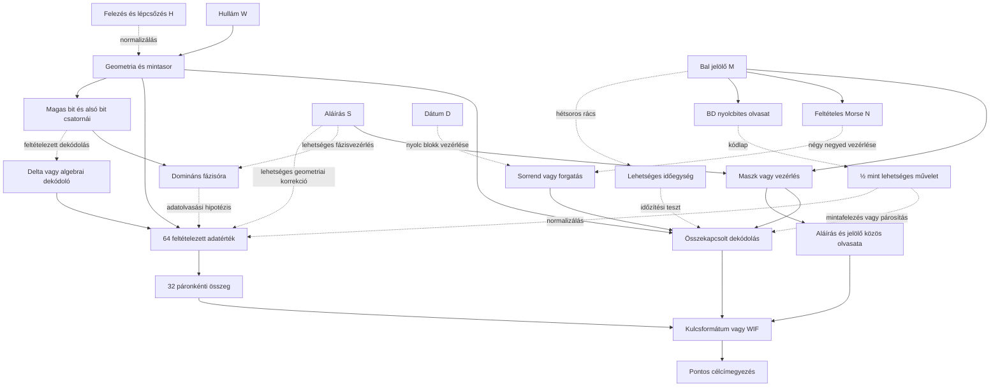

# HALV – összefüggések és tesztelhető modellek

Ez a fájl a kutatás közös térképe. A LOG.md a dátumozott részleteket őrzi.
**A közvetlen adat→kulcs teszt sikertelensége nem zár ki vezérlő-, sorrend-,
szűrő-, normalizáló- vagy ellenőrző szerepet ugyanannál a képrésznél.**
A több réteg lehetőségét vizsgáljuk; a konkrét rétegeket még nem igazoltuk.

## Mért elemek és lehetséges szerepek

| ID | Megfigyelés | Bizonyíték | Lehetséges szerep, még hipotézis |
|---|---|---|---|
| W | Hullám, 8×96 px feltételezett blokk, 256 négyszintű állapot | pixel_measurements.json, modellfüggő rekonstrukció | adatfolyam, két bitréteg, más görbemodell bemenete |
| M | Bal jelölő, 64 soros ablak; ezen belül 63 aktív sor T=3-nál | marker_pixels.csv, marker_grid_check.json | maszk, bitréteg-választó, időzítési vagy blokksorrendi utasítás |
| N | NMRM négy betű, 9 jelből, megadott küszöbökkel | feltételes Morse-dekódolás, nem igazolt üzenet | négy negyedhez tartozó vezérlés, faindexek vagy további dekódolókulcs |
| S | HALV/ZDEN: 4×(7×9) mintacella | corner_check.json, 3 nem homogén HALV-cella | négyrészes maszk, referencia, olvasási/geometriai utasítás |
| D | 20042402 nyolc számjegy | corner_check.json, közvetlen bitmap | időbélyeg; esetleg nyolc blokk paraméterei |
| H | Csökkenő hullámskála és lépcsőzés a logóban | bitmap és illesztés | felezés, normalizálás, réteg-/mintaválasztás |
| B | Hat erős csúcs 7 px rácson, nyolc helyen 10111101=BD | timing_lattice_check.json | Latin1/cp1252 „½” műveleti jel, vagy nyolc blokk vezérlése; a gyenge kilencedik csúcs magyarázandó |
| P | Domináns páratlan fázis mind a 8 blokkban: 2,1,0,3,2,1,0,3 | parity_phase_check.json, phase_law_diagnostics.json | fázisóra, 64 bites vezérlő és külön megőrzött maradékcsatorna |
| A | Bitcoin-célcím | Base58Check és offline címképzés | a teljes modell végső ellenőrzése |

A nyilak **kutatási hipotézisek**, nem megállapított adatfüggések.

## Most előre rögzített kapcsolt tesztek

| ID | Rétegek | Pontos feltételezés | Miért érdemes tesztelni? | Korlát |
|---|---|---|---|---|
| C1 | W + M + H | A 64 soros jelölő négyszer ismételve választ a hullám két bitrétegéből; XOR-kontroll is | 256 négyszintű minta = két 256 bites réteg; 4×64 vezérlőbit | ismétlés és bitréteg-kód nem bizonyított |
| C2 | W + S + H | A négy 63 bites betű egy-egy kitöltőbittel négy 64 bites maszkká válik | az aláírás négy mezője és a 256 minta kompatibilis méretű | a kitöltés és szerep hipotézis |
| C3 | S + M | A 256 bites aláírásmaszk és az ismételt jelölő XOR-ja ad adatot | két bináris rajz közös, hullámtól független olvasata | nincs szerzői utalás az XOR-ra |
| C4 | W + D + M/S | A nyolc számjegy nyolc 32 mintás blokk forgatását adja, utána C1/C2 | 8 jel és 8 blokk, explicit sorrendváltozat | gyenge kötés; a dátum lehet puszta időbélyeg |
| C5 | W + N + M/S | A négy Morse-faindex négy 64 mintás negyedet forgat, utána C1/C2 | négy Morse-csoport, négy negyed; a kezdő 1 megőrzi a jelhosszt | a Morse és a forgatási szerep is feltételes |
| C6 | M + S, strukturális teszt | A jelölő 9×7 bitje egy vagy több betűrács XOR/OR/AND fedvénye | egy jelölőmező és egy betű **azonos 63 bites méretű** | pontos egyezést kérünk; kis Hamming-távolság nem megfejtés |

N Morse-faindexei gyökér=1, pont=0, vonás=1 szabállyal:
`-. → 110₂=6`, `-- → 111₂=7`, `.-. → 1010₂=10`, `-- → 111₂=7`.
Ez egy szabályos számozás; nem állítjuk, hogy a szerző ezt használta.

C6-ban a nyolc HALV/ZDEN betű minden nem üres részhalmazát vizsgáljuk,
két globális 2×2 mintavétellel, négy tengelyfordítással, komplementálással
és az öt jelölőküszöbbel. A 63 bites vektorok mérete rögzített. Nem hangolunk
pixelenkénti eltéréseket, és a legközelebbi nem pontos olvasatot nem visszük
tovább kulcsként.

Minden családban előre/hátra olvasás, két forgatási irány, a négy állapot
24 bijektív címkézése szerepel. A teljes 256 bites köztes eredményt nyersen
és egyszeres SHA-256 után ellenőrizzük. Nincs korlátlan műveletlánc-keresés.

## Megőrzendő nyitott utak

- M vagy S csak az eredeti görbe mintavételi/rajzolási módját adja meg;
  a jelenlegi W-rekonstrukció ettől még hibás lehet.
- N nem feltétlenül betűként értelmezendő, és M nem feltétlenül Morse.
- S vonalainak helye vagy hossza számíthat, nem a betűbitmapek bitjei.
- W lehet mellékszereplő vagy redundáns ellenőrzés; C3 külön vizsgálja ezt.
- A 59 lobusz és az 51+8 olvasat továbbra is nyitott, a nyolc elválasztó
  független definíciója hiányzik.
- A korábbi negatívumok mindig egy adott rekonstrukcióra, kódolásra és
  műveletláncra vonatkoznak, nem egy teljes képrész általános irrelevanciájára.

## Végrehajtott első kapcsolt futás, 2026-10-31

| Modell | Az adott család különböző skalárjai | Pontos egyezés |
|---|---:|---:|
| C1 | 2384 | 0 |
| C2 | 21728 | 0 |
| C3 | 14592 | 0 |
| C4 | 47512 | 0 |
| C5 | 47800 | 0 |

Ebben a futásban összesen **134016** különböző érvényes skalár szerepelt,
mindkét nyilvánoskulcs-formátummal. Ezek a konkrét, előre rögzített láncok
nem adtak találatot. A végeredmény önmagában nem bizonyítja, hogy az adott
képrészek ne lennének összefüggésben.

C6: 61200, részben ismétlődő strukturális összehasonlítás, nulla pontos
fedvényegyezés. Ez nem privátkulcs-keresés. A legkisebb Hamming-távolság 5,
de ugyanazon ritka jelölőmaszk nullával való összehasonlítása is csak 9;
ezt nem tekintjük dekódolt kapcsolatnak.

Futtatók: `tools/check_composite_models.py`, `tools/check_marker_glyph_relation.py`.
Az eredményfájlok és hash-ek a `research/RUN_INDEX.json` jegyzékben vannak.

## C7/C8: jelölőrács → időzítés vagy felezési utasítás

**Mért:** a hat erős csúcs 450,464,471,478,485,499; páronkénti közepe
474,5, távolságai 3,5/10,5/24,5, azaz 1:3:7. Az egymás közti távolságok
14/7/7/7/14. Ez egyszerre egy szimmetrikus arány és egy 7 pixeles rácsminta.
A radiális távolság nem automatikusan hangidőtartam.

**Új kódolási kapcsolat:** BD a Latin1 és Windows-1252 kódlapon „½”.
UTF-8-ban „½” két bájt: C2 BD. A kódlap és a műveleti szerep hipotézis;
y=506-nál egy 177 intenzitású kilencedik csúcs megmarad, amelyet az egyszerű
nyolcbites olvasat nem magyaráz meg.

| Modell | Lánc | Eredmény |
|---|---|---|
| C7 | M rácsa → 3/3,5/7 px időegységek → normalizált W aktivitás → Morse-hosszak | megadott kontrollhoz képest ritkább időstruktúra; nem Morse-specifikus |
| C8 | M → BD → „½”/8 blokkparaméter → W mintafelezése vagy bitrétegválasztása → kulcs | 2112 különböző skalár, 0 címegyezés |

C7-ben öt explicit aktivitás, két polaritás és három időegység 30 modelljét
azonos modellválasztással alkalmaztuk 2000+2000 kontrollra. A blokkon belüli
átmeneteket és végpontokat megőrző Euler-kontroll referenciaaránya kb. 0,30%.
A legjobb modell azonban nulla hétegységes szünetet használ; ugyanazt a
veszteséget adja egy egyszerű 1/3 jel–szünet nyelvtan. Ez nem azonosítja
egyedül a Morse-t. A kontroll generálása nem egyenletes permutációmintavétel,
az arány feltáró referenciamutató, nem szerzői szándékot bizonyító p-érték.

Adatok: `timing_lattice_check.json`, `timing_specificity.json`,
`timing_surrogate_scores.npz`, `bd_halving_check.json`; a data/ könyvtárban.
Az egyetlen, a teljes képet előrejelző generátorszabály továbbra is nyitott cél.

C9: a „½” lehetséges műveleti olvasataként két mintából egyet képzünk:
átlagolás, különbség és a specifikáció szerinti rögzített műveletek, három
párosítással. A 128 négyszintű eredmény 256 kulcsbitre képezhető.
Ez a minták páronkénti feldolgozását vizsgálja a puszta ritkítás mellett;
nem 8SVX-dekódolás. Eredmény: `data/halving_pairs_check.json`.
5184 különböző skalár, nulla célcímegyezés ebben a rögzített családban.

## C10/C11: ellenőrzött alkotói előzmény, 64 érték → 32 összeg

**Pozitív kontroll:** a Level 5 képéből 64 téglalapot mértünk ki; mind a
64 W/H/külső-/belső-/keretterület egyezik a közzétett referenciával.
Két segédvonal a 40. egység szélességét 33→17, az 53.-ét 20→6 módosítja.
Ezután a közzétett normalizálás és kerekítés 64 értéke páronként összeadva
pontos kulcsot és a régi célcímet adja. Ez a teljes képi lánc ellenőrzése,
nem csupán egy ismert kulcsból történő címképzés.

HALV-hipotézis: 768 px = 64×12 px; a 256 állapot négyes csoportjai 64
értéket adhatnak. 8 felezési blokk × 8 cella egy 8×8 elrendezést is képez.

| Modell | Összekapcsolt lánc | Eredmény |
|---|---|---|
| C10 | W → 64 base4-/geometriai érték → normalizálás/½ → páronkénti összeg → 32 közvetlen bájt | 2846 különböző skalár, 0 címegyezés |
| C11 | W → 64 érték → M/BD által kijelölt blokkok felezése → páronkénti összeg → 32 bájt | 754 különböző skalár, 0 címegyezés |

A közvetlen, normalizálás nélküli base4-párok mind a 384 olvasatban
túlcsordulnak, legalább két bájthelyen. Ez egy pontos kódolási korlát;
a 64-egységes általános modellre nem kizárás. A Level 5 saját 10/64
együtthatóit nem alkalmaztuk automatikusan a HALV-ra, ahol jelentésük ismeretlen.

Adatok: `level5_geometry_verification.json`, `level5_remeasured_rectangles.csv`,
`halv_64_cells.csv`, `pair64_profiles.json`, `pair64_check.json`,
`pair64_range_diagnostics.json`, `bd_pair64_check.json`; a data/ könyvtárban.
A HALV 64 valódi adatértékének és normalizálási szabályának azonosítása nyitott.

## C12/C13: paritás, fázisóra és a korábbi 64-egységes ág összekötése

A felhasználó 3–7. blokkra adott táblája és a közvetlen magas bitsík pontosan
reprodukálható. Új, mind a nyolc blokkra érvényes megfigyelés:
**a páratlan értékek egyértelműen leggyakoribb helyi fázisa**
`r_b=(2-b) mod4`, azaz `2,1,0,3,2,1,0,3` (b nullaalapú).
Ez az első két és az utolsó blokkban nem kizárólagos fázis!

A jelöltek 64 bites fáziscsatornája mellett az összes további 192 alsó bitet
is megőrizzük. Ezekben blokkonként `10,4,0,0,0,0,0,12` egyes van.
Az első két és utolsó blokk adatait nem minősítjük zajnak, és nem töröljük.

C12-ben az egyik köztes képoszlopon újraillesztve, a másikon ellenőrizve
mindkét irányban pontosan ugyanaz a 256 állapot adódott. Ez oszlopok közti
predikció ugyanazon közelítő modellben, nem új képen történő validálás.
A korábbi 496 oszlop nagy része már a tárolt fit tanítóadata volt.

A `(mintaszám+b) mod4` értelmezés 33 logikai pozíciós blokkot is felvet,
de nem igazol hiányzó mintákat. A megosztott geometriai végpontot követve
a második blokk végén 1,5 állapot adódna, ami az egész négyszintű forrás
feltételezésével nem egyezik. Teljes generátorszabály még nincs.

| Modell | Cél | Eredmény |
|---|---|---|
| C12 | paritás-/fázismérés, referencia, képi kényszerek és oszloponkénti predikció | a szabály és domináns fázis stabil; globálisan kizárólagossá téve az első két blokk rosszul illeszkedik |
| C13-nibble | fázisolvasás → magas nibble + alsó bit / flag → 32 bájt | 640 különböző skalár a futáson belül, 0 találat |
| C13-pair64 | fázisolvasás → a korábbi 64 érték / normalizálás / páronkénti összeg | 22448 különböző skalár a futáson belül, 0 találat |
| C13-codec | nibblesor + flag → 8SVX-kompatibilis delta-mag → 64 érték → páronkénti összeg | 143458 különböző skalár a futáson belül, 0 találat |

A C13 teljes futásában 166546 különböző skalár, mindkét P2PKH-formátummal;
nem használ hash-véglegesítést. A kodekmag telítődő aritmetikát és külön
vizsgált nibble-sorrendet használ az archivált FFmpeg forrás szerint;
nem feltételez moduláris prediktor-túlcsordulást. IFF-fájl vagy hangüzenet
ettől még nem lett azonosítva.

**Mindkét fő ág aktív marad:** (1) az óra/fázis, magas adatbit és alsó
vezérlő/maradék csatorna szerepe; (2) a Level 5 által alátámasztott
geometria→korrekció→64 érték→32 összeg kompozíció. A C13 összeköti őket,
és nem helyettesíti a még nyitott geometriai terület- és aláíráskalibrációt.

Az alsó bit másik, párhuzamos értelmezése geometriai: `q/2 = H + L/2`.
A BD-féljel után L fél egységnyi koordináta-/amplitúdókorrekció lehet.
Ezt nem azonosítjuk automatikusan vezérlőbittel. A pontos területméréshez
a normalizálás és a kerekítés sorrendjét is igazolni kell, ahogy a Level 5-nél.

C14 az L fázishelyein vett 64 bit egyszerű paritás- vagy CRC64-szerepét
ellenőrizte a H adatokon: a deklarált affine-paritás és négy CRC64-változat
egyike sem adott pontos kapcsolatot. Ez nem általános ellenőrzőösszeg-kizárás.

## C15/C16: fizikai végpontok és fél egységnyi területkorrekció

C15 elkülöníti a **logikai** 33 helyet a külön rajzolt 33. **geometriai**
csúcstól. A 256 illesztett csúcs 255 intervallum, vízszintes távolságuk
765 px (92…857). A 256×3=768 számtani szorzat nem bizonyít 256 teljes,
független geometriai intervallumot; a 64×12-es cellázás külön hipotézis.

A hét belső határból hatnál a külön egészértékű végpont összeeshet a közös
végponttal; ezek nem különítik el a modelleket. Az x=284-nél a megosztott
végpont 1,5 előző-blokkbeli egység. A rögzített egész {0,1,2,3} végpontok,
két csatlakozási mód és három vonalskála közül mindegyik rosszabbul jósolja
az ellenőrző oszlopot a folytonos görbénél. A végső 857→860 hosszabbítás
a vizsgált, levágás nélküli modellekben szintén rosszul illeszkedik.
Ez nem zárja ki a logikai paddinget, más raszterizálót vagy a rajz előtti
adatátalakítást. A `r_b=(2-b) mod4` fázisóra továbbra is magyarázandó.

C16 a BD-féljel lehetséges műveleti olvasatát és az alsó bitsíkot geometriailag
kapcsolja össze: `q/2 = H + L/2`. A 61 alsó egyes hozzájárulása mind megmarad;
az F- és E-csatornát nem vágjuk le. Egzakt racionális trapézintegrálás, két
cellaigazítás, normalizált vagy fizikai csúcsmagasság, sugár/átmérő terület,
négy korábbi párosítás, két irány és négy kerekítési szabály szerepel.
Külön vizsgáljuk a kerekítés→összeg és az összeg→kerekítés sorrendet.

1024 recept, 404 különböző érvényes skalár, 0 címegyezés mindkét P2PKH
formátummal. A 512 fizikai-terület recept mind túlcsordul; a 512 normalizált
receptből adódik a 404 skalár. Nincs hash, modulojavítás vagy célcím alapján
választott skála. A statisztika és a helyes normalizálás nem azonosított.

A jobb alsó lépcső külön mérése: a bal végpontok x-lépése négyszer 16 px,
a vízszintes vonalpárok y-középértékei `879,5; 903,5; 917,5; 923,5; 926,5`.
Az utolsó futam a kijelölt ROI szélén levágott. A középértékek különbsége
`24,14,6,3`, ezért ezekből önmagukban nem állítunk pontos felezőképletet,
ötblokkos vezérlést vagy számszerű normalizálást. Az aláírás utasításszerepe
továbbra is aktív hipotézis, a teljes alakzat folytatása vizsgálandó.

Adatok: `boundary33_check.json`, `boundary33_audit.png`,
`fractional_area_check.json`, `fractional_area_profiles.json`,
`fractional_area_recipes.json`, `fractional_area_audit.png`,
`signature_staircase_geometry.json`; a data/ könyvtárban.

## C17/C18/C19: nullahelyfázis, veszteségmentes3+1 és jutalomsor

**Új, reprodukált strukturális adat:** a 3–7. blokkban nemcsak az alsó
egyesek helye kötött. Minden négyes csoport egy teljes mintája nulla!
Ennek fázisa `z_b=(3-b) mod4`, a páratlan mintáé `r_b=z_b-1 mod4`.
Az előbbi a középső ötben `1,0,3,2,1`, az utóbbi `0,3,2,1,0`.
A két fázist nem szabad felcserélni.

Következmény: a négy magas bitből egy fix nulla; három magas bit és az
r-fázis alsó bitje **veszteségmentesen** leír egy négyes csoportot.
40 csoport→160 bit, visszakódolva pontosan egyezik mind a 160 állapottal.
Ez a3+1 felépítés helyes bitköltsége; az öt változó bitre vonatkozó
kezdeti gyors értelmezést a nullahelymérés alapján javítottuk.

C17 az új szöveg7/8 periódusait és a három legnagyobb entrópiájú blokkot
reprodukálja. A dátummaszk kontrollja60/560=10,714%; a felezés a nemnulla
maszkot nem változtatja. A két képrész101 egyezése a szélső blokkokon nem
független a teljes maszkok7/8 egyezésétől. A felhasználó korábbi1032,
10368 és35436 kulcspróbáját külön bemenetek nélkül nem saját futásként kezeljük.

C18 a felhasználói929,5 referenciával a megmért lépcsőből számítja a
`floor(log2(h)) mod4` nullahelyfázist. Az összes képlet ugyanaz marad,
ha a referencia a **[928,5;930,5)** tartományon belül változik. Az összes
blokkra kiterjesztett nullahelyszám3,5,8,8,8,8,8,4 a nyolc lehetséges
cellahelyből. Az első blokkban holtversenyes, a többiben egyedi maximum.

A teljes, rétegzett veszteségmentes adat44 bájt: a három szélső blokkban
8-8 nyers bájt, az öt középsőben4-4 bájt. Pontos256-állapotos visszakódolás.
A három szélső blokk mintánkénti egybites kiválasztása még feltevés;
a kimaradó96 bitet minden BD-/kontrollváltozat mellett megőriztük.
A rögzített768 közvetlen kulcsjelölt nem adott címegyezést, hash nélkül.

C19 **jutalomértelmezése** és a fázisazonosság együtt fennáll. Az ideális
50,25,12.5,6.25,3.125 sorhoz a mért lépcső MSE-je pontosan17/64 px²,
RMS-e0,515388 px. Mindkettő logaritmusának egészrésze5,4,3,2,1.
A hullám középső skálái32,16,8,4,2, a jutalmakhoz közös faktoruk25/16.
A jutalom a lépcső természetes tematikus magyarázata lehet, de a szándékolt
kulcsműveletet ez még nem azonosítja. A feleződésből általában is
egyesével csökkenő logaritmus-egészrészek keletkeznek.

A25/16 és16/25 tényezővel külön ellenőrzött fizikai cellaterületek között
is van256 fölötti, ezért a közvetlen pozitív páronkénti összegzés továbbra
sem ad32 bájtot. Ez tartományvizsgálat, nem új kulcskeresés. A helyes
geometriai normalizálás és a szélső96 bit szerepe közös nyitott feladat.

## C20: egységes4+4 bites felbontás, a12 kivétel megőrzésével

Az új felhasználói maszkok ésEAA/ETE/ES olvasatok pontosan reprodukálhatók.
A kijelölt64 pozíció eloszlása52 nulla,9 egyes,3 kettes. A16 affine
fázismodell közül a(z=3−b mod4) valóban52 nullával az első, a második38.
A maszkBD és11000001 egyezése3/8; egyszerű kivételblokk-kijelölésként nem pontos.

Pontosítás: a40 középső cellán kívül a2. blokk1.,3.,5. és a8. blokk0.
cellája is teljesen megfelel a3+1 feltételnek (cellák nullaalapúak).
Így44 szabályos,20 eltérő cella van. A40+24 területi csoportosítás,
nem az összes cella pontos viselkedési besorolása.

Egységes kivonatolás minden cellában, z=(3−b)mod4 és r=z−1mod4:

- A4: három H bit növekvő helyi sorrendben z nélkül, majd L[r].
- R4: H[z], majd három L bit növekvő sorrendben r nélkül.

Egyetlen invertálható szabály, külön szélső bitválasztás nélkül. A mind a64
cellán képzett A32 bájt; az R64 nibble-jéből a középső40 nulla. A szélső
24 nibble12 bájtja mind megmarad, együtt44 bájt veszteségmentes adat.
Az R-ben29 egyes bit van:3 darabH[z],9 darabL[z] és17 további nem-r,
nem-z alsó egyes. A12 jelölt nullapozíció elemzése ezért nem a teljes
maradékréteg elemzése; a másik17 bitet sem hagyjuk el.

A főcsatorna24 közös bitpermutációja és rögzített irányai192 receptből96
különböző skalárt adnak,0 célcímegyezéssel, hash nélkül. A maradék szerepe
ettől nyitott. A szabály nem jósolja meg a12 értéket; **nem teljes generátor**.

A16-modelles, hisztogramot megőrző új kontrollban20000 permutáció közül
egyik sem érte el az52-es maximumot vagy a14-es első–második különbséget.
Ez feltételes, feltáró kontroll;0 esemény nem nulla valószínűség és nem
globális szándékbizonyíték. A kontrollpontszámok mentve vannak.

## C21–C23: teljes maradék, előrejelzés és képi kontroll

Két veszteségmentes keret: a C20 abszolút helyi bitsorrendje, illetve az
r-fázishoz forgatott sorrend. Utóbbi:
`A=[H[r],H[r+2],H[r+3],L[r]]`,
`R=[H[z],L[z],L[z+1],L[z+2]]` (pozíciók mod4).
Mindkettő visszaadja az összes 256 állapotot; nem dobunk el maradékbitet.

C21-ben mindkét keretben 10 főnibble-értékhez több különböző R tartozik.
Ez pontos ellenpélda bármely pozíciófüggetlen `R=f(A)` táblához.
A szomszédok és koordináták 18 bitjéből kimenetenként legfeljebb 3 XOR-tagot
használó, minimum tanítóhibára választott szabályok a kihagyott teljes
szélső blokkokon sem jósoltak meg nemnulla kivételt. Ez csak a deklarált,
korlátozott család negatívuma, nem minden kontextusos szabály kizárása.
A 192 közvetlen főcsatorna-kulcs között 96 korábbi kontroll és 96 új,
fázisrelatív változat van; nincs célcímegyezés.

C22 a 32+12 bájtos szerkezetet szabványos ellenőrzőkód lehetőségeként
vizsgálta. A rögzített RS(44,32), CRC32/Adler-bank és Fibonacci-rekurziós
család egyik olvasatban sem jósolta meg a 12 bájtot. RS: 73728 teljes
csomag-összevetés; ellenőrzőbankok: 552960. Ezek 96 bites előrejelzési
összevetések, **nem privátkulcs-próbák**. A 64 bitből tanult bináris
rekurziók 31–33 fokúak és a visszatartott 32 bitet sem találták el pontosan.
Ez nem általános hibajavítókód-, rekurzió- vagy Fibonacci-kizárás.

C23 fontos képi javítást ad: a korábbi magas tail-ROI az aláírást is
tartalmazta. Az x≥764 oszlopokra rögzített y450…500 hullám-ROI az összes
megengedett végblokk-görbét és vonaludvarát tartalmazza, az aláírást nem.
Azonos R=0 kényszer mellett a névleges ellenőrzőhiba-arány így 1,034-ről
4,279-re nő. Ez a háttérből eredő százaléktorzítás javítása; a korábbi
névleges állapotsor nem változik. Három vonalskála és két oszlopszerep
mind ugyanazt a 256 szabadon illesztett mintát adja. A maradék eltörlése
az utolsó blokkban 2,277–4,811-szeres hibát okoz ebben a modellcsaládban.

A q/2 geometriai eltérés 26 fél- és 3 egész egységnyi csúcskorrekció.
64 cellából 22 területe változik; a normalizált sugárterület-korrekció
pontos összege 48, a felezett fizikai magasság modelljében 3282 px².
Az R ezért ebben a felbontásban nem kizárólag fél egységnyi törtrész.
Az R-ből közvetlenül A-különbséget előállító állandó táblák is ellentmondásosak,
a vizsgált Fibonacci/exponenciális táblák sem adnak teljes egyezést.

**Nyitva marad:** állapottal, távolabbi összefüggéssel vagy más sorrenddel
működő közös generátor; R esetleges utasítás-/paraméter-szerepe; a megfelelő
geometriai normalizálás; összetettebb Fibonacci–hang–Morse műveletsorrend.
Az eddigi tesztek nem igazolnak kész dekódolási láncot.

## C24–C26: csatolmányok, lag2 fázis és a maradék lehetséges kapcsolata

Az új 13 forrásból négy átnézett programot futtattunk a rögzített q-n.
A rangok, 4608 ASCII7-olvasat, 2368 kulcsjelölt és a TXID-kontroll teljes
eredménye reprodukálható. A hiányzó CSV-t a repóból generáltuk; az eredeti
csatolmányok változatlanok. A nyers finanszírozási tranzakció nincs függetlenül
ellenőrizve. A beégetett CORE20 egy adott konvenció paramétere, nem új mérés.

A 3–5., 4–6., 5–7. pár körkörös eltolása 26,18,14, az egyezések 26,24,25.
Az első két párból az `s_b=(a+S_b/2) mod32` modellben a=10 adódik;
a harmadikra 14-et jósol. A 7. blokk 25/32 értéke és a nyolc változó L bitje
egyezik, hét H bit hibás. Ez a már látott adatokon végzett modellrekonstrukció;
a 10-es alap képi jelentése nincs meg. Az összes lag2 párt nem írja le pontosan.

A `phi_b=floor(2*S_b/3)-5*b` fáziskoordináta ugyanennek algebrai átírása,
nem külön bizonyíték. Az első 16 minta szerinti illesztés második felén
12/16 egyezés reprodukálható, de nem független új képi teszt.

A négy ablakra végzett kontroll az ismert 75-ös összegnél egész kvartetteket
keverve 0/30000, nyolcmintás szakaszokat keverve 44/10000 találatot ad.
A 25/32 céljóslatot a négy ablak közül legjobbat választva rendre 134/30000
és 566/10000 kontroll éri el. A különböző statisztikákat nem cseréljük fel;
a lokális szerkezet megőrzése lényegesen befolyásolja az értékelést.

Új összekapcsolási teszt: a három átmenet cellakód-javítása szintén 96 bit,
mint a külső R. Az XOR-javítások 7,11,7 egyest, az R-szavak 12,5,12 egyest
tartalmaznak; puszta bitpermutáció nem elég. Két R-keret, három A-keret,
XOR/nibble-/szókivonás és egységes forgatások 1728 konfigurációja közül
sem affine, sem általános memóriátlan nibble-tábla nem konzisztens már az
első két átmenettel sem. Ez e helyi család negatívuma, nem globális vagy
állapotos kapcsolatok kizárása.

Részletes audit: `REPORT_20261101_UPLOAD_AUDIT.md`. A korábbi geometriai,
Fibonacci–hang–Morse és bitréteg-ágak megmaradnak. Közös generátor és kulcs nincs.

## C27: történeti vezérlőjel-kontroll és új kutatási prioritás

A felhasználó a korábbi Zden-feladatok összetett műveleteit és több képelem
együttes szerepét kérte előtérbe helyezni. A most megtalált, commitra rögzített
`jsn/btc-crypto` Level 2 megoldó közösségi implementáció, a szerző publikált
megoldása után befejezve. Saját reprodukció: 51 szektor, 306/306 szomszédos
komplementpár, központi flag szerinti inverzió, két WIF-irányból egy érvényes;
a régi kép címe pontosan egyezik. Ez a HALV-tól független pozitív kontroll.

A fő tanulság: a flagből vezérlés, a szomszédos adatból tartalom lesz.
Az R=f(A) negatívumai nem zárják ki a dekódolt adat=f(A,R,előző állapot)
szerkezetet. A következő elsődleges HALV-irány a marker/aláírás által
indokolt feltételes inverzió és szomszédrekonstrukció, utána a felezéshez
kötött carry/borrow vagy kerekítési állapot. Ez tervezett kutatás, ebben a
körben nem új HALV-kulcscsalád.

A Level 5 teljes geometriai pozitív kontrollja megmarad. A WIF vezető 5,
a kihagyás vagy 0-kezelés csak konkrét formatálási/indexelési utasítás
alapján alkalmazható. A Level 2-ben az 5 nem hiányzik: a forgatás horgonya.
A más játékokban említett kihagyások pontos primer ellenőrzése részben
nyitott; nem egységes, minden Zden-képre érvényes műveletként kezeljük.

Részletes sorrend és falszifikációs feltételek:
`REPORT_20261101_ZDEN_METHOD_AND_NEXT_STEPS.md`.

## C28–C30: végrehajtott vezérlés → felezés → validálás

A felhasználó elfogadta a C27 után javasolt sorrendet. A rögzített
`models/ordered_decode_v1.json` szerinti család most lefutott.
Az A három adatbitjét szomszédválasztás és feltételes inverzió módosítja;
a flaget a helyi Lr, egy R-függvény, opcionális BD-bit és közös polaritás
határozza meg. A három keret összes 591 változata pontosan visszaadja a
256 bemeneti állapotot. Ez adatmegőrzési kontroll, nem dekódolási bizonyíték.
Nincs a Level 2-höz hasonló teljes komplementkapcsolat a három vizsgált
szomszédsági diagnosztikában. A primitív mind az 51 történeti karaktert
helyesen állítja elő a külön pozitív kontrollon.

A C29 mind a 591 esethez két főcsatorna/R byte-csomagolást, páros
felezést/összeget és négy szegmentálással carry/borrow szóaritmetikát
vizsgál. Az átalakított hullám pontos geometriai területe külön ág.
49 644 receptből 28 307 egyedi 32 bájtos eredmény született; a túlcsorduló
közvetlen bájtértékek elutasítva. A fizikai területváltozatok normalizálás
nélkül nem adnak bájtokat. A C16 területkontroll és az önálló átviteli
ellenőrzések sikeresek. Az összeg/átlag nem invertálható, eredeti bemenete
és determinisztikus receptje megmarad.

C30: négy rögzített kulcsolvasattal 115 592 különböző érvényes skalár,
két publikus kulcsformátum, 0 célcímegyezés. Az 50 karakteres ASCII7
14 184 olvasatában nincs teljes Base58-tartalom (maximum 30/50), ezért
a vezető 5 hozzáadása nem jutott át a formátumkapun. Az ASCII64-hex
1182 esetében sincs teljes hexszöveg. Nincs karakterjavítás vagy hash-véglegesítés.

Ezek nem zárnak ki más állapotfrissítést, más képből levezetett sorrendet
vagy normalizálást. Nem vezettük le a lag2-modell 10-es alapját vagy a hét
magasbit-hibát. A következő elsődleges követelmény e korrekciók közös
generáló szabályból történő előrejelzése, nem újabb paraméterenkénti javítás.
A dátum és a Fibonacci–hang–Morse szerepe nyitott; új hangteszt most nem futott.
Részletek és hatókör: `REPORT_20261101_ORDERED_SEQUENCE.md`.

## C31–C34: kauzális maradékkapcsolat és a megjegyzés korlátja

A három külső R-szót a három középső lag2 javítás bemeneteként vizsgáltuk,
nem független kulcsrésznek feltételezve. Az első két átmenet illesztési,
a harmadik ellenőrzési adat. A 10-es alap továbbra is poszthoc, és a teljes
kép ismert; visszatartott részhalmaz nem jelent független új mérést.

C31: aktuális és legfeljebb4 múltbeli R-bit, legfeljebb4 múltbeli kimeneti
bit és konstans GF(2)-rekurziója. Két határkezelés és bitirány, XOR/szókivonás
cél. Mind a4608 maximális jellemzőtér ellentmondásos az első64 célbiten;
a115200 könyvelt kisebb/nagyobb memóriaváltozat között nincs pontos illesztés.
Ez nem minden rekurzió vagy Fibonacci-delta hangkodek kizárása.

C32: R-rel és forrással végzett nibble-carry/borrow, prefix-XOR/összeg/különbség,
egy közös0..15 kezdőállapot, két irány és határkezelés. A184320 konfiguráció
közül egyik sem írja le pontosan az első16 cellát. Tetszőleges R-ből képzett
kezdőszó vagy más rejtett állapot ettől még nyitott.

C33: a normalizált, igazított q/2 cellaterület-változás és R-nibble közös
affin kapcsolata sem illeszthető pontosan. A geometriai következmény szerint
mindhárom párban van nemnulla mintakülönbségű, mégis nulla területváltozású
cella. Az5–7. pár5. cellájának [0,+2,−2,0,0] különbsége két H-eltérést rejt
el az integrált terület elől. Ez levezetett azonosság, nem új R-kódolás.

C34: nemlineáris R/előzőR/előzőkimenet kontextustáblák, opcionális forrásnibble.
46080 konfigurációból30388 konzisztens a tanításban, de nincs8/8 teljes
ellenőrzőjóslat. A legnagyobb lefedettség4/8; a legtöbb helyes cella2/8,
eltérő konfigurációkban. Ismeretlen kontextust nem töltünk ki és nem tanítunk
az ellenőrző kimenetekből. A sok tanítóillesztés itt nem dekódolási bizonyíték.

A három R-szó↔három javítás hozzárendelése továbbra is hipotézis, most
nincs rá új támogató eredmény. Következő prioritás a hullámot és R-t együtt
előállító szabály, a képi koordináták és felezés közös levezetésével.
A geometriai és Fibonacci–hang–Morse ág megmarad. Nincs új kulcskeresés,
teljes generátor vagy HALV-kulcs. Jelentés: `REPORT_20261101_STATEFUL_BRIDGE.md`.
