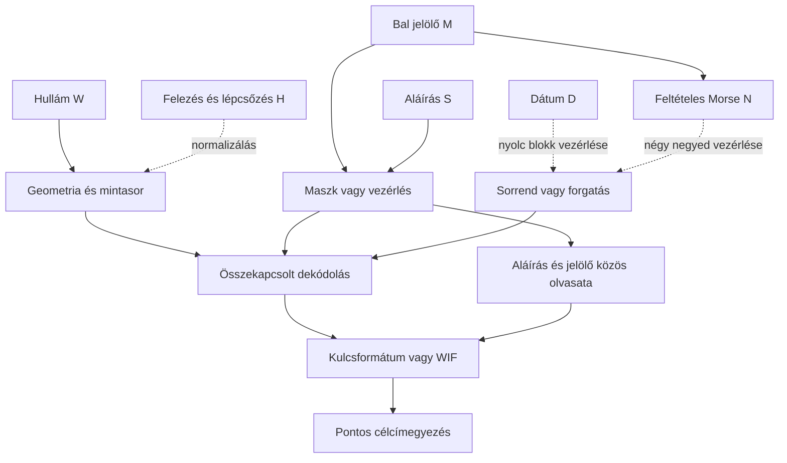

# HALV – összefüggések és tesztelhető modellek

Ez a fájl a kutatás közös térképe. A LOG.md a dátumozott részleteket őrzi.
**A közvetlen adat→kulcs teszt sikertelensége nem zár ki vezérlő-, sorrend-,
szűrő-, normalizáló- vagy ellenőrző szerepet ugyanannál a képrésznél.**
A több réteg lehetőségét vizsgáljuk; a konkrét rétegeket még nem igazoltuk.

## Mért elemek és lehetséges szerepek

| ID | Megfigyelés | Bizonyíték | Lehetséges szerep, még hipotézis |
|---|---|---|---|
| W | Hullám, 8×96 px feltételezett blokk, 256 négyszintű állapot | pixel_measurements.json, modellfüggő rekonstrukció | adatfolyam, két bitréteg, más görbemodell bemenete |
| M | Bal jelölő, 64 soros ablak; ezen belül 63 aktív sor T=3-nál | marker_pixels.csv, marker_grid_check.json | maszk, bitréteg-választó, időzítési vagy blokksorrendi utasítás |
| N | NMRM négy betű, 9 jelből, megadott küszöbökkel | feltételes Morse-dekódolás, nem igazolt üzenet | négy negyedhez tartozó vezérlés, faindexek vagy további dekódolókulcs |
| S | HALV/ZDEN: 4×(7×9) mintacella | corner_check.json, 3 nem homogén HALV-cella | négyrészes maszk, referencia, olvasási/geometriai utasítás |
| D | 20042402 nyolc számjegy | corner_check.json, közvetlen bitmap | időbélyeg; esetleg nyolc blokk paraméterei |
| H | Csökkenő hullámskála és lépcsőzés a logóban | bitmap és illesztés | felezés, normalizálás, réteg-/mintaválasztás |
| A | Bitcoin-célcím | Base58Check és offline címképzés | a teljes modell végső ellenőrzése |

A nyilak **kutatási hipotézisek**, nem megállapított adatfüggések.

## Most előre rögzített kapcsolt tesztek

| ID | Rétegek | Pontos feltételezés | Miért érdemes tesztelni? | Korlát |
|---|---|---|---|---|
| C1 | W + M + H | A 64 soros jelölő négyszer ismételve választ a hullám két bitrétegéből; XOR-kontroll is | 256 négyszintű minta = két 256 bites réteg; 4×64 vezérlőbit | ismétlés és bitréteg-kód nem bizonyított |
| C2 | W + S + H | A négy 63 bites betű egy-egy kitöltőbittel négy 64 bites maszkká válik | az aláírás négy mezője és a 256 minta kompatibilis méretű | a kitöltés és szerep hipotézis |
| C3 | S + M | A 256 bites aláírásmaszk és az ismételt jelölő XOR-ja ad adatot | két bináris rajz közös, hullámtól független olvasata | nincs szerzői utalás az XOR-ra |
| C4 | W + D + M/S | A nyolc számjegy nyolc 32 mintás blokk forgatását adja, utána C1/C2 | 8 jel és 8 blokk, explicit sorrendváltozat | gyenge kötés; a dátum lehet puszta időbélyeg |
| C5 | W + N + M/S | A négy Morse-faindex négy 64 mintás negyedet forgat, utána C1/C2 | négy Morse-csoport, négy negyed; a kezdő 1 megőrzi a jelhosszt | a Morse és a forgatási szerep is feltételes |
| C6 | M + S, strukturális teszt | A jelölő 9×7 bitje egy vagy több betűrács XOR/OR/AND fedvénye | egy jelölőmező és egy betű **azonos 63 bites méretű** | pontos egyezést kérünk; kis Hamming-távolság nem megfejtés |

N Morse-faindexei gyökér=1, pont=0, vonás=1 szabállyal:
`-. → 110₂=6`, `-- → 111₂=7`, `.-. → 1010₂=10`, `-- → 111₂=7`.
Ez egy szabályos számozás; nem állítjuk, hogy a szerző ezt használta.

C6-ban a nyolc HALV/ZDEN betű minden nem üres részhalmazát vizsgáljuk,
két globális 2×2 mintavétellel, négy tengelyfordítással, komplementálással
és az öt jelölőküszöbbel. A 63 bites vektorok mérete rögzített. Nem hangolunk
pixelenkénti eltéréseket, és a legközelebbi nem pontos olvasatot nem visszük
tovább kulcsként.

Minden családban előre/hátra olvasás, két forgatási irány, a négy állapot
24 bijektív címkézése szerepel. A teljes 256 bites köztes eredményt nyersen
és egyszeres SHA-256 után ellenőrizzük. Nincs korlátlan műveletlánc-keresés.

## Megőrzendő nyitott utak

- M vagy S csak az eredeti görbe mintavételi/rajzolási módját adja meg;
  a jelenlegi W-rekonstrukció ettől még hibás lehet.
- N nem feltétlenül betűként értelmezendő, és M nem feltétlenül Morse.
- S vonalainak helye vagy hossza számíthat, nem a betűbitmapek bitjei.
- W lehet mellékszereplő vagy redundáns ellenőrzés; C3 külön vizsgálja ezt.
- A 59 lobusz és az 51+8 olvasat továbbra is nyitott, a nyolc elválasztó
  független definíciója hiányzik.
- A korábbi negatívumok mindig egy adott rekonstrukcióra, kódolásra és
  műveletláncra vonatkoznak, nem egy teljes képrész általános irrelevanciájára.

## Végrehajtott első kapcsolt futás, 2026-10-31

| Modell | Az adott család különböző skalárjai | Pontos egyezés |
|---|---:|---:|
| C1 | 2384 | 0 |
| C2 | 21728 | 0 |
| C3 | 14592 | 0 |
| C4 | 47512 | 0 |
| C5 | 47800 | 0 |

Ebben a futásban összesen **134016** különböző érvényes skalár szerepelt,
mindkét nyilvánoskulcs-formátummal. Ezek a konkrét, előre rögzített láncok
nem adtak találatot. A végeredmény önmagában nem bizonyítja, hogy az adott
képrészek ne lennének összefüggésben.

C6: 61200, részben ismétlődő strukturális összehasonlítás, nulla pontos
fedvényegyezés. Ez nem privátkulcs-keresés. A legkisebb Hamming-távolság 5,
de ugyanazon ritka jelölőmaszk nullával való összehasonlítása is csak 9;
ezt nem tekintjük dekódolt kapcsolatnak.

Futtatók: `tools/check_composite_models.py`, `tools/check_marker_glyph_relation.py`.
Az eredményfájlok és hash-ek a `research/RUN_INDEX.json` jegyzékben vannak.
