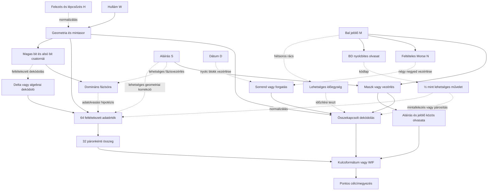

# HALV – összefüggések és tesztelhető modellek

Ez a fájl a kutatás közös térképe. A LOG.md a dátumozott részleteket őrzi.
**A közvetlen adat→kulcs teszt sikertelensége nem zár ki vezérlő-, sorrend-,
szűrő-, normalizáló- vagy ellenőrző szerepet ugyanannál a képrésznél.**
A több réteg lehetőségét vizsgáljuk; a konkrét rétegeket még nem igazoltuk.

## Mért elemek és lehetséges szerepek

| ID | Megfigyelés | Bizonyíték | Lehetséges szerep, még hipotézis |
|---|---|---|---|
| W | Hullám, 8×96 px feltételezett blokk, 256 négyszintű állapot | pixel_measurements.json, modellfüggő rekonstrukció | adatfolyam, két bitréteg, más görbemodell bemenete |
| M | Bal jelölő, 64 soros ablak; ezen belül 63 aktív sor T=3-nál | marker_pixels.csv, marker_grid_check.json | maszk, bitréteg-választó, időzítési vagy blokksorrendi utasítás |
| N | NMRM négy betű, 9 jelből, megadott küszöbökkel | feltételes Morse-dekódolás, nem igazolt üzenet | négy negyedhez tartozó vezérlés, faindexek vagy további dekódolókulcs |
| S | HALV/ZDEN: 4×(7×9) mintacella | corner_check.json, 3 nem homogén HALV-cella | négyrészes maszk, referencia, olvasási/geometriai utasítás |
| D | 20042402 nyolc számjegy | corner_check.json, közvetlen bitmap | időbélyeg; esetleg nyolc blokk paraméterei |
| H | Csökkenő hullámskála és lépcsőzés a logóban | bitmap és illesztés | felezés, normalizálás, réteg-/mintaválasztás |
| B | Hat erős csúcs 7 px rácson, nyolc helyen 10111101=BD | timing_lattice_check.json | Latin1/cp1252 „½” műveleti jel, vagy nyolc blokk vezérlése; a gyenge kilencedik csúcs magyarázandó |
| P | Domináns páratlan fázis mind a 8 blokkban: 2,1,0,3,2,1,0,3 | parity_phase_check.json, phase_law_diagnostics.json | fázisóra, 64 bites vezérlő és külön megőrzött maradékcsatorna |
| A | Bitcoin-célcím | Base58Check és offline címképzés | a teljes modell végső ellenőrzése |

A nyilak **kutatási hipotézisek**, nem megállapított adatfüggések.

## Most előre rögzített kapcsolt tesztek

| ID | Rétegek | Pontos feltételezés | Miért érdemes tesztelni? | Korlát |
|---|---|---|---|---|
| C1 | W + M + H | A 64 soros jelölő négyszer ismételve választ a hullám két bitrétegéből; XOR-kontroll is | 256 négyszintű minta = két 256 bites réteg; 4×64 vezérlőbit | ismétlés és bitréteg-kód nem bizonyított |
| C2 | W + S + H | A négy 63 bites betű egy-egy kitöltőbittel négy 64 bites maszkká válik | az aláírás négy mezője és a 256 minta kompatibilis méretű | a kitöltés és szerep hipotézis |
| C3 | S + M | A 256 bites aláírásmaszk és az ismételt jelölő XOR-ja ad adatot | két bináris rajz közös, hullámtól független olvasata | nincs szerzői utalás az XOR-ra |
| C4 | W + D + M/S | A nyolc számjegy nyolc 32 mintás blokk forgatását adja, utána C1/C2 | 8 jel és 8 blokk, explicit sorrendváltozat | gyenge kötés; a dátum lehet puszta időbélyeg |
| C5 | W + N + M/S | A négy Morse-faindex négy 64 mintás negyedet forgat, utána C1/C2 | négy Morse-csoport, négy negyed; a kezdő 1 megőrzi a jelhosszt | a Morse és a forgatási szerep is feltételes |
| C6 | M + S, strukturális teszt | A jelölő 9×7 bitje egy vagy több betűrács XOR/OR/AND fedvénye | egy jelölőmező és egy betű **azonos 63 bites méretű** | pontos egyezést kérünk; kis Hamming-távolság nem megfejtés |

N Morse-faindexei gyökér=1, pont=0, vonás=1 szabállyal:
`-. → 110₂=6`, `-- → 111₂=7`, `.-. → 1010₂=10`, `-- → 111₂=7`.
Ez egy szabályos számozás; nem állítjuk, hogy a szerző ezt használta.

C6-ban a nyolc HALV/ZDEN betű minden nem üres részhalmazát vizsgáljuk,
két globális 2×2 mintavétellel, négy tengelyfordítással, komplementálással
és az öt jelölőküszöbbel. A 63 bites vektorok mérete rögzített. Nem hangolunk
pixelenkénti eltéréseket, és a legközelebbi nem pontos olvasatot nem visszük
tovább kulcsként.

Minden családban előre/hátra olvasás, két forgatási irány, a négy állapot
24 bijektív címkézése szerepel. A teljes 256 bites köztes eredményt nyersen
és egyszeres SHA-256 után ellenőrizzük. Nincs korlátlan műveletlánc-keresés.

## Megőrzendő nyitott utak

- M vagy S csak az eredeti görbe mintavételi/rajzolási módját adja meg;
  a jelenlegi W-rekonstrukció ettől még hibás lehet.
- N nem feltétlenül betűként értelmezendő, és M nem feltétlenül Morse.
- S vonalainak helye vagy hossza számíthat, nem a betűbitmapek bitjei.
- W lehet mellékszereplő vagy redundáns ellenőrzés; C3 külön vizsgálja ezt.
- A 59 lobusz és az 51+8 olvasat továbbra is nyitott, a nyolc elválasztó
  független definíciója hiányzik.
- A korábbi negatívumok mindig egy adott rekonstrukcióra, kódolásra és
  műveletláncra vonatkoznak, nem egy teljes képrész általános irrelevanciájára.

## Végrehajtott első kapcsolt futás, 2026-10-31

| Modell | Az adott család különböző skalárjai | Pontos egyezés |
|---|---:|---:|
| C1 | 2384 | 0 |
| C2 | 21728 | 0 |
| C3 | 14592 | 0 |
| C4 | 47512 | 0 |
| C5 | 47800 | 0 |

Ebben a futásban összesen **134016** különböző érvényes skalár szerepelt,
mindkét nyilvánoskulcs-formátummal. Ezek a konkrét, előre rögzített láncok
nem adtak találatot. A végeredmény önmagában nem bizonyítja, hogy az adott
képrészek ne lennének összefüggésben.

C6: 61200, részben ismétlődő strukturális összehasonlítás, nulla pontos
fedvényegyezés. Ez nem privátkulcs-keresés. A legkisebb Hamming-távolság 5,
de ugyanazon ritka jelölőmaszk nullával való összehasonlítása is csak 9;
ezt nem tekintjük dekódolt kapcsolatnak.

Futtatók: `tools/check_composite_models.py`, `tools/check_marker_glyph_relation.py`.
Az eredményfájlok és hash-ek a `research/RUN_INDEX.json` jegyzékben vannak.

## C7/C8: jelölőrács → időzítés vagy felezési utasítás

**Mért:** a hat erős csúcs 450,464,471,478,485,499; páronkénti közepe
474,5, távolságai 3,5/10,5/24,5, azaz 1:3:7. Az egymás közti távolságok
14/7/7/7/14. Ez egyszerre egy szimmetrikus arány és egy 7 pixeles rácsminta.
A radiális távolság nem automatikusan hangidőtartam.

**Új kódolási kapcsolat:** BD a Latin1 és Windows-1252 kódlapon „½”.
UTF-8-ban „½” két bájt: C2 BD. A kódlap és a műveleti szerep hipotézis;
y=506-nál egy 177 intenzitású kilencedik csúcs megmarad, amelyet az egyszerű
nyolcbites olvasat nem magyaráz meg.

| Modell | Lánc | Eredmény |
|---|---|---|
| C7 | M rácsa → 3/3,5/7 px időegységek → normalizált W aktivitás → Morse-hosszak | megadott kontrollhoz képest ritkább időstruktúra; nem Morse-specifikus |
| C8 | M → BD → „½”/8 blokkparaméter → W mintafelezése vagy bitrétegválasztása → kulcs | 2112 különböző skalár, 0 címegyezés |

C7-ben öt explicit aktivitás, két polaritás és három időegység 30 modelljét
azonos modellválasztással alkalmaztuk 2000+2000 kontrollra. A blokkon belüli
átmeneteket és végpontokat megőrző Euler-kontroll referenciaaránya kb. 0,30%.
A legjobb modell azonban nulla hétegységes szünetet használ; ugyanazt a
veszteséget adja egy egyszerű 1/3 jel–szünet nyelvtan. Ez nem azonosítja
egyedül a Morse-t. A kontroll generálása nem egyenletes permutációmintavétel,
az arány feltáró referenciamutató, nem szerzői szándékot bizonyító p-érték.

Adatok: `timing_lattice_check.json`, `timing_specificity.json`,
`timing_surrogate_scores.npz`, `bd_halving_check.json`; a data/ könyvtárban.
Az egyetlen, a teljes képet előrejelző generátorszabály továbbra is nyitott cél.

C9: a „½” lehetséges műveleti olvasataként két mintából egyet képzünk:
átlagolás, különbség és a specifikáció szerinti rögzített műveletek, három
párosítással. A 128 négyszintű eredmény 256 kulcsbitre képezhető.
Ez a minták páronkénti feldolgozását vizsgálja a puszta ritkítás mellett;
nem 8SVX-dekódolás. Eredmény: `data/halving_pairs_check.json`.
5184 különböző skalár, nulla célcímegyezés ebben a rögzített családban.

## C10/C11: ellenőrzött alkotói előzmény, 64 érték → 32 összeg

**Pozitív kontroll:** a Level 5 képéből 64 téglalapot mértünk ki; mind a
64 W/H/külső-/belső-/keretterület egyezik a közzétett referenciával.
Két segédvonal a 40. egység szélességét 33→17, az 53.-ét 20→6 módosítja.
Ezután a közzétett normalizálás és kerekítés 64 értéke páronként összeadva
pontos kulcsot és a régi célcímet adja. Ez a teljes képi lánc ellenőrzése,
nem csupán egy ismert kulcsból történő címképzés.

HALV-hipotézis: 768 px = 64×12 px; a 256 állapot négyes csoportjai 64
értéket adhatnak. 8 felezési blokk × 8 cella egy 8×8 elrendezést is képez.

| Modell | Összekapcsolt lánc | Eredmény |
|---|---|---|
| C10 | W → 64 base4-/geometriai érték → normalizálás/½ → páronkénti összeg → 32 közvetlen bájt | 2846 különböző skalár, 0 címegyezés |
| C11 | W → 64 érték → M/BD által kijelölt blokkok felezése → páronkénti összeg → 32 bájt | 754 különböző skalár, 0 címegyezés |

A közvetlen, normalizálás nélküli base4-párok mind a 384 olvasatban
túlcsordulnak, legalább két bájthelyen. Ez egy pontos kódolási korlát;
a 64-egységes általános modellre nem kizárás. A Level 5 saját 10/64
együtthatóit nem alkalmaztuk automatikusan a HALV-ra, ahol jelentésük ismeretlen.

Adatok: `level5_geometry_verification.json`, `level5_remeasured_rectangles.csv`,
`halv_64_cells.csv`, `pair64_profiles.json`, `pair64_check.json`,
`pair64_range_diagnostics.json`, `bd_pair64_check.json`; a data/ könyvtárban.
A HALV 64 valódi adatértékének és normalizálási szabályának azonosítása nyitott.

## C12/C13: paritás, fázisóra és a korábbi 64-egységes ág összekötése

A felhasználó 3–7. blokkra adott táblája és a közvetlen magas bitsík pontosan
reprodukálható. Új, mind a nyolc blokkra érvényes megfigyelés:
**a páratlan értékek egyértelműen leggyakoribb helyi fázisa**
`r_b=(2-b) mod4`, azaz `2,1,0,3,2,1,0,3` (b nullaalapú).
Ez az első két és az utolsó blokkban nem kizárólagos fázis!

A jelöltek 64 bites fáziscsatornája mellett az összes további 192 alsó bitet
is megőrizzük. Ezekben blokkonként `10,4,0,0,0,0,0,12` egyes van.
Az első két és utolsó blokk adatait nem minősítjük zajnak, és nem töröljük.

C12-ben az egyik köztes képoszlopon újraillesztve, a másikon ellenőrizve
mindkét irányban pontosan ugyanaz a 256 állapot adódott. Ez oszlopok közti
predikció ugyanazon közelítő modellben, nem új képen történő validálás.
A korábbi 496 oszlop nagy része már a tárolt fit tanítóadata volt.

A `(mintaszám+b) mod4` értelmezés 33 logikai pozíciós blokkot is felvet,
de nem igazol hiányzó mintákat. A megosztott geometriai végpontot követve
a második blokk végén 1,5 állapot adódna, ami az egész négyszintű forrás
feltételezésével nem egyezik. Teljes generátorszabály még nincs.

| Modell | Cél | Eredmény |
|---|---|---|
| C12 | paritás-/fázismérés, referencia, képi kényszerek és oszloponkénti predikció | a szabály és domináns fázis stabil; globálisan kizárólagossá téve az első két blokk rosszul illeszkedik |
| C13-nibble | fázisolvasás → magas nibble + alsó bit / flag → 32 bájt | 640 különböző skalár a futáson belül, 0 találat |
| C13-pair64 | fázisolvasás → a korábbi 64 érték / normalizálás / páronkénti összeg | 22448 különböző skalár a futáson belül, 0 találat |
| C13-codec | nibblesor + flag → 8SVX-kompatibilis delta-mag → 64 érték → páronkénti összeg | 143458 különböző skalár a futáson belül, 0 találat |

A C13 teljes futásában 166546 különböző skalár, mindkét P2PKH-formátummal;
nem használ hash-véglegesítést. A kodekmag telítődő aritmetikát és külön
vizsgált nibble-sorrendet használ az archivált FFmpeg forrás szerint;
nem feltételez moduláris prediktor-túlcsordulást. IFF-fájl vagy hangüzenet
ettől még nem lett azonosítva.

**Mindkét fő ág aktív marad:** (1) az óra/fázis, magas adatbit és alsó
vezérlő/maradék csatorna szerepe; (2) a Level 5 által alátámasztott
geometria→korrekció→64 érték→32 összeg kompozíció. A C13 összeköti őket,
és nem helyettesíti a még nyitott geometriai terület- és aláíráskalibrációt.

Az alsó bit másik, párhuzamos értelmezése geometriai: `q/2 = H + L/2`.
A BD-féljel után L fél egységnyi koordináta-/amplitúdókorrekció lehet.
Ezt nem azonosítjuk automatikusan vezérlőbittel. A pontos területméréshez
a normalizálás és a kerekítés sorrendjét is igazolni kell, ahogy a Level 5-nél.

C14 az L fázishelyein vett 64 bit egyszerű paritás- vagy CRC64-szerepét
ellenőrizte a H adatokon: a deklarált affine-paritás és négy CRC64-változat
egyike sem adott pontos kapcsolatot. Ez nem általános ellenőrzőösszeg-kizárás.
