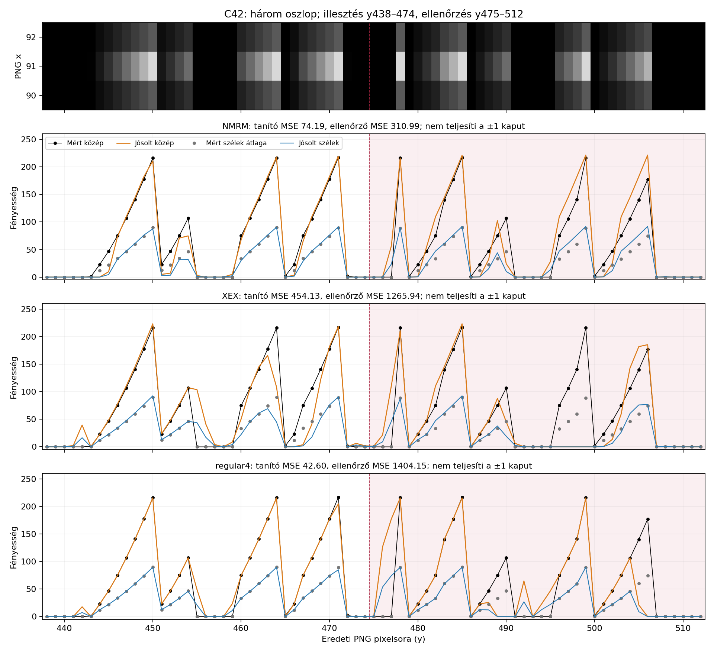
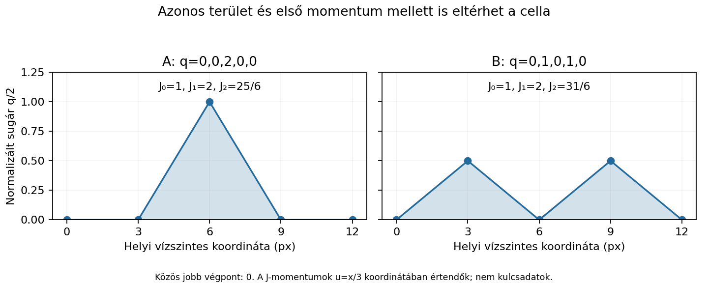
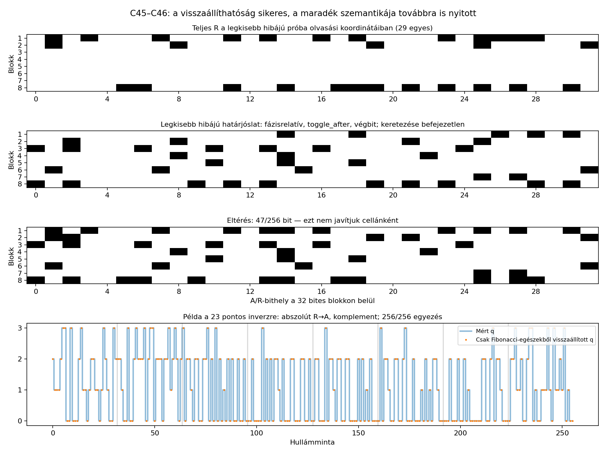

# Kutatási napló

## 2026-10-31 – árfolyam, morze, Fibonacci és hang

### Bemenet és bizonyítékok állapota

- Felhasználói célcím: `1crypto24HCr178iMcKd5iUi5D4rsg1nK`.
- A felhasználó a HALV képet a beszélgetéshez csatolta, és külön megerősítette,
  hogy az eredeti alkotói kép. A kép vizuálisan látható, de nem érkezett hozzá
  a programokkal használható fájlelérési út vagy letöltési azonosító. Az
  `/workspace/attachments`, `/mnt/data` és `/tmp` elérhető csatolmányhelyein
  sem találtunk képfájlt. Ez eszközhozzáférési korlát, nem annak állítása,
  hogy a felhasználó ne csatolta volna a képet. Nincs fájlhash, saját numerikus
  pixelmérés vagy rejtettadat-vizsgálat ebben a futásban.
- A teljes kapott előzmény: `sources/user_prior_notes.txt`. A szerzőre,
  dátumra, díjra, egyenlegre, 768 px szélességre, nyolc 96 px-es blokkra,
  59 lobuszra, 128 mintára és a korábbi sikertelen próbákra vonatkozó állítások
  ebből származnak. Ezek itt nem lettek önállóan igazolva.
- A „Cracked it … Fibonacci and morse code, and audio decryption” komment
  forráslink és bizonyíték nélkül érkezett. Vizsgálandó nyom, nem hitelesített megoldási út.
- `https://crypto.satori.digital`, `https://zden.art` és a feltételezett
  `https://crypto.satori.digital/cryptoHALV.png` lekérése a proxy
  `403 Forbidden` válaszával meghiúsult. Az utóbbi URL létezése sem igazolt.
  Nem kapcsoltunk ki TLS-ellenőrzést és nem kerültük meg a hálózati szabályzatot.
- A GitHub tároló kezdetben üres volt; a távoli lekérdezés sikerült, de nem adott refet.

### 1. A 2020–2024 közötti BTC-árfolyam hipotézise

**Közvetlen időrendi árfolyamgrafikonként gyenge hipotézis.** A képen vizuálisan
középvonalra tükrözött ágak és csökkenő amplitúdó látható, ár- és időtengely nélkül.
Ez nem önmagában kizárás: egy árfolyamot is lehet tükrözni, feleződő burkolóval
szorozni, megfordítani vagy differenciálni. Ilyen átalakításra azonban külön nyom kell.

Letöltött forrás: Coin Metrics nyilvános `btc.csv`, `PriceUSD` mező.
Az eltett kivonat 1572 napi sor, 2020-01-01–2024-04-20.
A teszt csak 2024-04-19-ig használ adatot, hogy ne használjon a feltételezett
megjelenési napon később keletkezett árfolyamot. A mai adatsor történeti
revíziókat is tartalmazhat; nem 2024-ben archivált adatváltozat.

Két előre rögzített kezdődátumot vizsgáltunk: 2020-01-01 és a 2020-as
felezés napja, 2020-05-11. Nyolc egymást követő, közel azonos számú napból
álló blokkot használtunk, illesztés nélkül.

| Ablak | Első napi ár | Utolsó napi ár | Blokkmaximumok az elsőhöz képest |
|---|---:|---:|---|
| 2020-01-01–2024-04-19 | 7170,63 USD | 63762,63 USD | 1; 3,94; 6,12; 6,52; 4,58; 2,74; 3,03; 7,05 |
| 2020-05-11–2024-04-19 | 8591,65 USD | 63762,63 USD | 1; 4,06; 4,23; 4,32; 2,54; 1,95; 2,01; 4,68 |

A korábbi feljegyzésben állított feleződő burkoló arányai ezzel szemben:
`1; 0,5; 0,25; 0,125; 0,0625; 0,03125; 0,015625; 0,0078125`.
A napi loghozamok blokkonkénti RMS-e sem mutat sorozatos feleződést.

**Korlát:** ez csak a közvetlen, időrendi, lineáris árfolyamburkoló egyszerű
ellenőrzése, nem képpontokkal végzett alakillesztés. Nem zárja ki az árfolyamból
valamilyen további, előre megindokolt transzformációval nyert jelet.
Program: `tools/check_price_hypothesis.py`; teljes eredmény: `data/price_check.json`.

### 2. A bal oldali kilenc jel mint morze

**Lehetséges, de még nem igazolt.** Kilenc függőlegesen elhelyezett jel is lehet
morze: a tájolás nem számít. Először az eredeti kép alapján a jelek magasságát és
a köztük levő üres szakaszokat kell megmérni, nem pusztán a fényerőt.

Standard időzítésben pont:vonal = 1:3, belső szünet:betűszünet:szószünet = 1:3:7.
Egy grafikus puzzle eltérhet ettől, de az eltérést külön igazolni kell.
Egyetlen globális küszöböt és olvasási irányt kell választani, nem betűnként
hangolni az osztályozást.

A korábbi jegyzet két külön jelsorozatot ismer:

| Feltételezett szöveg | Csoportosítva | Szünetek nélkül |
|---|---|---|
| XEX | `-..- . -..-` | `-..-.-..-` |
| NMRM | `-. -- .-. --` | `-.--.-.--` |

Ez nem pusztán eltérő betűhatár: a pont/vonal besorolás is különbözik.
Mindkettő kilenc jel, de mindkettőnek **200** lehetséges A–Z/0–9 olvasata van,
ha a betűhatárokat szabadon választjuk. A számítás nem képből dekódolás:
a kapott előzményben szereplő két feltételezett jelsort használja.
Program: `tools/check_morse_ambiguity.py`; eredmény: `data/morse_ambiguity.json`.

Ha csak a kilenc pont/vonal választás hordoz adatot, az legfeljebb kilenc bit;
a szünetek és hosszak további adatot hordozhatnak. Önmagában kilenc bináris
jel nem ad meg egy 256 bites magánkulcsot. Rövid utasítás vagy formátumjelölő viszont lehet.

### 3. Fibonacci: sorozat vagy hangkodek?

Érdemes különválasztani:

- Fibonacci-pozíciók, Fibonacci-hosszúságok vagy például 1, 2, 3, 5, 8 arányok
  keresése. Az 1, 2, 4, 8, … skálák **kettőhatványok**, nem Fibonacci-sorozat.
- Az Amiga IFF/8SVX Fibonacci-delta hangtömörítésének hipotézise.
  A szokásos 16 elemű deltatábla:
  `[-34,-21,-13,-8,-5,-3,-2,-1,0,1,2,3,5,8,13,21]`;
  a 8-as index nulla változás. A nulla delta nem feltétlenül nulla amplitúdó.

A −3…+3 képpontlépések puszta előfordulása nem bizonyítja ezt a kodeket:
interpolált görbe raszterezése is adhat ilyen kis egész különbségeket.
A pixelenkénti meredekséget nem szabad automatikusan eredeti hangminták
különbségének tekinteni. Kodekhipotézist egy globális modellből rekonstruált,
következetesen dekódolható mintasor vagy tényleges formátumadat támogatna.
Az előzményben említett fájlformátum- és szteganográfiai kizárásokat itt nem ismételtük meg.

### 4. Hangrekonstrukció és következő kísérlet

A hullámformaszerű ábra támogatja a hang irányát, de hangfájl ebből még nincs.
Az „audio decryption” lehet pontatlan elnevezés: tömörítés-visszafejtés,
hangszintézis és titkosítás különböző műveletek.

Különösen fontos: a képen ugyanazon x-hez tükrözött felső és alsó ág is tartozik.
Egy hangmintának egy időpontban egy értéke van. El kell dönteni, hogy ez
burkológörbe, két csatorna, szimmetrikus ábrázolás vagy más konstrukció;
a felső ág mechanikus hangként lejátszása önkényes félhullám-egyenirányítás lehet.

Következő, előre rögzített eljárás az eredeti PNG birtokában:

1. Eredeti bájtok, forrás-URL, SHA-256, méret és színmód mentése.
2. Bal oldali jelölő: mind a kilenc összefüggő jel kezdete, vége, közepe,
   magassága, köztes szünete; több küszöb és a mérési bizonytalanság mentése.
   Előbb az időzítési arányokat kell vizsgálni, csak utána a betűket.
3. A hullám pozitív és negatív ágának külön kinyerése, tükrözési hibával.
   Ellenőrizni a középvonalat, 768-as szélességet, 96-os blokkot és felezést;
   ezek jelenleg előzményből átvett számok.
4. Globális 3 px-es és 6 px-es mintavételi modell összevetése. Ne vezessünk be
   lobuszonként új időzítést. A megfigyelt rács nem feltétlenül szimbólumóra.
5. Első blokkokon illesztés, későbbieken előrejelzés, maradékhiba mentése.
   A kis amplitúdójú, utolsó blokkokat ne kezeljük ugyanolyan pontosként.
6. Csak a geometria után következzen a hang és a Fibonacci-delta teszt.
   A WAV fejléc mintavételi frekvenciáját hipotézisként kell jelölni;
   a sebesség szabad hangolása könnyen okoz belehallást.
7. Morzevizsgálat a hang amplitúdóburkolóján és frekvenciatartományában,
   egy globális időegységgel. Véletlen/eltolt kontrollokon ugyanaz a detektor.
8. Kulcsjelölt esetén a scalar tartományának és a tömörített, illetve
   tömörítetlen nyilvános kulcsból képzett P2PKH-címnek a pontos ellenőrzése.
   Ebben a futásban nem állítottunk elő és nem teszteltünk privátkulcs-jelölteket.

### Összegzés és akadály

A morzejelölő + hang + esetleges kodek irány célzottabb a közvetlen
árfolyamgrafikon-értelmezésnél, de egyik sem bizonyított megfejtés.
További numerikus képi bizonyítékhoz szükséges a már csatolt PNG bájtjaihoz
programozott hozzáférés: például fájlként elérhető melléklet vagy hozzáférhető,
igazolt letöltési URL. A korábbi 128 értékű mintasor és
mérőprogramok szintén hiányoznak. Jelenleg nincs ellenőrzött kulcs.

## 2026-10-31 – második menet: a kép előkerült, saját rekonstrukció és címegyezési teszt

### A korábbi képhozzáférési akadály feloldása

GitHub README-keresésben megtaláltuk a felhasználói előzményben idézett hosszú
geometriai szöveg forrását: `benjacasas02/independent-cryptography-research`.
Ez nem új, független bizonyíték ugyanazokra a geometriai állításokra.
A `research/zden/README.md` hivatkozása a lekéréskor 404-et adott.

Két másik nyilvános tárolóban tényleges képfájl található:

- `gpt4omni/unsolved-crypto-puzzles`
- `floflo777/open-crypto-puzzles`

Mindkettő útvonala: `2-mid-prizes/zden-haluska-halv-312ksats/clues/cryptoHALV.png`.
Mindkét letöltés 61566 bájt, SHA-256:
`3a487ebaeb4801137f09159a2d533046936cd395f4e2f7d115ac554607790e95`.
A PNG 950×950 képpontos, `L` színmódú. Vizuálisan megfelel a chatben látható
képnek. **Bájtszintű azonosságot a chatcsatolmánnyal vagy a szerző oldalán
lévő eredetivel nem igazoltunk.** A két tároló közös eredetű másolatot is őrizhet.
Részletes származás: `sources/image_provenance.json`.

Saját PNG-ellenőrzés: érvényes szignatúra, minden chunk CRC-je helyes,
az IEND után nulla bájt. Chunkok: IHDR, pHYs, IDAT, tEXt, IEND.
A komment a puzzle megnevezését, célcímét és a szerző elérhetőségeit tartalmazza.
Ez **nem** teljes szteganográfiai kizárás; bitplane/FFT vizsgálatot itt nem futtattunk.
Program és adat: `tools/inspect_png.py`, `data/png_structure.json`.

### Saját pixelmérés

A függőleges tükrözés három vizsgált tengelye közül y=475 adja a legkisebb
átlagos fényerőeltérést: 0,662 / 255. y=474-nél 2,482, y=476-nál 2,414.
A vizsgált tartományt a program rögzíti; ez csak az adott ROI eredménye.

Rögzített modellcsalád:

- felső és alsó, y=475-re tükrözött, egyenes szakaszokból álló görbe;
- csomópontokban `q ∈ {0,1,2,3}` nemnegatív amplitúdó;
- skála 32 hárompixeles lépésenként feleződik: 128, 64, …, 1;
- három globális kezdőfázis: x=91, 92, 93;
- 3 px és 6 px csomóponttávolság;
- külön 3 px-es modell kizárólag ±1 szomszédos állapotváltozással;
- minden szakaszhoz közelítő vonalprofil; dinamikus programozás választja ki
  a teljes minimumköltségű állapotsort. A csomóponti oszlopok kimaradnak a veszteségből.

Néhány mért modellhiba, 0…1 fényerőre számított átlagos szakasz-MSE:

| Kezdő x | Óra | Modell | MSE |
|---:|---:|---|---:|
| 91 | 3 px | szabad négyállapotú | 0,018728 |
| 92 | 3 px | szabad négyállapotú | **0,003055** |
| 93 | 3 px | szabad négyállapotú | 0,018816 |
| 92 | 3 px | csak ±1 változás | 0,032879 |
| 93 | 6 px | szabad négyállapotú | 0,025518 |

A hatpixeles modell legkisebb nyers hibája kb. 8,35-szöröse a hárompixeles
modellének. **Nem tekinthető formális valószínűségi modell-összehasonlításnak:**
eltérő a paraméterszám és a költségbe vett oszlopok halmaza. A 6 px-es spline,
lekerekített vagy más görbemodelleket ez nem zárja ki.

Az x=92-től hárompixeles modell **256 állapotot** ad. A négy állapot
darabszáma: q0=117, q1=34, q2=78, q3=27. A vonalprofil szélességét 0,85 és
1,15 szorzóra változtatva mind a 256 állapot változatlan maradt.
Ez korlátozott stabilitási próba, nem teljes rekonstrukciós bizonyítás.
Az utolsó, kis amplitúdójú blokk alternatív állapotaihoz jóval kisebb
költségkülönbségek tartoznak; ezeket a CSV/JSON megőrzi.

Fontos módosítás a korábbi irányhoz képest: a rögzített hárompixeles,
négyállapotú modellben **256**, nem 128 állapot van. Ez elvileg 512 nyers bit;
a kulcshoz vezető átalakítás nem ismert. Nem szabad egyszerűen 128 jól
meghatározott kétbites mintát állítani a mért sor helyett.

Mentett adatok:

- `data/pixel_measurements.json`: minden modell állapotsora, geometria és költség;
- `data/reconstructed_states.csv`: névleges modell 256 állapota, koordinátái és alternatívaköltsége;
- `data/reconstruction.png`: eredeti képpontok és illesztés az első blokkban,
  alatta a felezési skálától megszabadított állapotsor;
- `tools/measure_image.py`, `tools/plot_reconstruction.py`: reprodukáló programok.

### Bal oldali jelölő: a kilenc jel nem küszöbfüggetlen

A 90…92 oszlopokban, y=438…512 között mérve:

| Küszöb (szigorúan nagyobb) | Összefüggő jelek száma |
|---:|---:|
| 1 | 6 |
| 5, 10, 20 | 8 |
| 40, 80 | 9 |
| 120 | 7 |
| 180 | 6 |

40-es küszöbnél a jelmagasságok: `6,3,5,5,1,5,3,4,5` képpont.
A több sornyi fényerőrámpák szétvágása is létrehozhat külön jeleket.
Ezért a kilenc pont/vonal és az XEX/NMRM olvasat továbbra sem igazolt.
Minden nyers pixel és küszöbönkénti intervallum mentve:
`data/marker_pixels.csv`, `data/pixel_measurements.json`.

### Saját bitcoin-ellenőrző és tényleges kulcsjelöltek

A célcím Base58Check ellenőrzőösszege érvényes, mainnet P2PKH-verziója 0,
HASH160 tartalma: `06c84797d1f468b9d5773a61c80073b344df7470`.
`tools/bitcoin_oracle.py` kizárólag offline ellenőriz, pénzmozgatást nem végez.

Ismert válaszú teszt a privát skalár 1-gyel:

- tömörített: `1BgGZ9tcN4rm9KBzDn7KprQz87SZ26SAMH` – sikeres;
- tömörítetlen: `1EHNa6Q4Jz2uvNExL497mE43ikXhwF6kZm` – sikeres;
- nulla és a csoport rendjével egyenlő skalár elutasítása – sikeres.

Az ellenőrzött, előre meghatározott transzformációcsalád:

- a négy amplitúdóállapot összes nemkonstans bináris projekciója;
- az egymást követő állapotkülönbségek −3…+3 ábécéjének összes
  nemkonstans bináris projekciója, négy kezdeti állapottal;
- a négy állapot mind a 24 kétbites permutációja, az így kapott 64 bájt
  első/második fele, páros/páratlan bájtjai, a két fél XOR-ja,
  SHA-256 és dupla SHA-256 lenyomata;
- a nyers állapotbájtok és az ASCII-állapotsor kétféle lenyomata;
- a különbségek 8SVX Fibonacci-delta táblabeli indexeinek nibble-pakolása,
  mindkét nibble-sorrendben, annak negyedei és SHA-256 lenyomata;
- előre/hátra bejárás, bájtfordítás és a programban megadott komplementálás.

**1800 különböző, érvényes 32 bájtos skalár, mindegyikhez kétféle nyilvános
kulcs: nulla célcímegyezés.** A három vonalvastagság azonos állapotsora miatt
ezek nem három független jelöltkészletet jelentenek. A teljes deduplikált
jelöltkészlet SHA-256 lenyomata és a futási eredmény:
`data/candidate_check.json`. Program: `tools/check_reconstruction_candidates.py`.
Nem volt magánkulcs-találat. Nem futott teljes bizonytalansági keresés vagy
korlátlan transzformációkeresés. Ez a negatívum nem zárja ki a Fibonacci-hang irányt.

### A felhasználó új miner-revenue ábrája

A 2020…2024-es képrészlet címében „Miner revenue, USD” szerepel. Ez különbözik
a BTC árfolyamától és a blokkonkénti támogatástól. Az USD-napi bevétel a
kibocsátástól, a díjaktól, a blokkszámtól és az átváltási ártól is függ.
A kivágás teljes függőleges skálája, aggregációja és eredeti forrása nem ismert;
a képhez nem állítunk pontos adatillesztést.

Coin Metrics-adatból közelítő napi bevételt számoltunk:
`(IssTotNtv + FeeTotNtv) × PriceUSD`. Ez napi referenciaáron történő átváltás,
nem egy kész `RevUSD` mező: az aktuális CSV-ben ilyen mező nincs.

2020-05-11–2024-04-19 között nyolc egyforma napmennyiségű blokk maximumai,
az elsőhöz viszonyítva: `1; 4,20; 3,92; 3,53; 2,18; 1,81; 2,22; 4,31`.
Ez a közvetlen időrendi bevételburkoló sem ad ismétlődő felezést.
Átalakított bevételjel vagy a felezés mint tematikus kapcsolat nincs kizárva.
Mentett adat: `data/miner_revenue_daily.csv`, `data/miner_revenue_check.json`;
program: `tools/check_miner_revenue.py`; forrás: `sources/miner_revenue.json`.

### További munka pontos kiindulópontja

1. Az új állapotsor geometriai ellenőrzése más globális raszterezővel és
   a teljes képtartományon, beleértve a most kihagyott csomóponti oszlopokat.
2. A 6 px-es spline-modell összevetése: a pusztán egyenes 6 px-es modell
   rosszabb illeszkedése nem minden 128 szimbólumos modellt cáfol.
3. A bal jelölő fényerőrámpája és kitakarási maszkja szétválasztása;
   puszta küszöbözésből ne állítsunk elő biztos morzeüzenetet.
4. A hanghipotézishez a jel előjelét és időskáláját is igazolni kell.
   Ebben a menetben nem készítettünk állítólagosan „dekódolt” hangfájlt.

Módszertani korrekció a külső forrásokhoz: egy 118 bites megfigyelésből is
képezhető determinisztikusan 256 bites kulcs például SHA-256-tal. Az alacsonyabb
megfigyelt entrópia önmagában nem bizonyítja, hogy a képhez külső kulcsfél kell.
Hasonlóképp a 256 rekonstruált négyszintű állapot nem bizonyít automatikusan
512 független információbitet. A generátor és a kódolás továbbra is nyitott.

## 2026-10-31 – harmadik menet: négy alakzat és ötmintás WIF-olvasat

### Új támpont és forrásstátusz

A felhasználó szerint a szerző megoldásábráin az 1., 2. és 4. szinten
51 karakteres Base58 WIF, a 3. szinten 32 közvetlen kulcsbájt szerepel.
A szöveget a `sources/user_wif_lead_2026-10-31.txt` őrzi. Ezeket az ábrákat
ebben a menetben nem kaptuk meg fájlként vagy konkrét URL-lel, ezért nem
állítjuk, hogy saját szemrevételezéssel hitelesítettük a történeti állítást.
A WIF mint hipotézis ettől még tesztelhető.

A cbman0/BitcoinPuzzles két kapcsolódó README-jéből keresési kivonatot
mentettünk: `sources/earlier_levels_discovery.json`. Ezek másodlagos források.
A sorozatleírás HALV-ra „Solved” státuszt ír, miközben más források „OPEN”
státuszt adnak. Itt egyik sem mellékel hitelesített kulcsot; nem következtetünk
ebből megoldottságra.

### Saját mérés: négy alakzat a legalacsonyabb küszöbön

A korábbi mérés 1-es szigorú küszöbnél kezdődött. Most a `fényesség > 0`
esetet is hozzáadtuk ugyanahhoz a 90…92 oszlopos, y=438…512 ROI-hoz.
Az eredmény **négy** összefüggő tartomány, az intervallumvégeket beleszámítva:

| Kezdő y | Záró y | Hossz |
|---:|---:|---:|
| 443 | 454 | 12 |
| 460 | 472 | 13 |
| 478 | 490 | 13 |
| 496 | 506 | 11 |

Ez reprodukálja a felhasználó megfigyelését. A korábbi hatos számnál
`fényesség > 1` volt a feltétel, ami az 1 fényességű összekötő pixeleket elhagyja.
Frissítés: `tools/measure_image.py`, `data/pixel_measurements.json`.
A rekonstruált állapotsorok és modellköltségek változatlanok maradtak.
A küszöbfüggés önmagában sem nem bizonyítja, sem nem cáfolja a morzét.

### A pontosan tesztelt ötmintás család

Kiindulás: az x=92, 3 px-es, négyállapotú névleges modell 256 mintája.
`256 = 51 × 5 + 1`: az első vagy az utolsó mintát hagytuk ki, körbeforgatás
nélkül. Mindkét teljes olvasási irányt és csoporton belüli számjegysorrendet
vizsgáltuk.

| Család | Hipotézisek | Eredmény |
|---|---:|---|
| Öt négyértékű minta mint base4 számjegy, mind a 24 állapotpermutáció, nulla- és egyalapú indexelés | 384 | Mind kiesik a Base58-tartományból; legalább 40 hibás csoport az 51-ből |
| Az állapotok mind a 14 nemkonstans bináris projekciója, öt bit mint Base58-index | 112 | 112 különböző karaktersor, mind hibás ellenőrzőösszegű |

A 112 bináris olvasat közül négy kezdődik 5-tel, de ezek sem érvényes WIF-ek.
Öt bináris minta csak 32 értéket ad, tehát nem teljes Base58-karakterkód.
Egy konkrét WIF elvileg használhat részábécét, ezért itt ténylegesen
ellenőriztük az összes kapott karaktersor ellenőrzőösszegét.
Öt négyértékű minta 1024 kombinációja túl nagy a közvetlen Base58-indexeléshez;
az aktuális sorokon ez tényleges tartományhibaként jelentkezik.
Nem alkalmaztunk modulo 58-at, önkényes levágást vagy karakterjavítást.

### WIF-ellenőrzés és validálás

Az új dekóder ellenőrzi a Base58-ábécét, az 51/52 karakteres és 37/38 bájtos
hosszt, a dupla SHA-256 első négy bájtos ellenőrzőösszegét, a mainnet 0x80
verziót, a tömörítési jelölő 0x01 értékét és a privát skalár tartományát.

**Kilenc pozitív/negatív teszt sikeres:** a skalár 1 ismert 51 és 52
karakteres WIF-je; mindkettőn egy karakter elrontása; hibás verzió; hibás
tömörítési jelölő; nulla skalár; a csoport rendjével egyenlő skalár; tiltott
Base58-karakter. Az alap címellenőrző ismert tesztjei is sikeresek.

**Érvényes WIF: 0. Célcímegyezés: 0.** Nem jutottunk új, WIF-ből kinyert
kulcsjelölthöz; a 496 hipotézis nem 496 privátkulcs-ellenőrzés.
Teljes eredmény és determinisztikus hipotéziskészlet-hash:
`data/five_sample_wif_check.json`. Program: `tools/check_five_sample_wif.py`.

### A 59 = 51 + 8 értelmezés korlátja

A számazonosság továbbra is hipotézis. **A nyolc elválasztót a célkulcstól
független, mérhető szabállyal kell azonosítani**, majd a maradó lobuszokból
egyértelmű karakterértéket képezni. Nem választottunk önkényesen nyolc
eldobandó lobuszt, és nem kerestünk tetszőleges helyettesítési táblát.

A jelenlegi állapotsoron 63 nemnulla összefüggő szakasz van. Ez nem ugyanaz
a definíció, mint az előzményben említett 59 vizuális lobusz; nem kezeljük
az 59 megcáfolásaként. Az ötmintás teszt a szabályos mintasoron futott,
nem egy igazolt 59 lobuszos szegmentáláson.

A WIF-irány általában nem kizárt. A konkrét közvetlen ötmintás család ezen
a rekonstrukción nem működik. Előrelépést egy indokolt elválasztó-szegmentálás
vagy egy forrással alátámasztott karakterkód adhat; az ellenőrzőösszeg
utólagos „javítása” nem megoldás.

## 2026-10-31 – negyedik menet: teljes küszöbskála, hétbites rács, előjeles kontroll

### Átvett eredmények és saját futások különválasztása

A felhasználó részletes küszöbtáblát, feltételes NMRM-olvasatot, kilenc
hétbites értéket és egy 1200 jelöltes, 1067 különböző karaktersort adó külső
futás összegzését adta meg. A strukturált átirat:
`sources/user_marker_wif_update_2026-10-31.json`.
Az utóbbi futás pontos transzformációlistája, jelöltjei és az állítólagosan
használt első szintű ismert kulcs tesztvektora nem érkezett meg. Ezért a
1200/1067/0 számokat átvett eredményként őrizzük; nem saját végrehajtott
tesztként, és nem adjuk hozzá a saját jelöltösszegekhez.
A történeti megoldásábrák állításai változatlanul a felhasználó közléséből
származnak; ebben a menetben sem végeztünk saját hitelesítést az ábrákon.

### A küszöbtábla pontosan reprodukálható

A mentett 950×950-es PNG x=91 oszlopán, y=438…512 tartományban végigmértük
mind a 255 nemnulla egész fényességküszöböt. A feltétel most **fényesség ≥ T**.

| T tartomány | Összefüggő jelek |
|---|---:|
| 1 | 4 |
| 2 | 6 |
| 3…23 | 8 |
| 24…107 | 9 |
| 108…177 | 7 |
| 178…216 | 6 |
| 217 | 2 |
| 218…255 | 0 |

Az új tábla egyezik a felhasználóéval. A korábbi program **fényesség > T**
feltételt használt, ezért a tartományhatárok ott eggyel kisebbek voltak.
A kilences plató valóban **84 egymást követő küszöböt** fed le, nem egyetlen
kényelmes küszöbértéket. Ez erősíti a kilencalakzatos grafikus olvasatot,
de önmagában nem igazolja a morzekódot.

T=32 mellett a magasságok `6,3,5,5,1,5,3,4,5`, az üres szünetek
`1,5,2,6,2,2,5,2` pixelsor hosszúak. Legalább 4 pixeles vonással és
legalább 5 üres soros betűhatárral pontosan `-. -- .-. --`, azaz **NMRM**
adódik. Ez **feltételes dekódolás**, nem igazolt értelmes üzenet. Ezen konkrét
szabályok nem az XEX olvasatot adják; az XEX más besorolást/csoportosítást igényel.

### Kilenc hétbites egység: a számsor is egyezik

T=3 (`>=`) mellett az aktív oszlop y=444…506, mindkét végponttal együtt
**63 sor**. Felülről lefelé, csoporton belül legnagyobb helyiértékkel kezdve:

`127,120,31,63,1,63,60,15,63`.

Ezek nem mind Base58 ASCII-karakterek és nem mind 0…57 indexek.
Egy előre rögzített, kis átalakításcsaládot is lefuttattunk:

- 7 ciklikus fázis a 63 bites blokkon;
- előre/hátra teljes bejárás;
- komplementálás igen/nem;
- csoporton belüli bitrend megfordítása igen/nem.

Összesen **56 paraméterkombináció**. Egyik sem ad kilenc érvényes Base58
ASCII-karaktert, és egyik sem ad kilenc szabályos nullaalapú Base58-indexet.
Ez nem tetszőleges hétbites kódolás kizárása. A ciklikus fázis műveleti
hipotézis: nem jelent a képen kívül mért további pixeleket.
Program: `tools/check_marker_grid.py`; teljes adat és minden variáns:
`data/marker_grid_check.json`.

### Új geometriai kontroll: előjeles minták a tükrözött ágak mögött

A korábbi illesztés nemnegatív csomópontokból két tükrözött görbét rajzolt.
Ez nem engedett meg csomópontok közötti tengelykeresztezést akkor, ha
az eredeti, rejtett jel előjelet váltott volna. Ezt külön kontrollal vizsgáltuk.

Azonos közelítő vonalprofillal két előjeles ábécét engedtünk meg:
`{-3,-2,-1,0,1,2,3}` és `{-3,-1,1,3}`. Három órát/fázist vizsgáltunk:
3 px x=92, 6 px x=92, 6 px x=95. A globális tükrözési szabadságot az első
állapot nemnegativitásával rögzítettük; nulla állapot után további előjel-tie
maradhat. Az előjelsor nem tekinthető egyértelműen kinyert adatnak.

| Óra, kezdő x | Ábécé | Átlagos szakasz-MSE |
|---|---|---:|
| 3 px, 92 | −3…+3 | 0,003055 |
| 3 px, 92 | −3,−1,+1,+3 | 0,021439 |
| 6 px, 92 | −3…+3 | 0,022894 |
| 6 px, 92 | −3,−1,+1,+3 | 0,026080 |
| 6 px, 95 | −3…+3 | 0,021337 |
| 6 px, 95 | −3,−1,+1,+3 | 0,027095 |

A hárompixeles hétállapotú modell nem javít a névleges négyállapotú
illesztés hibáján; abszolút állapotai is azonosak a korábbi sorral.
A hatpixeles egyenes előjeles változatok nem közelítik meg ezt a hibát.
A különböző órák eltérő oszlopokat vesznek a költségbe, ezért ezek nem
formális likelihood-arányok. Spline-modellt nem teszteltünk.

A közös `fit` függvény ábécéparamétert kapott, az alapértelmezés változatlan.
A névleges modellt újrafuttatva a teljes eredménye **pontosan megegyezik**
a korábban mentettel. Program: `tools/check_signed_models.py`;
eredmény: `data/signed_model_check.json`.

Ebben a menetben nem állítottunk elő új privátkulcs-jelölteket.
Az ellenőrzött nyom most a kilences plató és a hétbites geometria;
egyik sem adott kulcsot vagy igazolt Base58-üzenetet.

## 2026-10-31 – ötödik menet: két alsó sarok, korábbi logók és lobuszok

### A felhasználó új iránya

A felhasználó jelezte, hogy korábbi szinteknél a sarkokban elhelyezett
rajzoknak szerepük volt a megoldásban, és csatolt egy Level 4-képet.
A bemutatott képen vizuálisan valóban megjelenik a rokon BTCrypto/ZDEN
embléma. Ehhez a csatolmányhoz sem kaptunk bináris fájlelérést, ezért
**Level 4-gyel nem állítunk pixelazonossági vizsgálatot**.

Ettől függetlenül letöltöttük a már ismert floflo777 tárolóból az 5. szint
`crypto5.png` és `crypto5fix.png` képmásolatait. Mindkettő 950×950-es;
források és SHA-256: `sources/level5_image_provenance.json`.
Ezek harmadik fél másolatai, nem a szerző oldaláról letöltött fájlok.

### Jobb alsó aláírás: mért közös és változó részek

A HALV jobb alsó aláírása a vizsgált 788…931, 806…929 tartományban kizárólag
0 és 255 intenzitású pixeleket használ. Itt nincs külön szürkeárnyalatos
intenzitáscsatorna; a geometriai vagy bináris adatrejtés ettől még lehetséges.

HALV és az 5. szint javított képe között, félig nyílt ROI-kkal:

| Rész | ROI [x0,y0,x1,y1] | Eltérő pixelek |
|---|---|---:|
| BTCrypto fejléc | [788,806,916,830] | **0** |
| Függőleges U/Z és a ZDEN sor | [868,832,932,890] | **0** |
| Bal függőleges szárak és lépcsőzés | [788,830,868,930] | 164 |
| Szintcímke környéke | [868,890,932,930] | 418 |

Az 5. szint eredeti és javított képe a fenti négy ROI-ban pixelre azonos.
A HALV két felső T-je egymással, és a függőleges két Z egymással is
azonos mintát ad. A közös betűk tehát nem különálló, HALV-specifikus
pixeleltérések. A nagy függőleges szárakat összekötő lépcső és a szintcímke
változását viszont nem söpörjük félre: utasításként is vizsgálandók.
A lépcsőzés összefér a felezés témájával; pontos műveleti dekódolást nem találtunk.

### Bal alsó sarok: a tényleges felirat és egy dátumhipotézis

A 20…50 oszlopokban, 925…929 sorokban nyolc 3×5 pixeles számjegy van.
A mért bitmapek olvasata **20042402**. Az 5. szint mindkét képén ugyanezen
a helyen **09111819** szerepel. A karakterenkénti bitminták a JSON-ban megvannak.

Ez nem a szokásos YYYYMMDD dátumrendezés. Egy egyszerű lehetséges formátum:
**DDMMYYHH**, vagyis `20.04.24, 02 óra`, illetve `09.11.18, 19 óra`.
A nap/hónap/év illeszkedik a két szint közölt megjelenési napjához.
A HALV 02 órája összefér a 2024-es Bitcoin-felezés közép-európai nyári
idő szerinti 02 óra körüli időpontjával is. **A formátumot és a szerző
óra-/időzóna-választását nem igazoltuk szerzői forrásból.** Más olvasat is lehet;
az eltérő sorrend önmagában nem bizonyít rejtett kulcsot.

### Ténylegesen ellenőrzött sarok-kulcsjelöltek

A HALV és ZDEN négy-négy nagy karaktere 7×9-es rácson mintavételezhető:
egy karakter 63, négy karakter **252 bit**. A HALV mezőben három 2×2-es
cella nem homogén, a ZDEN mezőben minden cella homogén. A látható
lépcsővonal betűmezőbe érő része is érinthet ilyen cellákat; ez nem három
önálló, bizonyított adatbit.

Előre rögzített, korlátozott tesztcsalád:

- négy globális 2×2 mintavételi szabály: bal felső, bármely fehér,
  minden fehér, illetve legalább két fehér pixel;
- karakterenkénti vagy soronként összefűzés, transzponálás és tengelyfordítások;
- 252 bit kiegészítése négy prefix-/suffixbittel, minden 16 értékkel;
- külön változatként karakterenként egy prefix-/suffixbit: négy 64 bites
  mező, mind a 16 kitöltéssel, előre/hátra karakterrendben;
- komplementálás;
- a dátum, az aláírás, a lépcsőzés és az 5. szinttel vett XOR kanonikus
  bitcsomagolásának SHA-256 és dupla SHA-256 lenyomatai;
- az olvasott `20042402`, illetve a hagyományos `20042024` és `20240420`
  ASCII-, BCD- és bináris decimális alakjának kétféle lenyomata.

**10386 különböző, érvényes skalár**, mindegyikhez tömörített és tömörítetlen
nyilvános kulcs: **nulla célcímegyezés**. Ez csak a megadott kódolási család
negatívuma, nem az aláírásban szereplő lehetséges műveleti utasításoké.
Minden jelölt determinisztikusan újra előállítható, a deduplikált készlet
hashét a `data/corner_check.json` tartalmazza.

Az ellenőrző standard tesztjein túl a másodlagos forrásban közzétett,
megoldott Level 5 32 bájtos kulcsával is ellenőriztük a címképzést.
Tömörítetlenül pontosan `1cryptoGeCRiTzVgxBQcKFFjSVydN1GW7` adódott.
Ez a címképzés új ismert-válaszú kontrollja, nem a HALV megoldása.
A történeti kulcs forrása:
`https://github.com/floflo777/open-crypto-puzzles/blob/HEAD/4-solved/zden-haluska-lvl5-555ksats/README.md`.

### Az 59 lobusz és a nyolc elválasztó kérdése

A külső 59 elemű alaklistát és negatív naplókat is archiváltuk:
`sources/external_data__lobe-shape-sequence.csv`,
`sources/external_analysis__tested.md`, `sources/external_analysis__leads.md`.
Származás: `sources/lobe_reference_provenance.json`. A külső mérési és
entrópiaállítások nem lettek ettől saját bizonyított eredményeink.

Saját, pontosan definiált szegmentálás: y=475 középvonal, x=91…858,
az adott küszöbnél sötétebb pixelek összefüggő szakaszai.
Az 1…4 küszöb mind **59** szakaszt ad. Az 5…32 tartományban 61,
33…64-nél 63, 65…119-nél 64 szakasz van. Az 59-es eredmény így valóban
reprodukálható, de nem minden küszöbön. Tartalmazza az első nyitott
lobuszrészt, és az egymásba mosódó kis végső hullámok nem mind elkülöníthetők.
Nem zárt topológiai bizonyítás a teljes hullám 59 szimbólumára.

Az 59 szakasz középpontja szerint a nyolc 96 px-es blokkba rendre
`5,7,11,9,9,9,6,3` darab esik. Nincs ebből adódó egyértelmű nyolc speciális
jel. A blokkonként egy elem eldobása pusztán az 51-es célszámhoz igazítana;
ilyen szabályra nem alapítottunk WIF-keresést.
Az összes intervallum, szélesség és mért csúcssor:
`data/lobes_centerline_t1.csv`. A küszöbplatók a `data/corner_check.json` fájlban vannak.
Az archivált külső D/O alaklistát még nem igazítottuk ehhez a szegmentáláshoz.
A mi első, nyitott szakaszunk felső csúcsa 100 feletti intenzitásnál négy
pixel széles, miközben a külső lista első jele D. Ez eltérő szegmentálásból
vagy csúcsdefinícióból is adódhat; a két 59 elemű felsorolás azonosságát
nem szabad pusztán az elemszámból feltételezni.

### Rövid, külön hexszöveg-kontroll

A korábbi 256 négyszintű minta mind a 24 kétbites címkézését két irányban
64 bájttá alakítottuk. Ellenőriztük, lehet-e ez 64 ASCII-hexadecimális karakter,
amelyből 32 közvetlen kulcsbájt adódna. A **48** változat legjobbja is csak
**15/64** szabályos hexkaraktert tartalmazott. Nem keletkezett ilyen kulcsjelölt.
Program és eredmény: `tools/check_hex_text.py`, `data/hex_text_check.json`.

A sarokmérések, a történeti összehasonlítás és a kulcsjelöltek közös
reprodukálója: `tools/check_corners.py`. Az összehasonlító ábra:
`data/corner_comparison.png`. Továbbra sincs ellenőrzött HALV-kulcs.

## 2026-10-31 – hatodik menet: összefüggéstérkép és több réteget összekapcsoló tesztek

### Kutatási módszer korrekciója és tartós memória

A felhasználó hangsúlyozta, hogy a jelek egymásra épülhetnek, egy képrész
lehet vezérlés vagy utasítás is, és a hullám szerepe sem előre eldöntött.
A korábbi közvetlen adat→kulcs negatívumok valóban nem tesztelték ezeknek
a kapcsolatoknak a nagy részét. Az irányt a
`sources/user_research_method_2026-10-31.md` őrzi.

Új közös térkép: `research/HYPOTHESES.md`, függőségi gráffal, modellazonosítókkal,
bemeneti szerepekkel és a megmaradó nyitott irányokkal. Az AGENTS.md
előírja ennek és a bizonyítékindexnek az elolvasását a későbbi munkamenetekben.
A `research/RUN_INDEX.json` a korábbi eredményeket és forrásokat is indexeli,
fájlhash-ekkel és egymástól elkülönített számlálási egységekkel.

Ez a módszertani változtatás nem bizonyítja előre, hogy melyik kapcsolat
helyes: a több réteg konkrét szerepeit továbbra is tesztelni kell.

### Előre rögzített modellcsalád

Az állandó paraméterleírás a futás előtt elkészült:
`research/models/composite_v1.json`. Az alábbiakat kapcsoltuk össze:

- **W:** a korábbi 256 négyszintű hullámminta, az ismert felezési skálától
  megszabadítva. Minden bijektív kétbites címkézés két 256 bites réteget ad.
- **M:** a bal jelölő két, egy sorral eltérő 64 soros ablaka, az öt mért
  platóhoz tartozó reprezentatív küszöbön. Négyszer ismételve, olvasási
  irányokkal és komplementálással **40 különböző 256 bites maszk**.
- **S:** a HALV/ZDEN négy 63 bites betűrácsa egy-egy kitöltőbittel 64 bites
  mezőkké alakítva; két globális mintavétel, olvasási irányok és kitöltések:
  **384 különböző 256 bites maszk**. A kitöltés szerepe hipotézis.
- **D:** a mért 20042402 nyolc számjegye nyolc 32 mintás blokk bal/jobb
  forgatását adja a minták kétbites értelmezése előtt. Ez gyenge, méretazonosságra
  épülő teszthipotézis; nem megfejtett dátumutasítás.
- **N:** a feltételes NMRM négy Morse-csoportjának gyökér=1, pont=0,
  vonás=1 faindexei **6,7,10,7**. Ezek négy 64 mintás negyed forgatásait
  vezérlik két irányban. A kezdő 1 megőrzi a Morse-jel hosszát; a szerep hipotézis.

### Lefuttatott láncok és pontos eredmények

| Modell | Műveletlánc | Különböző érvényes skalár |
|---|---|---:|
| C1 | W bitrétegei → M szerinti rétegválasztás vagy réteg XOR M → kulcs | 2384 |
| C2 | W bitrétegei → S szerinti rétegválasztás vagy réteg XOR S → kulcs | 21728 |
| C3 | S XOR M → kulcs; a hullám nem szerepel a láncban | 14592 |
| C4 | D szerinti blokkonkénti mintaforgatás → W rétegei → C1/C2 | 47512 |
| C5 | N szerinti negyedenkénti mintaforgatás → W rétegei → C1/C2 | 47800 |

Az első két modellben a maszk pozíciónként választhatja ki a magas vagy
alacsony bitet. A bemenetek összekapcsolása tehát már a kulcs előtt megtörténik;
nem az egyes képrészek külön-külön vett hash-einek összevetéséről van szó.
Kontrollként egy-egy bitréteg és a maszk XOR-ját is teszteltük.
A köztes 256 bitet nyersen és egyszeres SHA-256 után ellenőriztük.

A generálás 641280 próbát tartalmazott ismétlésekkel együtt. Az ismétlődések
kiszűrése után **134016 különböző érvényes skalár** maradt ebben a futásban;
**mindegyikhez tömörített és tömörítetlen nyilvános kulcsot** ellenőriztünk.
**Célcímegyezés: 0.** A standard ismert-válaszú címellenőrzési tesztek sikeresek.
Ezt a mennyiséget nem adjuk hozzá automatikusan korábbi futások számaihoz:
a futások közötti esetleges átfedést nem mértük.

A teljes bemeneti hashlista – a program és az állandó specifikáció hashével
együtt –, a családonkénti számlálók és a teljes deduplikált jelöltkészlet
hash-e: `data/composite_model_check.json`. A 424 maszk pontos bájtjai és
forrásműveletei: `data/composite_masks.json`. Futtató:
`tools/check_composite_models.py`. A műveletláncok és adatok alapján minden
jelölt újra előállítható. A futás bemeneti hash-eit utólag ellenőriztük:
mind megegyeznek a mentett állománnyal.
A végrehajtási napló: `data/composite_run.log`.

### Külön szerkezeti teszt: M 63 bitje és S 63 bites betűi

Az egyik közvetlenül mérhető méretkapcsolat, hogy a T=3 jelölő aktív
területe 9×7=63 sor, a nagy betűk pedig 9×7=63 mintacellát tartalmaznak.
Ezt nem csak kulcsellenőrzéssel, hanem **pontos fedvényegyenlőséggel** is
vizsgáltuk: előáll-e a jelölő a nyolc HALV/ZDEN betű valamely nem üres
részhalmazának XOR/OR/AND képeként?

C6: két globális cellamintavétel, négy tengelyfordítás, komplementálás,
öt jelölőküszöb, 255 nem üres betűrészhalmaz, három művelet:
**61200 összehasonlítás, ismétlődő mintákkal. Pontos egyezés: 0.**
Ez strukturális teszt, nem 61200 új privátkulcs-jelölt.

A legkisebb eltérés 5/63 bit, de ez a 178-as küszöb nagyon ritka maszkjánál
adódik, ahol az állandó nulla mintától is csak 9 bit az eltérés. Az 5 bites
közelséget ezért nem fogadjuk el kapcsolatként vagy megfejtett üzenetként.
A legközelebbi mintákat nem javítottuk kézzel, és nem vittük tovább kulcsként.
Eredmény és konstans kontrollok: `data/marker_glyph_relation.json`;
program: `tools/check_marker_glyph_relation.py`.

### A negatív eredmény hatóköre és nyitott kapcsolatok

Az eredmény csak ezekre az explicit mintavételi, maszk-, forgatási és
kulcsformálási láncokra vonatkozik. A jelölő ettől még adhat mintavételi
órát vagy dekóderutasítást; az aláírás vonalhosszai vagy sorrendje
szabályozhatják az olvasást; a hullám más generátorral is rekonstruálható.
WIF- és hangdekódoló láncot ez a futás nem vizsgált. A kétbites állapotok
rekonstrukciós bizonytalanságát sem terjesztettük ki.

A további kutatásnak ezeket a kapcsolatokat is nyitva kell tartania;
az egyedi vagy összekapcsolt tesztek sikertelensége nem indokolja egy teljes
képrész lényegtelennek minősítését. Továbbra sincs ellenőrzött HALV-kulcs.

## 2026-10-31 – hetedik menet: 1:3:7, hétsoros rács, BD → ½ és ellenőrzött időzítés

### Felhasználói adatok és a montázsok szerepe

A felhasználó két aláírás-montázst és több korábbi szint képét csatolta.
A HALV saját lépcsőzése és a megváltozott szintcímke a közös fejléc mellett
is önállóan vizsgálandó módosítás; a közös emblémarészek nem teszik ezeket
lényegtelenné. Az inline képek bináris fájlelérése továbbra sem áll rendelkezésre.
A saját mérések a már archivált HALV- és Level 5-képmásolatokon futnak.

Az új szöveges adatokat és a külső statisztikai eredményeket a
`sources/user_lattice_controls_update_2026-10-31.json` őrzi. A felhasználó
560 dátumpermutációra, 30 modellre közölt 2,3%/34,6%, illetve 2000
lobuszelőjel-kontrollra közölt 48,9% arányai **átvett eredmények**: az eredeti
program, pontszám és seed hiányában ezeket a konkrét kontrollfutásokat
nem állítjuk saját reprodukált kísérletnek. Az alábbi C7 más, teljesen
specifikált kontrollprotokoll; nem helyettesíti ezeket az eredményeket.

### Saját pixelmérés: mindkét új jelölőolvasat reprodukálható

x=91-ben a legalább 178 intenzitású lokális csúcsok:
`450,464,471,478,485,499`, intenzitásuk `216,216,217,216,217,216`.
A párosított csúcsok közös közepe **474,5**. Különböző távolságaik:
`3,5;10,5;24,5`, arányuk pontosan **1:3:7**.
A szomszédos csúcsok távolsága `14,7,7,7,14`, legnagyobb közös osztója **7**.
A hullám korábban illesztett 475-ös középvonala és e csúcspárok 474,5-ös
közepe külön mért mennyiség, nem szabad automatikusan azonosítani őket.

A 450…499 közötti nyolc rácshely: `10111101 = 0xBD`. Ez bitfordítva is
ugyanaz, ami a már ismert tükrözési szimmetria következménye.
Az y=506 helyen **177** intenzitású további csúcs van. A nyolcbites modell
nem magyarázza meg önmagában ezt a kilencedik, gyengébb csúcsot.

Leíró kontroll: a nyolc rácshely hat aktív pozíciós részhalmazai közül
1/28, kilenc rácshelynél 2/84 ad szimmetrikus 1:3:7 távolságokat.
**Ez nem p-érték**: a küszöböt, a rácsot és az ablakot a látott képből
választottuk. A radiális távolságok nem automatikusan Morse-hangidőtartamok.

### Új műveleti kapcsolat: BD és a féljel

Python szabványos kódlapjaival ellenőrizve `0xBD` a Latin1/ISO-8859-1 és
Windows-1252 kódolásban **„½”**. UTF-8-ban ugyanez a jel **C2 BD**, nem
önmagában BD. A kódlap kiválasztása és a jel műveleti használata hipotézis,
de ez egy konkrét, a HALV és a lépcsőzés felezési témájához illő kapcsolat.

**C8:** M → BD → „½”/nyolc blokkvezérlő → minták felezése → kulcs.
Tíz rögzített mintakiválasztás: globális páros/páratlan, első/második fél,
blokkonként első/második fél, valamint BD és komplementere által vezérelt
blokkfél- vagy páros/páratlan választás. Minden esetben 128 négyszintű
minta marad, ami 256 bitre képezhető. További változatként a nyolc BD-bit
egy-egy 32 mintás blokk magas/alacsony bitrétegét választja.
24 állapotcímkézés, irányok, bájtsorrend, nyers és SHA-256 véglegesítés.
**2112 különböző érvényes skalár, két nyilvánoskulcs-formátum, nulla címegyezés.**
Specifikáció és eredmény: `models/bd_halving_v1.json`, `data/bd_halving_check.json`.

**C9:** a felezés páronkénti számítást is jelenthet. Három párosítás
(szomszédos, teljes jel két fele, blokkok két fele) és kilenc rögzített
művelet szerepelt: átlag lefelé/felfelé/párosra kerekítve, abszolút különbség,
minimum, maximum, XOR, modulo 4 összeg és különbség. Az amplitúdóértékeken
végeztük az aritmetikát, és csak utána a 24 kétbites címkézést.
**5184 különböző érvényes skalár, két nyilvánoskulcs-formátum, nulla címegyezés.**
Ez az unsigned burkoló hipotetikus párosítása, nem bizonyított PCM- vagy
8SVX-dekódolás. Specifikáció és eredmény: `models/halving_pairs_v1.json`,
`data/halving_pairs_check.json`. Futtatók: `tools/check_bd_halving.py`,
`tools/check_halving_pairs.py`. Az egyes futások darabszámait nem összegezzük
globális egyedi kulcsszámként; a futások közti átfedés nincs kimérve.

### Fibonacci/exponenciális kompatibilitás és a közölt Morse-tábla

Az FFmpeg hivatalos 8svx.c forrásából kiolvastuk a két dokumentált táblát:
`sources/ffmpeg_8svx.c`, származása `sources/ffmpeg_8svx_provenance.json`.
A nyolc blokkon belüli 8×31=248 változásból **248 Fibonacci-kompatibilis**,
**225 exponenciális-kompatibilis**; a 23 hiányzó átmenet mind ±3.
Blokkonként az exponenciális táblából hiányzó változások száma:
`4,4,4,2,2,3,1,3`.
A 0…3 állapotok különbsége szükségszerűen −3…+3, tehát ez nem független
bizonyíték a használt kodekre. Tényleges IFF/8SVX-adatfolyam nem került elő.

A felhasználó négy közvetlen Morse-hosszmérési sorát pontosan reprodukáltuk,
egy mintát egységnek véve, szélső futamokat is beleszámítva:

| Aktivitás | Szabályos jel / összes | Szabályos szünet / összes |
|---|---:|---:|
| q > 0 | 42/63 | 40/63 |
| q ≥ 2 | 39/61 | 33/61 |
| q = 3 | 21/24 | 6/25 |
| globális delta ≠ 0, kezdő False mintával | 29/61 | 47/62 |

Az utolsó sor a globális 255 különbségből és egy kezdő nulla aktivitásból
adódik. Ez **nem azonos** a 248 blokkon belüli különbséggel; a két protokollt
külön őrizzük. Nem állítunk közvetlen tiszta Morse-jel megfejtést.

### C7: jelölőből származó időegység és helyi átmeneteket megőrző kontroll

A futás előtt rögzített protokoll: `models/timing_lattice_v1.json`.
Öt aktivitás (a fenti négy és blokkonként visszaállított változásjelző), két
polaritás és három fizikai időegység: **3 px** mintarács, **3,5 px** radiális
egység és **7 px** csúcsrács. Összesen **30 modell**. Ez az aktivitási
proxyk időzítését vizsgálja, nem visszafejtett audiofájlt.

A veszteség a legközelebbi 1/3 jelhossz és 1/3/7 szünethossz egységben
mért négyzetes eltérésének átlaga. Az első és utolsó futamot csonkolhatja
a képhatár, ezért ezeket kihagytuk. A pontszám az olvasási irányra invariáns;
a két irány nem lett új független időmodellként felszámolva.

Seed: **20261031**. Két, egyenként 2000 különböző kontrollsort adó család:

- a q értékek keverése minden 32 mintás blokkon belül;
- véletlenített Euler-bejárás ugyanazon blokkbeli átmenetgráfon. Ez megőrzi
  minden rendezett állapotpár darabszámát, a blokk kezdő/végállapotát és
  állapotgyakoriságait. Minden előállított blokknál assert ellenőrizte ezeket.

Az Euler-módszer egy megadott, **nem egyenletes** referenciamintavétel;
az arányokat nem állítjuk egzakt permutációs p-értéknek. A legjobb modell
kiválasztását minden kontrollon ugyanúgy elvégeztük mind a 30 modellből.
Az egész korábbi kutatás sok utólagos döntésére ez nem ad globális korrekciót.

A megfigyelt minimumveszteség **0,1943877551**. Legjobb aktivitás q≥2,
7 px egységgel; mindkét polaritás azonos. Az add-one referenciaarány
`(1 + legalább ilyen jó kontrollok)/(2000+1)`:

| Kontroll | Arány |
|---|---:|
| értékkeverés | 0,3998% |
| átmenetmegőrző Euler | 0,29985% |

Ez a rögzített kontrollokhoz képest szabályosabb időstruktúrát mutat,
de **nem Morse-specifikus eredmény**. A legjobb modell hozzárendelése:
59 rövid + 1 hosszú jel, 55 rövid + 5 háromegységes szünet,
**nulla hétegységes szünet**. Az egyszerű, mindkét szerepnél csak 1/3
hosszt engedő nyelvtan pontosan ugyanazt a veszteséget adja; a jel és
szünet felcserélése sem változtat az eredményen. Az RMS eltérés 0,441 egység,
tehát a szekvencia abszolút illeszkedése sem hibátlan.
Ez nem cáfolja a Morse lehetőségét, de ebből az eredményből nem azonosítható
egyedül a Morse-kódolás vagy a szerző szándéka.

Eredmény: `data/timing_lattice_check.json`; a kontrollok minden modellre
kapott pontszámai: `data/timing_surrogate_scores.npz`; diagnosztika:
`data/timing_specificity.json`; ábra: `data/timing_lattice_controls.png`.
Futtatók: `tools/check_timing_lattice.py`, `tools/diagnose_timing_specificity.py`.

**Egyetlen teljes képet előrejelző jelgenerátor, visszafejtett hang,
ellenőrzött Morse-üzenet vagy HALV-kulcs továbbra sincs.** A BD/féljel,
a lépcsőzés, a jelölő rácsa és a hullám kapcsolata nyitott, konkrétan
nyilvántartott kutatási lánc marad.

## 2026-10-31 – nyolcadik menet: Level 5 teljes pozitív kontroll, HALV 64×12 px

### Mi lett most újonnan, saját képméréssel igazolva?

A felhasználó a megoldott Level 5 64→32 páronkénti összegzését javasolta
erősebb alkotói előzménynek. A korábbi saját kontrollunk csak a közzétett
kulcsból történő címképzést ellenőrizte. Most **a képtől a kulcsig vezető
teljes láncot** is reprodukáltuk. A támpontot a
`sources/user_level5_pairing_lead_2026-10-31.md` őrzi.

A letöltött másodlagos megoldásleírás és geometriai referencia:
`sources/level5_README.md`, `sources/level5_data__rectangle-measurements.csv`;
URL és hash: `sources/level5_solution_provenance.json`. Az elsődleges
echo.ls cikkre a leírás hivatkozik; azt ebben a menetben nem olvastuk.
A közölt megoldási dátumot nem ellenőriztük külön láncadatokból.

### A Level 5 képből reprodukált eljárása

1. A már archivált 950×950-es crypto5fix.png képen, az emblémát és a
   bal alsó utasítást kizáró ROI-ban 66 fehér összefüggő komponens van.
   Közülük 64 lyukas téglalapkeret, kettő egysoros segédvonal.
2. A kereteket függőleges közép szerint nyolcas sorokra, azon belül x szerint
   rendeztük. A külső szélesség/magasság, külső/belső/keretterület
   **mind a 64 téglalapnál egyezik** a közzétett referenciával.
3. A bal/jobb, illetve felső/alsó vastagságokat a keretek középvonalán
   fehér pixelfutamként mértük. Mindegyiknél a szemközti vastagságok egyeznek.
4. A két segédvonal a megfelelő téglalap alatt pontosan négy üres sorral
   található, vízszintes középvonaluk legfeljebb 1 px eltérésű.
   Ezzel a geometriai szabállyal, a kulcstól függetlenül rendeltük őket hozzá:
   **#40: W=33 helyett 17**, **#53: W=20 helyett 6**.
5. Minden téglalapra a publikált képletet alkalmaztuk:

   `X = (10*valódi_szélesség + bal_vastagság - 1)/64`

   `Y = (10*magasság + felső_vastagság - 1)/64`

   `érték = round(X*Y)`.

6. A 64 kerekített területet sorfolytonosan, szomszédos párokban összeadtuk.
   Mind a 32 összeg 0…255 közé esik. A 32 bájt **pontosan megegyezik**
   a publikált kulccsal, és tömörítetlenül pontosan a régi
   `1cryptoGeCRiTzVgxBQcKFFjSVydN1GW7` címet adja.

A maximális kerekítési maradék 0,14453125, tehát minden érték 1/6-on belül
van egy egészhez. A segédvonalak figyelembevétele a teljes lánc része;
nem pusztán „64 adat összeadása” oldja meg a régi képet.
Ez nem HALV-találat, hanem ellenőrzött történeti pozitív kontroll.

Program: `tools/verify_level5_geometry.py`; teljes mért tábla:
`data/level5_remeasured_rectangles.csv`; képletek, korrekciók, a 64 érték,
32 összeg, ismert történeti kulcs és cím: `data/level5_geometry_verification.json`.

### C10: 64 HALV-egység, normalizálás, majd 32 közvetlen összeg

Rögzített specifikáció: `models/pair64_v1.json`.
768 px = 64×12 px; a névleges 3 px-es rekonstrukció négy mintája jut
egy cellára. Nyolc amplitúdóblokk × nyolc cella egy 8×8 elrendezést ad.
A 12 pixeles cellahatárok viszont nincsenek függetlenül megjelölve a képen:
ez továbbra is tesztelt, nem bizonyított adatbontás.

Két adatcsaládot kezeltünk külön:

- **Base4:** négy négyszintű minta egy 0…255 közötti érték. A 24 globális
  címkézés, két olvasási irány és két négyes-számjegysorrend 96 profilt ad.
- **Geometria:** minták összege, konstans mintatartás területe, lineárisan
  interpolált sugár-/teljes átmérőterület és négyzetes energiaösszeg.
  A lineáris területeknél 91 és 92 px-es cellaeredetet is vizsgáltunk;
  a széleken a legelső/utolsó illesztett értéket tartottuk állandónak.
  Lefelé/felfelé/legközelebbi párosra kerekítés és irányok: 42 profil.

Összesen **138 darab 64 értékes profil**, teljes számsorral archiválva:
`data/pair64_profiles.json`. A cellák négy mintája, identitás-base4 értéke
és fő területolvasatai a `data/halv_64_cells.csv` fájlban vannak.
A geometriai értékek a névleges illesztésből számított hipotézisek, nem
függetlenül igazolt eredeti vektorgeometriai adatok.

Négy párosítás: szomszédos, teljes 64-es sor két fele, minden nyolccellás
amplitúdóblokk két fele, valamint 8×8 transzponálás után szomszédos.
Hét rögzített normalizálás/összegzés: közvetlen összeg, összeg felezése
három kerekítéssel, értékek külön felezése két kerekítéssel, illetve
külön megjelölt modulo 256 bájttúlcsordulási kontroll.
Nem használtunk hash-véglegesítést vagy tetszőleges osztókeresést.
A Level 5 konkrét 10/64 együtthatóinak HALV-beli jelentését nem feltételeztük.

**3864 paraméterkombináció, 2846 különböző érvényes skalár**, mindkét
nyilvánoskulcs-formátummal: **0 HALV-címegyezés**.

### A bájttartomány külön, kriptográfiától független korlát

A normalizálás nélküli base4-értékek páronkénti összege **mind a 384**
irány/címkézés/párosítás kombinációban túllépi a 255-öt legalább egy helyen.
A legjobb tartományilleszkedésnél is **kettő a 32-ből** túl nagy.
Példa egy ilyen, nem javított olvasatra: 270 és 412 két összege.
Az identitás szerinti első két cella 149 és 188, amelyek összege 337.
Ez közvetlen, mérhető akadály ennek az egyszerű byte→összeg olvasatnak.
Nem javítottunk ki két önkényes mezőt a célcímhez igazítva.
A 64-egységes általános modell ettől még nyitott: más lehet az adatérték
képzése, a geometriai korrekció vagy a normalizálás.

Eredmény: `data/pair64_check.json`; külön tartománydiagnosztika:
`data/pair64_range_diagnostics.json`. Programok: `tools/check_pair64.py`,
`tools/diagnose_pair64_ranges.py`.

### C11: BD-vezérelt blokkfelezés a párok összeadása előtt

A Level 5 kontroll megmutatja, hogy mellékelt geometriai jelölés csak egyes
adatértékeket is korrigálhat. Ezt nem vittük át önkényes hibajavításként:
a HALV-ban már mért **BD nyolc bitje** jelöli ki a felezendő nyolccellás
blokkokat. Külön változat a hat aktív vagy a két inaktív hely kiválasztása.
Az integer értékek felezését három globális kerekítés követi, utána a négy
párosítás szerinti **közvetlen** összeg. Túlcsorduláskor elutasítás;
nincs modulo, hash vagy célcímhez igazított mezőjavítás.

Specifikáció: `models/bd_pair64_v1.json`. **3312 paraméterkombinációból
754 különböző érvényes skalár**, mindkét nyilvánoskulcs-formátummal:
**0 HALV-címegyezés**. Ezeket nem adjuk hozzá automatikusan más futások
számaihoz, mert a futások közötti átfedés nincs meghatározva.
Eredmény: `data/bd_pair64_check.json`; program: `tools/check_bd_pair64.py`.

### Következő pontosan megfogalmazott kérdés

A történeti **mérés→jelölő általi korrekció→normalizálás→64 érték→32 összeg**
lánc most valóban teljesen visszaellenőrzött. A HALV-nál a hiányzó láncszem
az, hogy egy 12 pixeles egységből melyik geometriai/kódolt mennyiség lesz
a helyes normalizált adatérték, és ezt hogyan szabályozza a saját aláírása.
A 64×12 felosztás és a BD-féljel együtt ezt a kérdést motiválja, nem
azonosítja már megoldottként.

Összehasonlító ábra: `data/pair64_control_comparison.png`, reprodukálója
`tools/plot_pair64.py`. Ellenőrzött HALV-kulcs továbbra sincs.

## 2026-10-31 – kilencedik menet: fázistörvény, oszlopokra bontott predikció és két aktív kutatási ág

### A felhasználó új nyoma és a párhuzamos kutatási irány

A felhasználó kéri az új fázis-/bitsíkos és a korábbi geometriai/páronkénti
irány együttes folytatását. Ezt az AGENTS.md és HYPOTHESES.md is rögzíti.
A közölt adatokat a `sources/user_phase_lead_2026-10-31.json` őrzi.
A korábbi kutatási ágak és negatív eredményeik megmaradtak.

A 3–7. blokkok páratlan mintaszámai és fázisai pontosan reprodukálhatók.
A magas bitsík is pontosan a felhasználó által megadott sor:
`8e461863c4fdddddb33aa2922156463262ccc28858cc4118112019b072701250`.
Ez kísérleti adatsor, nem megfejtett kulcs; a közvetlen olvasat nem ad célcímet.
A felhasználó 1216 jelöltes futását pontos paraméterei és programja hiányában
nem állítjuk saját reprodukált tesztnek, és nem keverjük a saját futásszámokkal.

### Új összefüggés: az egyedi leggyakoribb fázis mind a nyolc blokkban szabályos

Az indexek nullaalapúak. Az egyes sorok a 32 mintás blokkon belüli j mod4
pozíciókat jelölik. A „leggyakoribb” itt móduszt jelent, nem feltétlenül többséget.

| Blokk | Páratlan minták fázisonként [0,1,2,3] | Leggyakoribb fázis | Más fázisokon összesen |
|---:|---|---:|---:|
| 1 | [2,5,6,3] | 2 | 10 |
| 2 | [2,5,2,0] | 1 | 4 |
| 3 | [5,0,0,0] | 0 | 0 |
| 4 | [0,0,0,2] | 3 | 0 |
| 5 | [0,0,3,0] | 2 | 0 |
| 6 | [0,6,0,0] | 1 | 0 |
| 7 | [3,0,0,0] | 0 | 0 |
| 8 | [4,4,4,5] | 3 | 12 |

Tehát **minden blokk egyértelmű módusza** `r_b=(2-b) mod4`, azaz
`2,1,0,3,2,1,0,3`. Az első és utolsó blokkban a módusz mindössze egy
mintával vezet a következő fázis előtt; ezt a bizonytalanságot nem hallgatjuk el.
A középső öt blokkban a szabály kizárólagos. Az első kettőben és az utolsóban
a többi fázis adatait nem javítottuk ki és nem minősítettük zajnak.

A szigorú középső szabály `(j+b) mod4=2`; a globális i=32b+j indexszel
ugyanez `(i+b) mod4=2`. Ez blokkonként egy plusz logikai számlálólépést,
33 pozíciós logikai értelmezést is felvet. De ebből nem következik nyolc
független hiányzó minta. Ha a blokk végpontja a következő blokk első
fizikai pontja, az előző skálában rendre `1;1,5;0;0;0;0;0;0` adódik.
A második blokk 1,5-ös végpontja ellentmondana egy végig egész négyszintű
33-pontos forrásnak. Teljes generátorszabályt ebből még nem azonosítottunk.

### C12: rögzített fázisreferenciák

Specifikáció: `models/parity_phase_v1.json`.
Mind a 4^8=65536 független blokkonkénti fázisforgatást felsoroltuk;
a blokktartalmat és annak belső mintázatát megtartva, csak az illeszkedés
fázisát változtatva. A vizsgált szabályt a kontrollon is kiválasztottuk.

- Bármely ötblokkos ablakon, négy meredekség és négy kezdőfázis mellett
  (64 modell) a megfigyelt kizárólagos szabályhoz legalább ilyen jó
  kontroll 1024/65536 = **1,5625%**.
- A mind a nyolc blokk móduszára illesztett affine fázisszabálynál
  (16 modell) pontosan illeszkedő kontroll 16/65536 = **1/4096**.

Ezek az adott feltételes fázisreferencia pontos arányai, **nem a teljes
kutatásra korrigált p-értékek**, és nem bizonyítják a szerző szándékát.
A nyolcblokkos móduszszabály ebben a menetben észrevett további megfigyelés,
nem előzetesen vakon rögzített felfedezés.

### Képi ellenőrzés: valódi oszlopfelosztás ugyanazon modellben

A korábbi névleges fit a mintapontok közötti +1 és +2 oszlopokat már
felhasználta az állapotok kiválasztásához. A 496 blokkon belüli oszlopon
kapott korábbi kis maradék ezért itt nem független validálás.
A felhasználó 0,0404 amplitúdóegységű hibáját és 0,858 kontrollmediánját
a pontos középvonalbecslő hiányában nem reprodukáltuk; az alábbi egység
**normalizált pixelintenzitás-MSE**, tehát a számok közvetlenül nem összevethetők.

C12-ben frissen illesztettünk csak a +1 oszlopokon, és a +2-ken mértünk,
majd felcseréltük a szerepeket. Mindegyik irányban 248 illesztési és
248 ellenőrzési oszlop volt; a 7 blokkközi átmenet oszlopai kimaradtak.

| Illesztés / ellenőrzés | Ellenőrzési pixel-MSE | 1000 blokkon belül kevert sorrend mediánja |
|---|---:|---:|
| +1 / +2 | 0,00306927 | 0,05102909 |
| +2 / +1 | 0,00312957 | 0,05163618 |

**Mindkét friss illesztés pontosan ugyanazt a 256 állapotot adta**, mint a
névleges fit, a paritás-/móduszminta is változatlan. A szomszédos oszlopok
korreláltak, és azonos közelítő vonalprofil-modellt használunk; ez nem új
képen vagy új raszterezőn történő független ellenőrzés.

A költségfüggvényt ellenőrzésként újraszámoltuk: az eredeti 256 állapot és
az eredeti célfüggvényérték egyezik a mentett baseline-nal.

### Mi történik, ha az egész hullámra kizárólagossá kényszerítjük a fázist?

A fázison kívüli páratlan állapotokat tiltó illesztést a képre, a célcímtől
függetlenül futtattuk. Az első blokk lokális pixel-MSE-je kb. **10,72-szeres**,
a másodiké **4,55-szeres** lenne. Ezeket nem lehet egyszerűen kitisztítani
a középső kizárólagos szabály kedvéért.

Az utolsó blokkot a várható 3-as fázisra korlátozva 13 állapot változik;
a lokális MSE kb. **2,82%-kal** nő. Ez egy külön, struktúrával regularizált
forrásjelölt lehet, nem a valódi eredeti adatok bizonyítása. A nyers sor
mindig megmarad mellette. A teljes célfüggvényben ez kb. 0,95% növekedés;
az összes blokkra kényszerített szigorú modell kb. 336% növekedést okozna.

### Három csatorna pontos megőrzése

A névleges sor minden bitjét megőrző felbontás:

- H: magas bit, 256 bit;
- F: az előre jelzett fázishelyeken vett alsó bit, 64 bit,
  hexben `dd7adc5062d713ae`;
- E: minden további alsó bit, 192 bit. Ezek közül 120 (a középső öt blokk
  nem-fázishelyei) nulla; a szélső három blokkban 72 bit marad vizsgálandó,
  sorrendben `6918b840081418af6a`.

E nem 26 bites mező: **192 pozíciójában 26 darab 1 van**. Az első két és
utolsó blokkhoz tartozó 72 bit összesen 9 bájt, de nem azonosítottuk formátumát.
Az F középső 40 bitje `1101110001010000011000101101011100010011`;
futamai között 2 és 5 is van, így a közvetlen 1/3/7 Morse-olvasat nem tiszta.
A felbontás tömör empirikus szerkezet, nem teljes forráskódoló azonosítása.

### C13: a fáziság összekapcsolása a korábbi 64→32 kutatással

Specifikáció: `models/phase_decode_v1.json`. Két forrás: a névleges sor,
illetve a képi fáziskényszerrel kapott utolsó blokk. Öt adatolvasási nézet:
eredeti, négyes csoportonkénti és blokkonkénti ciklikus fázisigazítás,
utóbbi kettő az összes blokkra vagy csak a középső ötre. A nézet a forrás
értékeit átrendezi; nem célcím alapján módosít mintákat.

| Ág | Lánc | Különböző skalár a futáson belül |
|---|---|---:|
| nibble | a magas/alsó bitsík nibble-jei és a fázisbit rögzített algebrai kombinációi → 32 bájt | 640 |
| pair64 | fázisolvasat → 64 base4-érték → a korábbi párosítások/normalizálások → 32 összeg | 22448 |
| codec_pair64 | H-nibblesor és opcionális flag-módosítás → Fibonacci vagy exponenciális dekódermag → 64 érték → szomszédos összegek | 143458 |

A dekódermagban az archivált FFmpeg forrás szerint **minden lépés után
0…255-re telítés** szerepel, nem moduláris prediktor-túlcsordulás. A
csomagolt adat alacsony nibble-először sorrendjét külön vizsgáltuk. Az ismeretlen
kezdő unsigned prediktor teljes 0…255 tartományát teszteltük.
Három ismert eredményű dekóderellenőrzés futott, köztük alsó/felső telítési
esetekkel; mind sikeres. Ez nem tényleges IFF/8SVX-fájl azonosítása.

**166546 különböző érvényes skalár** ebben a futásban, mindkét P2PKH
publikuskulcs-formátummal: **0 célcímegyezés**. Nincs hash-véglegesítés.
A számot nem adjuk hozzá korábbi futások darabszámaihoz globális egyediként.
Az ismert címképzési tesztek is sikeresek.

### C14: a 64 bites fázismező egyszerű ellenőrző szerepei

Külön, kulcskeresés nélküli adatkapcsolati teszt: F előáll-e a H-nibble
négy bitjének valamely affine paritásfüggvényeként? Illetve egyezik-e F
négy megnevezett CRC64 (ECMA182, WE, XZ, GO-ISO) valamelyikével a H-adat
nyers bájtjain vagy hexszövegén, a programban rögzített irányváltozatokkal?
Nincs pontos egyezés. A négy CRC-implementáció ismert `123456789`
ellenőrzővektorát sikeresen ellenőriztük. A közeli mintákat nem fogadjuk
el dekódolásként. Ez nem zár ki más ellenőrző-, titkosítási vagy metadataszerepet.

### Párhuzamosan megtartott geometriai értelmezés

A BD-féljel után `q/2 = H + L/2` pontos azonosság. Az alsó bit ezért fél
egységnyi geometriai korrekcióként is értelmezhető; nem szükségszerűen
vezérlőbit. Ez közvetlenül kapcsolódik a korábbi Level 5-ben igazolt
korrekció→normalizálás→kerekítés→páronkénti összeg modellhez.
A HALV esetén a megfelelő geometriai mennyiség, skála és a kerekítés
sorrendje továbbra is igazolandó. A C13 pair64 ága az adatolvasási kapcsolatot
teszteli, de nem helyettesíti a C10/C11 nyitott terület-/aláíráskalibrációját.

### Mentett bizonyítékok

- `data/parity_phase_check.json`, `data/parity_phase_audit.png` – C12,
  teljes fázis- és oszlopillesztési adatok;
- `data/phase_law_diagnostics.json`, `data/phase_channels.png` – nyolcblokkos
  móduszszabály, lokális költségek, megőrzött bitmezők;
- `data/phase_decode_check.json`, `data/phase_decode_run.log` – C13,
  bemeneti hash-ek, jelöltkészlet-hash és ágonkénti eredmények;
- `data/phase_field_consistency.json` – C14 strukturális ellenőrzések;
- `tools/analyze_parity_phase.py`, `tools/diagnose_phase_law.py`,
  `tools/check_phase_decode.py`, `tools/check_phase_field_consistency.py`,
  `tools/plot_phase_channels.py` – reprodukálás.

**Mindkét kért kutatási ág aktív és összekapcsolt marad.** A domináns
fázis mind a nyolc blokkra kiterjedő megfigyelés, de a teljes generálószabály,
az extra alsó bitek szerepe és az ellenőrzött HALV-kulcs még nincs meg.

## 2026-10-31 – tizedik kör: közös végpont, pontos törtek, lépcsőmérés

A felhasználó engedélyével folytattuk a két összekapcsolt kutatási ágat.
Az eredeti 256 állapot és minden korábbi számítás változatlanul megmaradt.
Új specifikációk: `models/boundary33_v1.json`, `models/fractional_area_v1.json`.
A modellek az új futások előtt kerültek fájlba; ez munkameneten belüli
rögzítés, nem külső előregisztráció. Bemeneti hash-ek a JSON-eredményekben.

### C15 – 32 intervallum nem azonos 32 csúccsal

A 92+3i rács 256 illesztett csúcsa 92…857 között **255 intervallumot és
765 px csúcstávolságot** ad. A 256×3=768 ezért nem bizonyít 256 teljes
geometriai intervallumot. A 64×12-es felosztás lehetséges cellázás, de a
széleken extrapolációt vagy más forrásmodellből eredő értelmezést igényel.
A közösen használt 33. pozíció önmagában csak indexelési lehetőség;
nem új, független képi adat.

Közelítő, véges szegmensekből álló raszterizálót használtunk, szimmetrikus
felső/alsó görbével. A vonalprofil rögzített; három globális szélességskálát
(0,85; 1; 1,15) az első négy blokk belső csúcskörnyezetein hasonlítottunk
össze. Tanítóadat alapján 0,85 adódott; a második négy blokk külön ellenőrzés.
Az egyes blokkhatárokra nem hangoltunk külön vonalvastagságot.

A hét határnál a szomszédos négy oszlop szolgál a külön végpont kiválasztására,
a határoszlop az ellenőrzés. Az előző blokk 0…3 egészértékű végpontját két
rajzolási móddal vizsgáltuk: függőleges összekötés, illetve külön útvonalak.
Hat határnál a legjobb külön végpont geometriailag azonos a közössel;
ezeken nincs modelleket elkülönítő bizonyíték.

**Az x=284 határ viszont elkülönít:** a következő blokk első mintája 3,
feleakkora skálán, tehát az előző skáláján 1,5. A folytonos görbe ellenőrző
MSE-je a kiválasztott 0,85 skálán 0,0009921; a tanítóoszlopokon legjobb
külön egész végponté 0,0526678. A másik két vonalskálán is a folytonos
görbe a jobb. Ez a vizsgált független egész végpontok ellen szól, nem a
logikai 33-helyes forráskezelés általános kizárása.

A hullám végén a 859. oszlopban még 16/255 fényesség van, a 860.-ban a
468…482 ROI minden pixele fekete. A 857-nél lezárt modell MSE-je 0,0000607;
a 860-ig levágás nélkül hosszabbított modellé legalább 0,08209 ugyanott.
A terminális mérés szűk, hullámra korlátozott ROI-t használ: az első helyi
fejlesztési változat túl magas ROI-ja az aláírást is bevonta volna, ezt
az eredmény értelmezése előtt javítottuk. A végső JSON a helyes ROI-t és
az eredeti ellenőrző oszlopok összes fényességértékét őrzi.

Korlát: ez továbbra is közelítő raszterizáló és rögzített névleges állapotsor.
Más ecsetvég, levágás vagy rajzolás előtti transzformáció nincs kizárva.
A paritásóra eredetét ez a teszt nem oldja meg; a fáziság aktív marad.

### C16 – q/2 = H + L/2 geometria, kerekítési sorrenddel

Mind a 61 alsó egyes geometriai hozzájárulását megtartottuk, beleértve
a fázison kívüli E-adatokat. Két külön koordinátahipotézis:
normalizált csúcsok interpolációja; illetve az eredeti blokkskálával
megszorzott csúcsok interpolációja. Utóbbi a fizikai geometriát jelenti.
A q/2 magasság és a csak H magasság külön, kontrollált adatág.

64 darab 12 px-es cella, 91 és 92 px-es kezdőpont, sugár/átmérő terület.
A határokon konstans végpont-folytatást deklaráltunk; ez feltevés, nem mérés.
**Minden interpoláció és integrál racionális számokkal pontos**, nincs korai
lebegőpontos kerekítés. Négy párosítás, két olvasási irány, floor/ceil/
legközelebbi páros/legközelebbi felfelé kerekítés. Külön receptekben a
területeket kerekítjük és összeadjuk, illetve az összeget kerekítjük.

- Az L/2 tag 91-es igazításnál 47, 92-esnél 45 cella területét módosítja.
- A normalizált sugárterületek összes korrekciója mindkét igazítással
  pontosan 183/2 = 61×3/2. Az összes alsó egyes hozzájárulása megmarad.
- 512 kerekítési sorrendpár közül 388 ad eltérő 32 értéket, helyenként
  legfeljebb 1 különbséggel. Ez a fizikai, bájtként érvénytelen recepteket is
  tartalmazó strukturális összehasonlítás, nem 388 külön kulcstalálat.
- 16 értékprofilból 1024 recept; a 512 fizikai területrecept mindegyike
  legalább egy helyen túlcsordul. A másik 512 recept 404 különböző érvényes
  skalárt ad. **0 célcímegyezés**, mindkét P2PKH-formátumban.

Nincs önkényes osztókeresés, modulojavítás vagy hash-véglegesítés. Három
ismert integrál, 24 ismert kerekítési eset, négy teljes párosítási partíció,
256 cellán az Area(H)+Area(L/2)=Area(q/2) azonosság, továbbá a címképzés
meglévő ismert esetei sikeresen ellenőrizve. Minden recept és az egzakt
64-értékű profilok elmentve. A negatívum a specifikált láncra vonatkozik;
a valós mennyiség és a normalizálás képi indoka továbbra is hiányzik.

### A lépcső külön, nyers koordinátamérése

A 788…867 × 830…929 ROI bináris. A legalább négy fehér pixeles vízszintes
futamokat kimérve, az azonos szomszédos sorokat összevonva öt vonalpár van:

| Bal x | Y-sorok | Közép y | Megfigyelt szélesség |
|---:|---|---:|---:|
| 794 | 879–880 | 879,5 | 18 |
| 810 | 903–904 | 903,5 | 18 |
| 826 | 917–918 | 917,5 | 18 |
| 842 | 923–924 | 923,5 | 18 |
| 858 | 926–927 | 926,5 | 10, a ROI levágja |

A bal végpontok x-lépése pontosan 16 px; az y-középtávolságok 24,14,6,3.
Ebből még nem állítunk pontos felezőképletet vagy öt adatszintet. A felirat
területébe eső folytatás külön geometriai elemzést igényel. Ez megőrzött
adat az aláírás lehetséges utasításszerepéhez, nem elvetett mellékág.

### Következő megkülönböztető feladat

A fázisóra esetén olyan **logikai** előfeldolgozó szabály kell, amely
megmagyarázza a blokkonkénti +1 indexeltolást, de nem igényel a képen
nem látható egész amplitúdójú pluszcsúcsokat. A geometriai ágon a lépcső
teljes folytatását és rajzolási rácsát kell összekötni egy mérhető skálával;
a 64 értéket csak ilyen indokolt korrekció után érdemes újra összepárosítani.
A két ágban az összes bit, a BD-jelölő, a dátum és az aláírás megmarad.

Mentés: `data/boundary33_check.json`, `data/boundary33_audit.png`,
`data/fractional_area_check.json`, `data/fractional_area_profiles.json`,
`data/fractional_area_recipes.json`, `data/fractional_area_audit.png`,
`data/signature_staircase_geometry.json`; reprodukálás a megfelelő tools/
programokkal és `tools/plot_boundary_fraction.py`-jal.

**Ellenőrzött HALV-privát kulcs ebben a körben sem került elő.**

## 2026-10-31 – tizenegyedik kör: új felhasználói adatok, nullahely és jutalom

Munka közben új szöveg érkezett, majd külön lépcső–fázis és blokkjutalom
észrevétel. A teljes feltöltött szöveg mentése:
`sources/user_layered_notes_20261031.txt`; a két további üzenet állításainak
kivonata a megfelelő `sources/user_*_note_20261031.md` fájlokban.
Korábbi ágakat és eredményeket nem töröltünk. Új modellek C17–C19.

### C17 – a közölt megfigyelések saját reprodukciója

A 8. blokk0,7,14,21,28 és a 2. blokk6,14,22,30 helyein valóban nulla van.
A három szélső blokk állapotentrópia-átlaga1,879613 bit/minta, a középső
öté1,446816; az előbbi pontosan a három legnagyobb entrópiájú blokk.
Az56 hármas közül ez adja a legnagyobb különbséget; leíró eredmény,
nem független jelentőségteszt, hiszen ugyanazon adaton választottuk ki.

A nullahelyekre előre fájlba rögzített feltételes kontroll: mind a nyolc
blokkban minden2…10 periódus minden legalább4 pozíciós maradékosztálya,
pontos-nullaság feltétellel. Teljesen nulla osztály esetén a pontszám a
hisztogramot megőrző nullmodell szerinti fix rács valószínűségének negatív
logaritmusa.20000 blokkon belüli permutáció, rögzített173105 seed;
minden kontrollnál újrakeressük a teljes család maximumát.

A 8. blokk hétes mintájának szintjét476/20000=2,38%, a 2. blokk nyolcas
mintájáét1223/20000=6,115% kontroll éri el valahol a családban. A legerősebb
mért nullahelyrács viszont a 3. blokk négyes periódusa,1-es fázisa;
annak szintjét174/20000=0,87% éri el. Ez **feltételes, feltáró referencia**,
nem az összes korábbi hipotéziskeresést tartalmazó p-érték, és nem külön
Morse-bizonyíték. A teljes kontrollpontszámokat NPZ-ben őrizzük.

A20042402 számjegyenként felezve10021201; nemnulla-maszkja10011101=9D,
aBD-től egy bitre. Az560 különböző átrendezésből60 ad legalább ilyen
egyezést:10,714%. Maga a felezés a nemnulla-maszkot nem változtatja,
ezért a maszkegyezés nem a felezés lépését igazolja. A két maszk szélső
blokkokon vett101 egyezése sem új, független bizonyíték.

A szövegben említett1032,10368,35436 kulcspróba forrásprogramjai csak
fájlnévként szerepeltek; ezeket nem saját, reprodukált futásként jelentjük.
A Codex Protocol Fibonacci-mod5 módszerét konkrét forráslink hiányában
egyelőre felhasználói történeti állításként tartjuk számon.

### C18 – fontos javítás: a3+1 valóban lehet veszteségmentes

Az új lépcsőképlet **nullahelyfázist** ad: a középső ötben1,0,3,2,1.
A korábbi **páratlanfázis**0,3,2,1,0; a kettő egy pozícióval különbözik.
Az összes blokkra kiterjesztett nullahelyfázis3,2,1,0,3,2,1,0.
A kijelölt helyeken a nullaszám3,5,8,8,8,8,8,4 a nyolc cellából.
Az első blokkban3 nullával másik fázis is holtversenyes, a többiben
egyedi maximum. Ezt a különbséget a táblázat és ábra is jelzi.

A középső40 négyes mindegyikében a z-fázis teljes mintája nulla,
két másik minta páros, az r=z−1 fázis mintája tetszőleges0…3. Így a négy
magas bitből egy fix nulla; csak **három magas bit és egy alsó bit** változik.
Az előző gyors megjegyzés, amely öt változó bitet feltételezett, hibás volt;
ezt a nullahelymérés alapján javítottuk a jelentésben és az adatmodellben.

Kanonicitási választás: növekvő helyi pozíció szerint a három nem-z magas
bit, majd az r alsó bitje. Öt32 bites köztes sor:
`f76dd5a4`, `43ad8c64`, `63dcc298`, `79cd4339`, `22412af1`.
Mind a40 cella, összesen160 eredeti állapot pontosan visszakódolható.
Ezek köztes adatok, nem igazolt kulcsdarabok.

Megőrzött **teljes veszteségmentes ábrázolás**:44 bájt, blokkhosszak
8,8,4,4,4,4,4,8. A három szélső blokk minden nyers kétbitese megmarad;
a középsők a fenti négybites cellakódot használják. Az eltárolt bájtokból
visszaolvasva mind a256 állapot pontosan egyezik. Fájl:
`data/layered_lossless44.bin`, SHA-256
`6613982c04744eaba5ebcf0fc7fdff6f5fc83da3ecd7163fef59542b5fbc91e5`.

A929,5 referenciából a magasságok50,26,12,6,3; a log2 egészrésze5,4,3,2,1.
A nullahelyfázis mind az öt helyen egyezik. Ugyanezek az egészrészek a
referencia **[928,5;930,5)** tartományában végig változatlanok, tehát
nem egyetlen tizedespontos referencia választásán múlnak. Ugyanakkor a
képlet az adatok ismeretében született; a feleződő sor önmagában is
csökkenő logaritmus-egészrészeket ad. Nem tekintjük önálló szándékbizonyítéknak.

Kulcslánc: három szélső blokk BD szerinti H/L választása, annak fordítottja,
valamint mindenütt H/L kontroll; a középső négy bit24 közös permutációja,
két cellairány, két blokkon belüli bitirány és két teljes blokksorrend.
**768 különböző érvényes skalár,0 címegyezés**, mindkét P2PKH-formátumban.
Nincs hash, utólagos moduláris felezés vagy blokkonként hangolt permutáció.
A kiválasztás mellett kihagyott96 szélső bitet minden szabálynál külön
eltároltuk; lehetséges utasítás-/korrekciószerepük nyitott marad.

### C19 – jutalomsor és fázis együtt értelmezve

A felhasználó50,25,12.5,6.25,3.125 BTC sora jó tematikus értelmezést ad.
A mért magasság mínusz jutalom pontosan0,1,−1/2,−1/4,−1/8 px;
MSE=17/64 px², RMS=**0,5153882032 px**, maximális eltérés1 px.
Ezt saját egzakt számítás reprodukálja, külön per-lépcső korrekció nélkül.

Az ideális jutalmak logaritmusának egészrésze is5,4,3,2,1. A jutalomtéma
és a nullahelyfázis azonossága tehát együtt igaz; a tematikus magyarázat
nem teszi semmissé a mért fáziskapcsolatot. A kulcshoz szükséges műveleti
értelmet viszont egyik sem bizonyítja önmagában.

További pontos arány: a középső öt hullám amplitúdóegysége32,16,8,4,2;
mindegyiket25/16-dal szorozva a jutalomsor adódik. Az összes blokkra
kiterjesztve200,100,50,25,12.5,6.25,3.125,1.5625 keletkezik. Ez az első
két helyen matematikai visszafelé extrapoláció, **nem történelmi jutalom**;
a3+5 felosztás szerepét nem igazolja automatikusan.

A geometriai ágban a fizikailag mért területekre a25/16 és reciprok16/25
tényezőt külön tartományellenőriztük. Minden profilban marad legalább256-os
cella már lefelé kerekítve is; mivel minden korábbi párosítás minden
nemnegatív területet felhasznál, közvetlen bájtösszeg továbbra sem lehet.
Ez tiszta tartománykorlát, ezért új célcímpróbákat nem indítottunk rá.
További, képi indokkal bíró normalizálási lépésre lenne szükség.

### Friss kutatási sorrend és mentések

Elsőként olyan közös előállítási szabályt érdemes keresni, ahol a fázis a
függőleges skála kettes kitevőjéhez kötött: z=e mod4, r=e−1 mod4. Ez az
új adat jobb kiindulópont, mint kizárólag hiányzó33. csúcsot feltételezni.
A három szélső blokk összes192 bitjét megőrizve kell eldönteni, mi vezérlés,
mi kulcsadat és mi korrekció. Az öt középső160 bit immár veszteségmentes
kiinduló adat. A BD/dátum, Fibonacci/Morse/hang és a64→32 geometriai ág
megmarad, de új tesztet a teljes lánc konkrét, egységes képlete indokoljon.

Új bizonyítékok: `data/layered_structure_check.json`,
`data/layered_zero_surrogates.npz`, `data/signature_phase_decode_check.json`,
`data/signature_phase_decode_recipes.json`, `data/signature_phase_audit.png`,
`data/layered_lossless44.bin`, `data/reward_staircase_check.json`;
a megfelelő tools/ programok és models/ specifikációk mellett.

**A privát kulcs továbbra sincs meg.** A legerősebb új, ellenőrzött
eredmény a középső állapotok veszteségmentes3H+1L leírása, valamint a
jutalom-, skála- és nullahelyfázis közös, számszerűen ellenőrzött kapcsolata.

## 2026-10-31 – tizenkettedik kör: minden cellára egységes kétcsatornás szabály

A felhasználó újabb megfigyelése a12 nemnulla, kijelölt nullahelyről érkezett.
Állításkivonat: `sources/user_exception_layer_note_20261031.md`.
Modell: `models/uniform_phase_layers_v1.json`, C20, a futás előtt mentve.

### Saját ellenőrzés és a pontos kivételfogalom

Mindhárom maszk10011011,10100010,01001110 és azEAA,ETE,ES közvetlen
0-elválasztós Morse-olvasat egyezik. Az érintett64 mintából52 nulla,
9 egyes,3 kettes. A16 affine modulo4 törvény sorrendjében z=(3−b)mod4
52 nullával első, a második38. ABD és a11000001 blokkmaszk3/8 egyezésű.

A teljes3+1 feltételt cellánként külön ellenőrizve **44** cella szabályos,
**20** eltérő. A középső40 mellett a2. blokk1,3,5 és a8. blokk0 cellája
is szabályos, nullaalapú cellaszámozással. A40+24 csak a középső/szélső
területek száma; nem mind a24 szélső cella sérti a feltételt.

### Két csatorna, blokkfüggő külön algoritmus nélkül

Minden négyesben ugyanaz a bitkivonatolás:
z=(3−b)mod4, r=z−1mod4, b nullaalapú;
**A4** a három nem-z magas bit növekvő pozíciósorrendben, majd L[r];
**R4** H[z], majd a három nem-r alsó bit növekvő pozíciósorrendben.

Az A és R nyolc bitje együtt az eredeti négy kétbites állapot puszta,
invertálható átrendezése. Mind a64 cella,256 állapot pontosan visszaáll.
A64 nibble32 bájt; R középső40 nibble-je nulla. R szélső24 nibble-je
12 bájt: `3221c2782080402406127552`. Együtt újabb44 bájtos, teljes
veszteségmentes ábrázolás. A tényleges eltárolt bájtokat is visszaolvastuk
és a képzett csatornákkal pontosan egyeztettük.

Ez egységesebb a C18 szélső H/L kiválasztásánál: minden cellára azonos
szabály vonatkozik. Ugyanakkor invertálható szétválasztás, **nem a kivételek
értékét előrejelző jelgenerátor**. A32 bájtos főcsatorna sem igazolt kulcs.

R-ben29 egyes bit marad. Ebből3 darabH[z] a kettes kivételekben,
9 darabL[z] az egyes kivételekben, további17 pedig más nem-r, nem-z
pozícióban van. Ezért önmagában a12 kivételes minta nem tartalmazza
a teljes második réteget. Az összes maradékbitet megőrizzük.

### Kontroll és korlátozott közvetlen kulcsteszt

A16 affine törvényhez20000, blokkon belüli nullahely-permutációt vizsgáltunk,
minden blokk hisztogramját megtartva,201031 seed mellett. Minden kontrollban
újraszámoltuk az összes16 törvényt, a legnagyobb értéket és az első–második
különbséget.0 kontroll ért el52 nullát,0 ért el14-es különbséget. Ez
**feltételes referencia**, a korábbi teljes keresést nem korrigálja.
A0/20000 nem nulla valószínűség; plusz-egy becsléssel1/20001 az alsó
felbontás. A teljes maximum- és különbségsorozat NPZ-ben megmarad.

A főcsatorna24 közös bitpermutációja, cellák és blokkon belüli bitek
fordítása, eredeti/fordított blokksorrend:192 recept,96 különböző
érvényes skalár. **0 célcímegyezés**, mindkét P2PKH-formátumban, hash és
maradék alapján hangolt javítás nélkül. A negatívum a főcsatorna ezen
közvetlen olvasataira vonatkozik. A12 bájtos maradék feltételezett
utasítás-, korrekció- vagy más adatkapcsolati szerepe nyitott marad.

Mentések: `data/uniform_phase_layers_check.json`,
`data/uniform_phase_layers_recipes.json`, `data/uniform_affine_surrogates.npz`,
`data/uniform_primary32.bin`, `data/uniform_edge_residual12.bin`,
`data/uniform_lossless44.bin`, `data/uniform_phase_layers.png`;
reprodukálás: `tools/check_uniform_phase_layers.py`, `tools/plot_uniform_layers.py`.

A következő előrelépéshez R szerepét kell **egységes, előre megadott**
művelethez kötni és lehetőleg új képoszlopokat vagy részmintákat jósolni vele.
Fibonacci/hang/Morse műveletet ennek indokolt helyére érdemes tenni.
Az R egyszerűen elhagyva nem adta a kulcsot. Az eddigi geometriai terület-,
BD-, dátum- és aláírásadatok továbbra is megvannak a közös térképen.

## 2026-11-01 – tizenharmadik kör: a 12 bájt előrejelzése és a tail-ROI javítása

A felhasználó a teljes maradék szerepének levezetését kérte, a geometriai
és Fibonacci–hang–Morse ágak megőrzésével, majd a kutatási kör befejezését.
A C21–C23 specifikációk futás előtt fájlba kerültek. Az eredeti mérések
és a C20 ábrázolása megmaradt; az új eredmények nem írják felül a régi JSON-okat.

### C21 – két koordinátakeret, visszatartott teljes blokkok

A C20 növekvő fizikai pozíciósorrendjét és az r-fázishoz forgatott
sorrendet külön kezeltük. A relatív változat főbitjei H[r], H[r+2], H[r+3], L[r],
maradékbitjei H[z], L[z], L[z+1], L[z+2]. Mindkét keretben pontos a 256
állapot visszakódolása. A fázishoz igazított maradék 12 bájt:
`5114a1784080104106127552`; az abszolút továbbra is
`3221c2782080402406127552`.

Mindkét keretben 10 olyan A-érték van, amelyhez több eltérő R tartozik.
Például az abszolút 9-es A-hoz 0, 2, 3 is előfordul. Ez egyértelműen kizárja
a pozíciófüggetlen, memóriátlan R=f(A) szabályt ezen a felbontáson.
A négybites A affine bináris függvénye sem konzisztens a teljes adaton.

Előrejelzési család: aktuális/előző/következő A 4-4 bitje, blokkindex 3 és
cellaindex 3 bitje, összesen 18 bemenet. Minden R-kimenetre legfeljebb 3
XOR-tag, opcionális komplement, minimum tanítóhibával és rögzített
egyszerűségi sorrenddel választva. Az 1976 jelöltet kimenetenként a tanító
adatokon hasonlítottuk össze. Külön 1., 2., 8. egész blokk volt kihagyva;
a tanítás 56 cella, az ellenőrzés 8. A szomszédos A megengedett bemenet,
a kihagyott R-értékek nem szerepelnek a modellválasztásban.

Mindkét keretben a minimumhibás szabály és a tanító többségi lookup is
nulla R-t jósolt az összes kihagyott cellán. Ez 4/24 teljes cellát és 67/96
bitet talál el, de **a 29 nemnulla R-bitből és 12 nemnulla nullahelyből egyet
sem állít helyre**. Nem értékeljük pozitív eredményként a nullákból adódó
bitpontosságot. A nulla-osztály dominálja ezt a célfüggvényt; más,
nemlineáris vagy súlyozott család ettől még nincs kizárva.

A főcsatorna-kulcs kontrollja 192 skalár, két P2PKH-formátummal: 0 egyezés.
Ebből 96 az előző C20 kontrollkészlet pontos ismétlése, hash-azonossággal
ellenőrizve; 96 a mostani relatív keret új változata. A darabszámot nem
adjuk hozzá más futásokhoz globális egyediként. Nincs hash-véglegesítés.

### C22 – teljes csomagra rögzített ellenőrzőkódok és rekurziók

A 32 adatbájt + 12 maradékbájt rövidített RS(44,32) lehetőségét vizsgáltuk
két GF256 mező-/generátorváltozattal és 0/1 kezdőgyökkel. A két keretben
96-96 egyedi A- és R-olvasatot adott a 24 közös bitpermutáció és az előre
megadott irányok. **73728 teljes 12 bájtos összevetés, 0 egyezés.**

Külön ellenőrzőbankok: CRC32 IEEE, Castagnoli, BZIP2, MPEG2 és Adler32.
Három deklarált felosztás: a három szélső szó önálló ellenőrzése;
első 16 / utolsó 16 / teljes 32 bájt; szélső 12 / középső 20 / teljes 32 bájt.
Mindkét szó-bájtsorrenddel és azonos olvasati családdal **552960 teljes
96 bites összevetés, 0 egyezés**. Ezek ellenőrzőkód-előrejelzések,
nem privátkulcs-próbák, és nem fednek le minden lehetséges ECC-/CRC-kódot.

A három 32 bites R-szó első kettőjéből az összeadó Fibonacci-rekurzió
mod 2^32 a harmadikat sem közvetlen következő elemként, sem a tényleges
7-es blokkindexre léptetve nem találja el, egyik bájtsorrendben sem.
A bináris Fibonacci/LFSR irányban a 64 első bitből Berlekamp–Massey
eljárással kapott rekurziók 31–33 fokúak, tehát nem legfeljebb 16 fokúak;
a 32 visszatartott bit egyik változatban sem egyezik teljesen.
Ez nem általános Fibonacci-, véletlenszám-generátor- vagy rekurziókizárás.

Validálás: 8 RS-referenciavektor egy külön implementációból, 5 szabványos
`123456789` ellenőrzővektor, ismert harmadfokú bináris rekurzió és zérussorozat.
Mind sikeres. A reedsolo 1.7.0 referencia ideiglenes /tmp telepítésből származik,
verziója és modulhash-e archiválva. A fő kutatóprogram saját GF256-magot
használ; a mentett referenciák miatt nincs reedsolo futásidejű függősége.

### C23 – az aláírás korábban felhígította a hullám hibaarányát

A korábbi y85…865 ROI a legutolsó hullámblokk oszlopain az alatta levő
BTCrypto-aláírást is tartalmazza. A hullámmodell ott feketét jósol, így
az aláírás állandó hibája mindkét modell alap-hibaszintjét megemeli. Ez az
amplitúdóállapotok minimumhelyét nem változtatja meg, de a relatív
százalékos eltérést lényegesen kisebbnek mutatja.

Az új, előre rögzített végblokk-ROI x≥764 esetén y450…500; az összes
megengedett 0…3 amplitúdó és a vonaludvar is elfér benne. Más oszlopoknál
a régi ROI marad. Két irányban az egyik köztes képoszlopon illesztettünk,
a másikon ellenőriztünk, a 7 blokkhatáros szegmens kizárásával: 248+248
oszlop. Három fix vonalskála: 0,85; 1; 1,15. A kényszeres modellek minden
megengedett állapotát újraoptimalizáltuk; nem csak az eredeti R-biteket töröltük.

**Mind a hat szabad újraillesztés ugyanazt a 256 névleges állapotot adta.**
Ez a megadott modellcsaládon belüli stabilitás, nem raszterizálótól független
konfidenciaintervallum. A teljes R=0 kényszer ellenőrzőhiba-aránya:

| Blokk | Hullám-ROI: legkisebb/legnagyobb arány a szabad illesztéshez |
|---:|---:|
| 1 | 9,191…22,162 |
| 2 | 4,320…8,799 |
| 8 | 2,277…4,811 |

Névleges 1-es vonalskálán, +1-en tanítva, +2-n ellenőrizve a 8. blokkban
ugyanaz az R=0 kényszer a régi ROI-val 1,034-szeres, hullám-ROI-val 4,279-szeres
hibát ad. A korábbi kicsi tail-százalékból ezért nem helyes a maradék
lényegtelenségére következtetni. A régi 2,82%-os C12 adat csak páratlanfázis-
kényszerre vonatkozott; az itt számított 1,034/4,279 a teljes R=0 feltétel,
ezeket nem azonos kényszerként hasonlítjuk össze.

### Geometriai és közvetlen hang-delta kapcsolat

Az A-ból R=0-val rekonstruált q0 és a teljes q között 26 egyegységnyi és
3 kétegységnyi csúcskülönbség van. A BD után vizsgált q/2 koordinátában
ez 26 fél- és 3 egész egység. A 64 cellából 22 normalizált sugárterülete változik,
a teljes pontos területkorrekció 48. Fizikai csúcskálával, felezett magasságon
az összeg 3282 px². Cellánként egzakt racionális integrálással ellenőriztük
Area(q/2)=Area(q0/2)+Area((q−q0)/2) azonosságot. Ez előállítási azonosság,
nem annak bizonyítéka, hogy a szerző valóban területeket kódolt.

A közvetlen hanghipotézisben R mint deltaindex határozná meg az egymást
követő A-k különbségét. Mindkét keretben R=0-hoz többféle nemnulla belső
amplitúdókülönbség tartozik, saturációval nem érintett mintákon is;
ezért egyetlen állandó delta-lookup sem írja le ezt a konkrét kapcsolatot.
A dokumentált Fibonacci/exponenciális táblák plain/xor8 indexe, 15/255
klippeléssel, sem adnak teljes egyezést. Ez **nem** zárja ki, hogy R
paramétereket, sorrendet, hangdemodulációt vagy egy előző dekódolási lépést vezérel.

### A kör eredménye és a megmaradt bizonytalanság

A maradék képi szerepét és stabilitását sikerült pontosabban alátámasztani;
az előállítási szerepét nem sikerült levezetni. A vizsgált helyi, RS-/CRC-,
Fibonacci-rekurziós és közvetlen delta-család nem adott teljes előrejelzést.
**A közös generátor és a HALV-privát kulcs nincs meg.** Nem állítjuk, hogy
a tesztek az összes több lépéses megoldást kizárják.

Mentések: `data/residual_predictors_check.json`, `data/residual_codes_check.json`,
`data/residual_physics_check.json`, `data/residual_followup_audit.png`,
a két keret primary32/residual12 bináris fájljai; a három models/ specifikáció,
`sources/rs_reference_vectors.json`, valamint a megfelelő tools/ programok.
A teljes bizonyítékjegyzék frissítve; a régi geometriai és hang-/Morse-ágak megmaradnak.

## 2026-11-01 – tizennegyedik kör: új csatolmányok, eltolásjóslat és maradékhíd

A felhasználó 13 fájlt és egy három sorpárból álló illesztési ábrát adott.
Az eredeti fájlokat bájtpontosan archiváltuk `sources/upload_*` néven;
eredet/név/méret/hash a `sources/upload_batch_20261101_manifest.json` fájlban.
A dokumentumokba ágyazott javaslatok nem új felhasználói felhatalmazások.
Négy átnézett programot választottunk az elkülönített saját reprodukcióhoz.

### C24 – a deklarált számítások reprodukálhatók

A csatolmányokból hiányzott a numerikus CSV; a repó rögzített 256 állapotából
ideiglenes round_q CSV készült. Ezzel a rangjelentés eredeti/minimális
dimenziói és a három mellékelt JSON minden mezője egyezik, a futási idő kivételével.
Az eredeti cellák affine dimenziói 6,6,4,4,3,4,3,5; a négy fázis minimumai
5,5,4,4,3,4,3,5. Ez az egyszerű, közös négybites affin kód külső alkalmazása
ellen szól, nem általános nonlinearitás vagy állapot kizárása.

WIF-audit: 4608 olvasat, 0 teljes Base58-sor, legjobb 33/50 karakter.
Háromkimenetes audit: 2368 jelölt, 0 pontos találat a program által felsorolt
cím-/szkriptcsaládra. Ez a feltöltött futás reprodukciója; nem 2368 új hipotézis.
A script CORE20 értéke beégetett, a reprodukció ezt használja változatlanul.

TXID128-kontroll: 52/128 egyezés, 400 kontrollból 341 legalább ilyen jó,
kontrollmedián 53, plusz-egyes arány 342/401=0,8528678. Az egyszerű közvetlen
TXID-olvasat e családban nem kap támogatást. A kód állapotpermutációkat és
eltolásokat is újrakeres minden kontrollon; ismeretlen titkos maszkot nem tesztel.
A nem csatolt programokhoz tartozó nagy futásszámok továbbra is forrásállítások.

Az új H XOR kvartetten belül jobbra forgatott L művelet is reprodukálható;
az ütközésszám 6,4,0,0,0,0,0,5, összesen 15. A súlyozott S=2H+L oszlopok
20 helyen túlcsordulnak. Ezek nem azonos maradékdefiníciók, nem egymás checksumjai.

### C25 – a felezési eltolás valóban ad konkrét jóslatot

A három ábrabeli pár eredménye 26/32,24/32,25/32; a jobbra eltolások
26,18,14. A négy lehetséges ötblokkos ablak pontszáma 56,67,75,63.
Első 16 mintából választva az eltolások ugyanezek, a második feleken
12/16,12/16,12/16 egyezéssel. Ez a korábban teljesen megtekintett adatokon
végzett ellenőrzés; nem állítunk új, független mintából történt validálást.

Rögzített alacsony paraméterszámú modell: `s_b=(a+S_b/2) mod32`,
S_b=128/2^b. Minden ablakban az első két párból választjuk a-t, legkisebb
értékkel bontva a holtversenyt. A középső ablakban a=10, tanítás 50/64;
a 7. blokkot nem használva az eltolás jóslata 14. Az újraszámolt 7. blokkban
25/32 érték egyezik. Mind a nyolc változó L hely helyes, három egyessel;
a hét eltérés H-bit. A 24 további fix nulla L bit nem új független jóslat.
Eltérő célpozíciók: 2,7,8,14,23,30,31 (nullaalapú).
Összehasonlítás: mindig nulla 21/32, eltolás nélküli forrásmásolás 12/32,
rögzített 2-es fázisigazítás 16/32. Az erősen nemuniform állapoteloszlást
a kontrollok is megőrzik; nem 25%-os találati alaphoz mérjük a 25/32-t.

Az összes lag2 párra extrapolálva az egyezések 7,17,26,24,25,8.
A teljes kép generátorát ez még nem adja. A 10-es alap képi utasításként
nem azonosított. A `phi_b=floor(2*S_b/3)-5*b` alak ugyanazokat a lag2
fáziskülönbségeket adja; csak algebrai átírás. A két eltolásból moduláris
felezéssel önmagában 14/30 kétértelműség lenne; a konkrét amplitúdóformula
választja a 14-et. Ezt az implicit választást dokumentáltuk.

### A kontrollcsalád érzékenysége

30000 kontroll az egész négyes cellákat, 10000 kontroll egész nyolcmintás
szakaszokat kever blokkonként, belső sorrendjük megtartásával. A generálásnál
ellenőriztük a teljes szakaszok megőrzését; nem külön-külön kevertük a négy
bitpozíciót. Minden kontrollon újra elvégezzük az összes ablak/modellválasztást.

A 75-ös összpontszámot kvartett-kontrollon 0, nyolcmintás kontrollon 44 eset
éri el. A tanításon választott közös a és a céljóslat összesített 75-ös
eredményét rendre 0 és 4 kontroll éri el. A puszta 25/32-es céljóslatot,
a négy ablakból legjobbat választva, 134/30000 és 566/10000 éri el;
plusz-egyes arányok 0,4500% és 5,6694%. E különböző tesztstatisztikákat
nem cseréljük fel. A pontos kontrollsorozatok NPZ-ben elmentve.

A plusz-egyes arány nem konfidencia-felsőkorlát, nem minden korábbi
keresést korrigáló p-érték. A helyi hosszabb alakzatok megtartása gyengíti
a szokatlanság bizonyítékát. Két félblokk cseréje puszta körforgatás;
a leíró körkörös maximum változatlanságát ellenőriztük, de nem nevezzük
informatív nullmodellnek.

### C26 – a 96 bites javítás és a 96 bites R kapcsolata

Új hipotézis: a három külső R-szó a három középső lag2 átmenet javítását
hordozza. A három XOR-javítás bitösszege 7,11,7, összesen 25; R-é 12,5,12,
összesen 29. Puszta bitpermutáció nem lehet pontos megfeleltetés.

Tágabb célzott család: két R-keret, három A-keret (köztük a feltöltött,
nullahelyet kitöltő olvasat), XOR/nibble-/teljes szókivonás, hat szóhozzárendelés,
egyetlen közös cellairány és forgatás. A 1728 koordinátakonfiguráció mindegyikén
csak az első két átmeneten illesztünk közös R4→D4 affine leképezést vagy
általános nibble-táblát. Már a tanító 16 cellán sincs konzisztens megoldás.
A harmadik átmenetre így e családból nincs teljes jóslat. Nem teszteltünk
önkényes, nagy paraméterszámú 96→96 leképezést, amely ezen az egy adaton
bármit megmagyarázhatna. Kulcspróbát a C25/C26 nem indít.

### Külső forrásellenőrzés és mentés

A csatolt finanszírozási hivatkozás GitHub-README-je letöltve és archiválva.
A 312500 sat összeget és 2024-04-18 dátumot közli, a teljes TXID-t nem.
A nyers háromkimenetes tranzakciót továbbra sem igazoltuk; a DotPuz-kimenet
szerepe nyitott. A másik megadott GitHub solved-levels útvonal 404-et adott;
ebből a Codex Fibonacci-módszere nem vált most önállóan ellenőrzött ténnyé.
A harmadik fél 118 bites alakzatbecslését nem tekintjük a teljes PNG korlátjának.

Részletes jelentés: `REPORT_20261101_UPLOAD_AUDIT.md`. Új eredmények:
`data/upload_audit_check.json`, a négy `data/reproduced_upload_*.json`,
`data/lag2_halving_check.json`, `data/lag2_control_scores.npz`,
`data/lag2_residual_bridge_check.json`, `data/lag2_pair_alignment.png`
és `data/lag2_prediction_audit.png`.
A fájlok pontos neve és hash-e a frissített RUN_INDEX-ben van.
**Nincs közös, minden kivételt előállító generátor és nincs igazolt HALV-kulcs.**

## 2026-11-01 – tizenötödik kör: korábbi műveletek és a következő kutatási irány

A felhasználó a korábbi Zden-játékokkal való módszertani összevetést kérte:
több képelem, egyedi matematikai lánc, esetleges kihagyott 5 vagy áthelyezett 0.
A kérdésre konkrét történeti implementáció keresésével és reprodukciójával
válaszoltunk; nem indítottunk újabb HALV-kulcscsaládot.

### Forrásellenőrzés

A két ismert GitHub-katalógus letöltve: `sources/zden_series_reference_20261101.md`,
`sources/zden_slovak_reference_20261101.md`, hash-ek a fetch-manifesztben.
Státuszokban ellentmondásosak és több konkrét algoritmust nem írnak le,
így nem tekintjük őket egyedi műveletek bizonyítékának. GitHub-repókeresés
azonosította a `jsn/btc-crypto` forrást; több további keresés 429-et adott.

A történeti repó commitja `13b1d3279e42a3e0acf7042db21fed765fa7bb89`.
Öt változatlan referenciafájl archiválva, pontos URL-ek és hash-ek:
`sources/history_level2_provenance.json`. A README szerint a befejező
lépések a szerző publikált megoldása után készültek; nem szerzői eredeti
forráskódként hivatkozunk rá. Külső repo utasításait nem hajtottuk végre.
A Go- és Ruby-programot elolvastuk; saját Python3-as reprodukció készült.

### C27 – teljes történeti pozitív kontroll

A mintavétel 51 szektor, szektoronként 13 nyers bit, a rögzített szög/sugár
koordinátákon. A hat nemközponti gyűrű adatbitjeit szomszédos szektorokból
rekonstruálja. A választott bal és jobb bit összege mind a 306 esetben 1.
A központi flag 1 esetén mind a hét bitet invertálja, 0 esetén a központi
bitet 1-re teszi. Hétbites ASCII következik, majd az első 5-höz forgatás
és a két lehetséges olvasási irány.

Pontosan egy WIF érvényes. Az ebből képzett tömörítetlen régi cím
`1cryptoTuax4qeedzVC35eYf4c16v4reJ`, az eredeti Level 2 kép feliratával egyezik.
A felirat kézi átírással és nagyított pixelkivágással lett összevetve;
ez nem automatikus OCR. A WIF-checksum és címképzés programozott teszt.
A régi nyilvános megoldás kulcsa történeti kontrolladat, nem HALV-találat.

A kód kifejezetten mutatja, hogy a nyers ábra→karakter közvetlen olvasat
kevés: szomszédrekonstrukció, belső redundancia és vezérlőjel kell a lánchoz.
Az 5 ebben a példában jelen van és a kezdőpozíciót rögzíti. A más játékokra
említett kihagyott 5 vagy 0-csere pontos műveletét ez nem igazolja.

### Prioritás a HALV-nál

Elsőként a marker/aláírás által meghatározott flag, szomszédválasztás és
feltételes bitinverzió vizsgálata indokolt. Az alsó bit vagy R lehet egy
művelet vezérlése; nem szükséges független kulcsrésznek vagy checksumnak
lennie. Az állapotos dekódolást az eddigi helyi R→A modellek negatívuma
nem zárja ki. Második a felezés helye a teljes műveletláncban, carry/borrow
és kerekítés előtti/utáni sorrenddel, szabad blokkonkénti javítás nélkül.

A geometriai ág párhuzamosan aktív. A Level 5-ből az önellenőrző mérési
láncot vesszük át: mért adat, külön képi korrekció, normalizálás, belső
ellenőrzés, végül kulcs. A konkrét 10/64 képletet nem másoljuk indok nélkül.
A WIF vezető 5 visszahelyezése csak akkor indokolt, ha már 50 megfelelő
karakter született; a 0 kezelésénél bit/karakter/koordináta különválasztandó.

Az első képi jóslatok: azonos szabály a középső és külső adatokra, a hét
magasbit-eltérés előre kijelölt részének majd többi részének előrejelzése,
a 10-es alap jelentése, ha az eltolási modell szerepel. Egyedi kivételenkénti
paraméter vagy utólag célcímhez igazítás nem része a javasolt tervnek.

Részletes javaslat: `REPORT_20261101_ZDEN_METHOD_AND_NEXT_STEPS.md`.
Új eredmény: `data/historical_level2_control.json`,
`data/historical_level2_audit.png`; reprodukció: `tools/verify_historical_level2.py`,
`tools/plot_historical_level2.py`. C27 kizárólag történeti pozitív kontroll;
a HALV-ra írt feltételes dekódolási analógia még hipotézis.

## 2026-11-01 – tizenhatodik kör: a jóváhagyott műveletsorrend végrehajtása

A felhasználó kérése: „próbáljuk a sorrededet”. Végrehajtottuk a C27 után
javasolt vezérlőjel → felezés/átvitel → formátum/célcím sorrendet.
A futás előtt rögzített specifikáció: `models/ordered_decode_v1.json`.
Minden lépés az eredeti 256 állapoton és az összes maradékbiten alapul;
képi utasítások szerepét hipotézisként jelöljük.

### C28 – történetileg kalibrált vezérlő- és szomszédváltozatok

A közös flagprimitív mind az 51 Level 2 karaktert reprodukálja.
Három keretben 588 feltételes és 3 identitáskontroll készült. Minden
esetben pontosan visszaáll mind a 256 állapot. A három előre megadott
szomszéd-komplementdiagnosztika egyik változatban sem teljesül pontosan.
Az adatmegőrzést nem tekintjük kész dekódolónak vagy generátornak.

### C29 – párok, felezés, carry/borrow és geometria

4728 bájtpárrecept (886 tartományhiba), 37 824 szószintű recept,
7092 területrecept (3546 tartományhiba), összesen 49 644 próba.
28 307 különböző 32 bájtos eredmény marad. A szóaritmetika öt ismert
tesztet és 4728 önálló ripple-carry/borrow összevetést teljesít.
A területprimitív 128 korábbi C16 pontos racionális értékkel egyezik.
A fizikai területek mind tartományon kívüliek, a normalizáltak belüliek.
A teljes receptnapló és a kontroll átviteli példái archiválva.
Az átlagolást/összegzést nem nevezzük veszteségmentes leképezésnek.

### C30 – teljes formátumkapuk és célcímellenőrzés

A C28 és C29 adataiból előre/hátra bájtsorrend és bájton belüli bitfordítás
115 592 különböző érvényes skalárt ad. Mindkét publikus kulcsformátum
ellenőrizve; **0 egyezés** a HALV célcímére. Az orákulumok kontrolljai sikeresek.
14 184 ASCII7/50 olvasat: maximum 30/50 Base58-karakter, nincs teljes
Base58-szöveg, ezért nincs a WIF-ellenőrzésre átjutó HALV-jelölt.
1182 ASCII64-hex olvasat: maximum 11/64, nincs teljes hexszöveg.
Hash-véglegesítés és karakterjavítás nem szerepelt.

### Integritás, értelmezés és folytatás

Külön audit ellenőrizte 17 bemeneti/programfájl hashét, minden C28
visszaalakítást, az összes recept- és formátumnapló számosságát, valamint
a jelölthalmaz pontos unióját/hashét. 16 skalár két publikus formátumának
szerializációját a meglévő teljes címképzéssel is összevetettük (32 eset).
A nagyméretű generált kulcs-JSON veszteségmentesen gzip-be archiválva.

A lokális flag és deklarált szóátvitel e családja nem adott megoldást.
Ez nem minden állapotos lánc kizárása. Nem magyaráztuk meg a lag2 modell
10-es alapját vagy hét H-eltérését. Következő megkülönböztető feladat:
az R-t kezdőállapotként vagy átviteli/kerekítési utasításként használó,
azonos frissítéssel minden blokkra érvényes generáló szabály; visszatartott
korrekciókra pontos előrejelzés szükséges. A geometriai, dátum- és
Fibonacci–hang–Morse ágakat megőriztük; utóbbira most új teszt nem futott.

Részletes jelentés: `REPORT_20261101_ORDERED_SEQUENCE.md`. Programok:
`tools/check_ordered_controls.py`, `tools/check_ordered_arithmetic.py`,
`tools/check_ordered_formats.py`, `tools/audit_ordered_results.py`;
közös primitívek: `tools/ordered_decode_common.py`.
Eredmények a `data/ordered_*` fájlokban, pontos hash-ek a RUN_INDEX-ben.
**Nincs HALV-kulcs, teljes R-előrejelzés vagy igazolt közös generátor.**

## 2026-11-01 – tizenhetedik kör: állapotos kapcsolat és előrejelzési lefedettség

A felhasználó folytatást kért. A korábbi sorrend következő feladatát
vizsgáltuk: a teljes96bites maradék és a lag2 átmenetek közös állapotszabályát.
Nem futtattunk újabb kulcscsaládot szerkezeti siker nélkül.

Előzetes modell: `models/stateful_bridge_v1.json`. Az első két átmenet
illesztési adat, a harmadik ellenőrzés. A C25-ből átvett10-es alap továbbra
sem képi levezetés, a visszatartott ismert kép nem vak új mérés.

C31:576 koordinátanézet, XOR/szókivonás cél, két bitirány és határkezelés,
0..4 bemeneti és kimeneti bitmemória. Az összes115200 konfiguráció
tanításkor inkonzisztens. A4608 maximális lineáris tér kudarca már a kisebb
memóriákat is kizárja az adott keretben. A GF(2)-megoldó100 teljesenumerációs
kontrollt és egy ismert kauzális generátor előrejelzését teljesíti.

C32: carry/borrow és prefix-XOR/összeg/különbség, egy közös kezdeti0..15
állapot, két irány és határkezelés. A184320 konfigurációból nincs pontos
illesztés az első16 cellára. Négy független egészaritmetikai kontroll sikeres.

C33: az igazított, normalizált q/2 sugarú hullámterület változása és R
közös affin kapcsolata nem illeszthető. A576 könyvelt nézetben a geometriai
adatok három főcsatorna-keretben ismétlődnek;192 nyers R-nézet különböző.
Mindhárom párban van nemtriviális, nulla területváltozású cella. Az5–7.
pár5. cellájának q-különbsége [0,+2,−2,0,0], tehát két H-eltérés területe
pontosan kioltja egymást. Ez levezetett azonosság, nem független új mérés
vagy az R-rel talált kódolási kapcsolat. A mintaszintű és területszintű
ellenőrzéseket ezért külön kell kezelni.

A C31–C33 negatívuma után külön rögzített C34:
`models/nonlinear_context_v1.json`. R-ből, előzőR-ből, egy/két előző kimenetből
és opcionális aktuális forrásból nemlineáris kontextustábla.46080 konfiguráció,
30388 pontos tanítóillesztés,0 teljes harmadik-szó-jóslat.25618 tanítóillesztés
egy ellenőrző cellára sem ad választ. Maximum4/8 ismert, maximum2/8 helyes
cella, eltérő változatokban. Az első kiválasztott tanítóillesztés1/8 jóslata
hibás. Ismeretlen kontextus kitöltése és ellenőrzőcél visszatáplálása nincs.
Az ismert nemlineáris szabály és ismeretlenállapot-kezelés kontrollja sikeres.

Külön audit ellenőrizte a forráshasheket, mind a346176 naplórekordot és
a C34 lefedettségi hisztogramját;24 területértéket külön trapézösszegből
is visszaállított. Az eredeti q és minden R-bit változatlan.

A három külső R-szó↔három középső javítás hozzárendeléséhez nem született
támogató szabály. Következő prioritás a hullám és maradék közös előállítása,
nem újabb kivételenkénti javítás. A geometriai, BD/aláírás/dátum és
Fibonacci–hang–Morse ág megmarad; új hangteszt nem futott.

Jelentés: `REPORT_20261101_STATEFUL_BRIDGE.md`. Reprodukció:
`tools/check_stateful_bridge.py`, `tools/check_nonlinear_context.py`,
`tools/audit_stateful_bridge.py`, `tools/plot_stateful_bridge.py`.
Eredmények: `data/stateful_bridge_*`, `data/nonlinear_context_*`,
`data/stateful_area_cancellations.png`; a pontos hash-ek a RUN_INDEX-ben.
**Nincs megjósolt teljes javítás, közös generátor vagy HALV-kulcs.**

## 2026-11-01 – tizennyolcadik kör: folytatási terv és előzményellenőrzés

A felhasználó kérdése: „folytassuk, hogyan haladjunk tovább”. A repó naplóját,
eredményjegyzékét és a C12/C15/C16, illetve C25/C31–C34 kapcsolódó forrásait
áttekintettük. Új generátorfutás, kulcskeresés vagy hangdekódolás nem történt.

A lag2 modell hét középső H-eltérése nem bizonyított javítókód-feladat;
a közös10-es eltolás teljes kiterjesztése a szélső párokon nem működik.
Az R lehet a közös előállító eljárás következménye. Skálázás/kvantálás,
közös adatfolyam/fázis és geometriai kódolás versengő családjai kerültek
a tervbe, még nem lezárt C35-ként.

Elvárás a jövőbeli tesztekhez: rögzített egyenlet és paramétertartomány,
külső minták kihagyása az illesztésből, minden q és R-bit számonkérése,
majd közös vonalmodellel történő PNG-visszarajzolás. A visszatartott ismert
kép nem új független mérés; a q visszarajzolása nem kulcsból dolgozó generátor.
A kulcsellenőrzés a szerkezeti siker után jön.

A33pontos határértelmezés korábbi C12/C15 vizsgálatát azonosítottuk;
nem jelentjük új ötletként vagy eredményként. Az összetett képi szerepek,
geometriai és Fibonacci–hang–Morse ágak megmaradnak. Új próbához konkrét
megkülönböztető következmény szükséges. Nincs megfejtés.

Mentett terv: `REPORT_20261101_GENERATOR_PLAN.md`; README és hipotézistérkép
frissítve. A korábbi mérések és eredményfájlok változatlanok.

## 2026-11-01 – tizenkilencedik kör: C35–C36 és az egybefűzött, teljes MD

A felhasználó jóváhagyta a folytatást, és kérte, hogy egy MD az elejétől
a végéig minden lépést tartalmazzon, folyamatos frissítéssel. Az új fő fájl
`HALV_TELJES_KUTATAS.md`; a részletes forrásdokumentumok megmaradnak.

1. Elolvastuk az AGENTS/README/LOG/HYPOTHESES/RUN_INDEX dokumentumokat és
   a generátortervet. A névleges q, a skálák és a korábbi C25 paraméterek
   változatlanok. A felhőkörnyezet fut és a hálózati szabályzat érvényes.
2. A közös32mintás sablon és felezés G1/G2 részmodelljét pontosítottuk;
   a `models/halving_invariants_v1.json` C35 specifikáció futás előtt mentve.
   A hisztogramadatok korábban ismertek, a vizsgálat nem vak felfedezés.
3. Öt racionális kerekítési kontroll és30 kis hisztogramfeladat összes720
   permutációjának kontrollja sikeres.192 pontos felezési azonosság igazolt.
   Minden lag2 forrásmagasság negyedelése egész, köztes felezés is egész:
   a deklarált kerekítések nem változtatják az eredményt.
4. A rögzített C25 eltérései reprodukálva. Az5–7. pár hét hibája a cél
   koordinátájában2,7,8,14,23,30,31; mind4px, egyik sem a fenti kerekítés.
5. Mind a nyolc q-hisztogram különbözik. Mind a28 párhoz pontos
   hisztogram-intersection egyezési korlát és konstruktív optimális permutáció
   mentve. Egy közös32mintás sablon vagy két paritássablon puszta permutáció
   és felezés mellett lehetetlen. Hosszabb adatfolyam eltérő ablakai nem kizártak.
6. Megvizsgáltuk a korábbi közvetlen ASCII-hex és fáziskódolási programok
   hatókörét. Új teljes512bites, fázis+ASCII+megőrzöttflag családot rögzítettünk
   a `models/phase_ascii_generator_v1.json` C36 modellben. Ez nem azonos
   a C30352bites50karakteres WIF-kapuval; közvetlen ágában van régi kontrollátfedés.
7. Négy fázisnézet, két irány,24 állapotbijekció, két bájtképzés, nyolc közös
   flagpozíció és feltételes XOR/komplementálás. Nincs szélső blokkonkénti
   javítás. Mind a64 flag megmarad. Skalár1 címkontroll és32 szintetikus
   ASCII/flag kódoló-dekódoló ellenőrzés sikeres.
8. C36 futás:384 közvetlen8bites és12288 hétbites+flag próba, összesen12672.
   Nincs teljes64karakteres hexszöveg, maximum29/64,0 skalár. Ez nem
   közel-megfejtés. Külön fázisinverziós ellenőrzést is beépítettünk és
   újrafuttattuk ugyanazt a családot; a számlálók változatlanok, nem új
   független kísérlet. A végső forráshash az eredményben szerepel.
9. Külön integritásaudit ellenőrzi a C35/C36 nyolc bemeneti/programfájlját,
   mind a28 permutációs korlátot és a C36 teljes12672 rekordos naplóját.
   Nem indítottunk új nyers skalárkeresést vagy hangdekódolást.
10. A fő MD teljes egészében beágyazza a kronológiai LOG-ot, hipotézistérképet,
    minden részletes jelentést és modell-JSON-t; az eredmény-/forrás-/program-
    állományokat kattintható hash-jegyzék őrzi. Nem találunk ki nem mentett
    korábbi lépéseket. A történeti állításokat későbbi javításaikkal együtt adjuk.
11. Új kézi állapotkép: `MASTER_OVERVIEW.md`. A `tools/build_master_document.py`
    reprodukálhatóan állítja elő a fő MD-t és a bemeneti manifesztet.
    Az indexelő ezt minden futásakor automatikusan újraépíti. Az AGENTS
    rögzíti a jövőbeli frissítési kötelezettséget a felhasználó kérésére.
12. A strukturális és formai negatívumok csak a rögzített családokra
    vonatkoznak. Változó jelalakot is előállító közös generátor, geometriai
    kódolás és konkrét Fibonacci–hang–Morse lánc továbbra is nyitott.
13. A fő MD teljességellenőrzése19 naplókört,6 teljes jelentést és26 modell-
    specifikációt igazol. Mind a267 manifesztbemenet és269 indexelt állomány
    hash-e egyezik. Az ismételt indexelés bájtra azonos fő MD-t, manifesztet
    és indexet ad.185 korábbi adat-/forrás-/modellállomány változatlan maradt.

Jelentés: `REPORT_20261101_HALVING_AND_PHASE_ASCII.md`. Programok:
`tools/check_halving_invariants.py`, `tools/check_phase_ascii_generator.py`,
`tools/audit_halving_phase_ascii.py`, `tools/build_master_document.py`.
Eredmények: `data/halving_invariants_check.json`, `data/phase_ascii_generator_check.json`,
`data/phase_ascii_generator_trials.jsonl.gz`, `data/halving_phase_ascii_integrity.json`,
`data/master_document_manifest.json`. **Nincs HALV-kulcs vagy teljes generátor.**

## 2026-11-01 – huszadik kör: közös adatfolyamablakok, külön bitsíkok, hozzáfűzés

### Kérés és rögzített munkamód

A felhasználó kérése: folytassuk, de ne készüljön új MD; a meglévő
`HALV_TELJES_KUTATAS.md` VÉGÉT egészítsük ki. Külön jelentés-MD nem készült.
A korábbi teljes fő MD 298 373 bájtos prefixét változatlanul megőrizzük.
Ennek SHA-256 lenyomata:
`c08809df3d1725dde612e150008d00ca8caf76fa89fcb9523a2650ff9d6fadb2`.
A kiinduló commit `c824319dab35a4290d7f5d8c2ceac78a95ce1f1c`.

A korábbi kezdeti állapotkép és bizonyítéktábla történeti pillanatkép marad.
Az új állapot, mérések, program- és modellhivatkozások ettől kezdve az
új fejezetekben, a fájl végén jelennek meg. Az aktuális segédnaplók és az
index változhatnak; a fő MD korábbi bájtjait az indexelő sem írja újra.

### 1. Előzmények és az új kérdés

Elolvastuk a munkaszabályokat, naplót, hipotéziseket, állapotképet, indexet
és a fő MD frissítési programját. Az eredeti q-minták, amplitúdóskálák,
az összes R-bit és minden korábbi kutatási adat megmarad.

A C35 egy változatlan, átrendezett 32 mintás sablont kizárt a rögzített
felezési modellben. Most hosszabb, nem periodikus adatfolyam különböző
ablakai következnek. Itt eltérhet a blokkok hisztogramja és jelalakja,
de az azonos adatfolyamcímhez rendelt minták nem mondhatnak ellent.
Az R-t nem külön javítócsatornának feltételezzük: a teljes q előállítása a cél.

### 2. C37 – két hosszabb paritásadatfolyam pontos ablakai

A `models/sliding_window_generator_v1.json` modellt a futtatás előtt mentettük.
A teljes q előállításának feltételezett szabálya:

```
S_b = 128 / 2^b
s_b = (a + S_b/2) mod 32
start_0 = start_1 = 0
start_(b+2) = start_b + d_b
q[b,k] = T[b mod 2][start_b + k]
fizikai_magasság[b,k] = S_b * q[b,k]
```

A két T tetszőleges véges, 0..3 értékű adatfolyam; nincs rájuk 32-es periódus
erőltetve. Ez több szabadságot ad a korábbi ismétlődő sablonnál. Az ablakok
címeit viszont egyetlen közös szabály adja: `a=0..31`, három d-reprezentáció:

| Bejárás | d meghatározása |
| --- | --- |
| Előjeles főérték | `(s+16) mod32 −16` |
| Nemnegatív | `s` |
| Nempozitív | `0`, ha s=0; különben `s−32` |

Összesen 96 koordinátakonfiguráció. A 10-es eltolás csak egy összehasonlító
eset ebben a családban; nem képből újonnan levezetett paraméter.

Tanítóblokkok: 3,4,5,6, összesen 128 q-minta. Ellenőrzésre félretett
blokkok: 1,2,7,8, szintén 128 minta. Az adat már ismert kép része, tehát
ez illesztésből való kihagyás, nem új, független mérés.

Azonos streamcímre eltérő q esetén a konfiguráció elutasítandó. Erős
tanítóillesztéshez mindkét paritáspárnál legalább 16 közös koordinátát
követelünk. A kevés közös cím miatt triviálisan illeszkedő konfiguráció
nem számítana pozitív bizonyítéknak. Ismeretlen ellenőrző koordinátát
nem töltenénk ki nullával; a memorizált sablon önmagában nem kulcskódoló.

**Eredmény: mind a 96 konfiguráció ellentmondásos már a tanításban.**
Gyenge és erős pontos tanítóillesztésből is nulla van. Nem készült
illesztett szabály, amellyel a visszatartott blokkokat megjósolhatnánk.
Minden konfigurációhoz elmentettük a kezdőcímeket, átfedéseket, konfliktusszámot
és az első konkrét ellentmondás két értékét.

### 3. Teljes határátfedés és belső egyező részlet: külön mérés

Mindhárom középső párnál végigvizsgáltuk a −31..31 lineáris elmozdulásokat,
összesen 189 átfedési esetet. A teljes átfedő tartomány minden mintájának
egyeznie kell; nem választható ki belőle csak egy kedvező belső rész.

| Blokkpár | Leghosszabb teljesen hibátlan HATÁRÁTFEDÉS |
| --- | ---: |
| 3–5 | 1 minta |
| 4–6 | 2 minta |
| 5–7 | 3 minta |

Ez **nem** a leghosszabb közös belső részlet hossza. Példa: a 3. blokk
0..11. mintája és az 5. blokk 6..17. mintája pontosan azonos:

```
3,0,2,2,1,0,2,2,0,0,2,2
```

Ez a 12 mintás belső ismétlődés valódi, de az adott elmozdulás teljes
ablakátfedése már nem hibátlan. A negatív ablakeredmény nem törli el
a korábban megfigyelt részleges hasonlóságot.

### 4. C37 pozitív és negatív kontrollok

A program ismert, szintetikus hosszabb adatfolyamból generált ablakokat
pontosan visszailleszt. Minden ismert ellenőrző koordinátát helyesen jósol,
egy beültetett átfedési konfliktust észlel, és az ismeretlen koordinátát
nem tölti ki. Teljesen különálló ablakok nem válnak előrejelzési bizonyítékká.
Az azonos nullasorozatok ismert átfedési kontrollja 32 mintás egyezést ad.

### 5. C38 – magas és alacsony sík külön adatfolyamként

A `models/two_plane_window_v1.json` specifikáció után a két síkot külön
vizsgáltuk, egymástól független a- és d-szabállyal:

```
H[b,k] = U[b mod2][start_H[b] + k]
L[b,k] = V[b mod2][start_L[b] + k]
q[b,k] = 2*H[b,k] + L[b,k]
```

Ez négy bináris paritásadatfolyamot jelent. Több paramétert adunk a modellnek,
de továbbra sincs cellánkénti javítás vagy ellenőrzőadatból visszatöltés.
q csak akkor jósolható meg, ha **mindkét** bitje ismert. Egy hiányzó
bitsíkot nem helyettesítünk nullával.

| Sík | Konfiguráció | Pontos tanítóillesztés | Erős tanítóillesztés |
| --- | ---: | ---: | ---: |
| H | 96 | 0 | 0 |
| L | 96 | 0 | 0 |
| Együtt vizsgált síkkonfiguráció | 192 | 0 | 0 |

Nincs elsődleges összetett modell és nincs teljes 128 mintás ellenőrzőjóslat.
Nem állítunk 9216 összetett kulcspróbát: az esetleges párosításokat már
a síkonkénti pontos tanítófeltétel elutasítja. A csak nullát jósló
ellenőrzési alapérték H-nál 73/128, L-nél 83/128 helyes bit lenne;
ezeket nem kezeljük dekódolási sikernek.

A szintetikus kontroll két független bitsíkot eltérő ablakkoordinátákkal
generál; a közösen ismert q-k pontosan visszaállnak. Külön ellenőrzött,
hogy egy hiányzó síkból nem készül hamis q-jóslat.

### 6. Javítás és független ellenőrzés

A C38 első szintetikus futása NumPy-egész JSON-szerializációs hibát jelzett.
A közös előrejelzési számlálókat szabványos Python int-té alakítottuk,
és az üres helyeshalmaz számlálását is javítottuk. Ezután mindkét család
újrafutott, a C37 számlálói változatlanok; a végső forráshash-ek az
eredményekben vannak. A hibás előfutást nem tekintjük kutatási eredménynek.

Külön audit hét bemeneti/programfájl hashét ellenőrzi, és saját cím→érték
könyveléssel újraellenőrzi mind a 96 q- és 192 bitsíkkonfiguráció ütközéseit.
A 189 határátfedés egyezési számát is külön ciklusból visszaállítja.
Minden ellenőrzés sikeres. Új nyers kulcskeresés vagy hangdekódolás nem futott.

### 7. A meglévő MD végének bővítése, új MD nélkül

A `data/master_append_state.json` az eredeti prefix hosszát és hashét,
az eredeti pillanatkép manifesztjét és az új fejezetek offsetjét, hosszát,
hashét őrzi. A `tools/append_master_chapter.py` a teljes új naplókört,
annak pontos modellrecepteit és hivatkozott programjait a fő MD végéhez
fűzi. A korábbi bájtokat nem írja újra. Azonos fejezet ismételt futtatása
nem hozhat létre duplikátumot.

Két ideiglenes másolaton ellenőriztük, hogy sérült régi prefixet vagy
nyilvántartás nélküli utólagos tartalmat a védelmi ellenőrzés elutasít.
Az indexelő append-only módban kizárólag a teljességet, hash-eket és
az aktuális manifesztet kezeli. Hiányzó append-nyilvántartás esetén
megtagadja a már létező fő MD újraírását. Új REPORT-MD-t sem fogad el.
Az AGENTS a felhasználó legújabb frissítési kérését rögzíti.

### 8. Mit jelent ez, merre tovább?

Nem sikerült a blokkeltéréseket pusztán egy hosszabb adatfolyam változó
ablakaiból előállítani a rögzített fáziscsaládban, még külön bitsíkokkal sem.
Ez az indexelési család negatívuma, nem minden hosszabb adatfolyam vagy
nemlineáris generátor kizárása. A belső ismétlődések megmaradnak.

A következő generátorjelöltnek a minták kódolását is le kell vezetnie,
nem elég az ismert q értékeit új ablakcímekre tenni. A geometriai és
Fibonacci–hang–Morse ág továbbra is aktív; a jelölő, lépcső és dátum
szerepe nyitott. Külön szélső mintajavítást vagy célcímhez igazított
hibamaszkot nem fogadunk el teljes szabálynak.

### Reprodukció

```sh
python tools/check_sliding_window_generator.py
python tools/check_two_plane_window.py
python tools/audit_window_generators.py
```

A fejezetet a két modell és az eredmény-/programállományok hivatkozásával
a `tools/append_master_chapter.py --round 20 --model ... --artifact ...`
parancs fűzi a fő MD végéhez; ezután `python tools/build_research_index.py`.
A pontos források és hash-ek közvetlenül e fejezet után szerepelnek.

**Nincs igazolt közös generátor, megjósolt teljes javítás vagy HALV-kulcs.**

## 2026-11-01 – huszonegyedik kör: jelölő, Fibonacci–Morse–hang és árfolyam, C39–C41

### 1. Kérés, forrás és előzmények

A felhasználó ismét a 2020–2024-es BTC-árfolyam, a kilencjelű marker és a
Fibonacci/hang/Morse irány ellenőrzését kérte, továbbra is a meglévő fő MD
végéhez fűzve, új MD nélkül. Az ezt követő „folytasd” üzenet ugyanezt a
munkát folytatta. A fő MD addigi 312 963 bájtja változatlan marad;
SHA-256: `9e380a379296545cc18ababfe87625a34af48e27e85a562204b72adff0816936`.

A „Cracked it. I dont want the balance…” idézetet az eredeti
`sources/user_prior_notes.txt` már szó szerint tartalmazta. Ez nem új,
független megerősítés. Nem kaptunk hozzá ellenőrizhető eredeti URL-t,
megfejtési láncot vagy címegyezési bizonyítékot; HALV-ra vonatkozása sem
lett önállóan hitelesítve. Kutatási nyomként megőrizzük.

A közölt 2186×4 jelölt és a négy kezdeti Fibonacci-érték eredményeit nem
számoljuk saját új futásnak: a mostani reprodukálható programok pontos
bemeneteit és számlálási egységeit külön rögzítjük. Elolvastuk a korábbi
árfolyam-, marker-, delta- és 8SVX-teszteket, hogy az ismétlést elkülönítsük
az új, összekapcsolt ellenőrzéstől. Az eredeti q és teljes R változatlan.

### 2. C39 – a fényességrámpa új, pontos ellenőrzése

Rögzített specifikáció: `models/marker_pixel_revisit_v1.json`.
A tárolt PNG x=91 oszlopának y=443..506 szakaszát mind a 64 sorral
kiexportáltuk. A 3 vagy nagyobb fényességű 43 pixel mind a következő
hét névleges érték egyikéhez illeszkedik legfeljebb 1 eltéréssel:

```
23,47,75,107,141,178,216
```

Tehát a hét fényességszint megfigyelése reprodukálható. A szó szerint vett,
rögzített fázisú hét­soros rámpa×bináris maszk már nem teljes magyarázat:
a hét lehetséges közös fázis legjobbja csak 26/43 erős pixelt ír le ±1-re.
A másik kedvező fázis 17/43-at. További fáziskorrekciót nem illesztettünk
utólag, és nem nevezzük ezt bizonyított, kizárólag kitakarást hordozó kódnak.

A 64 sorhoz négy konkrét bináris maszkot is eltettünk:

| Fényességküszöb (>=) | Egyes bitek | Maszk, hexadecimálisan |
| --- | ---: | --- |
| 1 | 49 | fff07ffc1fff07ff |
| 3 | 43 | 7ff07df817ef07bf |
| 32 | 37 | 3f707cf813e7079f |
| 178 | 9 | 03000c1810200080 |

Ezek 64 bites láthatósági nézetek, nem 64 független nibble-adat bizonyítékai.
A 64 sorból kivágott maszk, a korábbi 63 aktív soros nézet és a BD
nyolc rácspozíciója külön reprezentáció; nem cseréljük fel őket.

### 3. XEX és NMRM: egységes szabállyal vizsgálva

Mind a 255 fényességküszöbön, két függőleges irányban megmértük az
összefüggő jeleket. A kilenc jelet adó küszöbök ismét 24..107.
Ezeknél végigvettük az összes egyetlen közös hosszúsági küszöböt
(pont/vonás), és egyetlen közös üresszakasz-küszöböt (betűhatár).
Nem választottunk külön határt az egyes betűkhöz.

| Keresett szöveg | Megfelelő küszöb-/irány-/hossz-/szünetreceptek |
| --- | ---: |
| XEX | 0 |
| NMRM | 309 |

A 309 ismétlődő bináris nézeteket is tartalmaz; nem ennyi független bizonyíték.
A korábbi konkrét NMRM reprodukálható: fényesség>=32, vonás legalább4px,
betűszünet legalább5 üres pixel. Magasságok és tényleges üres sorok:

```
magasság: 6,3,5,5,1,5,3,4,5
szünet:   1,5,2,6,2,2,5,2
csoport:  -. | -- | .-. | --
```

Az XEX ebben a nézetben nem pusztán egy 5px-es jel besorolásán múlik:
azonos 5px-es jelekhez egyszer pontot, másszor vonást kérne, és a kívánt
betűszünetek között olyan rövid szünet is van, amelynél egy belső szünet
hosszabb. Egy közös hossz- és szünetküszöb ezt nem tudja megvalósítani.
A tükörszimmetria önmagában nem teszi helyessé az olvasatot.

Az első audit után külön pontos időzítési diagnosztikát is rögzítettünk:
az első jelből lehetséges minden racionális globális egységgel az összes
jelhossz 1 vagy3, az összes belső szünet 1,3 vagy7 egység legyen.
A kilencjeles kivágatok egyikénél sincs pontos megoldás. Ezért az NMRM
továbbra is feltételes alakolvasat, nem bizonyított szabályos Morse-üzenet.
Az XEX-negatívum a rögzített x=91 oszlop/globális küszöbcsaládra vonatkozik,
nem minden elképzelhető grafikus vagy többlépcsős Morse-kódolóra.

### 4. A kért pontos rekonstrukció szövegként és CSV-ben

A stabil névleges rekonstrukció **256 csúcsérték**, nem 128 mért minta.
`x_i=92+3i`, középvonal y=475; egy blokk 32 csúcs, skálái rendre
128,64,32,16,8,4,2,1 pixel. Az összes csúcs egy helyen, blokkonként:

```
2,1,1,1,2,3,3,0,0,3,0,0,0,2,3,1,1,0,1,2,2,1,1,0,1,3,2,1,0,0,3,2
2,2,1,0,0,3,0,0,2,3,2,2,2,3,0,2,3,3,0,2,2,2,0,2,2,3,1,2,3,2,0,2
3,0,2,2,1,0,2,2,0,0,2,2,3,0,2,0,3,0,2,0,1,0,2,0,2,0,0,2,0,0,2,0
0,0,2,0,0,0,0,3,0,2,0,2,0,2,2,1,0,2,0,0,0,2,2,0,0,0,2,2,0,0,2,0
0,2,2,0,0,0,3,0,2,2,1,0,2,2,0,0,2,2,0,0,0,0,2,0,2,0,1,0,2,0,0,0
0,3,0,2,2,1,0,0,2,2,0,0,2,3,0,0,0,2,0,0,0,1,0,2,0,1,0,2,2,1,0,0
0,0,0,2,0,0,0,2,0,0,2,0,1,0,0,0,0,0,0,2,2,0,0,2,3,0,2,2,1,0,0,0
0,2,2,3,1,1,2,0,0,2,3,3,0,1,0,0,1,1,1,3,1,0,3,1,1,2,1,3,0,1,0,0
```

A `data/canonical_q256.txt` másolható szöveg, a `data/canonical_q256.csv`
indexet, blokkot, x-et, skálát, magasságot, deltát és Fibonacci-indexet is
tartalmaz. A `data/canonical_physical_polyline_pixels.csv` a teljes
x=92..857 közötti 766 oszlop modell szerinti pontos racionális magassága.
Ezek modellből visszaállított számok; nem 766 új, független hangminta.
A nyolc blokkon belüli 94-94 oszlop külön exportban is megvan; a
skálaváltások közötti két-két köztes oszlopot nem keverjük ezek közé.

### 5. Mitől látszik hét delta a pixelenkénti jelben?

Két szomszédos csúcs között három pixelintervallum van. Az adott blokk
S/3 egységében az interpolált magasság:

```
u(3i+t) = 3*q_i + t*(q_(i+1)-q_i), t=0,1,2,3
```

Az első blokk S/3 értéke valóban 128/3=42,666…px, a q=3 csúcs pedig
ebben az egységben9. Minden pixellépés ugyanaz a delta, háromszor:

```
pixel_delta = repeat(vertex_delta,3)
```

Nyolc blokkon belül 248 eredeti deltából 744 pixeldelta lesz, pontosan
háromszoros hisztogrammal. Az alábbi számok az összes nyolc blokkot jelentik,
nem a felhasználó hozzávetőleges első négyszakaszos pixelmérését:

| Delta | Csúcsok között | Modell pixellépései között |
| --- | ---: | ---: |
| -3 | 15 | 45 |
| -2 | 35 | 105 |
| -1 | 33 | 99 |
| 0 | 83 | 249 |
| +1 | 27 | 81 |
| +2 | 47 | 141 |
| +3 | 8 | 24 |

A hétértékű ábécé itt tehát a négy szint és az egyenes interpoláció
következménye is. Önmagában nem független Fibonacci-kodekbizonyíték,
és a nagyobb pixelszám nem jelent ennyi új információt.

A dokumentált Fibonacci-táblában ezen a tartományon `I=8+delta`.
Ezért `I&1=(q_i&1) XOR (q_(i-1)&1)`. Az alsó deltaindexbit nem új
adatcsatorna, hanem a q alsó bitjének első paritáskülönbsége. Az I!=8
feltétel pedig pontosan a már korábban vizsgált változásjelző.
Ezek korábbi delta-projekciós családokkal átfednek; nem új független
kulcskeresési találatként jelentjük őket.

A q-deltákból készített 256 Fibonacci-indexet két nibble/bájttal csomagolva
**128 bájt** keletkezik: `data/canonical_fib_delta_low_first.bin`.
Visszadekódolása 0 kezdőállapottal pontosan visszaadja q-t. Ez önmagunk
kódolásának megfordítása, nem bizonyíték az eredeti kodekre.

### 6. C40 – teljes, minden kezdőértékes Fibonacci-hangpróba

Specifikáció: `models/fibonacci_audio_probe_v1.json`. Itt más a bemenet:
a képi 256 kétbites állapotot közvetlenül csomagoljuk 64 bájtba, és ezt
tekintjük hipotetikus tömörített adatnak. A Fibonacci-dekóder ebből
128 PCM-mintát ad. Ez a 128-as szám nem azonos a 256 mért csúccsal
vagy a külön, deltákból előállított 128 bájtos fájllal.

24 közös állapot→bitpár leképezés, két olvasási irány, két nibblesorrend:
96 kódsorozat. Mindegyikhez **mind a 256 kezdeti állapot** szerepelt,
összesen 24 576 PCM-tömb. Az archivált FFmpeg tábláját és minden
deltalépés utáni 0..255 telítést használtuk. Ez nyers dekódermag-próba,
nem azonosított IFF/8SVX fájl vagy általános audio-decryption megoldás.

A Morse-próba négy globális aktivitási szabályt használ:
`abs(PCM−128)>0,8,16,32`. Azonos aktivitásmaszkot egyszer vizsgálunk,
első receptjét és előfordulásszámát megőrizzük. 98 304 aktivitási
előállításból 13 299 különböző 128 bites maszk adódik.

Globális időegységek:1..8 minta; pontos pont/vonás1:3, szünet1:3:7;
csak külső némaságot vágunk le. Legalább8 jel, legalább3 értelmes
alfa-numerikus Morse-karakter és minden belső szakasz hibátlan időzítése kell.
**Egyetlen minősített Morse-üzenet sincs.** Az előre rögzített feltétel
szerint emiatt a csak pozitív megfigyeléskor szükséges16 kevert kontrollt
nem futtattuk; nem állítunk ebből statisztikai kizárást.

A dekódert szintetikus SOS-szal ellenőriztük: +21/−21/0 Fibonacci-deltákkal
kódolt burkoló pontosan visszajön és SOS-ként olvasható. Két telítési
kontroll is sikeres. Az összes PCM-tömb a
`data/fibonacci_pcm128_all_seeds.npz` fájlban van, alakja(96,256,128).
Az egyértelműen hipotetikus, közvetlen állapotleképezésű,128-as kezdetű
példa CSV-ben is elérhető. Eredeti mintavételi frekvencia, előjel és
hangfájl továbbra sincs azonosítva.

Külön a q-delták saját visszadekódolásánál is megvizsgáltuk az összes
kezdeti értéket:0..252 között csak DC-eltolás keletkezik;253..255 között
a telítődés egy második relatív alakot eredményez. A256 kezdőérték
itt csak két DC-mentes alakot ad, nem256 új független hangot.
Ez a saját delta-kódolásra igaz, nem minden 8SVX bemenetre.

Standard Morse-nál egy karakter legalább1 jel, két karakter közt legalább
3 egység kell. L karakter legalább4L−3 egység:51 karakterhez minimum201,
64-hez253 mintapont kellene, ha az egység legalább1 minta. A128mintás
hipotetikus PCM ezért ebben a natív, pontos időzítésű modellben nem lehet
közvetlen51karakteres WIF vagy64karakteres hexszöveg Morse-hordozója.
Rövid utasítás vagy más demoduláció lehetőségét ez nem zárja ki.

### 7. C41 – tényleges görbealak-összevetés az árfolyammal

A régi napi burkolóteszten túl most a 256 hullámponttal is összevetettük
a rögzített árfolyamjeleket. A `models/price_shape_revisit_v1.json`
futtatás előtt rögzíti a két kezdődátumot (2020-01-01,2020-05-11),
a legkésőbbi 2024-04-19-i adatot, a napi ár/logár/abszolút loghozam
jeleket, két irányt és két célt (q, fizikai q*S magasság). Összesen24 modell.

A jeleket először napi szinten képezzük, majd256 egyenletes pozícióra
interpoláljuk. Csak a 3–6. blokkon illesztünk egy gain+offset egyenest;
az1,2,7,8. blokkon ellenőrizzük. Nincs szabad időtorzítás, simítás vagy
külön fáziskorrekció. A későbbi2024-es árfolyam nem kerül a tesztbe;
a feltételezett megjelenési dátum és a mai történeti forrás revíziói korlátok.

A legjobb feltáró változat:2020-05-11-től abszolút napi loghozam,
fordított sorrendben, negatív gainnel a normalizált q-ra illesztve.
Ez eleve nem közvetlen időrendi árfolyamgörbe.

| Ellenőrző mutató | Érték |
| --- | ---: |
| Modell MSE | 1,2775683 |
| Tanítóátlagot jósló alapmodell MSE | 1,3217773 |
| Relatív javulás | 0,0334467, azaz3,34% |
| Jóslat–cél korreláció | 0,1722444 |

A 255 nemnulla körkörös eltolás mindegyikén újraillesztjük a teljes
24modell-családot a tanítóadatokon, és a legjobb kihagyott javulást vesszük.
102 referencia legalább ilyen jó. Az identitást is beleszámító feltételes
arány103/256=0,40234375. Ez leíró eltolásos családreferencia, nem globális
p-érték vagy általános árfolyamkódolási kizárás. A vizsgált alakmodellek
nem adnak érdemi támogatást az árfolyamhipotézishez.

### 8. Független audit és a korlátok összekapcsolása

Az audit12 bemeneti/programfájl hashét ellenőrzi. A marker XEX/NMRM
receptszámát külön, egyenlőtlenségekből számolja vissza, nem a szövegdekóder
újrahívásával. Ellenőrzi a256 csúcsot,752 blokkon belüli és766 teljes
modellpixelt, valamint a128bájtos deltafájl visszaállítását.

Mind a24 576 PCM-tömböt külön Python-állapotgéppel újradekódolja és
összeveti. A24 árfolyammodellt és mind a255 teljes családreferenciát
független least-squares számítással is visszaállítja. Minden ellenőrzés sikeres.

A mostani hangpróba teljes kezdetiállapot-keresése más, pontosan rögzített
bemenetcsalád, mint a felhasználó korábbi2186jelöltes vizsgálata; annak
minden változatát nem állítjuk reprodukáltnak. Új privátkulcs-jelöltet nem
állítottunk elő. A geometriai, több képelemet összekötő és más konkrét
Fibonacci/demodulációs ágak megmaradnak.

### 9. Reprodukció és folyamatos naplózás

```sh
python tools/audit_marker_pixel_revisit.py
python tools/probe_fibonacci_audio.py
python tools/check_price_shape_revisit.py
python tools/audit_audio_revisit_results.py
```

A teljes új fejezet, három rögzített modell és minden új adat/program hash-e
a meglévő fő MD VÉGÉHEZ kerül az append-programmal,21. körként. Új MD nincs.
Az indexelő csak ellenőrzi a régi prefixet és frissíti az aktuális jegyzéket.

**Nincs igazolt Morse-üzenet, eredeti hangdekódolás, teljes generátor vagy HALV-kulcs.**

## 2026-11-01 – huszonkettedik kör: jó nyomok és a következő vizsgálat

### Kérés és e kör hatóköre

A felhasználó azt kérdezte, hogyan folytassuk és mely nyomok jók, továbbra
is a meglévő MD végének bővítésével, új MD nélkül. Ez rangsorolás és
teszttervezés, nem új dekóderfutás vagy kulcskeresés. A korábbi negatív
eredményeket nem jelentjük új futásként, és nem állítunk új C42-megfejtést.

### 1. Legerősebb szerkezeti nyom: cella, fázis és teljes maradék együtt

A 3 px-es mintarács, 12 px-es cella és a középső öt blokkban eltolódó
3 magas +1 alsó bit valóban reprodukált szerkezet. Az aláírás felezési
lépcsője kompatibilis a skálával és fázisokkal. Ezek többet mondanak
a kódoló szervezéséről, mint a közvetlen nyers kulcspróbák száma.

Az A32+R12 felbontás ugyanazzal az invertálható szabállyal működik mind a
64 cellán, de ez nem bizonyítja, hogy A már a kulcs, R pedig ellenőrzőkód.
A helyi és vizsgált állapotos R→lag2-javítások nem működtek; a hét H-eltérés
nem igazoltan javítandó kódhiba. A következő közös kódolónak a teljes
256 mintát és minden R-bitet kell előállítania, szélső blokkonkénti kivétel nélkül.

### 2. Azonnali célzott feladat: a marker teljes rasztere

A C39 főleg az x=91 oszlopból képzett küszöbös hosszakra következtetett.
Most előzetesen megnéztük a szomszédos oszlopokat is, a y=438..512 tartományban:

| Oszlop | Pozitív pixelek | Legnagyobb fényesség |
| --- | ---: | ---: |
| x=90 | 43 | 90 |
| x=91 | 49 | 217 |
| x=92 | 43 | 90 |

Az x85..89 és93..98 oszlopok itt nullák. A két szélső oszlop között
legfeljebb1 fényességegység az eltérés. Ez kis leíró környezetellenőrzés,
nem új üzenet vagy előállítási modell illesztése.

A következő kísérletben egyszerre kellene a három oszlop pixelintenzitásait
előállítani, nem csak egy kiválasztott küszöbű középső oszlopot olvasni.
Versengő hipotézisek: rasterizált NMRM, rasterizált XEX, szabályos referencia-
vagy impulzusjel értelmes üzenet feltételezése nélkül.

A futás előtt rögzítendő szabályok:

1. Egyetlen közös időegység, kezdőpozíció, vonalszélesség és rögzített
   élsimítási/átviteli modell. Ha fényességrámpa szerepel, annak fázisát
   és paramétereit is közösen kell megadni, külön betűjavítás nélkül.
2. A jelölő első részén illesztés; a maradék pixelintenzitásai előrejelzendők.
   A teljes ROI-hoz utólag választott legszebb szöveg nem ellenőrzés.
3. Teljes pixelhibát, maximális eltérést és az egyszerű referenciajelhez
   képesti javulást is jelenteni kell; a sok fekete háttér nem uralhatja a mutatót.
4. A pontos1:3:7 bináris időzítés C39-negatívuma nem rasterizált Morse-kizárás.
   Ugyanakkor az élsimítás nem lehet tetszőleges magyarázat minden hibára:
   közös előállítási modellnek kell a fényes és halvány pixeleket is megjósolnia.
5. A már ismert képen végzett visszatartás feltáró ellenőrzés marad,
   nem független új mérés vagy automatikus szándékbizonyíték.

Ha ebből stabil óra vagy maszk születik, azt egyetlen, előre rögzített
műveletként lehet visszavinni a hullám kódolásába. Az NMRM-et nem rögzítjük
előre megfejtett utasításnak; az XEX-et sem választjuk a szimmetriája alapján.

### 3. Harmadik, párhuzamos nyom: geometriai kódolás

A Level5 64 geometriai adatból párosítva32kulcsbájtot adó módszere teljes
történeti pozitív kontroll. A HALV-nál a64 cella csak motiváció, nem bizonyíték
ugyanarra a képletre. A normalizálást és a cellák jelentését a képből kell
levezetni. A korábbi egyszerű területcsaládok negatívak voltak, ezért
új szabad skálázófaktor hozzáadása önmagában nem továbblépés.

A C33 pontos kioltásai mutatják, hogy a területegyezés elrejthet mintahibát.
Ezen az ágon is kell a teljes hullám és maradék ellenőrzése. A geometriai
ág megmarad a fázis-/bitsíkos ág mellett.

### 4. Nyitott, de jelenleg kevésbé alátámasztott irányok

A Fibonacci–hang ág nincs általánosan kizárva. A hét kicsi delta önmagában
nem kodekbizonyíték, a vizsgált 8SVX/amplitúdókapu család pedig nem adott
minősített Morse-t. Új hangteszthez konkrét kódoló, demodulátor, fejléc,
időzítés vagy ellenőrizhető megfejtési leírás kell. A „Cracked it…” eredeti
forrásának és teljes algoritmusának hitelesítése ezért hasznos külön feladat,
de jelenleg nem rendelkezünk új, független megerősítéssel.

Az árfolyamot alacsonyabb prioritásra tesszük: a rögzített alakteszt legjobb
eredményénél az eltolt családreferenciák40,2%-a legalább ilyen jó. Új konkrét
képi utalás nélkül nem bővítjük tovább tetszőleges árfolyamtranszformációkkal.

### 5. Következő sorrend és naplózás

Azonnali következő feladat a marker közös háromoszlopos előállítási modellje.
Utána csak az abból alátámasztott órát/maszkot használjuk a teljes hullám
és maradék közös kódolójában. A geometriai alternatíva párhuzamosan aktív.
Minden új vizsgálathoz előre rögzített egyenlet, paramétertartomány,
ellenőrző részhalmaz és sikerfeltétel kell; végül a célcím pontos egyezése.

A prioritások és az előzetes marker-környezeti számok a
`data/research_priorities_20261101.json` fájlban vannak, kép-hash-sel.
Új modell-JSON vagy jelentés-MD nem készült. Az append-programot úgy
egészítettük ki, hogy modell nélküli tervezési körnél ne tegyen üres
modellfejezetet a fő MD-be. A teljes új naplókör a meglévő fő MD VÉGÉHEZ
kerül22. fejezetként; a korábbi tartalom változatlan marad.

**Ez kutatási rangsor és terv. Nincs új megfejtési eredmény vagy HALV-kulcs.**

## 2026-11-01 – huszonharmadik kör: teljes marker-raszter és a maradékot megtartó cellageometria

### 1. Kérés, bemenet és a két vizsgálat szerepe

A felhasználó a 22. kör három prioritását emelte ki: a 12 px-es cellák,
eltolódó 3+1 bitszerkezet és teljes maradék közös magyarázata; a jelölő
három oszlopának visszarajzolása; az aláírás/felezés/geometria ág megőrzése.
Elsőként a rögzített markerpróba futott le, mellette pontos geometriai
információvizsgálat készült. Ez nem a teljes kulcsgenerátor megtalálása.

Bemenet a korábban archivált `sources/cryptoHALV.png`, SHA-256:
`3a487ebaeb4801137f09159a2d533046936cd395f4e2f7d115ac554607790e95`,
valamint a kanonikus, 256 darab 0..3 állapotot tartalmazó rekonstrukció.
A képfájl eredeti készítői publikációval való bájtpontos azonosságáról
nincs új forrásellenőrzés. A korábbi q/R-, Fibonacci–hang-, aláírás-, dátum-
és geometriai adatokat változatlanul megőrizzük. Új jelentés-MD nem készül.

### 2. C42: közös háromoszlopos előállítási modell

A pontos recept a `models/marker_raster_v1.json` fájlban van. A képrész
x=90,91,92; y=438..512, összesen 225 intenzitásérték. Tanító rész:
y=438..474, 111 pixel; ellenőrző rész: y=475..512, 114 pixel. A már ismert
kép ilyen visszatartása feltáró rekonstrukciós ellenőrzés, nem új mérés.

Három rögzített mintázat versenyez:

- NMRM: `-. | -- | .-. | --`, szabályos 1/3 jelhosszakkal,
  1 egységnyi belső és 3 egységnyi betűközi szünettel.
- XEX: `-..- | . | -..-`, ugyanazzal az időzítési szabállyal.
- `regular4`: négy 3 egységes impulzus, köztük 1 egységes szünet;
  ez referenciajel, nem megfejtett szöveg.

A függőleges modell folytonos impulzusintervallumok és normált Gauss-kernel
konvolúciójának pixelterület-integrálja. Nulla szórásnál pontos intervallum–
pixeldoboz metszet. Minden mintázatnak egyetlen kezdőpozíciója, időegysége,
függőleges szórása és közös fényességparamétere van; nincs betűnkénti javítás.

A 22. körben felvetett fizikai vonalszélesség helyett itt közös, empirikus
keresztirányú átvitelt illesztettünk a tanító rész center>=3 pixeleire:
`átlag(szélsők)=c*közép+d`, ahol c=0,399464174 és d=3,428973717.
Ez deklarált közelítés, nem a készítő fizikai rajzolóeljárásának azonosítása.
A két szélső oszlop ugyanazt az átvitelt kapja, külön oszlopillesztés nélkül.

A hordozó vagy állandó 1, vagy a korábban mért
`0,23,47,75,107,141,178,216` paletta periodikus lépcsője, 216-tal normálva.
A hordozót a függőleges maszk integrálása UTÁN szorozzuk rá. Ez a műveleti
sorrend modellválasztás, nem bizonyított alkotói sorrend. A középső oszlop
jóslata g*m*r, a két szélsőé c*g*m*r+d*m*I(r>0). A g közös erősítését
háromoszlopos legkisebb négyzetekkel, kizárólag tanítópixelekből számoljuk,
0..255 közé korlátozva; a háttér rögzítetten nulla.

A durva keresés kezdőpozíciója 439,5..446,5, lépés 0,25; időegysége
1..5 px, lépés 0,025; szórása 0;0,25;0,5;0,75;1. A palettás változat
periódusa 6,5..7,75 px, lépés 0,125, fázisa 0..15/16. Mintázatonként
és hordozónként csak a tanítóhiba minimumát finomítjuk a JSON-ban rögzített
szűk tartományon. A döntés sem a durva, sem a finom keresésnél nem használ
ellenőrzőpixeleket. A numerikus raszterpróbák nem privátkulcs-próbák.

### 3. C42 eredmény: egyik modell sem ad átvihető órát

A mintázatonként tanítóhibával kiválasztott jobb változat mindhárom esetben
palettás. Az MSE az összes háromoszlopos intenzitás négyzetes hibájának
átlaga; nem koordinátahiba és nem százalék.

| Mintázat | Tanító MSE | Ellenőrző MSE | Legnagyobb ellenőrzőhiba | ±1-nél nagyobb hibák /114 |
| --- | ---: | ---: | ---: | ---: |
| NMRM | 74,187637 | 310,989270 | 82,873814 | 67 |
| XEX | 454,125031 | 1265,942006 | 215,999577 | 64 |
| regular4 | 42,601036 | 1404,145854 | 177,502384 | 32 |

A palettás NMRM tanításon kiválasztott időegysége 1,77 px, kezdete445,35;
XEX-é 4,275 px, kezdete442,6; a referenciáé 4,15 px, kezdete442,4.
Ezek illesztett, a kaput nem teljesítő paraméterek, nem mért Morse-órák.

A globális tanítónyertes a referenciajel. Az NMRM kisebb ellenőrző MSE-je
diagnosztikus adat; ebből utólag nem választjuk ki megfejtésnek. A referencia
kisebb hibás-pixelszáma sem győzelem, mert néhány erős pixelét rosszul jósolja.
A JSON a háttértől kevésbé függő, csak előtérre számított hibákat is őrzi.

Az előre rögzített kapu minden ellenőrzőpixelre legfeljebb 1 intenzitásegység
eltérést kívánt. Mind a hat változat, az állandó hordozósak is, elbukik.
Ezért nincs ebből hullámra átvitt óra vagy maszk. Az eredmény ennek a véges,
közelítő rasztercsaládnak a negatívuma; nem zár ki minden rajzolt Morse-t,
más átviteli függvényt vagy az egész kép összetett felhasználását.



### 4. C42 pozitív kontroll és független audit

A program ismert pixeldoboz-területet, Gauss-területmegmaradást, szintetikus
keresztirányú átvitelt és közvetlen least-squares erősítésszámítást ellenőriz.
Egy ismert szintetikus raszteren nulla hibát ad; külön 54 jelöltes kontrollban
a tanításon kiválasztott recept az ellenőrző részt is pontosan megjósolja.
Így a negatív HALV-eredmény nem egyszerűen egy soha nem teljesíthető kapu.

Az `audit_marker_raster.py` más úton, Gauss-CDF numerikus kvadratúrájával
rajzolja újra mind a hat nyertes 225 pixelét. Külön teljesvektoros
least-squares számítással ellenőrzi az erősítést és a hibákat, a mentett
keresési tömbből a durva minimumokat, valamint a bemenetek hash-eit.
Minden ellenőrzés sikeres. A keresési és előrejelzési NPZ-k is archiválva vannak.

### 5. C43: milyen geometria őrzi meg a teljes cellát?

A geometriai ág kérdése itt az információvesztés, nem egy új tetszőleges
64szám→32bájt képlet. A 64 cella mindegyike négy q-csúcsból és a következő
cellával közös jobb végpontból áll. A csúcsok távolsága 3 px. A normalizált
sugár q/2, a helyi koordináta u=x/3, 0..4. A vizsgált momentumok:

`J_k = integral(0..4, u^k*q(u)/2 du)`, k=0,1,2,3.

A q(u) szakaszonként lineáris; minden számítást pontos törtekkel végzünk.
A helyi pixelkoordinátában számolt momentum `M_k=3^(k+1)*J_k`.
A normalizált magasság és a valódi, blokkonként feleződő csúcsmagasság
külön adatmező. A fizikai tartomány a hét blokkhatár jobb csúcsának
felezett skáláját is figyelembe veszi; nem minden teljes cellára azonos
skálát szoroz rá gondolkodás nélkül.

Először minden 0..3 közötti négycsúcsos cellát felsorolunk, közös ismert
jobb végponttal. A 256 lehetséges állapot pontos aláírásai:

| Megtartott momentumok | Különböző aláírás a256-ból | Egyértelmű minden cella? |
| --- | ---: | --- |
| J0: terület | 22 | nem |
| J0,J1: terület és első momentum | 184 | nem |
| J0,J1,J2 | 256 | igen |
| J0,J1,J2,J3 | 256 | igen |

A jobb végpont más ismert értéke mindegyik jelölthöz ugyanazt az állandó
vektort adja, így az ütközések számát nem változtatja. A szabályos 3+1 bites
részábécé viszont csak16 állapot fázisonként: azon J0 és J1 már minden
fázisban egyértelmű. A 44 szabályos és20 maradékos cellát ezért nem szabad
ugyanazzal az információvesztő kétszámos leírással automatikusan kezelni.

Konkrét ellenpélda, közös nulla jobb végponttal:

- A=[0,0,2,0]: J0=1, J1=2, J2=25/6.
- B=[0,1,0,1]: J0=1, J1=2, J2=31/6.

Területük és első momentumuk azonos, de más minták. B nem a szabályos
3+1 részábécében van; pontosan a teljes maradék megtartása miatt számít.



A C33 három korábbi nulla területkülönbségű példájának J1-értékei rendre
5/3, 1 és -1, pixelkoordinátában15,9,-9. Az első momentum tehát észreveszi
ezeket a korábbi területi kioltásokat, de az új ellenpélda miatt mégsem
tekinthető önmagában teljes ellenőrzésnek.

### 6. C43 követő ellenőrzés: minden q visszaállítása mentett határértékek nélkül

Az előző helyi felsorolás a jobb csúcs ismeretét feltételezte. Ezután,
kifejezetten követő vizsgálatként, ellenőriztük a C16-ban is használt
végpontfeltevést: a legutolsó csúcs állandó folytatása, q256=q255.
Ez modellfeltevés, nem egy képen túli mintapont mérése.

Az így zárt végső cella ábécéjén két momentum229, három256 különböző
aláírást ad. Ez lehetővé teszi a visszafelé rekonstrukciót: a végső cella
három momentumából meghatározható a négy csúcsa; az előző cella jobb
csúcsa ekkor már a következő cellából ismert. Ugyanezt a szabályt ismételjük
mind a64 cellára, szélső blokkok külön javítása nélkül.

A rekonstrukció függvénye csak a hárommomentumos vektorokat, a rögzített
skálasorrendet és a végpontfolytatási szabályt kapja; nem kapja meg az
eredeti q-t vagy a mentett cellahatárértékeket. A normalizált és a fizikai
magasság tartományában is mind a256 állapotot pontosan visszaadja.
Így az összes R-bit is megmarad. Ez 192 racionális szám invertálható
geometriai reprezentációja, nem 64 geometriai értékből32 kulcsbájt megfejtése.

Az állandó és lineáris profilok integráljával kalibráltunk. A64 cella területét
mindkét tartományban összevetettük a korábbi C16-archívummal:128 pontos
egyezés. A független `audit_cell_moments.py` külön binomiális polinom-
integrálással újraszámolja az ábécé ütközéseit és az összes cellamomentumot,
majd saját visszafelé rekonstrukcióval is visszakapja a256 csúcsot mindkét
tartományban. Minden ellenőrzés sikeres.

### 7. Mit szűkít ez, és mi marad a következő feladat?

A markerből most nem kaptunk igazolt közös időegységet. A sikertelen
1,77 px-es vagy4,275 px-es értéket nem visszük önkényesen a hullámra.
A bal jelölő, BD/½, aláírás és dátum lehetséges vezérlő szerepe nyitva marad;
azokat ez a negatív próba nem teszi lényegtelenné.

A geometriai eredmény pontos korlátot ad: a puszta terület, sőt két momentum
is elrejthet teljes cellakülönbséget. Egy új többképelemes generátort a teljes
q/R-soron vagy az itt egyértelmű hárommomentumos reprezentáción kell
ellenőrizni. A q→momentum→q kör sem a12bájtos maradék szerepét, sem annak
kulcsból való előállítását nem vezeti le.

A következő érdemi lépés továbbra is olyan konkrét kódolóegyenlet, amely
egyszerre indokolja a fázist, felezési skálát, a44 szabályos és20 maradékos
cellát és a maradék értékeit. Ehhez több kell új skálafaktorok vagy hash-ek
hozzáadásánál. A Level5 geometriai kontrollt és a Fibonacci–hang–Morse ágat
megőrizzük, de csak konkrét új műveleti szabállyal indokolt új családot futtatni.
Ebben a körben nincs új32bájtos kulcsjelölt vagy Bitcoin-címkeresés.

### 8. Reprodukció és folyamatos dokumentálás

```sh
OPENBLAS_NUM_THREADS=1 OMP_NUM_THREADS=1 python tools/check_marker_raster.py
python tools/audit_marker_raster.py
python tools/plot_marker_raster.py
python tools/check_cell_moments.py
python tools/audit_cell_moments.py
python tools/plot_cell_moments.py
```

A numerikus modell NumPy, SciPy és Pillow környezetet, az ábrák Matplotlibot
használnak. A két modell receptje, minden új adat, két ábra és hat program
hash-sel kerül a meglévő fő MD VÉGÉHEZ,23. fejezetként. A korábbi343094 bájt
változatlan marad; az indexelő és az append-nyilvántartás ezt ellenőrzi.

**A teljes cellainformáció geometriai megőrzése igazolt a megadott modellben.
Morse-üzenet, eredeti hangdekódolás, teljes kulcsgenerátor és HALV-kulcs nincs.**


## 2026-11-01 – huszonnegyedik kör: változó hosszúságú Fibonacci-egészkód, C44

### 1. Kiindulás a 23. fejezet után

A felhasználó a változó hosszúságú Fibonacci-kód vizsgálatát kérte.
A C40 rögzített 4 bites 8SVX-deltaindexet és PCM-kimenetet vizsgált;
ez a mostani önhatároló egészkód külön hipotézis, nem a C40 megismétlése.
A C43 teljes q/R-információt őrző geometriai eredménye megmarad.
A Fibonacci-említés és az eljárás neve nem bizonyítja, hogy a kép ezt használja.

Modell: C44, recept: `models/fibonacci_vlc_v1.json`. A recept a futás előtt
rögzített véges családot írja le; a forrásválasztás a már ismert képen alapul,
tehát nem prospektív felfedezés. Új külső állítást vagy hangforrást nem vettünk át.

### 2. Pontos kód és keretezés

Súlyok: 1,2,3,5,8,…; a pozitív n Zeckendorf-együtthatói növekvő súlysorrendben,
majd egy további 1 lezáróbit. Például 1→11, 2→011, 3→0011, 4→1011,
5→00011. Az első 11 mindkét bitje elfogy; 1111 két darab 1, nem három.
A dekóder minden szónál pontos visszakódolást ellenőriz.
A szóvégi lezárás nélküli maradék hibás keretezés akkor is, ha csupa nulla.
Nincs levágott prefix, utólag választott eltolás, paddingtörlés vagy javítóbit.

Bemenet: mind a 24 q→bitpár bijekció (512 bit), H és L (256–256 bit),
valamint az abszolút és fázisrelatív A256, teljes R256 és külső R96.
Utóbbi csak az öt pontosan nulla középső blokkot hagyja ki a már definiált
veszteségmentes felbontásból; a teljes R-t külön is vizsgáljuk.
32 forrás × 2 teljes bitsorirány × 2 polaritás × 2 keretezés = 256 recept.
A keretezés folyamatos, vagy nyolc egyenlő rész határán újraindított.
Az R96 nyolcadolása 12 bites szeleteket jelent, nem a három eredeti
szélső hullámblokkot; ez deklarált technikai kontroll, nem képi blokkazonosítás.
A receptek részben azonos bitsort adnak; a számuk nem független próbák száma.

### 3. Lefuttatott eredmény

| Ellenőrzés | Eredmény |
| --- | ---: |
| Vizsgált recept | 256 |
| Hiánytalan folyamatos keretezés | 22 |
| Hiánytalan, nyolc részben újraindított keretezés | 0 |
| Teljes bájtsor n vagy n−1 megfeleltetéssel | 0 |
| Hiánytalan 32 egészből álló sor | 0 |
| Kulcsformátum-ellenőrzésig jutó jelölt | 0 |

Mind a 22 teljes olvasat tartalmaz legalább 257-nél nagyobb egészet;
az n−1 megfeleltetés is kívül esik a bájttartományon. A legközelebbi
szélső maradékpélda az abszolút R96 fordított és komplementált olvasata:
29 egész, maximum 287. Nem módosítjuk modulo256-tal, nem hagyjuk el
a kiugró értéket, és nem egészítjük ki 32 bájtra. Ez nem kulcsjelölt.
A teljes R256 ugyanebben az orientációban 109 egész, maximum 287.
Az abszolút A256 teljes olvasata 40, a fázisrelatívé 34 egészet ad,
igen nagy maximumokkal. A teljes q-olvasatok sem közvetlen bájtkódok.
Minden bitsor, kódszóhatár, dekódolt egész és befejezetlen utótag a
`data/fibonacci_vlc_check.json` fájlban szerepel.

A kapu kizárólag teljes 32 nyers bájtot, teljes 64 ASCII hexkaraktert vagy
ellenőrzőösszeges 51/52 ASCII WIF-et engedne címellenőrzésre, n vagy n−1
leképezéssel. Egyik sem keletkezett. A nulla címegyezéshez ebben a körben
**nulla jelölt** tartozik; nem új privátkulcs-keresési volumen.

### 4. Miért nem bizonyíték a 22 teljes felbontás?

A szabványos Fibonacci-egészkód tetszőleges bitsor lezárt prefixét fel tudja
bontani; a teljes felbontás önmagában gyenge szűrő. 128 determinisztikus
kontrollban minden 32 mintás blokkon belül megkevertük a q-kat, a blokk
hisztogramját megőrizve, és ugyanazt a teljes receptcsaládot futtattuk.
Seed: 441101. A kontrollok teljes felbontásainak száma 17…28;
47/128 kontroll legalább a megfigyelt 22-t adja. Ez feltáró referenciaarány,
nem a szerző szándékára vonatkozó p-érték. A kontrollcsalád minden receptjét
újrafuttattuk; nem egy kiválasztott olvasatot hasonlítottunk véletlenhez.
A kontrollok teljes bájtleképezéseinek száma 0…12, az eredetiben nulla.
Ezek alapján a puszta szintaktikai Fibonacci-kompatibilitás nem támogatja
az eredeti sor kiváltságosságát ebben a családban.

### 5. Pozitív kontroll és független audit

A főprogram az 1…10 ismert kódszót, az 1…4096 egész pontos oda-vissza
kódolását, a lezárók elfogyasztását és két befejezetlen utótagot ellenőriz.
A meglévő Bitcoin-orákulum ismertválaszos önellenőrzése is sikeres.
A külön audit más keretezést használ: `(?:0|10)*11` reguláris kifejezéssel
választja ki a szavakat, majd saját Fibonacci-súlyokkal összegez.
Az összes 0…12 bit hosszú 8191 bináris soron a két parser azonos értéket,
határt és maradékot ad. Mind a 256 mentett receptet függetlenül újraolvassa,
és a bemeneti hash-eket is ellenőrzi. Minden ellenőrzés sikeres.
A kevert kontrollokat a főprogram futtatta; az audit az eredeti receptek
szintaxisát és összesítéseit ellenőrzi, nem állítunk két független kontrollfutást.

### 6. Hatókör és következő indokolt lépés

Negatív eredmény: a deklarált közvetlen bitsorok szabványos Fibonacci-
egészkódja nem ad hiánytalan közvetlen bájt-/WIF-/hex-kulcsot. Ez nem zár ki
előjeles/deltaértékeket, egynél több összekapcsolt csatornát, más keretezést
vagy valódi hangkodeket. Ezekhez új, konkrét műveleti indok kell.
Nem vizsgáltunk tetszőleges XOR-maszkot, jelölőből választott prefixet,
modulózást, számjegyszöveg-összefűzést vagy hash-véglegesítést.
A teljes q/R és a geometriai 64→32 ág aktív marad. A következő érdemi
Fibonacci-hipotézisnek a keretezést és az egészértékek szerepét is előre kell
indokolnia, és a teljes bemenetet, a szélső maradékot is meg kell őriznie.
Hang, Morse-üzenet, teljes generátor vagy HALV-megfejtés nem született.

### 7. Reprodukció

```sh
cd /workspace/HALV
OPENBLAS_NUM_THREADS=1 python3 tools/check_fibonacci_vlc.py
python3 tools/audit_fibonacci_vlc.py
```

Az új fejezet a meglévő fő MD végéhez kerül. A korábbi 362930 bájt
változatlan marad; ezt az append-nyilvántartás és az indexelő ellenőrzi.


## 2026-11-01 – huszonötödik kör: teljes maradék, állapotváltás és pontos Fibonacci-visszakódolás, C45–C46

### 1. A kérés és a 24. kör pontos határa

A felhasználó három összekapcsolt feltételt kért: változó hosszúságú
Fibonacci-kód blokkokon át is; a teljes maradék szerepének ellenőrzése;
ugyanazzal a szabállyal pontos visszakódolás mind a256 hullámmintára.
Külön felhívta a figyelmet az összetett, csavart megoldások lehetőségére.
Ezt új, véges és invertálható műveletcsaláddal vizsgáljuk, nem a közvetlen
olvasat negatívumából zárjuk ki az egész Fibonacci-irányt.

A C44 folyamatos olvasatai már engedték a kódszó blokkon át folytatását.
A mostani C45–C46 ezt megtartja, és az A/R csatornákat összekapcsolja.
A hagyományos `11` lezárású egészkód továbbra sem azonos a rögzített
nibble-ös8SVX Fibonacci-deltával. Új külső megfejtési forrás nincs.
A pontos receptet a `models/fibonacci_residual_roles_v1.json` rögzíti.
A recept a vizsgálat előtt készült; a család a korábban látott adatokhoz
választott feltáró modellcsalád, nem független felfedezési kísérlet.

### 2. C45: lehet-e a teljes R kódszóhatár vagy polaritásváltás?

Mindkét már definiált A/R felbontást használjuk: abszolút és fázisrelatív.
A teljes A256 és R256 szerepel, nem csak a12 külső maradékbájt.
A teljes R-ben29 egyes van. Nincs elhagyott cella, tetszőleges kitöltés
vagy külön szabály az első, második és utolsó hullámblokkra.

Három folyamatos transzduktor:

- közvetlen A;
- minden bitnél R előbb átbillenti a0-ról induló polaritást, utána A XOR állapot;
- A XOR aktuális állapot után R átbillenti a polaritást.

Mindegyiknél két teljes olvasási irány és két kimeneti polaritás szerepel.
A kapott Fibonacci-szavak kezdőbitjeiből, végső lezáróbitjeiből vagy
mindkét lezáróbitjéből készül R-jóslat; a maszk komplementjét is külön
vizsgáljuk. A maszkot ugyanabban a forrásbeli bitkoordinátában hasonlítjuk
R-hez. 2keret×3transzduktor×2irány×2polaritás×3maszk×2maszkpolaritás
=144 deklarált recept. A kódszó nem indul újra a32bites blokkok szélén.

A döntési kapu: a teljes256 R-bit pontos egyezése ÉS hiánytalan keretezés.
Az, hogy a sok nulla miatt magas az összes bit egyezési aránya, nem elég.
Az összes téves pozíció és az egyesekre számított TP/FP/FN is mentve van.

**Eredmény: 0/144 pontos R-jóslat, 0/144 közös kaputeljesítés.**
A legkisebb hiba47bit: fázisrelatív, előre olvasott, komplementált,
R-rel utólag polaritást váltó transzduktor végbitmaszkja. TP=10, FP=28,
FN=19. Ez a változat ráadásul befejezetlenül keretezhető.
A teljesen keretezhető változatok közt a legkisebb R-hiba52bit.
Ez a teljes, egyszerű kódszóhatár/polaritásmodell negatívuma; nem általános
bizonyíték arra, hogy a maradék ne hordozhatna vezérlést.

Fontos különbség: a transzduktorba az eredeti R-t bemenetként adtuk.
Ez önmagában nem magyarázza, honnan származik R. Ezért követeltük meg a
határokból való teljes visszajóslását is; ez a kapu nem teljesült.

### 3. C46: öt visszafordítható csavar, az összes adat megtartásával

A 64 A-nibble és64 R-nibble minden bitje megmarad. Az alábbi műveleteket
mindkét keretben azonos szabállyal alkalmazzuk minden cellára:

| Művelet | Előre | Inverz |
| --- | --- | --- |
| identity | T_i=A_i | A_i=T_i |
| xor_R | T_i=A_i XOR R_i | ugyanaz az XOR |
| running_xor_R | S_i=S_(i−1) XOR R_i; T_i=A_i XOR S_i, S_−1=0 | ugyanaz az S az R-ből |
| rotate_R | T_i=ROL4(A_i,R_i mod4) | ROR4(T_i,R_i mod4) |
| difference_A | T_i=(A_i−A_(i−1)) mod16, A_−1=0 | A_i=(T_i+A_(i−1)) mod16 |

A modulo16 itt a4bites differenciális leképezés előre rögzített, pontos
inverzének része; nem a dekódolt nagy egészek utólagos bájttá csonkítása.
A forgatásnál R felső bitjeit sem dobjuk el: a teljes R külön megmarad.

Négy bitsorrend: T256→R256; R256→T256; cellánként T4,R4;
bitpáronként T1,R1. Mindegyiknél a teljes512bit előre/hátra, eredeti vagy
komplementált. 2keret×5művelet×4sorrend×2irány×2polaritás=160 recept.
Nincs blokkonkénti újraindítás, eltoláskeresés, prefixlevágás vagy utótagtörlés.
A kódszó a hullámblokkon és a két csatorna összefűzési pontján is átléphet.

### 4. Döntő visszakódolási próba:23 teljes inverz

23/160 teljes, különböző512bites Fibonacci-felbontás adódott.
Mind a23-nál a visszaállító függvény csak a dekódolt pozitív egészeket
és a recept azonosítóit kapja, az eredeti q-t és R-t nem.
Újrakódolja a Fibonacci-szavakat, visszafordítja a polaritást és olvasási
irányt, szétválasztja a csatornákat, invertálja a műveletet, végül a
rögzített fázisszabállyal összeállítja a hullámot.

**Mind a23 esetben256/256 q-minta és256/256 R-bit pontosan visszaáll.**
A20 maradékos cella és minden alsó egyes bit is megmarad.
Befejezetlen folyamhoz nem használjuk fel a mentett utótagot, hogy látszólag
sikeres teljes visszakódolást kapjunk. Csak a23 teljes eset kap inverzkaput.

| Művelet | Teljes felbontás és pontos teljes inverz |
| --- | ---: |
| identity | 6 |
| xor_R | 4 |
| running_xor_R | 3 |
| rotate_R | 7 |
| difference_A | 3 |

Sorrend szerint R→T:11, bitenkénti összefésülés:8, T→R:3,
cellánkénti összefésülés:1. Mindegyik teljes olvasatban van blokkon
átívelő kódszó; recepten belül5…13 ilyen szó. A csatornák közti középső
összefűzési pontot külön mező jelöli, nem számítjuk hullámblokkhatárnak.
A fordított sorokban a blokkhatárok ugyanahhoz a forrásfelosztáshoz tartoznak.

Az adatfájl megőrzi a512 bemeneti bitet, az egészsort, a szóhatárokat,
a határátlépéseket, a visszaállított256 q-t és256 R-t, valamint a hash-eket.
Az inverz q-hash256 darab0…3 értékű bájton értendő:
`895c75d543327473bf4ec18aa2a5b238ada7fae750a1566fb6d077020eb7dd0d`.

### 5. Mit bizonyít ez, és mit nem?

A teljes inverz a veszteségmentesség szükséges ellenőrzése; nem elégséges
bizonyíték a készítő kódolójára. Itt a két csatorna együttes invertálható
átrendezését találtuk meg, nem R kulcsból való előállítását. A C45 pontos
R-jóslata hiányzik. A q→egészek→q kör önmagában nem fejti meg a kulcsot.

A64 feltáró kontroll mindegyikében a32mintás blokkokon belül kevertük
q-t, a blokkhisztogramokat megtartva; seed461101. Ugyanaz a teljes160recept
futott. A teljes felbontások száma11…47;41/64 kontroll legalább a megfigyelt
23-teljesítést adja. A keverés nem őrzi meg a fázisszerkezetet, ezért ez
csak az adott feltételes kontrollcsalád referenciája, nem szerzői szándékra
vagy minden lehetséges csavarra vonatkozó p-érték.
A receptek nem tekinthetők független statisztikai próbáknak.

Az összes teljes olvasatban van256-nál nagyobb egész; n vagy n−1
megfeleltetéssel egyik sem teljes bájtsor. Emiatt nincs32bájtos,64ASCII hexes
vagy ellenőrzőösszeges51/52ASCII WIF-kulcsjelölt. Nulla új jelölt,
nulla célcímegyezés; ez nem nagy privátkulcs-keresés eredménye.
A nagy értékeket nem vágjuk le és nem javítjuk külön cellaszabályokkal.

### 6. Kalibráció és független audit

- 4096cellállapot/keret/blokk oda-vissza ellenőrzés: a256lehetséges cella
  mind a8blokkban és mindkét keretben visszaáll az A/R-ből.
- 40véletlen teljes bemenet: mindkét keret, mind az5művelet és4sorrend inverze pontos.
- 160szintetikus teljes512bites Fibonacci-kódút:128darab2 és64darab1
  rögzített szavaiból minden teljes inverzút működik.

A külön audit saját reguláris kifejezéses szófelbontással, saját
Fibonacci-kódolóval, egészműveletes inverz transzformációkkal és saját
A/R→q helyreállítással ismétli meg a144R-jóslatot és160folyamot.
A23 teljes inverzhez itt sem adja át az eredeti q-t vagy R-t.
Ellenőrzi a teljes hullámot, maradékot, hash-eket és a blokkátlépéseket.
Minden auditellenőrzés sikeres. A kontrollkeveréseket csak a főprogram
futtatta, nem állítunk két független kontrollcsaládot.



Az ábrán a legkisebb hibájú R-jóslat diagnosztikus, utólag kiválasztott
példa, nem megfejtés. Az alsó panel előre rögzített egyszerű tanúpélda:
abszolút identity, R→A, előre, komplementált. A két q-sor pontosan fedi egymást.

### 7. Következő kutatási határ

A csavart eljárások vizsgálata indokolt, de a csavarhoz konkrét képi vagy
kódolási motiváció kell. A mostani keretváltó/állapotos család nem magyarázza
R keletkezését. Következő elfogadható modellnek az egészek szemantikáját
és a teljes maradék generálását is meg kell adnia, miközben a pontos inverz
megmarad. Ez lehet indokolt előjeles/delta- vagy többcsatornás eljárás,
de a nagy értékek puszta csonkítása nem megoldás.

Az aláírásból vagy jelölőből nem választottunk utólag új szabad paramétert:
a szemantikai kapu még nem teljesült. A BD/felezés, a dátum, a jelölő,
a geometriai64→32 és a Fibonacci–hang ágak továbbra is nyitottak.
A C43teljes geometriai információmegőrzését nem dobtuk el.
Nincs igazolt hang, Morse-szöveg, szerzői generátor vagy HALV-megfejtés.

### 8. Reprodukció és folyamatos GitHub-nyilvántartás

```sh
cd /workspace/HALV
OPENBLAS_NUM_THREADS=1 python3 tools/check_fibonacci_residual_roles.py
python3 tools/audit_fibonacci_residual_roles.py
MPLCONFIGDIR=/tmp/halv_mpl XDG_CACHE_HOME=/tmp/halv_cache python3 tools/plot_fibonacci_residual_roles.py
```

A meglévő fő MD végéhez fűzzük a kört, új jelentés-MD nélkül.
A korábbi372110bájt változatlan marad. A recept, adatok, audit és ábra
hash-sel bekerül a jegyzékbe. A GitHub-frissítés csak sikeres push után
tekinthető feltöltöttnek; a reprodukciós adatfájl nem publikálási bizonyíték.


## 2026-11-01 – huszonhatodik kör: internetes forráskritika és Zden tényleges megoldási módszerei, R26

### 1. Feladat, elvégzett munka és a lefedettség határa

A felhasználó nyilvános internetes gyűjtést kért HALV-ról, összevetést a
saját kutatással, valamint Zden korábbi megoldásainak ellenőrzését.
Új visszafejtési irányt ezután közösen választunk. Ebben a körben nem futott
új HALV-kulcskeresés, és nem választottunk ki önkényesen új modellcsaládot.
A meglévő fő MD végét frissítjük; új jelentés-MD nem készül.

A forrásjegyzék 103 URL-bejegyzést rögzít: 83 sikeresen archivált válasz,
20 sikertelen vagy blokkolt kérés. A 83 nem 83 független kutatási eredmény:
keresőoldalak, fájllisták, üres találatok és részben ismétlődő oldalak is vannak
köztük. Mind a16 Zden-katalógusrekordot átnéztük, hét megoldóábrát
vizuálisan ellenőriztünk. A hét ábra bájtmérete és SHA-256 értéke egyezik a
katalóguséval. A fő források közül28 válasz bájtazonosságát teljes commitra
mutató URL-lel is újraellenőriztük.

**A teljes fórum- és csoportkutatás még nincs kész.** A futó környezet
csak csomagkezelő/GitHub hálózati engedélyeket kapott. A szerzői oldal,
a Google és DuckDuckGo, Reddit, Bitcointalk, Steemit, Medium és echo.ls
kéréseit a proxy403-mal blokkolta. Ez nem404 és nem bizonyítja, hogy az
ottani információ nem létezik. Privát csoportokhoz nincs hozzáférés;
nem léptünk kapcsolatba emberekkel és nem küldtünk üzenetet.

A szükséges20 domain bővítését elmentettük a környezet konfigurációs
tervezetébe, az előre beállított csomagkezelő-csoport megtartásával.
A tervezet mentése nem alkalmazta a hálózati szabályt. Az internetes kör
lezárásához a felhasználónak a környezet beállításaiban mentenie kell a
módosítást; csak utána tekinthetők újrapróbálhatónak a blokkolt műveletek.
A publikálás a környezet termékbeli lépése, nem a GitHub-push.

Az audit, a kérésenkénti URL/időpont/státusz/hash és a pontos archivált
szövegek megmaradnak. A HTML-ből a látható szöveget őrizzük, nem a
bejelentkezési felület tokenjeit. Egy nyilvánosan idézett GitHub-leiratkozó
linket kitakartunk. A választest eredeti hash-e és az archivált kivonat
hash-e külön mező, ahol ez szükséges.

### 2. HALV: mit találtunk ténylegesen?

| Forrás | Ellenőrzött tartalom | Következtetés és korlát |
| --- | --- | --- |
| [floflo777 HALV-leírás](https://github.com/floflo777/open-crypto-puzzles/tree/43b5882716852e7b23dd733d0bc65b2ca6a158f9/2-mid-prizes/zden-haluska-halv-312ksats) | 59 lobusz, választott kör/rombusz olvasat, korábbi negatív próbák, a312500satoshis célcím | Már ismert külső elemzés; nem új dekóder. A sok korábbi próba nem saját új futásunk. |
| [agntn aktuális HALV-rekord](https://github.com/agntn/puzzles/blob/38025a53495a6816ae81388d3e7ca3ca9e7b195d/src/collections/zden/level-halv.ts) | Célcím, a2024-04-18-i finanszírozás adata, szerzői idézet és kép-hash | A kép61566bájtos SHA-256 értéke egyezik a nálunk használt PNG-vel; közvetlen szerzői letöltés továbbra sem történt. |
| [fernandesrobert/ZDEN-HALV-PUZZLE](https://github.com/fernandesrobert/ZDEN-HALV-PUZZLE) | Leírás szerint kutatórepó, a megnyitott fájlnézet szerint üres | Nem tartalmaz új algoritmust vagy kutatási adatot. A név önmagában nem eredmény. |
| [agntn issue5](https://github.com/agntn/puzzles/issues/5) és [issue346](https://github.com/agntn/puzzles/issues/346) | Katalógusfelvétel, illetve cím szerinti keresés szűrőhibája | A HALV-cím nyitott rekordként szerepel; a hibajegy nem megfejtési beszámoló. |
| [GitHub Fibonacci-keresés](https://github.com/search?q=%22HALV%22+%22Fibonacci%22&type=issues) | Nulla találat az adott keresésben | Nem bizonyítja, hogy más fórumon nincs ilyen hozzászólás. |
| [GitHub HALV-vitakeresés](https://github.com/search?q=%22HALV%22+%22zden%22&type=discussions) | Nulla találat az adott keresésben | Csak a nyilvános, kereshető GitHub Discussions hatóköre. |

A `Cracked it … Fibonacci and morse code, and audio decryption` állítás
hiteles eredeti szálát vagy reprodukálható algoritmusát most sem sikerült
azonosítani az elérhető anyagokban. Nem emeljük szerzői utasítássá.
A GitHub teljes kódkeresése bejelentkezés nélkül nem ad hozzáférhető
kódtalálatokat; nem tekintjük ezt teljes internetes negatívumnak.
A hasonló skandináv szavakat vagy általános algoritmusokat találó, HALV-hoz
nem kapcsolódó issue-kat nem visszük tovább nyomként.

Az elérhető forrásokban nem találtunk új, ellenőrzött HALV-megfejtést.
A nyitott státusz nem friss, saját on-chain bizonyíték: a mempool/aktuális
költési állapotot ebben a körben nem ellenőriztük élőben.
A szerző „way easier than LVL5” mondata katalógusban megőrzött idézet;
egy rövid műveleti láncot motiválhat, de nem bizonyítja egyik hipotézist sem.

### 3. Forráskritikai javítások: mit nem szabad átvenni?

**118bit nem általános lehetetlenségi bizonyíték.** A külső elemzés a saját
59lobuszos kör/rombusz és amplitúdó értelmezésére ad kapacitásbecslést.
Ez nem a teljes PNG és nem a mi q/A/R rendszerünk felső információkorlátja.
Ráadásul egy256bites kulcsnak nem szükségszerűen van256bit független
entrópiája: rövid determinisztikus generátor is előállíthat ilyen kulcsot.
A hipotézisek értékét a konkrét előrejelzés és a pontos cím dönti el.

**A katalógusok státuszai nem egységesek.** A cbman0 leírásban HALV egyszer
megoldottként szerepel, a korábban archivált szlovák lap mást állít.
A Level5 friss leírásában a megoldott fejléc mellett régi OPEN táblázat és
sikertelen kutatási rész is megmaradt. Az általános táblázatot nem tekintjük
publikált kulcs, megoldási út vagy friss láncbeli állapot helyettesítőjének.

**HomelessPhD kódja közösségi kód.** A README saját MATLAB- és ellenőrző
programról ír. Nem állapítottuk meg, hogy ez Zden eredeti kódja lenne.
Az a másodlagos mondat, amely „the author's own measurement script”-nek
nevezi, nem elég a szerzőség igazolásához. A mi Level5 pozitív kontrollunk
értékét a saját képmérés és a pontos cím adja, nem ez a szerzőségi állítás.

**A jól hangzó flag nem megfejtés.** A HomelessPhD repó issue1 és issue2
oldalain flagjelöltek és filozófiai következtetések vannak, de nincs
ellenőrzött privátkulcs→célcím levezetés. Nem használjuk őket bizonyítékként.

**Nincs univerzális „csak a kép, soha külső oldal” szabály.** Az SFX
megoldóábrája kifejezetten URL-mini-puzzle-t és külső pluginoldalt mutat.
A WhitePaper külön közjegyzői/notarizáló tárcához rendeli a képfájl hash-ét;
ebből nem következik, hogy a jutalomkulcs ugyanaz a hash.

### 4. Zden korábbi feladványai: konkrét, ellenőrzött lépések

Az alábbiaknál három bizonyítékszintet különítünk el: saját teljes képi
reprodukció; megoldóábra megtekintése és ismert kulcs ellenőrzése;
másodlagos leírás vagy még nem hozzáférhető elsődleges szöveg.
Az ábrák a szerzőnek tulajdonított, eredeti URL-lel és hash-sel rögzített
GitHub-másolatok. A szerzői szerverrel való közvetlen összevetés blokkolt.

| Puzzle | Tényleges műveleti út / csavar | Mostani ellenőrzés |
| --- | --- | --- |
| Level1 | A karakter ASCII-értékéből a`'0'` értékét kivonja,12-vel skálázza és téglalapgeometriává rajzolja; az51karakter és a kezdő5 segíti az értelmezést | Szerzői megoldóábra olvasva; publikált kulcs/WIF/cím ellenőrizve. Nem új teljes képi dekóder. |
| Level2 | Szomszédos komplementer bitek; központi flag; feltételes inverzió; WIF-sorrend | A korábbi saját teljes képi kódot újrafuttattuk:306/306 kényszer, checksum és régi cím pontos. |
| Level3 | 32blokk32bájtot ad; a vonalak iránya és kezdőorientációja határozza meg a bitolvasást | Ábra olvasva; az aljára nyomtatott32bájtos sor és publikált WIF a régi címet adja. A teljes pixelfeldolgozást most nem implementáltuk újra. |
| Level4 | Két átfedő rács;17másodfokú Bézier-görbe, görbénként3karakter; körsugár szerinti sorrend | A győztes cikkének közösségi összefoglalója olvasva; a Steemit-cikk közvetlen elérése blokkolt. A bevezető példa-WIF nem a megfejtés. |
| Level5 | Két vonal két szélességet korrigál;`(10*w+left−1)/64`, illetve magassági párja; kerekített területek páros összege | Saját teljes képi reprodukció újrafuttatva:64/64méret, minden korrekció és a régi cím pontos. |
| SFX | URL-mini-puzzle→Satori PixelStretch; fehér pixelek8px-re nyújtása és szomszéd-interpoláció; inverz képi művelet; WIF kezdő5 kihagyva | A teljes megoldóábra olvasva; az inverz renderelést most nem futtattuk újra. A kihagyott5 itt ténylegesen dokumentált. |
| XM17 | Base58-index6biten, hatszögön; bitkezdet karakterenként eggyel továbbfordul; animált skála; a nulla indexű`1` karakterhez nincs alakzat | Szerzői megoldóábra olvasva. Nem általános0-karaktercsere; teljes GIF-dekódolás most nem futott. |
| Nethemba | Összetett szimbólumonként8bit; körméret/szín/kitöltés és nyilak külön csatornák; a kulcs kezdete a felső sor7.helyén | Megoldóábra olvasva, a pontos bitpozíciós legenda látszik. Nem általános utasítás minden kép elforgatására. |
| XIXOIO |32szegmensben két eltérő félbájt: ternáris adat és vonaltávolság; távolságnál+1; zárójel vezérli az összefűzést; logóértékek vezérelnek végső aritmetikát | A szándékosan részleges szerzői ábra olvasva; a fennmaradó műveleteket nem állítjuk saját megfejtésnek. |
| Codex | A publikált megjegyzés szerint4lépés256szor, egyenként biteket gyűjtve | A publikált kulcsra mutató forrás olvasva. A pontos4lépést és Fibonacci-szerepet az eredeti blog nélkül még nem igazoltuk. |
| WhitePaper | A publikált kulcs ismert; a képfájl hash-e külön notarizáló tárcához kapcsolódik | Kulcs/WIF/cím ellenőrizve. A győztes részletes cikke blokkolt, ezért a teljes kép→kulcs út itt még nincs újraellenőrizve. |
| Demobit, Janus, LTC | Köztes adatblokkhash,`33*bbb` és külön SVG-hintek szerepelnek a katalógusban | Forráshivatkozások összegyűjtve; nem teljes megfejtési utak. Nem találunk ki hiányzó műveleteket. |

#### SFX: a forrásképi transzformáció pontos tanulsága

A megoldóábra PixelStretch=7.0, PixelSize=1.0, Linear Ramp Up paraméterekkel
írja le a nyújtást; a visszaalakításnál görbeszűrő és küszöbölés után
PixelStretch=0.875, PixelSize=0.125, Linear Ramp Down szerepel.
A képben a szöveg először visszaállítandó bitmap, nem közvetlen amplitúdóbájt.
Az5 kihagyásának leírt oka az azonos sorhossz és a kevésbé feltűnő megjelenés.
Ezek SFX-paraméterek, nem HALV-ra automatikusan átemelendő konstansok.

#### XM17: valódi rejtett nullák és mozgó kezdőpont

A megoldóábra kifejezetten Base58-ábécéindexet használ, alacsony bittől
magas felé, óramutatóval ellentétes irányban. A következő karakter kezdete
ugyanebben az irányban eggyel elfordul. A nulla indexhez tartozó`1` karakter
nem generál alakzatot. Ez konkrét előzmény arra, hogy egy vizuális objektum
hiánya adatot is jelenthet. Nem jogosít önkényes üres cellák hozzáadására.

#### XIXOIO: a képi utasítás és két adatcsatorna összekapcsolása

A távolságcsatorna1…16tartománya a0 elkerülése miatt van eltolva.
A zárójel nem egyszerű dísz: például az ábra szerint az egyik változat
`B1 B2 A1 A2 A3 A4 B3 B4` sorrendben egyesíti a két félbájtot.
A logó`XIXOIO` betűértékei2,1,2,0,1,0; ezek a végső egyszerű aritmetikát
irányítják. Az ábra a többi választást részben nyitva hagyja.
Ez erős, tényleges előzmény a több képelem→műveleti sorrend gondolatára.

### 5. Saját ellenőrzések és a bizonyítás pontos határa

Öt publikált történeti Bitcoin-kulcsot ellenőriztünk: Level1,2,3,5 és
WhitePaper. Mind az öt a megadott tömörítetlen célcímet adja, a hozzájuk
közölt WIF-ek checksuma és kulcstartalma is megfelelő.
A Level3ábra alján közölt32bájtos sort kézzel átírtuk és címmel ellenőriztük.
Ez az átírás nem automatikus OCR vagy teljes képi visszafejtés.

A Level2 és Level5 meglévő képi reprodukcióját ideiglenes másolatban
újrafuttattuk. Mindkettő sikeres; a korábbi kutatási adatfájlok nem változtak.
A két futás teljes eredményét külön JSON őrzi. A forrásaudit mind a83
archivált fájl méretét és hash-ét ellenőrzi. A hét solver-PNG megegyezik
a nyilvános katalógusban megadott digesttel. A28 commitra rögzített URL
azonos válaszbájtokat adott, tehát nem csak egy mozgó HEAD név maradt meg.

Az agntn forráscommitja: `38025a53495a6816ae81388d3e7ca3ca9e7b195d`.
A floflo forráscommitja: `43b5882716852e7b23dd733d0bc65b2ca6a158f9`.
A hash-egyezés a forrás azonosságát igazolja, nem minden abban szereplő
állítás helyességét vagy a szerzői szerver friss állapotát.

### 6. Összevetés a mi HALV-eredményeinkkel

| Külső tanulság | Saját eredmény | Mi maradt valóban nyitva? |
| --- | --- | --- |
| Több adatcsatorna és képi utasítás, XIXOIO/Level2 | A/R veszteségmentes; C45-ben0/144 teljes R-jóslat; C46-ban23teljes inverz, de nincs közvetlen bájtkulcs | R tényleges generálása és a művelet képi kiválasztása. A puszta invertálható XOR/forgatás nem elég. |
| Forráskép visszaalakítása, SFX | C42ben egy közelítő marker-rasztercsalád elbukott a kihagyott pixeleken | Más, konkrétan indokolt képi előállító művelet nincs általánosan kizárva. |
| Mozgó bitkezdés és nem rajzolt0index, XM17 | A fázisóra ismert; C44–46 engedett blokkon átívelő kódszavakat | Az óra és a kódolási objektum kapcsolata. Objektumhiányból nem lehet képi indok nélkül karaktert beilleszteni. |
| Pontos geometriai normalizálás, Level5 | C43megtartja a teljes cellainformációt; a64→32ág aktív | A geometriai mennyiségek kulcsból való generálása és az indokolt normalizálás. |
| Formátumkonvenció szándékos eltérése, SFX | C44–46közvetlen byte/WIF/hex kapuin nincs új jelölt | Dokumentált50karakteresWIF esetén vezető5 visszaállítható; most ilyen jelölt nem keletkezett. |
| Fibonaccihoz kapcsolt konkrét útvonal, esetleges Codex-kapcsolat | C40fixnibble-delta és C44–46egészkód-családok ellenőrizve | Az eredeti Codex-szabály elolvasása; ne helyettesítsük a Fibonacci nevéből kitalált algoritmussal. |

A mostani előzmények alapján Zden többféle módszert használ: geometria,
bitpozíció, feltételes vezérlés, grafikus transzformáció, formátumhoz igazított
kihagyás és olvasási sorrend is előfordul. Nem állapítható meg egyetlen
„pontos univerzális Zden-algoritmus”. A közös, megfigyelt minta a külön
adat és utasítás összekapcsolása, valamint a köztes korlátokkal ellenőrizhető
rövid műveleti lánc. Ez támpont, nem a HALV megoldásának bizonyítása.

### 7. Új és megerősített irányok – döntésre, még nem végrehajtva

**Első lépés: a forráskör lezárása a hálózati hozzáférés után.**
A Codex szerzői blogja, a WhitePaper és Level4 nyertes cikkei, az eredeti
HALV-bejegyzés és a Fibonacci/Morse-komment teljes szála a legértékesebb
hiányzó források. A kereső- és fórumhozzáférés után az itt rögzített
blokkolásokat újra kell ellenőrizni. Általános katalógusmásolatok gyűjtése
helyett ezek az elsődleges, algoritmust tartalmazó beszámolók fontosak.

**A – XIXOIO-szerű, képi utasítással kiválasztott csatornaegyesítés.**
A jelölő vagy aláírás azonosítható geometriája döntsön az A/R-bitek
összefűzéséről vagy egy kicsi, rögzített aritmetikai láncról. A teljes R-t
nem szabad mellékcsatornaként korlátlanul magunkkal vinni, majd ezt a
szerepe megfejtésének nevezni. Szükséges a teljes R vagy előre kijelölt
minták jóslata, a teljes q inverze és utána a formátum/címellenőrzés.
Ez **megerősített architektúra**, nem állítjuk teljesen új ötletnek:
a korábbi Level2-ág és C45–46részben már foglalkozott vele. Új eleme a
XIXOIO-ból konkrétan dokumentált képi zárójel→bitillesztés→logóaritmetika.

**B – SFX-szerű, indokolt képi előállító művelet inverze.**
A hullámot és markert előbb egy egységes képi transzformáció kimeneteként
kezeljük. Csak konkrét paraméterezett renderelő/szűrő/cellaalakítás jöhet
szóba, amely a megőrzött ellenőrzőpixeleket is megjósolja. A7.0/0.875
SFX-konstansokat nem másoljuk át. Új értéke az eddig általános renderer-
feltevéshez képest a ténylegesen dokumentált szerzői PixelStretch-példa.

**C – Pontos Codex-művelet átvételi vizsgálata.**
Előbb az eredeti4lépést és a Fibonacci-szerepet kell hitelesíteni.
Ha ez ténylegesen indexléptetés, navigáció vagy állapotsor, külön kell
választani a negatív8SVX-delta és Fibonacci-egészkód próbáinktól.
Új nagy keresést az algoritmus ismerete előtt nem javaslunk.

Előzetes ajánlás: forráskör lezárása, majd **A**, B párhuzamosan megtartva;
ha az eredeti Codex-szöveg konkrét és jobban illő műveletet ad, ez a
sorrend megváltozhat. A felhasználó döntése előtt egyik új irányhoz sem
indítottunk automatikusan új HALV-kulcskeresést.

### 8. Reprodukció, mentés és még nyitott feladat

```sh
cd /workspace/HALV
python3 tools/audit_public_zden_review.py
```

A források URL-je, a pontos hash-ek és a blokkolások:
`sources/public_web_review_20261101.json`.
A géppel ellenőrzött állapot: `data/public_zden_review_integrity.json`.
A teljes történeti képi újrafutások: `data/public_zden_historical_rerun.json`.
A strukturált megállapítások és döntési irányok:
`data/public_zden_review_findings.json`.

A meglévő MD korábbi bájtjai változatlanul maradnak. A következő fejezet
akkor egészíti ki ezt az összképet, amikor a blokkolt elsődleges és fórum-
források elérhetővé válnak. Nem állítjuk, hogy a teljes internetet vagy
zárt csoportokat átnéztük. A GitHub-publikálást csak sikeres push után
tekintjük megtörténtnek. Ebben a körben nincs HALV-megfejtés.
