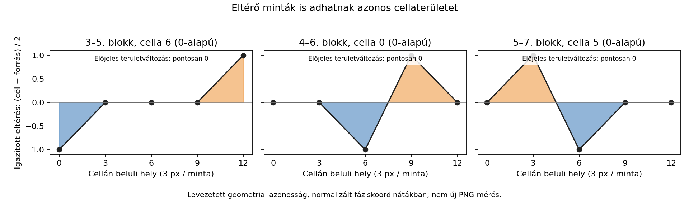

# HALV – állapotos maradékkapcsolat és geometria, C31–C34

2026-11-01. A felhasználó folytatást kért a C28–C30 után. **A kulcs még
nincs meg.** A teljes maradék és a három középső lag2 átmenet közötti
közös, állapotos kapcsolatot vizsgáltuk. Új nyers kulcskeresés nem futott:
előbb pontos szerkezeti szabályt követeltünk, és ilyen nem született.

## Kiindulás és korlátok

A C25 eltolásai 26,18,14. A 3.,4.,5. blokkot az eltolt 5.,6.,7. blokkhoz
hasonlítjuk. A 10-es alapeltolás továbbra is az adatokra illesztett paraméter,
nem új képi utasításból levezetett szám. A harmadik átmenet visszatartása
az illesztésből való kihagyást jelenti; a már ismert kép nem új vak mérés.

Az R mind a 96 bitjét megtartjuk, három 32 bites szóként. Két R-keret,
három főcsatorna-keret, hat szóhozzárendelés, közös előre/hátra cellasorrend
és közös nyolcféle forgatás 576 koordinátakonfigurációt ad. Nincs szavanként
külön forgatás vagy eltérésenkénti javítóparaméter.

A vizsgált állítás: lehet-e az R a három lag2 javítás bemenete egy azonos,
rövid memóriájú műveletben? A kudarc nem jelenti az R lényegtelenségét
vagy minden állapotos algoritmus kizárását.

## C31: bináris visszacsatolás

Specifikáció: [stateful_bridge_v1.json](models/stateful_bridge_v1.json).
A kimenet a főcsatornák XOR-különbsége vagy teljes szókivonásának bitje.
GF(2) felett aktuális R-bitből, legfeljebb négy korábbi R-bitből és négy
korábbi kimeneti bitből, valamint állandóból képezhető lineáris kimenetet
keresünk. Két bitirány és két határkezelés: folyamatos 96 bit vagy szavanként
nullázott előzmény. A kezdeti történet nulla, nem szabadon illesztett állapot.

Az első 64 célbit pontos konzisztenciáját vizsgáljuk. Siker esetén az összes
szabad együtthatómegoldásból kauzálisan generálnánk a harmadik szót,
a valódi ellenőrző kimenetek visszatáplálása nélkül. **Nincs pontos tanítóillesztés**,
így ilyen harmadik-szó-jóslat nem készült.

115 200 konfigurációt naplóztunk. Ezek nem független próbák: a kisebb
memóriájú terek a legnagyobbak részterei. Mind a 4608 maximális, 4+4
memóriájú jellemzőtér ellentmondásos, ami az adott koordinátákon az összes
kisebb változatot is kizárja.

Kalibráció: 100 kis GF(2)-feladat összevetése az összes együttható közvetlen
enumerálásával, és egy ismert visszacsatolt generátor pontos előrejelzése.
Ez a bináris visszacsatolás nem az Amiga Fibonacci-delta hangkodek tesztje.

## C32: nibble-enként továbbvitt állapot

A forrás S, az R és az állapot együttes használatával öt közös szabályt
vizsgáltunk: összeadás carryvel; kivonás borrow-val; R-prefix XOR;
R-prefix összeg és különbség. A prefixszabályok frissítik az állapotot R-ből,
majd XOR-t vagy összeadást alkalmaznak S-re. Egyetlen közös kezdeti állapot
0…15 között, két irány és folyamatos/szavanként újraindított állapot szerepel.

A 184 320 konfiguráció egyike sem írja le pontosan az első 16 tanítócellát.
Nincs illesztett modell a harmadik nyolc cella előrejelzésére. A carry/borrow
primitív négy egészszó-aritmetikai kalibrációja sikeres. Ez nem tesztel minden
R-ből képzett kezdőállapotot, rejtett állapotot vagy más képi adatbejárást.

## C33: geometriai kapcsolat és pontos kioltások

Az igazított hullámok q/2 sugarának cellánkénti előjeles területváltozását
pontos negyedegységekben számoltuk. Ez normalizált fáziskoordináták
geometriája, **nem az eredeti PNG fizikai területének új mérése**.
A 32 mintás összehasonlító jelet egy konstans végponttal zárjuk a 32.
intervallumhoz; ezt a határszabályt előre rögzítettük.

Az R-nibble és a területváltozás közös racionális affin kapcsolatát az első
két átmenet 16 celláján vizsgáltuk. Nincs pontos illesztés. Az 576 könyvelt
konfigurációban a három főcsatorna-keret azonos területadatot ismétel,
ezért csak 192 különböző nyers R-koordinátanézet szerepel.

Mindhárom átmenetben van viszont egy pontos geometriai kioltás:

| Blokkpár | Cella (0-alapú) | Öt egymást követő q-különbség | Területkülönbség |
| --- | ---: | --- | ---: |
| 3–5 | 6 | −2, 0, 0, 0, +2 | 0 |
| 4–6 | 0 | 0, 0, −2, +2, 0 | 0 |
| 5–7 | 5 | 0, +2, −2, 0, 0 | 0 |

A harmadik eset két H-eltérést tartalmaz, mégsem változtatja a cella területét.
Ez levezetett azonosság, nem az R-rel talált új kódolási kapcsolat. Megmutatja,
miért kell a mintaszintű és területszintű modelleket külön ellenőrizni:
azonos összegzett geometria nem jelent azonos hullámot.



## C34: nemlineáris tábla és tényleges előrejelzési lefedettség

A negatív C31–C33 után külön rögzítettük a
[nonlinear_context_v1.json](models/nonlinear_context_v1.json) családot.
Ötféle kontextus: aktuális R; R és előző R; R és előző kimenet; ezek együtt;
illetve R és két korábbi kimenet. A forrás aktuális nibble-je opcionális
további bemenet. A hiányzó kezdőelőzmény nulla; nincs szabad rejtett állapot.

A tanítóadat azonos kontextusaihoz azonos kimenet kell. Ellenőrzéskor csak
korábban látott kontextusra adunk jóslatot, saját jósolt előzmény használatával.
Ismeretlen helyzetet nem töltünk ki nullával vagy a valódi ellenőrző értékkel.

| Eredmény | Konfigurációk / cellák |
| --- | ---: |
| Összes konfiguráció | 46 080 |
| Hibátlan tanítóillesztés | 30 388 |
| Ezekből egyetlen ellenőrző cellát sem tud megjósolni | 25 618 |
| Legnagyobb előrejelzési lefedettség | 4/8 cella |
| Legtöbb helyes cella bármely változatban | 2/8 cella |
| Mind a nyolc cella helyes előrejelzése | 0 |

A két maximum különböző konfigurációhoz tartozik: a négy ismert cellát adó
változatok legfeljebb egyet találnak el. A 30 388 nem ennyi egyedi függvény:
a koordináta- és táblacsalád ismétlődéseket tartalmaz. Az első tanításra
illeszkedő modell 15 kontextussal írja le a 16 tanítócellát; az ellenőrzésen
egyet jósol, hibásan. A nagyobb kontextus itt megjegyzést enged, nem általános
dekódolási szabályt. Külön kontroll igazolja az ismert nemlineáris szabály
előrejelzését és az ismeretlen állapot kitöltésének mellőzését.

## Értelmezés és következő prioritás

Nem jósoltuk meg a hét H-eltérést az R-ből. A tesztek nem támasztják alá,
hogy a három külső R-szó éppen a három középső lag2 átmenet javítókódja.
E hozzárendelést hipotézisként megőrizzük; bővítéséhez új képi indok kell.

A következő prioritás a hullám és a maradék **közös előállítási módja**:
az R lehet a generáló folyamat következménye, nem utólagos javítócsatorna.
A 10-es eltolást, fizikai amplitúdófelezést, 12 px-es rácsot és szélső mintákat
egyetlen képből indokolt koordinátaszabállyal kell összekötni. A geometriai
ágban a minták és a területi invariánsok a kioltások miatt külön kontrollt
igényelnek. Az aláírás, BD, dátum és Fibonacci–hang–Morse ág nyitott;
új hangdekódolás vagy történeti forrásvizsgálat most nem történt.

## Reprodukálás

```sh
python tools/check_stateful_bridge.py
python tools/check_nonlinear_context.py
python tools/audit_stateful_bridge.py
python tools/plot_stateful_bridge.py
python tools/build_research_index.py
```

Python 3, numpy; az ábrához matplotlib. Eredmények:
[C31–C33](data/stateful_bridge_check.json), [C34](data/nonlinear_context_check.json),
[állapotos napló](data/stateful_bridge_trials.jsonl.gz),
[nemlineáris napló](data/nonlinear_context_trials.jsonl.gz),
[integritási audit](data/stateful_bridge_integrity.json).

Az audit kilenc bemeneti/programhasht és a teljes 346 176 rekord számosságát
ellenőrzi, újraösszesíti a C34 lefedettséget, és 24 területértéket külön
intervallumonkénti trapézösszegből is visszaállít. Minden eredmény a pontos
deklarált családra vonatkozik. **Nincs közös generátor vagy HALV-kulcs.**
